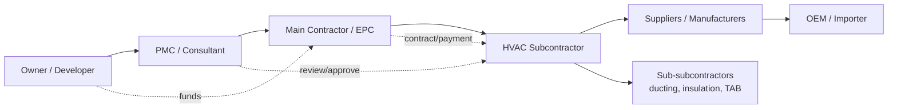

# 01 — Market and Domain Research

**Status:** Draft v0.2 — research synthesis, not legal advice
**Change history:** v0.2 records that every legal, regulatory, tax and competitor claim below is now tracked in `SOURCES-VERIFICATION.md` and is **UNVERIFIED** until a verifier fills the row.
**Scope:** Indian commercial construction, HVAC subcontracting, documentation and handover
**Companion:** `17-BUSINESS-VALIDATION-PLAN.md`

---

## 1. Purpose

This document explains how Indian HVAC subcontractors actually deliver documentation, so that product requirements are grounded in reality rather than a generic construction-software template. It separates:

- what is **contractually or statutorily required** (and by which instrument),
- what is **common industry practice**,
- what is **assumption or hypothesis**.

## 2. Method, evidence grades and limitations

### 2.1 Method

1. Domain decomposition of an HVAC project into lifecycle stages and document gates.
2. Actor and artefact mapping for each stage.
3. Review of Indian public-procurement and statutory frameworks by named instrument.
4. Competitive scan by category.
5. Translation of findings into product implications, assumptions (`A-###`) and open questions (`Q-###`).

### 2.2 Evidence grades

| Grade | Meaning | Permitted use |
|---|---|---|
| **VO** | Official publication/portal; edition and date must be re-checked | May be described as a requirement, with source |
| **IP** | Common industry practice, not a legal obligation | Described as "typical" or "common" |
| **A** | Assumption; needs customer/expert confirmation | Tracked, not asserted as fact |
| **H** | Commercial hypothesis | Tested in `17` |

### 2.3 Limitation (read before relying on anything)

Live web access was unavailable while drafting. Sources are named by their canonical official location, but **editions, clause numbers, thresholds and tax rates were not re-verified during drafting**. No statement here is legal, tax or compliance advice. Before launch:

- a chartered accountant must confirm GST treatment, SAC code, TDS, e-invoicing thresholds and invoice content;
- an Indian construction lawyer must confirm contract, retention, limitation and e-signature positions;
- a data-protection counsel must confirm DPDP Act obligations and notice/consent design;
- each `VO` item must be checked against the current edition.

## 3. Source register

### 3.1 Official Indian sources to verify

| Ref | Source | Used for | Status |
|---|---|---|---|
| S1 | CPWD — Works Manual; CPWD Specifications; General Conditions of Contract; Schedule of Rates (`cpwd.gov.in`) | Public-works execution, completion, defect liability, documentation | VO — verify edition |
| S2 | Central Public Procurement Portal (`eprocure.gov.in`); GeM (`gem.gov.in`) | Tender and procurement process | VO |
| S3 | State PWD manuals and schedules (e.g., PWD Maharashtra, Karnataka, Tamil Nadu, UP) | State-level variations | VO — state-specific |
| S4 | National Building Code of India 2016, BIS (`bis.gov.in`) | Fire/life safety, building services, ventilation | VO — verify parts/amendments |
| S5 | BIS/Indian Standards for ducting, insulation, testing, earthing, electrical installations | Technical test methods | VO — exact IS numbers to verify |
| S6 | ISHRAE handbooks; ASHRAE/SMACNA/NEBB/AABC (international practice) | HVAC design, duct leakage, TAB | IP/international |
| S7 | CBIC (`cbic.gov.in`) — CGST Act/Rules, notifications | GST registration, invoicing, TDS, e-invoicing | VO — rates/thresholds change |
| S8 | Income Tax Department (`incometax.gov.in`) — TDS provisions | TDS on contractor/professional payments | VO |
| S9 | Ministry of MSME / Udyam (`udyamregistration.gov.in`); MSMED Act 2006 | MSME status, payment timelines | VO |
| S10 | MeitY — DPDP Act 2023; IT Act 2000; SPDI Rules 2011 (`meity.gov.in`) | Privacy, electronic records/signatures | VO — rules/commencement to verify |
| S11 | CERT-In directions (2022) | Incident reporting, log retention | VO |
| S12 | Ministry of Labour — BOCW Act 1996, CLRA 1970, Factories Act 1948; state rules | Labour and safety obligations | VO — applicability varies |
| S13 | CPCB/SPCB; EIA Notification 2006; ODS Rules 2000; C&D Waste Rules 2016; E-Waste Rules | Environmental approvals and refrigerant handling | VO — applicability varies |
| S14 | State fire services; NBC Part 4 | Fire NOC and fire safety systems | VO |
| S15 | Arbitration and Conciliation Act 1996; Indian Contract Act 1872; RERA 2016 | Disputes, contracts, real-estate context | VO |
| S16 | BEE (`beeindia.gov.in`) star labelling; BIS certification | Equipment compliance labels | VO — product-specific |
| S17 | RBI (`rbi.org.in`) payment/aggregator rules; Razorpay/PA documentation | Payment collection | VO |

### 3.2 Industry and competitor sources

Trade publications, contractor associations (e.g., ISHRAE chapters, industry bodies), vendor documentation and direct interviews. These are **IP** unless independently verified. Interviews are the primary validation method (`17`).

## 4. Market structure

### 4.1 Value chain

Documentation flows **upward** and is reviewed by parties with no commercial incentive to be fast. Payment flows downward and is gated by documentation. This asymmetry is the core pain.

### 4.2 Contractor segments

| Segment | Size | Typical projects | Documentation maturity | Fit for MVP |
|---|---|---|---|---|
| Proprietor-led HVAC contractor | 5–30 staff | Shops, offices, small hotels, villas | Owner + 1 engineer; Excel/WhatsApp | High (price-sensitive) |
| Regional HVAC contractor | 30–150 staff | Hospitals, malls, IT parks, industrial | PM + site engineers + part-time document controller | **Best fit** |
| Large MEP contractor | 150–1000+ | Metro, airports, data centres, high-rise | Dedicated document control, Aconex/Asite | Low (existing tools) |
| OEM service arm | Varies | AMC, installations | OEM portals and formats | Low–medium |
| Labour-only subcontractor | <20 | Labour supply | Minimal | Not a buyer |

### 4.3 Buyer and user

- **Economic buyer:** proprietor, managing director or projects head. Cares about retention, final bill, reputation with main contractor, and not being embarrassed in a client meeting.
- **Champion:** project manager or senior project engineer who assembles the file.
- **Daily users:** site engineer (uploads), document controller (tracks), PM (reviews/coordinates), procurement (supplier documents), QC (test reports).
- **Blocker:** "our client/consultant won't accept a new system" or "we already have Excel".

## 5. HVAC project lifecycle and document gates

The following is a **typical** commercial project (IP). Exact stages vary by contract.

| Stage | Typical activities | Documents created/required | Who drives |
|---|---|---|---|
| 0. Tender/pre-award | Bid, technical qualification, make list | Tender drawings, BOQ, technical bid, compliance statements, OEM authorisations | Contractor owner/estimator |
| 1. Award & mobilisation | Contract signing, PBG, insurance, kickoff | Contract, work order, bank guarantee, insurance, labour licences, safety plan | PM/accounts |
| 2. Design & submittals | Shop drawings, equipment selection, material approvals | Shop drawings, equipment schedules, technical datasheets, material submittals, method statements, ITP | Design/PM |
| 3. Procurement | PO, manufacturing, inspection | Purchase orders, factory test certificates, material test certificates, inspection reports, dispatch clearances | Procurement |
| 4. Installation | Ducting, piping, equipment erection, electrical | Installation checklists, weld logs, pressure test reports, duct leakage reports, hidden work inspections | Site engineer/QC |
| 5. Pre-commissioning | Flushing, charging, controls checkout | Flushing reports, refrigerant charge records, electrical test reports, calibration certificates | Commissioning engineer |
| 6. Commissioning & TAB | Start-up, balancing, performance | Commissioning reports, TAB reports, performance test reports, noise/vibration readings | Commissioning/QC |
| 7. Training & handover | Client training, as-builts, O&M | O&M manuals, as-built drawings, training records, warranty certificates, spare-parts lists, handover register | PM/document controller |
| 8. Defect liability | Snag closure, warranty support | Snag list, closure reports, warranty claims, service records | PM/service |
| 9. Final acceptance & closure | Retention release, final bill | Completion certificate, final acceptance, warranty start confirmation | Owner/accounts |

**Key observation:** 60–80% of handover documents are created *before* handover, often by parties who do not know they will be needed. A closeout tool must capture them at creation, not reconstruct them at the end. (IP; exact proportion unmeasured.)

## 6. Stakeholders and document responsibilities

| Actor | Creates | Supplies/uploads | Reviews/approves | Receives |
|---|---|---|---|---|
| Contractor owner | Commercial decisions, authorisations | Company KYC, insurance | Final package internally | Handover status |
| Project manager | Schedules, submittal register | Compiled packages | Internal QA | Consultant comments |
| Site engineer | Site checklists, photos, readings | Test reports, installation records | — | Work instructions |
| Document controller | Transmittals, registers | All controlled documents | Format/completeness | Consultant responses |
| Procurement | POs, vendor docs | Datasheets, warranties, test certs | Vendor compliance | Delivery status |
| QC engineer | ITP, inspection reports | Test certificates | Installation quality | NCRs |
| Safety officer | Safety plan, toolbox talks | Safety records | Safety compliance | Incident reports |
| Supplier/OEM | Datasheets, O&M, warranty, factory tests | Certificates, manuals | — | PO/payment |
| Sub-subcontractor | Ducting/insulation/TAB records | Test reports | — | Work orders |
| Main contractor | Contract, instructions | Approval comments | Subcontractor submittals | Closeout package |
| Consultant/PMC | Specifications, review comments | Approval stamps | **Technical approval** | Submittals |
| Client representative | Requirements, acceptance | Sign-offs | Final acceptance | Handover package |
| Statutory authority | NOCs, licences | Approvals | Statutory compliance | Applications |

## 7. How documentation is managed today

### 7.1 Observed patterns (IP)

1. **Excel master register** maintained by a document controller or PM. Columns vary: document name, revision, status, remarks, submission date. Often duplicated per project and per consultant.
2. **WhatsApp groups** for urgent requests, photos of test reports, and "please send warranty certificate" messages. Files expire or are lost when phones change.
3. **Email** for formal submissions, with large attachments or links to Drive/WeTransfer.
4. **Shared drives** (Google Drive, OneDrive, SharePoint) with folder structures like `Project/03_HVAC/01_Submittals/Rev A`. Permissions are ad hoc.
5. **Paper files** at site and head office; signed transmittals; physical stamps.
6. **Consultant portals** (Aconex/Asite) imposed by large main contractors. Subcontractors receive limited accounts and download everything to local drives anyway.
7. **OEM portals** for warranty registration and manuals.
8. **Accounts software** (Tally, Zoho Books, Busy, Vyapar) for invoices and retention tracking; disconnected from documents.

### 7.2 Consequences

- Duplicate and conflicting registers.
- No single source of truth for "current approved revision".
- Approvals evidenced only by email or a stamped paper copy.
- Missing documents discovered at final bill stage.
- Supplier documents addressed to the wrong legal entity or project.
- Employee turnover destroys institutional memory.
- Disputes over what was submitted and when.

## 8. Root causes of delay, rejection and rework

| Cause | Mechanism | Product implication |
|---|---|---|
| Requirements discovered late | Checklist arrives with handover or final bill | Checklist at project creation; import from contract |
| Ambiguous responsibility | Contractor vs supplier vs OEM document ownership unclear | Requirement owner field + supplier assignment |
| Wrong revision | Approved shop drawing superseded; as-built not updated | Revision lineage, supersession, "current approved" rule |
| Asset mismatch | Warranty/serial number not tied to installed tag | Asset-linked requirements and serial validation |
| Incomplete submittal | Missing datasheet page, unsigned certificate | Per-document checklist and reviewer comments |
| Format rejection | Consultant requires searchable PDF, specific naming, stamped drawings | Naming conventions, PDF validation, template rules |
| Language/quality | OEM manual not project-specific; poor scans | Metadata checks, OCR suggestions, resubmission workflow |
| Approval bottleneck | Consultant unavailable; no escalation | Review SLA, reminders, delegation |
| No audit trail | Dispute over submission date/content | Immutable submission and audit records |
| Staff turnover | Knowledge in personal accounts | Org-owned data, reassignment workflow |

## 9. Project and procurement types

Requirements differ materially by owner type. A single universal checklist is wrong.

| Type | Characteristics | Documentation implications |
|---|---|---|
| **Private commercial** (developer, office, mall, hotel) | Consultant-driven; brand/tenant standards; fast track | Submittals, mock-ups, consultant review, as-builts, O&M; brand-specific requirements |
| **Government / CPWD / state PWD** | Item-rate or percentage-rate contract; measurement books; strict completion process; defect liability | Completion certificate, as-built drawings, test certificates, guarantees, site order book extracts, measurement records; format often prescribed |
| **PSU** | Vendor registration, approved make lists, third-party inspection, pre-dispatch inspection | TPI reports, factory test certificates, NDT, vendor documents, integrity requirements |
| **Institutional** (hospital, lab, data centre, airport) | Uptime, infection control, security, redundancy | IST/commissioning scripts, redundancy tests, IAQ, pressure regimes, training, SOPs |
| **Industrial** (factory, warehouse) | Process ventilation, safety, environmental consents | Performance tests, emissions/ventilation, safety documentation, statutory approvals |
| **Government-funded but privately executed** | Hybrid; funding agency reporting | Additional reporting and audit requirements |

**Rule:** requirements are **contract-driven**, not trade-universal. The product must support a base trade template plus contract/client/specification overlays (`07`).

## 10. Regulatory and contractual landscape

> This section distinguishes instruments from obligations. Applicability depends on the contract, project, state, equipment and client. **Verify with counsel.**

### 10.1 Contract and procurement

- Indian Contract Act 1872 governs contracts; arbitration commonly under the Arbitration and Conciliation Act 1996.
- Public works follow CPWD/state PWD conditions, including defect liability and completion certification (VO, verify edition).
- Tenders via CPPPortal/state portals/GeM; EMD, performance bank guarantee, retention money are common (IP; contract-specific).
- RERA 2016 affects real-estate projects and therefore main contractors, not usually the HVAC subcontract directly.

### 10.2 Tax and payments

- GST registration via GSTIN; invoices must carry prescribed particulars (VO, CGST Rules; verify current form and e-invoice threshold).
- Works contracts and pure services are taxed differently; HVAC installation may be a works contract, while AMC is a service (verify with CA).
- TDS may apply under Income Tax Act (contractor/professional sections) and GST TDS for notified recipients (verify applicability and current rates).
- MSME suppliers have statutory payment-period protections under the MSMED Act (VO; verify current provisions).
- E-invoicing thresholds and e-way bill rules change; do not hardcode.

### 10.3 Labour, safety and environment

- BOCW Act/state rules, CLRA, Factories Act and state factory rules can require registrations, safety plans, PPE, incident records (VO; applicability by project/state).
- Fire safety: NBC 2016 Part 4 and state fire NOCs; fire dampers and pressurisation are inspected (VO).
- Refrigerants: ODS Rules 2000 and phase-down commitments; recovery/recycling records are good practice and may be required (VO/IP).
- Construction waste, e-waste and noise rules may apply (VO; project-specific).

### 10.4 Technical standards

- NBC 2016 (building services, fire), BIS standards for ducts, insulation, electrical installations and earthing, BEE labelling for many appliances (VO, product-specific).
- ISHRAE/ASHRAE/SMACNA/NEBB/AABC are design and test references, not Indian law; they become binding only when the contract specifies them (IP).
- Manufacturer instructions and warranty conditions are contractual evidence even when not statutory.

### 10.5 Data and electronic records

- DPDP Act 2023 governs processing of digital personal data; rules/commencement must be verified (VO).
- IT Act 2000 provides a framework for electronic records and signatures; Aadhaar eSign is available through licensed ASPs (VO, verify process).
- SPDI Rules 2011 may still be relevant for sensitive personal data until fully displaced; take counsel advice (VO).
- CERT-In directions require incident reporting within prescribed timelines and log retention (VO, verify current).
- Contractual confidentiality and client NDAs often impose stricter rules than statute.

### 10.6 What is *not* a statutory obligation

The following are typically **contractual or client requirements**, not law: O&M manual content, as-built drawing format, warranty duration, spare-parts list, training records, specific approval workflows. Do not label them "statutory" in the product.

## 11. Competitive landscape

| Category | Examples (indicative) | Strength | Gap for target customer |
|---|---|---|---|
| Enterprise document control | Oracle Aconex, Asite, Autodesk Construction Cloud/BIM 360, SharePoint-based systems | Audit trail, transmittals, large-project adoption | Price, complexity, main-contractor-centric |
| Project management | Procore, Zoho Projects, Monday, ClickUp, Asana | Task tracking, familiarity | No requirement/asset/revision/handover model |
| Indian construction apps | Various site-management and progress apps | Mobile, local pricing | Progress/quality focus, weak closeout and document control |
| DMS | Google Drive, OneDrive, M-Files, DocuWare | Storage, search | No compliance model or approval workflow |
| OEM portals | Manufacturer warranty/manual portals | Authoritative OEM docs | Per-OEM silos, no project view |
| Excel + WhatsApp + email | Status quo | Free, flexible, familiar | No traceability, no automation, no audit |

**Positioning:** not a cheaper Aconex. A closeout-specific system that is dramatically simpler and priced for subcontractors, which can later exchange data with main-contractor platforms.

## 12. India-specific operational constraints

1. **Mobile-first, low bandwidth.** Site engineers use mid-range Android phones on patchy 4G. Uploads must resume; previews must be light.
2. **WhatsApp is the operating system.** Reminders and supplier requests should work via WhatsApp deep links or Business API; email alone is insufficient.
3. **Suppliers are unsophisticated.** A distributor's accounts clerk may not create an account. No-login, expiring upload links are essential.
4. **English is the business language, Hindi/regional is the site language.** UI must be translation-ready; documents remain in English.
5. **Price sensitivity.** Per-seat enterprise pricing fails. Per-company or per-project pricing with predictable limits.
6. **Cash-flow pressure.** Retention and final bills are the trigger; the product must connect to payment milestones.
7. **Trust and data ownership.** Contractors fear clients seeing internal data or the vendor locking them in. Clear ownership, export, and no cross-tenant visibility.
8. **Electricity and device constraints.** Offline-tolerant capture (queue uploads) matters.
9. **Paper still exists.** Signed and stamped documents will be scanned; support image PDFs and poor-quality scans.
10. **Relationships matter.** The product must not force a main contractor or consultant into a workflow that damages the relationship. Guest access must be optional and low-friction.
11. **Regional variation.** State PWD formats, local body NOCs, and languages differ. Configuration must handle this without code.
12. **Data localisation preference.** Indian customers often prefer India-region hosting; some contracts require it. Host in India where feasible (see `09`, `13`).

## 13. Implications for TradeCloseout

| Finding | Product decision |
|---|---|
| Requirements are contract-specific | Base HVAC template + layered contract/client/project overrides (`07`) |
| Assets drive much of the evidence | First-class Asset entity; requirements link to assets |
| Documents are created by many parties | Guest/supplier access with scoped grants |
| Revisions cause disputes | Immutable versions + explicit supersession + "current approved" rule |
| Approvals are informal | Structured review with comments, decisions and audit |
| Handover is the payment gate | Package generator and submission tracking in MVP |
| WhatsApp is unavoidable | Notification adapter with WhatsApp deep link in MVP; Business API in V1 |
| Contractors use Excel | Import/export registers; do not force data re-entry |
| Price sensitivity | Per-company plans, generous supplier access |
| Trust deficit | Tenant isolation, export, transparent audit, India hosting |

## 14. Market hypotheses to test (H-series)

| ID | Hypothesis | Test | Threshold |
|---|---|---|---|
| H1 | Closeout pain is acute enough to pay ₹5,000–₹20,000/month per company | 20 interviews + 3 paid pilots | ≥12 report a payment/acceptance delay; ≥3 pilots at ≥₹5,000 |
| H2 | Contractors will adopt mid-project if setup is <1 day | Time-to-first-checklist in onboarding | <2 hours with assistance |
| H3 | Suppliers will upload via link without training | Pilot supplier conversion | ≥70% within 7 days |
| H4 | Consultants will review in the tool | Pilot review participation | ≥50% of reviews in-app |
| H5 | Handover package generation is a top-3 buying reason | Interview ranking | Top 3 for ≥50% |
| H6 | Main contractors will eventually pay for subcontractor closeout visibility | 5 main-contractor interviews | ≥2 express intent |

## 15. Assumptions

| ID | Assumption |
|---|---|
| A-001 | HVAC subcontractors (not main contractors) are the initial payer |
| A-002 | A configurable checklist can cover 70%+ of projects without custom code |
| A-003 | Most required documents can be sourced as PDFs or scans |
| A-004 | Contractors will accept India-hosted SaaS with export rights |
| A-005 | English UI is acceptable for MVP, with Hindi planned |
| A-006 | Suppliers can use a browser link on a phone |
| A-007 | Project-level guest access is sufficient for client/consultant review in MVP |
| A-008 | Contractors will pay annually after a successful pilot |

## 16. Open research questions

See `Q-001`–`Q-020` in `DECISIONS-AND-OPEN-QUESTIONS.md`. Highest priority:

- Which exact documents gate final payment in private vs government contracts?
- Who signs the completion certificate, and does a digital approval satisfy consultants?
- How much does a typical HVAC subcontractor spend on closeout per project?
- Do main contractors require a specific document-control platform contractually?
- What document formats and naming conventions do major consultants enforce?

## 17. Sources (canonical, to verify)

- CPWD: `https://cpwd.gov.in` — Works Manual, Specifications, GCC, Schedule of Rates.
- Central Public Procurement Portal: `https://eprocure.gov.in`; GeM: `https://gem.gov.in`.
- BIS: `https://www.bis.gov.in` — NBC 2016 and Indian Standards.
- CBIC: `https://www.cbic.gov.in` — GST law, rules, notifications.
- Income Tax: `https://www.incometax.gov.in` — TDS.
- MSME/Udyam: `https://udyamregistration.gov.in`.
- MeitY: `https://www.meity.gov.in` — DPDP Act 2023, IT Act 2000.
- CERT-In: `https://www.cert-in.org.in`.
- Ministry of Labour: `https://labour.gov.in`.
- CPCB: `https://cpcb.nic.in`; BEE: `https://beeindia.gov.in`.
- RBI: `https://www.rbi.org.in`.
- ISHRAE: `https://ishrae.in`; ASHRAE: `https://www.ashrae.org`; SMACNA: `https://www.smacna.org`; NEBB: `https://nebb.org`; AABC: `https://aabc.org`.

## 18. Version log

| Version | Date | Change |
|---|---|---|
| 0.1 | 2026-10-31 | Initial research synthesis |
| 0.2 | 2026-10-31 | All external claims registered in `SOURCES-VERIFICATION.md` as UNVERIFIED |
