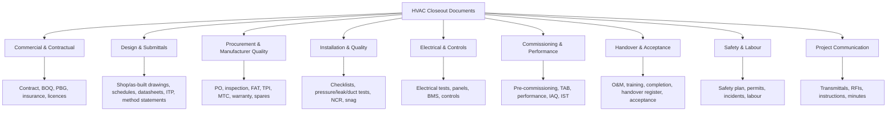

# 04 — Document Catalogue (HVAC)

**Status:** Draft v0.2
**Change history:** v0.2 applies AUD-003, AUD-D-01/02/03/06/07/08.
**Purpose:** Define the default HVAC document taxonomy and the rules the product applies to each type.
**Critical caveat:** **No checklist is universal.** The 98 types below are a **hypothesis** assembled from industry practice; the 72-item default template (`TPL-HVAC-IN-001`) has **not** been validated against real consultant checklists and must not be marketed as comprehensive (`AUD-003`, `FR-CHK-015`). Every item below is a *default template* item. Contract, client, consultant, specification, equipment and jurisdiction determine the actual requirement. The product must allow every item to be made mandatory, conditional, optional, renamed, replaced or waived through configuration (`07`).

---

## 1. How to read this catalogue

### 1.1 Obligation codes

| Code | Meaning |
|---|---|
| **M** | Included as mandatory in the default HVAC template. The contract may still waive it. |
| **C** | Conditional; applies only when the stated condition is true. |
| **O** | Optional / best practice; not mandatory by default. |
| **SR** | **Statutory record** — a copy of an approval issued by an authority. Applicability is project-, state- and scope-specific. **TradeCloseout does not verify compliance; it stores the record.** |

`M` is **not** a claim of legal obligation and is **not** a statutory requirement. Most items are contractual or consultant requirements. Items marked `SR` are copies of statutory approvals; their presence in the system does not constitute compliance. **Every `SR` item must be verified against the current state/project rules before it is relied upon** (`SOURCES-VERIFICATION.md`).

### 1.2 Other codes

- **Scope:** `P` project, `A` asset, `AC` asset category, `C` contract.
- **Reuse:** `N` never across projects, `R` reusable with applicability attestation, `G` generic manufacturer document reusable.
- **Basis:** `C` contractual/consultant, `S` statutory, `I` industry good practice.

### 1.3 Universal metadata (all types)

Every document version records:

`title`, `document_type`, `project`, `asset(s)` (if applicable), `requirement(s)`, `revision_code`, `issue_date`, `issuer/source`, `language`, `expiry_date` (optional), `remarks`, `uploaded_by`, `file`, `checksum`.

For **third-party test reports** the metadata dictionary additionally requires `accreditation_id` (e.g. NABL registration number) and `lab_name` (`AUD-D-06`).

Type-specific metadata is listed in §5.

### 1.4 Universal rejection reasons

Wrong project; wrong asset/tag; wrong make/model/serial; illegible or corrupt; missing pages; unsigned/undated where signature required; wrong revision; expired; not project-specific; unacceptable format; password-protected; duplicate; unapproved make; missing supporting annexure; incorrect metadata.

### 1.5 Validity model

- **No expiry** — historical evidence; validity is tied to the revision and asset, not time.
- **Fixed validity** — e.g., calibration 12 months, insurance 12 months, labour licence 12 months.
- **Event-based** — warranty starts at commissioning/handover; ends after the contracted warranty period.
- **Revision-based** — superseded when a new approved revision exists.
- **Project-life** — valid until project closure unless superseded.

The system stores `valid_from`, `valid_until`, `validity_basis` and recomputes `EXPIRED` daily.

## 2. Taxonomy



### 2.1 Commercial Payment Milestone Mapping (RT-008)

To link technical handover compliance directly to contractor cash flow, every document type and requirement maps to a standard payment lifecycle milestone (`requirements.milestone_key`):

| Milestone Key | Payment Trigger / Commercial Stage | Relevant Document Families & Example Types |
|---|---|---|
| `MOBILISATION` | Advance payment / mobilisation release | `DT-001` (Contract), `DT-002` (BOQ), `DT-003` (PBG/Advance BG), `DT-004` (CAR Policy), `DT-005` (Labour Licences) |
| `SUBMISSION` | Design approval / approval milestones | `DT-008` (Shop Drawings), `DT-010` (Equipment Schedules), `DT-011` (ITP), `DT-098` (Make Deviation Approvals) |
| `DELIVERY` | Material supply / delivery on-site (70–80% billing) | `DT-016` (PO copies), `DT-017` (MTC), `DT-018` (FAT Reports), `DT-020` (Delivery Challans) |
| `INSTALLATION` | Running Account (RA) bills / erection completion | `DT-025`–`029` (Installation checklists), `DT-030` (Pressure test), `DT-085` (Joint Measurement Records / JMR) |
| `COMMISSIONING` | Testing & Commissioning billing milestone | `DT-042`–`048` (Pre-comm checklists), `DT-050` (TAB Report), `DT-055` (Integrated System Test) |
| `HANDOVER` | Virtual Completion / Substantial Completion (Retention 50%) | `DT-057` (As-Builts), `DT-058` (O&M Manuals), `DT-061` (TOC / Virtual Completion), `DT-086`–`089` (Fire/Pollution NOCs), `DT-099` (Green Building Submittals) |
| `FINAL_BILL` | Final Bill settlement & retention release | `DT-007` (Approved Variation Orders), `DT-097` (No-Demand Certificate / Final Bill Settlement Undertaking) |
| `DLP_END` | End of Defect Liability Period / Final BG release | `DT-022` (Extended Warranties), `DT-060` (DLP Certificate), `DT-090` (Warranty Registration Confirmation) |

## 3. Master catalogue — identity, obligation and responsibility

| ID | Document type | Purpose | Obl. (`M` template-mandatory / `C` conditional / `O` optional / `SR` statutory record) | Basis | Normally created by | Usually uploads | Reviews / approves | Scope | Reuse |
|---|---|---|---|---|---|---|---|---|---|
| DT-001 | Contract / Work Order | Defines scope, price, timelines, warranty and closeout obligations | M | C | Client / main contractor | Contractor PM | Owner / PM (acknowledge) | P | N |
| DT-002 | BOQ / Price Schedule | Records priced scope and quantities | C | C | Contractor estimator | PM | Client/consultant | P | N |
| DT-003 | Performance Bank Guarantee | Security for performance during contract | C | C | Bank on contractor request | Accounts/PM | Client | P | N |
| DT-004 | Insurance Certificate | Covers works, third party, employees | C | S | Insurer/broker | Admin | Client/PM | P | N |
| DT-005 | Labour Registration / Licence | BOCW/CLRA/state registration where applicable | SR | S | Contractor/consultant | Admin | PM/compliance | P | N |
| DT-006 | Company KYC (GST/PAN/incorporation) | Establishes legal identity for approvals and billing | C | C/S | Contractor | Admin | Main contractor | P | N |
| DT-007 | Variation Order | Documents scope/price changes | C | C | Client/MC | PM | PM/owner | P | N |
| DT-008 | Tender Technical Compliance | Shows compliance with tender specifications | C | C | Estimator | PM | Client | P | N |
| DT-010 | Shop Drawing | Shows fabrication/installation detail for approval | M | C | Contractor design/drafting | Design/PM | Consultant | A/AC | R |
| DT-011 | As-Built Drawing | Records installed condition, used for O&M and future works | M | C | Contractor design/site | Design/PM | Consultant/client | P/A | N |
| DT-012 | Equipment Schedule | Lists all equipment, tags, capacities, locations | M | C | Design/PM | PM | Consultant | P | R |
| DT-013 | Manufacturer Technical Datasheet | Proves equipment meets specification | M | C | OEM | Procurement/supplier | Consultant | A/AC | G |
| DT-014 | Material Submittal | Seeks approval of make/model/material before procurement | M | C | Contractor | Procurement | Consultant | A/AC | R |
| DT-015 | Sample / Mock-up Approval | Confirms visual/functional standard before mass work | C | C | Contractor | Site engineer | Consultant/client | P | N |
| DT-016 | Method Statement | Describes safe, compliant execution method | M | C | Contractor | Site engineer/QC | Consultant/PMC | P/A | R |
| DT-017 | Inspection and Test Plan (ITP) | Defines inspection points, standards and records | M | C | QC engineer | QC | Consultant | P/A | R |
| DT-018 | Design Calculation (heat load/duct sizing) | Demonstrates design basis and capacity | C | C | Design engineer | Design | Consultant | P | R |
| DT-019 | Coordination / BIM Drawing | Resolves spatial coordination with other services | C | C | Design/BIM team | Design | Consultant | P | N |
| DT-020 | Purchase Order | Records procurement source, model and quantity | M | C | Procurement | Procurement | Internal | A | N |
| DT-021 | Material Inspection Report (MIR) | Records receipt inspection at site | M | C | QC/site engineer | Site engineer | Consultant (if required) | A/AC | N |
| DT-022 | Factory Acceptance Test (FAT) | Proves equipment performance at factory | C | C | OEM | Procurement/supplier | Consultant/TPI | A | G |
| DT-023 | Third-Party Inspection (TPI) Report | Independent verification for PSU/high-value equipment | C | C | TPI agency | Procurement | Client/consultant | A | G |
| DT-024 | Material Test Certificate (MTC) | Certifies material grade/composition | C | C | Mill/OEM | Procurement | QC | A/AC | G |
| DT-025 | Calibration Certificate | Proves instrument accuracy | C | C/I | Calibration lab | QC/commissioning | Consultant | A | G |
| DT-026 | Warranty Certificate | Establishes warranty terms and start date | M | C | OEM/supplier | Procurement/supplier | PM/client | A | R |
| DT-027 | Guarantee / Undertaking | Contractor/OEM guarantee of workmanship/performance | M | C | Contractor/OEM | PM | Client/consultant | P/A | R |
| DT-028 | Spare Parts List | Lists recommended spares and quantities | M | C | OEM/contractor | Procurement | Consultant | A | G |
| DT-029 | Refrigerant / MSDS Record | Records refrigerant type, charge, safety data | C | S/I | OEM/commissioning | Commissioning engineer | QC | A | G |
| DT-030 | Packing / Dispatch Clearance | Confirms equipment packed and cleared for dispatch | C | C | OEM/TPI | Procurement | Client/consultant | A | N |
| DT-031 | Installation Checklist | Step-by-step confirmation of correct installation | M | C/I | Site engineer | Site engineer | QC | A/AC | R |
| DT-032 | Weld / Brazing Log | Records joints, welder, filler, test linkage | M | C | Site engineer/contractor | Site engineer | QC | A/P | N |
| DT-033 | Pressure / Hydrostatic Test Report | Proves piping/ductwork integrity under pressure | M | C/I | Site engineer/QC | QC | Consultant | A/P | N |
| DT-034 | Refrigerant Leak Test Report | Proves refrigerant circuit tightness | M | C/I | Commissioning engineer | Commissioning | Consultant | A | N |
| DT-035 | Duct Leakage Test Report | Proves duct airtightness class | M | C/I | TAB/QC agency | QC | Consultant | AC/P | N |
| DT-036 | Pipe Flushing / Chemical Cleaning Record | Proves internal cleanliness before commissioning | M | C/I | Site engineer | QC | Consultant | A/P | N |
| DT-037 | Insulation Record | Records material, thickness, coverage, joints | M | C/I | Site engineer | Site engineer | QC | A/P | N |
| DT-038 | Support / Hanger Inspection | Confirms supports, spacing, vibration isolation | C | C/I | Site engineer | Site engineer | QC | A/P | N |
| DT-039 | Fire Damper Test Record | Confirms fire damper installation and operation | C | S/C | Contractor | Site engineer | Consultant/fire officer | A | N |
| DT-040 | Concealed Work Inspection | Approves work before it is covered | M | C | Site engineer | Site engineer | Consultant | P/A | N |
| DT-041 | Non-Conformance Report (NCR) | Records defect/non-compliance and closure | C | C/I | QC/consultant | QC | Consultant | P/A | N |
| DT-042 | Snag / Punch List | Tracks outstanding defects to closure | M | C/I | Client/consultant/contractor | PM | Client/consultant | P/A | N |
| DT-043 | Electrical Test Report | Insulation resistance, earthing, continuity | M | C/S | Electrical engineer | Site engineer | Consultant | A/P | N |
| DT-044 | Panel / Control Panel Test Report | Verifies panel build, wiring and function | C | C/I | Panel builder | QC | Consultant | A | N |
| DT-045 | BMS Point Schedule | Lists all monitored/controlled points | C | C | Controls contractor | Commissioning | Consultant | P | N |
| DT-046 | Point-to-Point / Controls Checkout | Verifies each control point end-to-end | C | C/I | Controls engineer | Commissioning | Consultant | P | N |
| DT-047 | Relay / Protection Coordination | Verifies electrical protection settings | C | C/I | Electrical engineer | QC | Consultant | P | N |
| DT-048 | Pre-Commissioning Checklist | Confirms readiness before energisation/start-up | M | C/I | Commissioning engineer | Commissioning | QC | A/P | R |
| DT-049 | Commissioning Report | Records start-up, checks and results | M | C/I | Commissioning engineer | Commissioning | Consultant | A/P | N |
| DT-050 | TAB Report | Testing, adjusting and balancing of air/water systems | M | C/I | TAB agency | Commissioning | Consultant | P | N |
| DT-051 | Performance Test Report | Proves capacity/efficiency against design | M | C/I | Commissioning/TPI | Commissioning | Consultant/client | A/P | N |
| DT-052 | Noise and Vibration Report | Verifies acoustic/vibration limits | C | C/I | Specialist agency | Commissioning | Consultant | A/P | N |
| DT-053 | Refrigerant Charge / Recovery Record | Records charge quantity and recovery/disposal | C | S/I | Commissioning engineer | Commissioning | QC | A | N |
| DT-054 | Water Quality Report | Verifies chilled/condenser water treatment | C | C/I | Water-treatment vendor | Commissioning | Consultant | P | N |
| DT-055 | Indoor Air Quality Report | Verifies IAQ parameters where specified | C | C/I | Specialist agency | Commissioning | Consultant | P | N |
| DT-056 | Integrated Systems Test (IST) | Verifies HVAC with fire, BMS, power, controls | C | C/I | Commissioning lead | Commissioning | Consultant/client | P | N |
| DT-057 | Room Pressure / Air Change Verification | Proves cleanroom/hospital/lab pressure regimes | C | C/I | TAB/commissioning | Commissioning | Consultant | P | N |
| DT-058 | O&M Manual | Enables safe operation and maintenance | M | C | OEM/contractor | PM/document controller | Consultant/client | A/P | R |
| DT-059 | Installation Manual | Documents installation method and constraints | O | I | OEM | Procurement | Internal | A | G |
| DT-060 | Maintenance Schedule | Defines planned maintenance tasks/frequencies | M | C | OEM/contractor | PM | Consultant/client | A/P | R |
| DT-061 | Training Record | Proves client staff were trained | M | C | Contractor | PM | Client | P | N |
| DT-062 | Completion Certificate | Declares work complete and fit for purpose | M | C/S | Contractor | PM | Client/consultant | P | N |
| DT-063 | Handover Register / Transmittal | Lists documents handed over and receipt | M | C | Contractor | Document controller | Client/MC | P | N |
| DT-064 | Asset Register | Lists installed assets with tags and details | M | C | Contractor | PM | Client/consultant | P | N |
| DT-065 | Client Approval / Sign-off | Records client acceptance of scope/handover | M | C | Client | PM | Client | P | N |
| DT-066 | Statutory Approval / NOC Copy | Evidence of fire/electrical/environmental approvals | SR | S | Authority/contractor | PM | Client | P | N |
| DT-067 | Warranty Start Confirmation | Fixes warranty start date per asset | M | C | Contractor/OEM | PM | Client | A | N |
| DT-068 | Defect Liability / Snag Closure Certificate | Closes defects at end of DLP | M | C | Contractor | PM | Client | P | N |
| DT-069 | Final Acceptance | Client's final acceptance and release | M | C | Client | PM | Client | P | N |
| DT-070 | Spare Parts Handover Record | Confirms physical handover of spares | M | C | Contractor | PM | Client | P | N |
| DT-071 | Software / Licence / Password Handover | Transfers controls/BMS access and licences | C | C | Controls/BMS vendor | Commissioning | Client | P | N |
| DT-072 | As-Built Photo Record | Visual evidence of concealed/installed work | O | I | Site engineer | Site engineer | QC | P/A | N |
| DT-073 | Safety Plan | Project-specific safety arrangements | C | S/C | Safety officer | Safety officer | Main contractor/consultant | P | R |
| DT-074 | Risk Assessment | Task-level hazards and controls | S/C | S/C | Safety officer/site engineer | Safety officer | Main contractor | P/A | R |
| DT-075 | Work Permit | Authorises high-risk work | C | S/C | Main contractor/site | Site engineer | Main contractor | P | N |
| DT-076 | Toolbox Talk Record | Evidence of daily safety briefing | C | S/C | Safety officer | Safety officer | Internal | P | N |
| DT-077 | Incident Report | Records and investigates incidents | SR | S | Safety officer | Safety officer | Statutory/internal | P | N |
| DT-078 | Lifting / Scaffolding Plan | Safe method for heavy lifts/temporary works | C | S/C | Contractor/specialist | Safety officer | Main contractor | P | N |
| DT-079 | Transmittal | Formal record of submission and receipt | M | C | Document controller | Document controller | Client/MC | P | N |
| DT-080 | RFI | Seeks clarification on design/contract | O | C | Site/PM | PM | Consultant | P | N |
| DT-081 | Site Instruction | Records client/MC instruction | O | C | Client/MC | PM | Internal | P | N |
| DT-082 | Meeting Minutes | Records decisions and actions | O | C | PM/consultant | PM | Attendees | P | N |
| DT-083 | Progress Report | Reports physical/technical progress | O | C | PM | PM | Client/MC | P | N |
| DT-084 | Delay / Hindrance Register | Records delays and causes for claims | C | C | PM | PM | Client/MC | P | N |
| DT-085 | Measurement / Joint Measurement Record | Records measured quantities for billing | C | C | Site engineer/client | PM | Client | P | N |
| DT-086 | Fire NOC / Fire Safety Certificate | Evidence of fire-safety approval for occupancy | SR | S | Authority / main contractor | PM | Client | P | N |
| DT-087 | Electrical Inspectorate Certificate | Authorises energisation of HT/LT supply feeding HVAC | SR | S | Electrical inspectorate / EC | PM | Client | P | N |
| DT-088 | Environmental Consent (SPCB/CPCB) | Consent to operate where emissions or discharge apply | SR | S | Authority | PM | Client | P | N |
| DT-089 | Noise / DG Consent Record | Noise compliance where cooling towers or DG sets are involved | SR | S | Authority | PM | Client | P | N |
| DT-090 | Warranty Registration Confirmation | Confirms OEM warranty registration and start basis | M | C | OEM / supplier | Procurement | Client | A | R |
| DT-091 | Commissioning Protocol / Script | Evidence of the commissioning method actually followed | C | C | Commissioning engineer | Commissioning | Consultant | P | R |
| DT-092 | System Integration Test Script | Test scenarios and results for HVAC + fire + BMS | C | C | Commissioning lead | Commissioning | Consultant | P | N |
| DT-093 | OEM Training Certificate (customer engineers) | Certifies training of the client's service engineers | C | C | OEM | Procurement | Client | P | N |
| DT-094 | Quality Plan | Project quality organisation and controls | C | C | Contractor QC | QC | Consultant | P | R |
| DT-095 | Environmental Management Plan | Environmental controls for the works | C | C | Contractor | Safety officer | Main contractor | P | R |
| DT-096 | Back-to-Back Sub-subcontractor Agreement | Flow-down of scope and warranty obligations | C | C | Contractor | PM | Internal | P | N |
| DT-097 | No-Demand Certificate (NDC) / Final Bill Settlement Undertaking | CPWD/PSU closeout undertaking confirming contractor has received all dues and has no further claims | M | C | Contractor | PM | Client / Main contractor | P | N |
| DT-098 | Approved Make Deviation Approval | Formal approval by PMC/Consultant for equipment make/model deviation from tender specification | C | C | PMC / Consultant | PM / Procurement | Consultant | A | N |
| DT-099 | Green Building Submittal (IGBC / GRIHA / LEED) | Environmental and energy compliance submittals (CFC-free refrigerant, ECBC, ASHRAE 90.1/62.1) | C | C | MEP Contractor / OEM | QC / Safety officer | Consultant / Green Auditor | P | R |

## 4. Catalogue — evidence rules

| ID | Required metadata (beyond universal) | Validity / expiry | Common rejection reasons | Template / signature / supporting evidence |
|---|---|---|---|---|
| DT-001 | Contract no., date, value, retention %, DLP, parties | Project life | Unsigned, missing annexures, wrong parties, illegible scan | Signed contract; all annexures |
| DT-002 | BOQ version, date | Project life | Quantities don't match scope, no rates, wrong revision | Priced BOQ; client approval |
| DT-003 | BG no., bank, amount, beneficiary, validity | Expiry per BG | Expired, wrong beneficiary, insufficient amount | Bank-issued BG; amendment if extended |
| DT-004 | Policy no., insurer, cover, sum insured, validity | 12 months / policy term | Expired, wrong project/entity, inadequate cover | Insurer certificate; endorsements |
| DT-005 | Registration no., authority, validity, worker count | Annual/term | Expired, wrong state, wrong establishment | Registration certificate |
| DT-006 | GSTIN, PAN, legal name, address | Standing | Mismatch with contract, unreadable | Certificates; self-attested |
| DT-007 | Variation no., date, scope, amount, approval | Project life | Unsigned, no rate basis, no client approval | Signed variation order |
| DT-008 | Tender ref, compliance matrix | Project life | Non-compliant item unexplained, no evidence | Compliance statement + datasheets |
| DT-010 | Drawing no., revision, sheet count, scale, discipline | Revision-based | Superseded revision, unapproved, missing stamp, wrong sheet size | Consultant stamp; native PDF preferred |
| DT-011 | Drawing no., revision, date, "AS-BUILT" mark, asset/location | Project life | Not marked as-built, inconsistent with site, missing services | Signed/stamped as-built set; markups |
| DT-012 | Schedule version, asset count | Revision-based | Missing assets, duplicate tags, capacity mismatch | Excel/PDF schedule; OEM data |
| DT-013 | Make, model, capacity, refrigerant, serial range, standards | Model life | Wrong model, generic brochure, missing performance table | OEM datasheet; certified copy |
| DT-014 | Submittal no., make, model, spec clause, deviations | Until approved | Unapproved make, no compliance statement, missing datasheet | Submittal cover + datasheet + compliance |
| DT-015 | Sample ref, location, approval date | Project life | Not approved, differs from installed, no photo | Signed approval; photos |
| DT-016 | Method statement no., revision, activity, risk ref | Until superseded | Generic, no project specifics, no safety controls | Method statement; risk assessment; approval |
| DT-017 | ITP no., activity, inspection points, standards, witness/hold | Until superseded | Missing hold points, no standards, not approved | ITP matrix; consultant approval |
| DT-018 | Calculation ref, software, inputs, outputs, assumptions | Until design change | Inputs unsupported, no revision, wrong units | Signed calculations; design basis |
| DT-019 | Drawing no., revision, clash status | Revision-based | Unresolved clashes, not coordinated, superseded | Federated model/coordinated drawing |
| DT-020 | PO no., date, supplier, model, qty, value | Project life | No PO, supplier mismatch, model mismatch | PO copy; approval reference |
| DT-021 | MIR no., date, material, quantity, PO ref, result | Project life | Not inspected, wrong PO, missing photos | Signed MIR; delivery challan |
| DT-022 | FAT no., date, equipment serial, test results, witness | Project life | Test done on different unit, incomplete tests, no witness | FAT report; calibrated instruments |
| DT-023 | TPI ref, agency, scope, result, inspector | Project life | Wrong scope, not independent, unresolved NCR | TPI report; NCR closure |
| DT-024 | Heat no., grade, standard, mill, results | Project life | Grade mismatch, uncertified copy, wrong batch | Mill TC; traceability to heat no. |
| DT-025 | Instrument ID, calibration lab, date, due date, uncertainty | 12 months typical | Expired, not traceable (NABL), wrong range | Calibration certificate; sticker |
| DT-026 | Product, serial, warranty period, start date, terms, exclusions | Warranty term | Wrong serial, wrong start date, expired, not endorsed to client | OEM warranty; dealer endorsement |
| DT-027 | Guarantee type, period, scope, signatory | Per guarantee | Unsigned, undated, vague scope, wrong entity | Signed guarantee on letterhead |
| DT-028 | Equipment model, item, part no., qty, recommended/optional | Model life | Generic list, wrong model, quantities missing | OEM spare list |
| DT-029 | Refrigerant type, GWP, charge kg, SDS, recovery | Asset life | Missing quantity, prohibited refrigerant, no SDS | OEM data; SDS; recovery log |
| DT-030 | Dispatch ref, equipment list, inspection status | Project life | Not inspected, packing damage, wrong destination | Dispatch clearance; packing list |
| DT-031 | Checklist version, asset tag, steps, readings, sign-off | Project life | Generic, incomplete, unsigned, missing readings | Checklist template; photos |
| DT-032 | Joint no., welder ID, filler, pressure, date, test ref | Project life | Missing welder qualification, no joint map, inconsistent count | Weld log; welder cert; isometric markup |
| DT-033 | System/zone, test medium, pressure, duration, result, gauge cert | Project life | Held too short, gauge out of calibration, not witnessed, leaks unresolved | Signed test report; gauge calib.; witness |
| DT-034 | System, refrigerant, test method, pressure, duration, result | Project life | No electronic leak check, incomplete circuit, no instrument ID | Leak test record; instrument calib. |
| DT-035 | Duct section, class, test pressure, leakage %, result | Project life | Wrong class, untested sections, no calibrated rig | Duct leakage report; test diagram |
| DT-036 | System, chemical, concentration, duration, flush velocity, result | Project life | Not flushed, no water test, procedure skipped | Flushing record; lab report |
| DT-037 | Material, thickness, density, area, joints, vapour barrier | Project life | Wrong thickness, gaps, no vapour seal, photos missing | Insulation record; material cert |
| DT-038 | Support type, spacing, load, vibration isolator, inspection | Project life | Spacing exceeds spec, missing isolators, no photos | Inspection record; photos |
| DT-039 | Damper ID, location, type, test result, reset | Project life | Not tested, inaccessible, wrong rating | Test record; fire rating cert |
| DT-040 | Location, service, date, photos, approval | Project life | Covered without approval, no photos, missing dimensions | Signed inspection; photos |
| DT-041 | NCR no., description, cause, action, closure, verifier | Until closed | No root cause, no verification, open NCR | NCR form; closure evidence |
| DT-042 | Snag no., location, description, owner, due date, status | Until closed | Duplicates, no evidence, unassigned | Snag list; closure photos |
| DT-043 | Circuit, insulation resistance, earth resistance, tester ID | Project life | Missing readings, tester uncalibrated, incomplete circuits | Test sheet; calibration cert |
| DT-044 | Panel ID, wiring check, insulation, functional test | Project life | Incomplete, no schematic, no witness | FAT/site test report |
| DT-045 | Point list, type, range, alarm, controller, address | Revision-based | Missing points, address mismatch, no units | BMS schedule; as-built |
| DT-046 | Point ID, signal type, result, date, tester | Project life | Not all points tested, no trend evidence | P2P sheet; BMS screenshots |
| DT-047 | Relay, setting, coordination study, approval | Project life | No study, settings differ, unapproved | Coordination study; setting sheet |
| DT-048 | Asset tag, checklist, readings, deficiencies | Project life | Not complete, unsafe start-up, no sign-off | Pre-commissioning checklist |
| DT-049 | System, test steps, results, deviations, sign-off | Project life | Generic, incomplete, no client witness | Commissioning report; data sheets |
| DT-050 | System, design vs measured flows, instrument IDs | Project life | Imbalance > tolerance, missing branches, no calibration | TAB report; instrument certs |
| DT-051 | Capacity, power, efficiency, conditions, result | Project life | Test conditions not stated, not at design load, no witness | Performance test; calibrated instruments |
| DT-052 | Location, dBA/NC, vibration, limits, result | Project life | Not at specified points, meter uncalibrated | Acoustic report; calib. certs |
| DT-053 | Refrigerant, charge kg, recovered kg, cylinder ID, handler | Asset life | No recovery record, quantity mismatch, venting evidence | Charge log; recovery manifest |
| DT-054 | System, parameters, limits, lab, sample point | Project life | Sample not representative, out of limits unresolved | Lab report; treatment log |
| DT-055 | Parameters (CO2, PM, TVOC, temp/RH), limits, lab | Project life | Unaccredited lab, wrong sampling, limits not stated | Lab report; method |
| DT-056 | Systems tested, scenarios, results, failures, witness | Project life | Partial systems, failures unresolved, no witness | IST script; signed results |
| DT-057 | Room, pressure differential, ACH, method, result | Project life | Wrong rooms, no baseline, method unclear | Verification report |
| DT-058 | Asset tags covered, sections, OEM manuals, local contacts, revision | Project life | Generic OEM manual, missing asset tags, missing sections | Project-specific O&M; index |
| DT-059 | Model, revision, language | Model life | Wrong model, illegible | OEM manual |
| DT-060 | Asset, task, frequency, skill, spares, safety | Project life | Generic, no frequencies, missing assets | Maintenance schedule |
| DT-061 | Date, trainer, attendees, topics, duration, signatures | Project life | No attendance, no topics, unsigned | Attendance sheet; photos |
| DT-062 | Completion date, scope, exceptions, signatory | Project life | Signed before completion, no exceptions list, wrong format | Completion certificate on letterhead |
| DT-063 | Document list, revisions, copies, recipient, date | Project life | Incomplete, wrong revisions, no receipt | Handover register; acknowledgement |
| DT-064 | Asset tag, make, model, serial, location, capacity | Project life | Missing assets, duplicate tags, wrong serial | Asset register (Excel/PDF) |
| DT-065 | Acceptance scope, date, signatory | Project life | Conditional acceptance not noted, unsigned | Signed acceptance |
| DT-066 | Authority, NOC no., date, validity, scope | Per NOC | Expired, wrong premises, missing page | NOC copy; renewal |
| DT-067 | Asset, serial, warranty start, end, basis | Warranty term | Start date before commissioning, wrong asset | OEM/contractor confirmation |
| DT-068 | DLP dates, defects closed, outstanding items | Project life | Open defects not listed, unsigned | Closure certificate |
| DT-069 | Acceptance date, scope, conditions | Project life | Premature, conditional not recorded | Final acceptance |
| DT-070 | Item, qty, location, recipient, date | Project life | Short supply, no acknowledgement | Handover record |
| DT-071 | System, licence key/account, custodian, date | Project life | Credentials sent insecurely, no custodian | Handover note; password reset evidence |
| DT-072 | Location, service, date, description | Project life | Unlabelled, poor quality, no context | Photo log |
| DT-073 | Project, hazards, organisation, emergency plan, signatory | Project life | Generic, no project details, unapproved | Safety plan; approval |
| DT-074 | Activity, hazards, controls, residual risk, reviewer | Task life | Generic, no controls, unsigned | Risk assessment |
| DT-075 | Permit no., work type, location, validity, issuer | Permit term | Expired, wrong work, no isolation | Signed permit |
| DT-076 | Date, topic, attendees, trainer | Project life | No attendance, repetitive content | Attendance sheet |
| DT-077 | Incident no., date, severity, cause, action, reportability | Statutory retention | Late, incomplete, no corrective action | Incident report; statutory form |
| DT-078 | Lift plan, load, crane, radius, signatory | Task life | No engineer approval, exceed capacity | Lift plan; engineer sign-off |
| DT-079 | Transmittal no., date, documents, revisions, recipient | Project life | No receipt, missing revisions, wrong recipient | Transmittal form |
| DT-080 | RFI no., question, reference, response, date | Project life | Unclear, no drawing ref, response missing | RFI form |
| DT-081 | Instruction no., date, scope, cost/time impact | Project life | Unpriced, unsigned, not acknowledged | Site instruction |
| DT-082 | Meeting date, attendees, decisions, actions | Project life | No actions, unattributed decisions | Minutes; circulation |
| DT-083 | Period, progress, issues, photos | Project life | Inaccurate, no evidence | Progress report |
| DT-084 | Event, dates, cause, impact, notice | Project life | Late notice, no evidence | Delay register; correspondence |
| DT-085 | Measurement date, item, quantity, signatories | Project life | Unsigned, arithmetic errors, no joint measurement | Measurement sheet |
| DT-086 | Authority, NOC no., premises, validity, fire systems covered | Per NOC | Expired, wrong premises, systems not listed | Fire NOC copy; renewal |
| DT-087 | Authority, certificate no., supply details, validity | Per certificate | Expired, wrong premises | Inspectorate certificate |
| DT-088 | Consent no., validity, parameters, authority | Per consent | Expired, wrong unit | SPCB/CPCB consent |
| DT-089 | Consent/record no., parameters, limits, result | Per consent | Expired, out of limits | Consent + test report |
| DT-090 | Asset, serial, OEM reference, registration date, start basis | Warranty term | Unregistered, wrong serial, basis unstated | OEM confirmation (`DT-090`) |
| DT-091 | Protocol ref, revision, activities, instruments | Project life | Results without protocol, unapproved | Signed protocol + results |
| DT-092 | Scenarios, systems, results, failures, witness | Project life | Partial systems, failures open | Signed script + results |
| DT-093 | Trainee names, topics, date, trainer, OEM signatory | Project life | No attendance, unsigned | Training certificate |
| DT-094 | Quality plan ref, revision, responsibilities, hold points | Project life | Generic, unapproved | Quality plan |
| DT-095 | EMP ref, aspects, controls, monitoring | Project life | Generic, no monitoring | Environmental management plan |
| DT-096 | Sub-subcontractor, scope, warranty terms, flow-down clauses | Project life | Missing warranty flow-down | Signed agreement |
| DT-097 | Contract no., final bill ref., total received, retention release amount, no-claims declaration | Project life | Unsigned by authorized signatory, conditional reservations, missing final bill link | Signed and stamped on company letterhead / non-judicial stamp paper |
| DT-098 | Original specified make, proposed deviation make, reason/cost impact, consultant approval ref. | Project life | Unapproved make, lack of technical parity justification, unreferenced variation | Consultant approval letter / stamped transmittal |
| DT-099 | Rating system (IGBC/GRIHA/LEED), credit ref., CFC-free confirmation, efficiency test results | Standing / Building Life | Expired rating template, missing OEM refrigerant cert, non-ECBC compliant COP/IEER | OEM compliance certificate; energy auditor endorsement |

> `DT-084` (delay/hindrance) and `DT-085` (measurement) are **record-only** in MVP. There is no workflow; they are captured as evidence for commercial claims and are exported for the contractor's own use (`AUD-D-08`).

## 5. Applicability matrix by project type

Legend: **●** default mandatory; **○** common/conditional; **–** rarely required.

| Type | Private commercial | Govt/PWD | PSU | Institutional | Industrial |
|---|---|---|---|---|---|
| Contract/BOQ/insurance/PBG | ● | ● | ● | ● | ● |
| Shop drawings / material submittals | ● | ● | ● | ● | ● |
| As-built drawings | ● | ● | ● | ● | ● |
| Datasheets / equipment schedule | ● | ● | ● | ● | ● |
| Method statements / ITP | ● | ● | ● | ● | ● |
| FAT / TPI / MTC | ○ | ● | ● | ○ | ● |
| Pressure/leak/duct tests | ● | ● | ● | ● | ● |
| TAB / commissioning / performance | ● | ● | ● | ● | ● |
| Electrical tests | ● | ● | ● | ● | ● |
| BMS/controls / IST | ○ | ○ | ● | ● | ○ |
| IAQ / room pressure | ○ | ○ | ○ | ● | ○ |
| Noise/vibration | ○ | ○ | ○ | ● | ● |
| O&M / training / spares | ● | ● | ● | ● | ● |
| Warranty / guarantee | ● | ● | ● | ● | ● |
| Completion / final acceptance | ● | ● | ● | ● | ● |
| Statutory NOCs | ○ | ● | ● | ● | ● |
| Safety plan / permits | ● | ● | ● | ● | ● |
| Transmittals / registers | ● | ● | ● | ● | ● |
| Delay/hindrance/measurement | ○ | ● | ● | ○ | ○ |

## 6. Default HVAC checklist groups

The MVP template (`TPL-HVAC-IN-001`, versioned) groups requirements so a user can navigate 60–100 items without overwhelm. Groups:

1. **Contract & Commercial** — contract, BOQ, insurance, PBG, KYC, variations.
2. **Design & Submittals** — shop drawings, equipment schedule, datasheets, material submittals, calculations, coordination.
3. **Quality Planning** — ITP, method statements, NCR procedure.
4. **Procurement & Manufacturer Quality** — POs, MIR, FAT/TPI, MTC, calibration.
5. **Installation Records** — checklists, weld logs, supports, insulation, concealed work.
6. **Testing** — pressure, leak, duct leakage, flushing, electrical.
7. **Controls & BMS** — point schedule, P2P, panel tests.
8. **Commissioning & Performance** — pre-commissioning, commissioning, TAB, performance, noise, IAQ, IST.
9. **Handover Documentation** — O&M, as-builts, spares, training, warranty, asset register.
10. **Acceptance & Closure** — completion certificate, handover register, sign-offs, DLP closure.
11. **Safety & Labour** — safety plan, permits, incidents, registrations.
12. **Project Communication** — transmittals, RFIs, minutes, delay register.

## 7. Conditional applicability rules (examples)

Rules are evaluated when the snapshot is created and re-evaluated on controlled change.

| Rule ID | When | Then |
|---|---|---|
| R-001 | Asset category = Chiller | Require FAT/TPI (if contract value > threshold), performance test, refrigerant record, vibration report |
| R-002 | Asset category = Cooling Tower | Require water quality, drift loss/performance, vibration |
| R-003 | Project type = Hospital / Cleanroom | Require room pressure/ACH, IAQ, IST |
| R-004 | Client type = Government/PSU | Require TPI, MTC, measurement records, completion certificate in prescribed format |
| R-005 | Contract includes BMS | Require point schedule, P2P, IST, software/licence handover |
| R-006 | Fire damper present | Require fire damper test and fire rating evidence |
| R-007 | Refrigerant charge > 5 kg | Require charge/recovery record and leak test |
| R-008 | Equipment contains hazardous voltage | Require electrical test and panel test |
| R-009 | Contract has DLP > 0 | Require DLP/snag closure certificate at closure |
| R-010 | Consultant requires stamped drawings | Require signed/stamped revision |
| R-011 | Project type in (Government, Institutional, Industrial) | Require statutory approval register (`DT-086`–`DT-089`) |
| R-012 | Asset has a manufacturer warranty | Require `DT-090` warranty registration confirmation before handover |
| R-013 | Project has a DLP > 0 | Require `DT-068` DLP closure certificate and defect evidence (`WF-25`) |

## 8. Naming convention (default, configurable)

```
{ProjectCode}-{Discipline}-{DocTypeCode}-{AssetTag?}-{Revision}-{YYYYMMDD}.{ext}
Example: PRJ-024-HVAC-OM-CHLR-01-R2-20261031.pdf
```

Rules:

- Uppercase ASCII, hyphens only, no spaces.
- Revision codes: `R0`, `R1`, `R2`…; `A`, `B`, `C`… allowed by configuration.
- Date is issue date, not upload date.
- Asset tag included only for asset-scoped documents.
- The original filename is preserved for audit; the display name is generated.

## 9. Package ordering (default)

1. Cover and company details.
2. Index and approval summary.
3. Completion certificate and client sign-offs.
4. Contract and commercial documents.
5. Design and as-built drawings.
6. Equipment schedule and asset register.
7. Manufacturer documents (datasheets, O&M, warranty, spares).
8. Installation and test records (by asset/system).
9. Commissioning and performance reports.
10. Training records.
11. Statutory approvals.
12. Waivers and exceptions.
13. Revision history and transmittal.

## 10. Reuse policy

| Reuse code | Rule |
|---|---|
| **N** | Must be created for this project/asset. No reuse. |
| **R** | May be copied from another project only with an attestation that make/model/serial/asset and contract applicability are unchanged; a new linked record is created. |
| **G** | Generic manufacturer document; may be reused without attestation if the model matches. Still linked to this project's asset. |

Reuse never copies approvals. A reused document starts as `UPLOADED` and must be reviewed in the new project unless the type and configuration allow an "approval carry-over" with explicit attestation.

## 11. What is deliberately *not* assumed

- No universal warranty duration.
- No universal O&M manual table of contents.
- No universal test pressure, duration or leakage class.
- No universal approval authority.
- No claim that a document is legally required merely because it is common.
- No single package order that suits every consultant.
- No assumption that all equipment has a serial number or that all suppliers can produce digital documents.

All of the above are configuration inputs, captured as contract/specification data or project overrides.

## 12. Version log

| Version | Date | Change |
|---|---|---|
| 0.1 | 2026-10-31 | Initial HVAC catalogue (84 types) |
| 0.2 | 2026-10-31 | Remediation: `SR` rename, statutory family `DT-086`–`DT-089`, warranty registration `DT-090`, `DT-091`–`DT-096`, lab accreditation metadata, rules R-011–R-013, template marked as hypothesis |
| 0.2.1 | 2026-10-31 | Remediation: Added payment milestone mapping (§2.1, RT-008), added CPWD/PSU closeout types DT-097 (No-Demand Cert), DT-098 (Make Deviation Approval), and DT-099 (Green Building Submittal) (RT-031), updating total catalogue count to 98 types (RT-037). |
