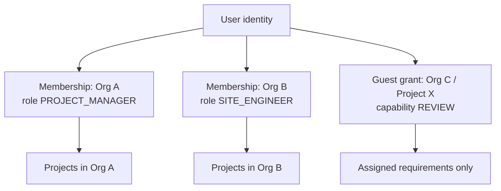

# 05 — Actors and Permissions

**Status:** Draft v0.2 — authoritative for access control
**Change history:** v0.2 applies remediation items AUD-005, AUD-012, AUD-P-01, AUD-S-24/25/26/28.
**Related:** `03` FR-IAM, `06` states, `08` entities, `13` security
**Rule:** when in doubt, deny.

---

## 1. Actor model

TradeCloseout has three actor planes:

1. **Platform plane** — TradeCloseout staff. No default access to customer content.
2. **Tenant plane** — members of a contractor Organisation.
3. **Project plane** — project-scoped members and guests (suppliers, consultants, clients, main contractors).

A person can be a member of multiple Organisations and a guest on projects owned by other Organisations. Identity is global; authorisation is always contextual.



## 2. Actor definitions

### 2.1 Platform actors

| Actor ID | Actor | Responsibilities | Default data access |
|---|---|---|---|
| ACT-PLAT-ADMIN | Platform administrator | Manage orgs, plans, templates, incidents, jobs | Metadata only; content via break-glass |
| ACT-PLAT-SUPPORT | Support engineer | Diagnose issues, resend notifications, inspect job status | Metadata only; no document content |
| ACT-PLAT-BILLING | Billing operator | Invoices, refunds, dunning | Billing data only |

### 2.2 Organisation roles

| Role ID | Role | Responsibilities |
|---|---|---|
| R-OWNER | Owner | Legal owner of the account; billing, ownership transfer, deletion; all project access |
| R-ADMIN | Company administrator | Members, parties, templates, all projects, configuration |
| R-BILLING | Billing manager | Subscription, invoices, payment methods; no project content by default |
| R-PM | Project manager | Project setup, checklist, assets, assignments, reviews coordination, packages |
| R-SITE | Site engineer | Upload evidence, update installation records, view assigned requirements |
| R-DOC | Document controller | Registers, metadata, transmittals, package assembly, document status |
| R-PROC | Procurement | Supplier parties, POs, datasheets, warranties, material documents |
| R-QC | Quality-control engineer | ITPs, inspection records, test reports, NCRs |
| R-SAFETY | Safety officer | Safety plan, permits, incident records |
| R-REVIEWER | Internal reviewer | Review/approve assigned documents; no administration |
| R-AUDITOR | Auditor (internal/external) | Read-only access to project records and audit trail |

### 2.3 Project-scoped / guest roles

| Role ID | Role | Responsibilities | Access boundary |
|---|---|---|---|
| R-CONSULT | Consultant reviewer | Review and approve technical submittals | Assigned requirements/projects only |
| R-CLIENT | Client representative | View progress, review/accept handover | Approved/client-visible items only |
| R-MC | Main contractor representative | Review subcontractor submissions, record acceptance | Assigned projects and packages |
| R-SUPPLIER-OEM | Manufacturer / dealer | Upload datasheets, O&M, warranties, test certificates | Assigned requirements only; no browsing |
| R-SUBCONTRACTOR | Sub-subcontractor (ducting, insulation, TAB) | Upload installation and test records | Assigned requirements only; no browsing |
| R-SUPPLIER-UP | Supplier upload-only | Upload only, no review visibility beyond status | Assigned requirement links only |
| R-LAB | Third-party test agency (TAB, IAQ, water lab) | Upload lab and test reports | Assigned requirements only |
| R-OEM-SERVICE | OEM service engineer | Upload warranty and service reports during DLP | Assigned assets and defects only |
| R-MC-DOC | Main-contractor document controller | Receive and register the handover package | Package and submission scope only |
| R-EXT-REVIEW | External reviewer (generic) | Review assigned items | Assigned items only |

> `R-CONSULT` and `R-CLIENT` may approve only where the project's approval workflow grants them an approval stage. A guest is never automatically an approver.

## 3. Permission model

### 3.1 Permission naming

`resource.action` with an optional scope qualifier in the check, not the name.

Examples: `project.read`, `document.upload`, `document.download`, `review.decide`, `requirement.waive`, `package.generate`, `package.submit`, `org.manage_members`, `billing.manage`.

### 3.2 Effective permission algorithm (RT-004, RT-018)

Evaluation separates additive capabilities (actions allowed) from restrictive resource scopes (resources targetable):

```
Effective_Capabilities(user, org, project) =
    platform_grants(user)
  ∪ org_role_permissions(membership(user, org))
  ∪ project_role_permissions(project_member(user, project))
  ∪ guest_capability_grants(user, project, resource)

Target_Scope(user, org, project, resource) =
    Min(Org_Scope, Project_Membership_Scope, Resource_Grant_Scope)

Permitted(user, action, resource) =
    (action ∈ Effective_Capabilities(user, org, project))
  ∧ (resource ∈ Target_Scope(user, org, project, resource))
  ∧ resource_scope_ok(user, resource)
  ∧ reviewer_role_matches(user, resource)      -- AUD-005
  ∧ field_visibility_ok(user, resource)        -- AUD-S-24
  ∧ project_status_allows(project, action)
  ∧ plan_limit_allows(org, action)
```

**Model: positive-only with narrowing scopes (`AUD-012`, `RT-004`, `RT-018`).** There is **no explicit deny list**. Where two grants apply, the **narrower scope wins** (project grant beats org grant; asset-scoped grant beats project-wide; a requirement's `reviewer_role` beats a role's blanket capability).

Rules:

1. **Tenant is absolute.** No grant can cross `org_id`. A guest grant is always tied to one owning Org and one Project (or a set of projects explicitly).
2. **Scope narrows, never widens.** Effective permission is the intersection of the role's capability and the member's `scope_json`, further narrowed by the resource's own constraints.
3. **Resource scope is checked, not inferred.** A supplier with `document.upload` can upload only to assigned requirements/assets.
4. **Status gates.** Suspended/cancelled/archived projects reject write actions even for owners.
5. **Self-approval is denied by default** (`FR-REV-009`), unless `org.allow_self_approval = true` and the reviewer holds an explicit override permission.
6. **Separation of duties:** `document.upload` does not imply `review.decide`; `requirement.waive` is restricted and, for mandatory items, requires a second approver (`FR-CHK-016`); `package.submit` is distinct from `package.generate`.
7. **Reviewer authority is per requirement, not per role** (`FR-REV-002`). A Project Manager with `review.decide` may decide only where `requirements.reviewer_role` matches one of their roles (or the requirement is untyped and `org.allow_generic_review` is on).
8. **Field-level visibility** (`AUD-S-24`): `R-CLIENT`, `R-MC` and `R-SUPPLIER*` never receive contract value, pricing, internal comments, other parties' documents, or other suppliers' submissions. The API applies a visibility projection before serialising (`05` §6.4).
9. **Export is constrained** (`AUD-S-25`): `export.data` is limited to `Owner`/`Admin` by default, requires a recorded reason, is rate-limited (one export per project per hour) and is fully audited.

### 3.3 Permission catalogue

| Permission | Description | Sensitive |
|---|---|---|
| `org.read` | View org profile | No |
| `org.manage` | Edit profile, branding, defaults | Yes |
| `org.manage_members` | Invite/remove/suspend members, change roles | Yes |
| `org.transfer_ownership` | Transfer Owner role | Critical |
| `org.delete` | Request/confirm org deletion | Critical |
| `billing.read` | View plan, invoices | Yes |
| `billing.manage` | Change plan, payment method, refunds | Critical |
| `party.read` / `party.manage` | Directory | No / Yes |
| `template.read` / `template.manage` | Org templates and configuration | No / Yes |
| `project.create` | Create project | Yes |
| `project.read` | View project summary | No |
| `project.manage` | Edit project settings and members | Yes |
| `project.close` | Close/reopen project | Critical |
| `contract.manage` | Contracts and specification refs | Yes |
| `checklist.manage` | Snapshot, change requests, waivers | Critical |
| `asset.read` / `asset.manage` | Equipment register | No / Yes |
| `document.read` | View metadata and previews | No |
| `document.upload` | Upload new versions | No |
| `document.download` | Download originals | Yes |
| `document.metadata_edit` | Edit metadata | Yes |
| `document.delete` | Soft delete/restore | Critical |
| `document.reuse` | Reuse across projects | Yes |
| `review.read` | View review history | No |
| `review.submit` | Submit for review | No |
| `review.decide` | Approve/request changes/reject | Critical |
| `requirement.waive` | Waive/not-applicable | Critical |
| `package.generate` | Generate handover package | Yes |
| `package.download` | Download package | Yes |
| `package.submit` | Record submission to external party | Critical |
| `package.accept` | Record client acceptance/rejection | Critical |
| `notification.manage` | Configure reminders | Yes |
| `audit.read` | View audit events | Yes |
| `export.data` | Export project/org data | Critical |
| `apikey.manage` | Issue/revoke API tokens | Critical |
| `review.record_external` | Record an external approval with evidence | Critical |
| `requirement.waive_second` | Countersign a waiver of a mandatory requirement | Critical |
| `document.bulk_import` | Import a ZIP of documents with mapping | Critical |
| `submission.recipients_manage` | Add/remove submission recipients | Yes |
| `warranty.manage` | Record warranty registration and claims | Yes |
| `defect.manage` | Raise and close defects | Yes |

## 4. Organisation role matrix

Legend: **Y** allowed, **–** not allowed, **S** allowed for own records only, **A** allowed for all projects (admin/owner), **C** conditional via explicit grant.

| Permission | Owner | Admin | Billing | PM | Site | Doc | Proc | QC | Safety | Reviewer | Auditor |
|---|---|---|---|---|---|---|---|---|---|---|---|
| org.read | Y | Y | Y | Y | Y | Y | Y | Y | Y | Y | Y |
| org.manage | Y | Y | – | – | – | – | – | – | – | – | – |
| org.manage_members | Y | Y | – | – | – | – | – | – | – | – | – |
| org.transfer_ownership | Y | – | – | – | – | – | – | – | – | – | – |
| org.delete | Y | – | – | – | – | – | – | – | – | – | – |
| billing.read | Y | Y | Y | – | – | – | – | – | – | – | – |
| billing.manage | Y | – | Y | – | – | – | – | – | – | – | – |
| party.read | Y | Y | – | Y | Y | Y | Y | Y | Y | Y | Y |
| party.manage | Y | Y | – | Y | – | – | Y | – | – | – | – |
| template.read | Y | Y | – | Y | – | Y | – | Y | – | – | Y |
| template.manage | Y | Y | – | – | – | – | – | – | – | – | – |
| project.create | Y | Y | – | Y | – | – | – | – | – | – | – |
| project.read | A | A | – | A | S | A | S | S | S | S | A |
| project.manage | A | A | – | A | – | – | – | – | – | – | – |
| project.close | Y | Y | – | Y | – | – | – | – | – | – | – |
| contract.manage | Y | Y | – | Y | – | – | – | – | – | – | – |
| checklist.manage | Y | Y | – | Y | – | – | – | – | – | – | – |
| asset.read | A | A | – | A | S | A | S | S | S | S | A |
| asset.manage | Y | Y | – | Y | S | Y | S | S | – | – | – |
| document.read | A | A | – | A | S | A | S | S | S | S | A |
| document.upload | A | A | – | A | S | A | S | S | S | – | – |
| document.download | A | A | – | A | S | S | S | S | S | S | A |
| document.metadata_edit | A | A | – | A | S | A | S | S | – | – | – |
| document.delete | A | A | – | A | – | A | – | – | – | – | – |
| document.reuse | A | A | – | A | – | A | – | – | – | – | – |
| review.read | A | A | – | A | S | A | S | S | S | S | A |
| review.submit | A | A | – | A | S | A | S | S | – | – | – |
| review.decide | A | A | – | S | – | – | – | S | – | S | – |
| requirement.waive | Y | Y | – | Y | – | – | – | – | – | – | – |
| review.record_external | Y | Y | – | Y | – | Y | – | – | – | – | – |
| document.bulk_import | Y | Y | – | Y | – | Y | – | – | – | – | – |
| package.generate | Y | Y | – | Y | – | Y | – | – | – | – | – |
| package.download | Y | Y | – | Y | S | Y | – | – | – | Y | Y |
| package.submit | Y | Y | – | Y | – | Y | – | – | – | – | – |
| package.accept | Y | Y | – | Y | – | – | – | – | – | – | – |
| notification.manage | Y | Y | – | Y | – | Y | – | – | – | – | – |
| audit.read | Y | Y | – | Y | – | – | – | – | – | – | Y |
| export.data | Y | Y | – | – | – | – | – | – | – | – | – |
| apikey.manage | Y | Y | – | – | – | – | – | – | – | – | – |

Notes:

- `S` = only projects where the user is a project member with that role, and only assigned resources where applicable.
- **`review.decide` is `S` for `R-PM`, not `A` (`AUD-005`).** A Project Manager may approve only requirements whose configured `reviewer_role` matches their roles (`FR-REV-002`). Blanket technical approval is not granted to PMs.
- **`document.download` is `S` for `R-DOC` by default (`AUD-005`).** An org setting `document_controller_org_wide_download` may widen it; enabling it is recorded in the audit.
- `R-QC` may approve only QC/test-related requirements, not commercial or drawing approvals.
- `R-REVIEWER` may approve only where explicitly assigned as an approval-stage reviewer.
- `R-BILLING` has no project content access by default; a billing operator who is also a PM gets both roles.
- **Waiving a mandatory requirement** requires `requirement.waive` **and** a second approver (`Owner`/`Admin`) via `requirement.waive_second` (`FR-CHK-016`).
- **`export.data` is Owner/Admin only**, rate-limited and reason-logged (`AUD-S-25`).

## 5. Project membership and scoping

### 5.1 Project member record

`project_members(project_id, user_id, project_role, scope_json, added_by, added_at, removed_at, status)`

`scope_json` may restrict:

- asset categories or specific assets,
- requirement groups,
- document types,
- read-only vs read-write,
- date range (for auditors).

### 5.2 Default project access

| Actor | Access |
|---|---|
| Owner/Admin | All projects in org |
| PM | Assigned projects, full project actions |
| Site/Doc/Proc/QC/Safety | Assigned projects, role-specific actions |
| Reviewer | Assigned projects and assigned requirements |
| Auditor | Assigned projects, read-only |
| Guest | Explicit grants only |
| Unassigned member | No project access (unless org setting allows browse) |

### 5.3 Multiple roles

A user can be `R-PM` on Project A and `R-QC` on Project B. Effective permissions are computed per project. There is no global "super role" other than Owner/Admin within the org.

## 6. Guest and supplier access

### 6.1 Grant types

| Grant | Allows | Does not allow |
|---|---|---|
| `SUPPLIER_UPLOAD` | Upload to specified requirements/assets; view own upload status and reviewer comments | Browse project, see other suppliers, download other documents |
| `SUPPLIER_CONTRIBUTOR` | Upload + view its own submissions and approved status | Review/approve |
| `CONSULTANT_REVIEW` | View assigned requirements and documents; comment; approve/request changes if stage assigned | Project settings, other parties, commercial data |
| `CLIENT_VIEW` | View approved/client-visible documents, package status, submit acceptance | Internal comments, unapproved drafts, other suppliers |
| `MC_VIEW` | View approved documents and package status for assigned projects | Internal notes |
| `AUDITOR_READ` | Read-only metadata, documents and audit for scope | Writes |

### 6.2 Guest safeguards

**Risk statement (`AUD-P-10`, `D-017`):** upload-only links are **bearer capabilities**. Anyone holding the link can upload to the assigned requirements until it expires. This is a deliberate trade-off for supplier adoption. Orgs may enable OTP verification on supplier links (`guest_grants.otp_required`), and **the default for new projects is `true`**. Review, decision and acceptance actions **always** require OTP verification.

1. Guest links are unguessable (≥128-bit token), single-use for invitation, expiring, revocable.
2. Link opening requires verifying the invited email/mobile via OTP before access. Upload-only links may be bearer-token-only with a short expiry **only when `guest_grants.otp_required = false`**; the default is `true` for new projects (`Q-004` resolved: OTP on by default).
3. Guest sessions are project-scoped; URLs never accept an arbitrary `org_id`.
4. Guest listing endpoints return only explicitly granted resources; counts reflect only visible items.
5. Guest access cannot be used to enumerate other projects, parties, users or documents.
6. Guests see the owning contractor's branding and a clear "external access" indicator.
7. All guest actions are audited with `actor_type = GUEST`.
8. Revocation invalidates sessions and links within 60 seconds.

### 6.3 Supplier upload link

- Scoped to one request batch (1–20 requirements) and one Party.
- Expires after 30 days by default (configurable 1–90).
- Allows upload, metadata entry for allowed fields, and viewing reviewer decision.
- Cannot download other files, view pricing, or see internal comments.
- Rate-limited and CAPTCHA-protected after repeated failures.
- Link can be reissued; old link is revoked.

### 6.4 Field-level visibility projection

Applied before any response is serialised:

| Field class | R-CLIENT | R-MC | R-SUPPLIER-OEM | R-SUBCONTRACTOR | R-LAB | Internal roles |
|---|---|---|---|---|---|---|
| Requirement title / type / status | ✅ | ✅ | ✅ (assigned only) | ✅ (assigned only) | ✅ (assigned only) | ✅ |
| Approved document and revision | ✅ | ✅ | ✅ (own uploads + approved) | ✅ (own + approved) | ✅ (own + approved) | ✅ |
| Contract value, retention, pricing | ❌ | ❌ | ❌ | ❌ | ❌ | ✅ (scoped) |
| Internal comments and notes | ❌ | ❌ | ❌ | ❌ | ❌ | ✅ |
| Other suppliers' submissions | ❌ | ❌ | ❌ | ❌ | ❌ | ✅ |
| Reviewer identity (internal) | Initials only | Initials only | ❌ | ❌ | ❌ | ✅ |
| Audit log | ❌ | ❌ | ❌ | ❌ | ❌ | ✅ (scoped) |

## 7. Delegation, replacement and revocation

| Scenario | Required behaviour |
|---|---|
| Employee resigns | Admin suspends member; sessions revoked; owned requirements/reviews reassigned; audit preserved |
| PM on leave | Delegate review/approval authority to another eligible member for a date range; both recorded |
| Supplier link forwarded to wrong person | Recipient verification (OTP) or immediate revocation; audit shows access |
| Role downgraded | Effective permissions recomputed; open approvals not auto-reassigned; admin prompted |
| Guest removed | Grants revoked; sessions killed; uploaded documents remain owned by the project |
| Owner leaves | Ownership must be transferred before deactivation; otherwise org admin escalation |
| Auditor expires | Time-bound grant; automatic revocation |

Delegation rules:

- Delegate must hold the underlying permission.
- Delegation cannot exceed the delegator's scope or expiry.
- Delegation is explicit per project and per permission class (`REVIEW`, `APPROVE`).
- The audit records `on_behalf_of`.

## 8. Multi-company membership

- A user sees an org switcher listing only orgs where they have an active membership or guest grant.
- Switching orgs changes `sessions.active_org_id` server-side via `POST /auth/switch-org`; all queries are re-scoped from the session. **`orgId` in a path or body is never authoritative**; if it disagrees with `session.active_org_id` the request returns `404` (`AUD-014`).
- Notifications identify the org and project to avoid confusion.
- Billing and plan limits are per Organisation.
- A user's personal profile (name, phone, email) is global; role and designation are per org.
- A main contractor who is also a TradeCloseout customer cannot see a subcontractor's tenant; collaboration is via guest grants only (V1+).

## 9. Access checks by operation

| Operation | Check |
|---|---|
| Read project | `project.read` + project membership/admin + not guest-restricted |
| Upload document | `document.upload` + project `ACTIVE` + requirement assignment + plan storage |
| Download original | `document.download` + document visibility + not quarantined |
| Approve | `review.decide` + assigned stage + not uploader (unless override) + version `IN_REVIEW` |
| Waive | `requirement.waive` + mandatory reason + project `ACTIVE` + not guest |
| Generate package | `package.generate` + all selected docs readable + project not cancelled |
| Submit package | `package.submit` + package `READY` + recipient Party exists |
| Export org | `export.data` + Owner/Admin + re-authentication |
| View audit | `audit.read` + project scope |
| Change plan | `billing.manage` + Owner/Billing |

## 10. Tenant isolation invariants

1. Every tenant-owned row has a non-null `org_id`.
2. Every query is filtered by `org_id` from the session, never from user-supplied input.
3. PostgreSQL Row-Level Security is enabled on all tenant tables; the app sets `app.current_org` per transaction.
4. Composite foreign keys include `org_id` where cross-entity references could otherwise cross tenants.
5. Object-storage keys are prefixed by `org_id`; signed URLs are issued only after a permission check.
6. Cache keys include `org_id` and permission scope.
7. Background jobs carry `org_id` and re-validate before acting.
8. Generated PDFs never include data from another org; templates are org-scoped.
9. Search indexes are partitioned/filtered by `org_id`.
10. Tests must attempt cross-tenant reads/writes and expect 404 (not 403) to avoid existence leaks.

## 11. Permission-denial behaviour

- API returns `404 Not Found` for resources outside the user's scope to avoid leaking existence.
- `403 Forbidden` is used only when the resource is known to be visible but the action is not permitted (e.g., viewer tries to upload).
- UI hides unavailable actions and explains why where helpful.
- Denials are audited at `WARN` level with actor, resource, action, reason.
- Repeated denials trigger rate limiting and a security alert.

## 12. Permission test obligations

Every permission in §3 must have at least one positive and one negative test (`14` §5). The test matrix must cover:

- owner vs admin vs member,
- project member vs non-member,
- internal reviewer vs guest reviewer,
- supplier scoped to requirement A cannot see requirement B,
- cross-tenant ID substitution returns 404,
- revoked session fails within 60 seconds,
- self-approval blocked,
- suspended project blocks writes,
- archived project blocks writes but allows reads/exports.

## 13. Version log

| Version | Date | Change |
|---|---|---|
| 0.1 | 2026-10-31 | Initial actors and permission model |
| 0.2 | 2026-10-31 | Remediation: positive-only model, `review.decide` scoped for PM, `document.download` scoped for Doc Controller, `export.data` restricted, supplier roles split, guest OTP default on, field-level visibility, session/active-org binding |
