# 06 — Workflows and State Machines

**Status:** Draft v0.2 — authoritative for process and state
**Change history:** v0.2 adds WF-23…WF-26 (external approval, warranty, DLP, variation) and fixes the approval race, `due_at IS NULL`, multi-recipient submission, package requirement snapshot, warranty precedence, reopen-after-purge guard, asset instantiation and waiver-with-evidence.
**Related:** `03` requirements, `05` permissions, `07` configuration, `08` data, `12` edge cases

---

## 1. Conventions

- State names are `SCREAMING_SNAKE_CASE` and are used identically in the database, API and tests.
- `MISSING`, `OVERDUE` and `EXPIRING` are **derived display flags**, not stored states. This prevents state explosion and stale data.
- Every transition writes an `AuditEvent` and emits a domain event.
- Every write transition is idempotent by `Idempotency-Key` where triggered by an API request.
- Notifications are side effects and never block a transition.
- A transition not listed here is invalid and must be rejected with `409 INVALID_STATE_TRANSITION`.

## 2. State machine index

| Machine | Section | Entity |
|---|---|---|
| Organisation | 3.2 | `E-ORGANISATION` |
| Membership | 3.3 | `E-MEMBERSHIP` |
| Invitation | 3.4 | `E-INVITATION` |
| Project | 3.1 | `E-PROJECT` |
| Checklist snapshot | 3.5 | `E-CHECKLIST_SNAPSHOT` |
| Requirement | 3.6 | `E-REQUIREMENT` |
| Document version (file) | 3.7 | `E-DOCUMENT_VERSION` |
| Document version (review) | 3.8 | `E-DOCUMENT_VERSION` |
| Review | 3.9 | `E-REVIEW` |
| Change request | 3.10 | `E_CHANGE_REQUEST` |
| Warranty event | 3.14 | `E-WARRANTY_EVENT` |
| Defect | 3.15 | `E-DEFECT` |
| Handover package | 3.11 | `E-HANDOVER_PACKAGE` |
| Submission | 3.12 | `E-SUBMISSION` |
| Subscription | 3.13 | `E-SUBSCRIPTION` |

## 3. State machines

### 3.1 Project

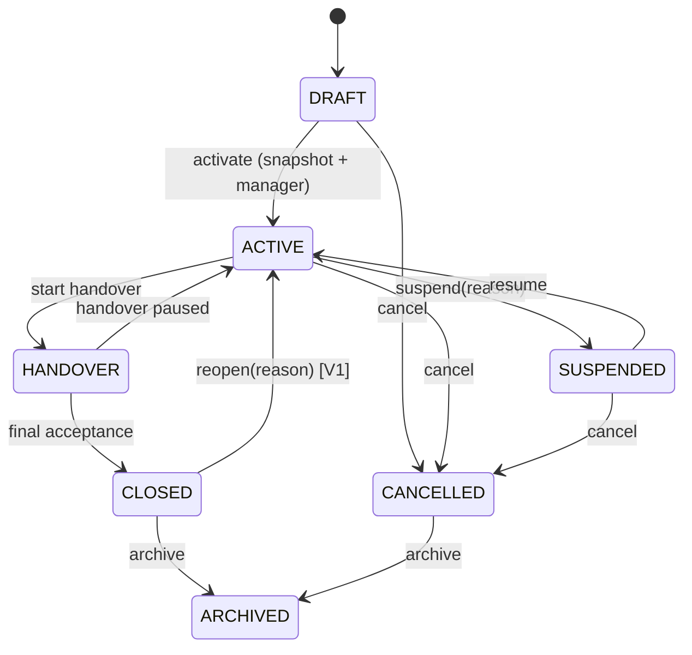

| From | To | Trigger | Guard | Side effects |
|---|---|---|---|---|
| — | DRAFT | Create project | Code unique, org active | Audit, project member = creator |
| DRAFT | ACTIVE | Activate | Snapshot exists, ≥1 manager, contract client set (warn only) | Lock code, start reminders, audit |
| ACTIVE | SUSPENDED | Suspend | Reason required, permission `project.manage` | Cancel pending reminders; block writes |
| SUSPENDED | ACTIVE | Resume | Reason optional, permission | Restart reminders |
| ACTIVE | HANDOVER | Start handover | `project.manage` + explicit confirmation of handover intent | Dashboard mode change |
| HANDOVER | ACTIVE | Pause handover | Reason | Resume normal mode |
| HANDOVER | CLOSED | Close | Final acceptance recorded, no open mandatory items unless waived | Set warranty start, freeze writes except corrections |
| CLOSED | ACTIVE | Reopen | `project.close`, reason, V1 | Increment reopen count, audit |
| any non-archived | CANCELLED | Cancel | Reason, `project.close` | Stop jobs, preserve reads |
| CLOSED/CANCELLED | ARCHIVED | Archive | Retention elapsed or explicit admin action | Read-only, exclude from plan limits |

**Rule:** documents remain readable in `SUSPENDED`, `HANDOVER`, `CLOSED`, `CANCELLED` and `ARCHIVED`; only writes are restricted.

### 3.2 Organisation

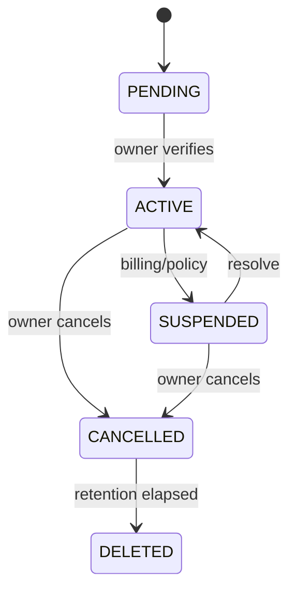

### 3.3 Membership

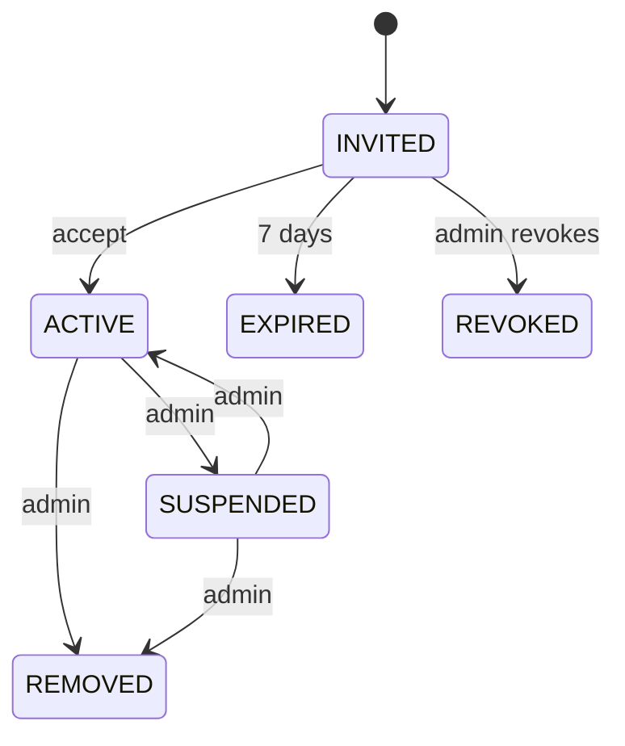

### 3.4 Invitation

`PENDING → ACCEPTED | EXPIRED | REVOKED`. Single-use token; acceptance binds to the invited verified identity. Re-invitation creates a new row.

### 3.5 Checklist snapshot

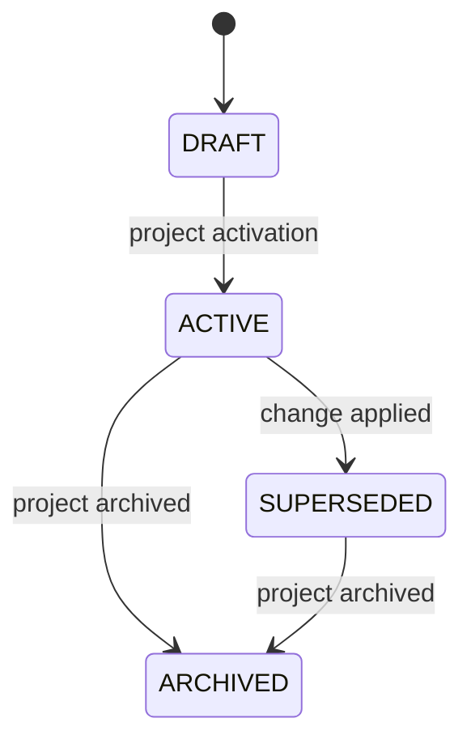

Snapshots are immutable after `ACTIVE`; a change creates a new snapshot and supersedes the old one. Requirement rows persist at project level and point to the current snapshot via `current_snapshot_id`; historical definitions remain in the snapshot payload (see `08` §5.4).

### 3.6 Requirement (RT-009, RT-023, RT-024)

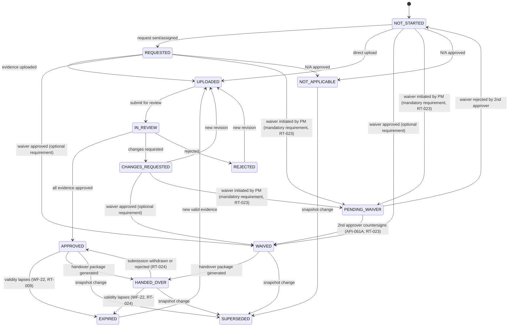

Notes:

- `MISSING` = `due_at IS NOT NULL AND due_at < now AND state NOT IN (APPROVED, WAIVED, NOT_APPLICABLE, HANDED_OVER)`. A requirement with `due_at IS NULL` is **never** `MISSING` (`AUD-P-05`).
- `EXPIRING` = approved evidence with `valid_until ≤ now + 30 days`.
- `EXPIRED` = approved evidence whose `valid_until < now`; such a requirement **blocks or explicitly warns** at package generation (`AUD-P-09`).
- **Waiver with existing evidence (`AUD-030`):** waiving a requirement does not delete its documents. Linked documents remain in the project and are excluded from the "satisfies" set; the package shows the requirement as `WAIVED` and lists the orphaned evidence in a non-blocking appendix when `package_include_waived_evidence` is on.
- A requirement with multiple required evidence items stays `IN_REVIEW` until all are approved; partial approval is visible per document but does not satisfy the requirement.
- `SUPERSEDED` requirements are retained for history and excluded from progress.

### 3.7 Document version — file processing

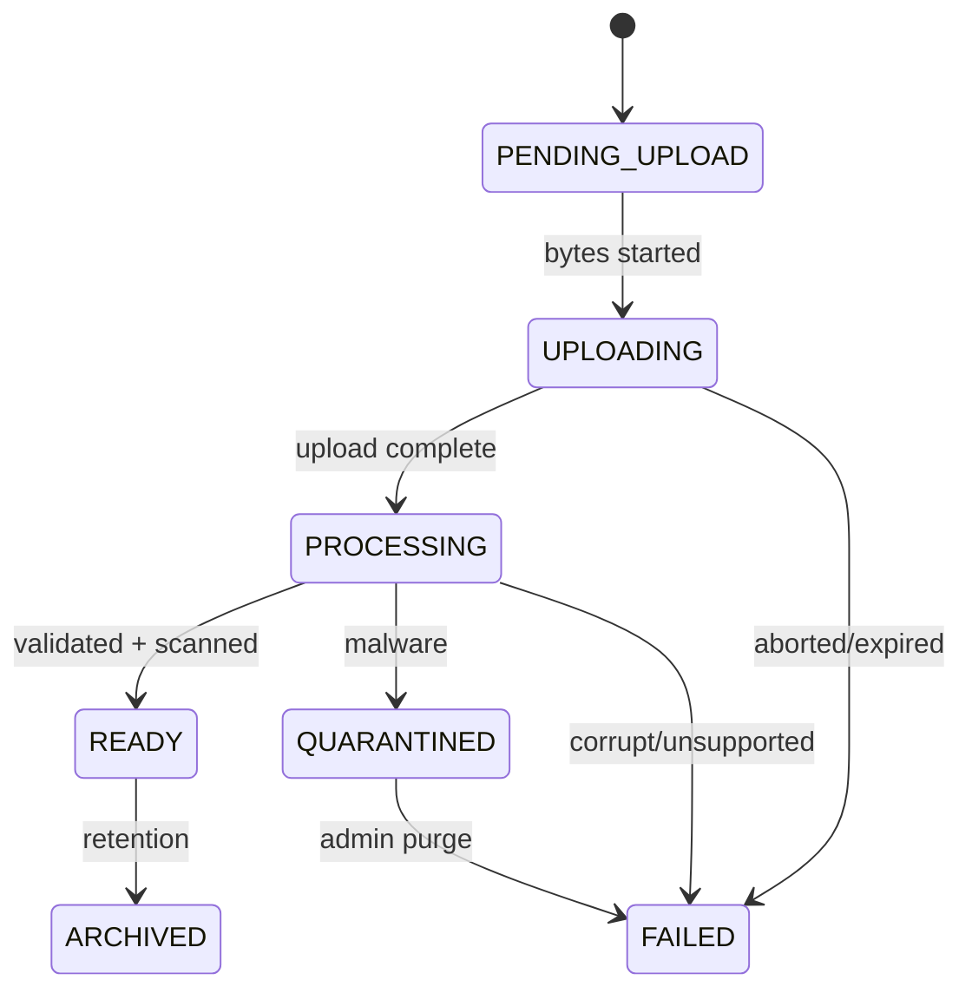

| State | Meaning | Download allowed |
|---|---|---|
| PENDING_UPLOAD | Signed URL issued, no bytes | No |
| UPLOADING | Multipart in progress | No |
| PROCESSING | Hash, MIME, pages, AV scan, preview | No |
| READY | Usable | Yes (with permission) |
| QUARANTINED | Malware detected | No |
| FAILED | Unusable; reason recorded | No |

### 3.8 Document version — review state

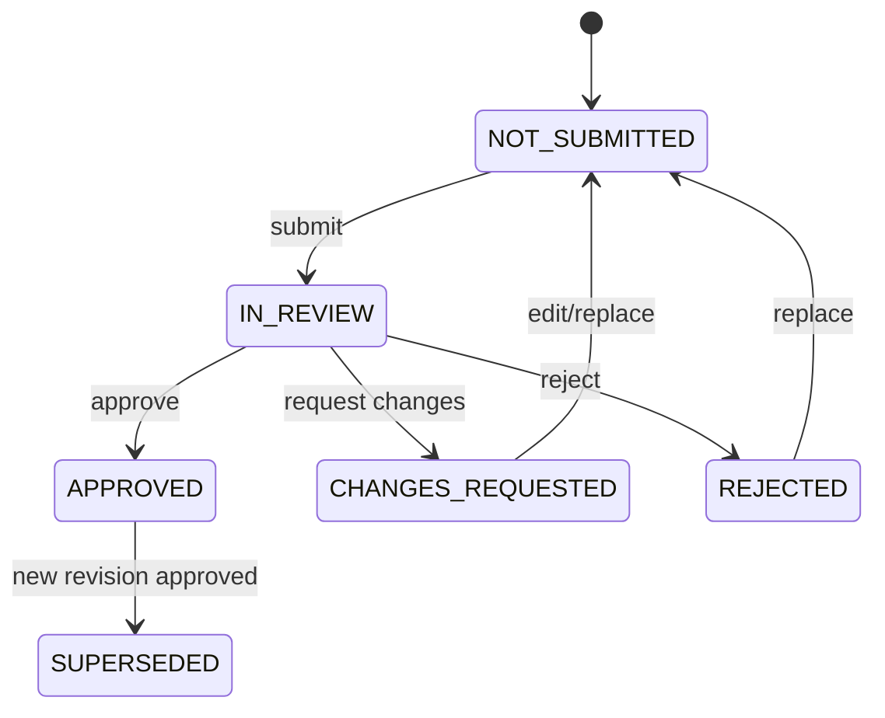

Orthogonal to file processing: a version cannot enter `IN_REVIEW` unless file state is `READY`.

**Approval race rule (`AUD-007`):** only the version that is the **most recently submitted** for review may be approved. Approving a version superseded by a newer submission returns `409 INVALID_STATE_TRANSITION`. The transition takes a row lock on the parent `documents` row and commits version state, `documents.current_approved_version_id` and the requirement state in **one transaction**.

### 3.9 Review

`PENDING → IN_REVIEW → APPROVED | CHANGES_REQUESTED | REJECTED | CANCELLED`.

A Review is per reviewer per stage. Requirement approval requires all required stage reviews to be approved. A single `REJECT` may terminate the workflow depending on configuration; default: any terminal rejection ends the stage.

### 3.10 Requirement change request

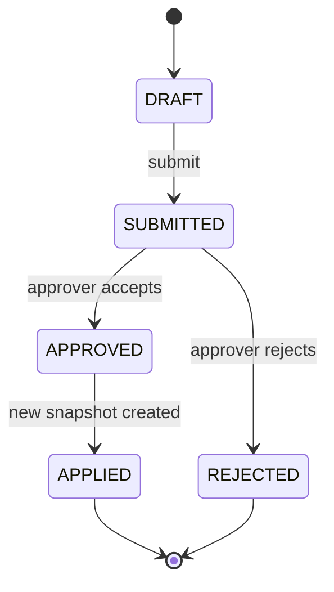

### 3.11 Handover package (RT-007)

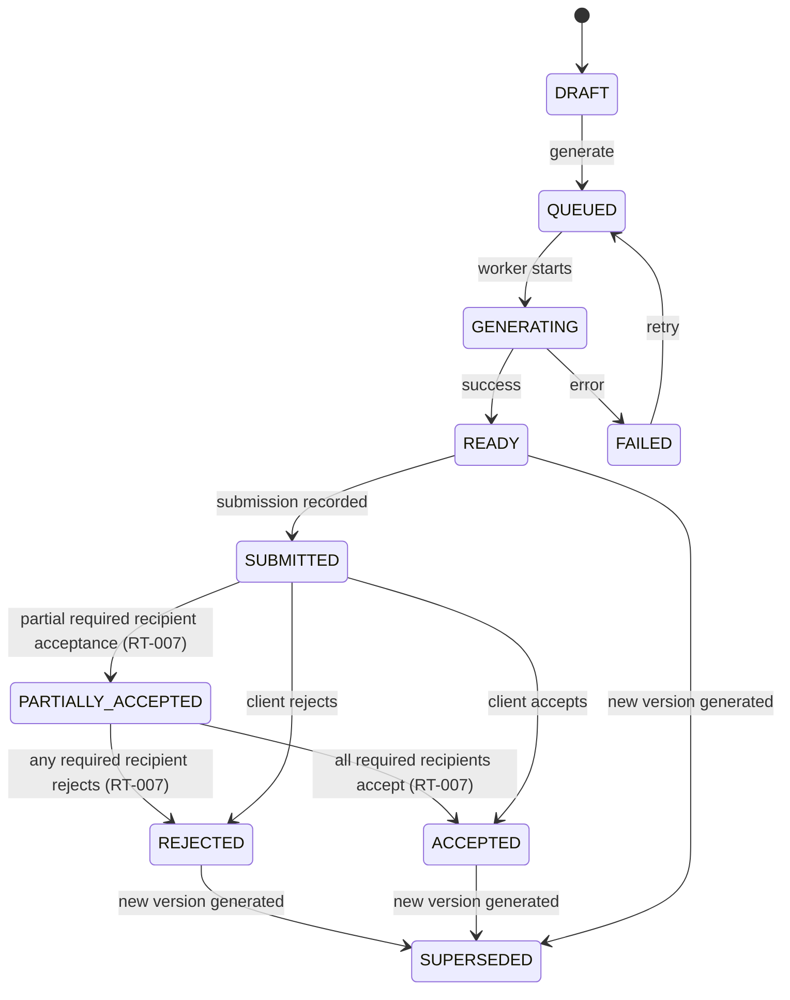

Once `READY`, the package and its manifest are immutable. A new generation creates a new package row/version.

### 3.12 Submission (RT-007)

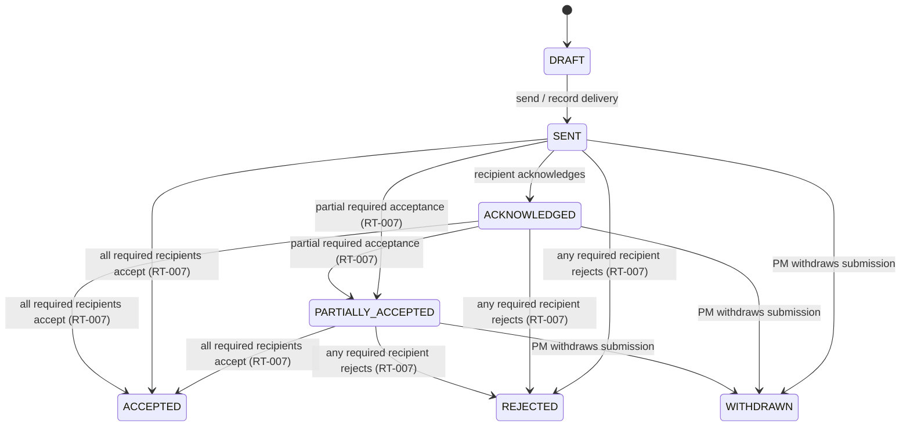

**Deterministic Multi-Recipient Decision Aggregation Rule (`RT-007`):**
A submission can have multiple `submission_recipients` (e.g., Main Contractor, PMC, Client Owner). Each recipient records its decision via `API-117` (`POST /submissions/{id}/recipients/{recipientId}/decision`). Status aggregates deterministically:
1. **REJECTED:** If ANY recipient with `is_required_approver = true` rejects the submission, `submissions.status` immediately transitions to `REJECTED`, and the linked `handover_packages.status` becomes `REJECTED`.
2. **ACCEPTED:** If ALL recipients with `is_required_approver = true` record `ACCEPTED`, `submissions.status` transitions to `ACCEPTED`, and `handover_packages.status` becomes `ACCEPTED`. (Rejections by non-required approvers do not block acceptance, but are noted in audit).
3. **PARTIALLY_ACCEPTED:** If at least one recipient records `ACCEPTED`, no required recipient has recorded `REJECTED`, but one or more required recipients are still `PENDING`, `submissions.status` transitions to `PARTIALLY_ACCEPTED`, and `handover_packages.status` transitions to `PARTIALLY_ACCEPTED`.
4. **WITHDRAWN:** If PM withdraws the submission, all unfulfilled recipient requests are cancelled and `submissions.status` becomes `WITHDRAWN`.

### 3.13 Subscription

`TRIAL → ACTIVE → PAST_DUE → SUSPENDED → CANCELLED`; `PAST_DUE → ACTIVE` on payment; `TRIAL → CANCELLED`.

## 4. Workflows

Each workflow lists trigger, actors, preconditions, steps, validations, permissions, states, notifications, failure handling and outcome.

### WF-01 — Company registration and onboarding

| Field | Detail |
|---|---|
| Trigger | Visitor clicks "Start free" |
| Actors | Visitor, Owner, system |
| Preconditions | None |
| Steps | 1. Enter name, business email/mobile, org name. 2. Verify OTP/magic link. 3. Create Org (`PENDING`), User, Owner membership. 4. Set passwordless session. 5. Guided setup (profile → trade pack → project → invite). |
| Validations | Valid email/Indian mobile; org name 2–120 chars; duplicate org name allowed but warned; accept terms/privacy. |
| Permissions | Public (rate-limited) |
| States | Org `PENDING → ACTIVE` on verification; membership `ACTIVE` |
| Notifications | Welcome email/WhatsApp; verification code; setup reminders (2) |
| Failures | OTP expired → resend; duplicate identity → login instead; rate-limited → CAPTCHA; email bounce → prompt alternate |
| Outcome | Verified owner with an org and a resumable setup checklist; audit `ORG_CREATED`, `USER_VERIFIED` |

### WF-02 — Company profile and trade configuration

| Field | Detail |
|---|---|
| Trigger | Owner/admin opens Company Settings or setup step |
| Actors | Owner, Admin |
| Preconditions | Active org |
| Steps | 1. Edit legal/display name, entity type, GSTIN/PAN, address, logo, signatory. 2. Select trade pack (HVAC). 3. Set defaults (time zone, reminders, naming). 4. Save as new config version. |
| Validations | GSTIN checksum (V1), PAN format (V1), logo ≤2 MB (PNG/JPEG/WebP only; SVG strictly prohibited to eliminate SSRF/LFI attack vectors per RT-006), required legal name. |
| Permissions | `org.manage`, `template.manage` |
| States | Config version `DRAFT → ACTIVE` |
| Notifications | None, except confirmation |
| Failures | Invalid GSTIN → field error; unsupported logo → reject; concurrent edit → optimistic concurrency conflict |
| Outcome | Branded org with defaults; existing projects unaffected; audit |

### WF-03 — Project creation

| Field | Detail |
|---|---|
| Trigger | PM/admin creates a project |
| Actors | Owner, Admin, PM |
| Preconditions | Active org; plan allows another active project |
| Steps | 1. Enter code, name, client, MC/consultant, site, dates, value. 2. Create contract stub (optional). 3. Add project members. 4. Select checklist template. 5. Review resolved requirements. 6. Activate. |
| Validations | Code unique per org (normalised), name required, dates coherent, client required before activation (warn in draft), at least one manager. |
| Permissions | `project.create`, `project.manage` |
| States | `DRAFT → ACTIVE` |
| Notifications | Assigned members notified; client not notified automatically |
| Failures | Duplicate code → error; plan limit → upgrade prompt; template resolution error → show blocking items; activation without snapshot → blocked |
| Outcome | Active project with immutable snapshot version 1, members, dashboard |

### WF-04 — Client and main-contractor configuration

| Field | Detail |
|---|---|
| Trigger | Project setup or Party directory |
| Actors | PM, Admin, Procurement |
| Preconditions | Active org |
| Steps | 1. Search existing Party (GSTIN/name/email). 2. Create or select. 3. Attach roles for this project. 4. Optionally invite a representative as guest. |
| Validations | Name required; at least one contact channel for guest invite; GSTIN optional but unique warning. |
| Permissions | `party.manage`; guest invite requires `project.manage` |
| States | Party `ACTIVE`; invitation `PENDING` |
| Notifications | Guest invitation; internal confirmation |
| Failures | Duplicate Party → merge suggestion; invalid contact → field error; guest already invited → reuse/revoke prompt |
| Outcome | Project has client/MC/consultant linked; review routing can use them |

### WF-05 — Contract and specification registration

| Field | Detail |
|---|---|
| Trigger | Project setup or change order |
| Actors | PM, Admin |
| Preconditions | Project in `DRAFT` or `ACTIVE` |
| Steps | 1. Enter contract reference, type, value, retention, DLP, warranty terms. 2. Upload contract file. 3. Add specification references (title, issuer, revision, date, file). 4. Map specification clauses to requirement groups (optional). |
| Validations | Reference unique per project; dates valid; retention 0–100%; DLP ≥0; financial values ≥0. |
| Permissions | `contract.manage` |
| States | Contract `ACTIVE`, later `SUPERSEDED` |
| Notifications | None |
| Failures | Duplicate ref → error; corrupt file → quarantine/fail; spec revision conflict → warning |
| Outcome | Contract register drives applicability rules and package cover data |

### WF-06 — Checklist selection and customisation

| Field | Detail |
|---|---|
| Trigger | Project setup, or controlled change request |
| Actors | PM, Admin, QC, config approver |
| Preconditions | Project exists; template available; project not closed |
| Steps | 1. Choose trade template + optional client profile. 2. Preview resolved requirements (inheritance shown). 3. Adjust: add/remove, mandatory flag, owner, reviewer, due offset, evidence count, naming. 4. Resolve applicability rules for assets (or defer asset-scoped items). Asset-category requirements are **instantiated as one requirement row per matching asset** (`scope_key = 'asset:{id}'`) at snapshot creation **and** again whenever a new asset is created (`AUD-002`). 5. Create snapshot. 6. Activate project if draft. |
| Validations | At least 1 mandatory item; every item has type + title; no duplicate keys; due offset ≥0; reviewer role exists; locked platform items cannot be removed. |
| Permissions | `checklist.manage`; after activation requires change request + approver |
| States | Snapshot `DRAFT → ACTIVE`; previous `SUPERSEDED` |
| Notifications | PM notified of snapshot creation/change; approver notified of change request |
| Failures | Template not found → choose another; rule conflict → show conflict and block; concurrent activation → one wins, other gets 409 |
| Outcome | Immutable requirement set with provenance; project dashboard populated |

### WF-07 — Equipment and asset registration

| Field | Detail |
|---|---|
| Trigger | Project setup, delivery, or as-built reconciliation |
| Actors | Site engineer, PM, QC |
| Preconditions | Project active (or draft for planning) |
| Steps | 1. Add asset manually or import CSV. 2. Validate tag uniqueness and category. 3. Enter make/model/serial/location/warranty. 4. Link asset-scoped requirements. 5. Optionally print QR (V1). |
| Validations | Tag required, unique per project, ≤50 chars; category from configured list; serial optional but warned for equipment; dates coherent. |
| Permissions | `asset.manage` |
| States | Asset `ACTIVE → REPLACED/RETIRED` |
| Notifications | None by default; import summary |
| Failures | Duplicate tag → row error; bad CSV → downloadable error report; partial import → transactional per batch with clear counts |
| Outcome | Asset register; per-asset requirement instances with missing/approved counts |

### WF-08 — Supplier registration and invitation

| Field | Detail |
|---|---|
| Trigger | Procurement needs manufacturer documents |
| Actors | Procurement, PM, supplier |
| Preconditions | Party exists or is created; project active |
| Steps | 1. Create/select supplier Party. 2. Assign supplier to requirements. 3. Generate scoped upload link (or guest invite). 4. Send via WhatsApp/email. 5. Supplier verifies (if required), uploads. 6. Internal review. |
| Validations | Supplier contact required; at least one assigned requirement; link expiry 1–90 days. |
| Permissions | `party.manage`, `document.upload` on behalf? No; supplier uploads via grant |
| States | Invitation `PENDING → ACCEPTED/EXPIRED/REVOKED`; requirement `REQUESTED` |
| Notifications | Supplier request with list/deadline/link; internal confirmation; reminder schedule |
| Failures | Link expired → reissue; wrong recipient → revoke; supplier uploads wrong doc → reviewer requests changes; no response → escalate to procurement |
| Outcome | Supplier uploads land against assigned requirements with audit; no org-wide access |

### WF-09 — Document request and upload

| Field | Detail |
|---|---|
| Trigger | Requirement needs evidence; user clicks Upload |
| Actors | Site engineer, doc controller, procurement, supplier, QC |
| Preconditions | Project active; requirement applicable; user has upload permission and scope |
| Steps | 1. Select requirement/asset. 2. Choose file(s) or camera. 3. Enter metadata (pre-filled from type). 4. Client requests presigned URL(s). 5. Upload directly to storage (multipart if >10 MB). 6. Server verifies completion, computes hash, enqueues processing. 7. Processing validates MIME/size/PDF/AV. 8. Duplicate check. 9. Document version created `READY`; requirement `UPLOADED`. 10. User may submit for review. |
| Validations | Allowed type by content sniffing; size limit; required metadata; asset/requirement belongs to project; revision format; expiry > issue date; if expiry_date < CURRENT_DATE, reject with 422 DOCUMENT_ALREADY_EXPIRED on submit (RT-009). |
| Permissions | `document.upload` + project membership/guest grant; plan storage |
| States | Version `PENDING_UPLOAD → UPLOADING → PROCESSING → READY/FAILED/QUARANTINED`; requirement `UPLOADED` |
| Notifications | Reviewer notified on submit; uploader notified of processing failure |
| Failures | Network drop → resume; expired URL → re-issue; duplicate → prompt; AV → quarantine; wrong type → reject; storage full → clear error and alert |
| Outcome | Immutable file version linked to requirement/asset, audited, ready for review |

### WF-10 — Classification and metadata extraction

| Field | Detail |
|---|---|
| Trigger | Upload, or manual edit |
| Actors | Uploader, doc controller, system |
| Preconditions | Version `READY` |
| Steps | 1. Apply defaults from requirement/document type. 2. Suggest title/revision/date from filename/PDF metadata (V1 OCR). 3. User confirms/edits. 4. Validate required fields. 5. Save; audit field-level changes. |
| Validations | Type-specific required metadata; revision pattern; dates; issuer; asset link if asset-scoped. |
| Permissions | `document.metadata_edit` |
| States | No state change; metadata version incremented |
| Notifications | None |
| Failures | Extraction low confidence → leave blank, never guess silently; conflicting metadata → flag; edit after approval → require correction reason or new revision |
| Outcome | Searchable, correctly linked metadata; audit of changes |

### WF-11 — Automated verification

| Field | Detail |
|---|---|
| Trigger | Version processing completes |
| Actors | System |
| Preconditions | File uploaded |
| Steps | 1. Sniff MIME and compare to extension. 2. Check size and page count (qpdf pre-check with max 512 MB memory, max 1,000 pages / 25,000 objects to prevent decompression bombs per RT-034). 3. Detect PDF encryption/corruption. 4. Compute SHA-256 and detect duplicates. 5. Run AV scan. 6. Check required metadata presence. 7. Check expiry (if expiry_date < CURRENT_DATE, mark as FAIL to block review submission per RT-009). 8. Check asset/serial relevance (text search, V1). 9. Produce pass/warn/fail result. |
| Validations | Any `fail` blocks review submission; `warn` requires acknowledgement. |
| Permissions | System only |
| States | `PROCESSING → READY/QUARANTINED/FAILED` |
| Notifications | Uploader on fail/quarantine |
| Failures | Scanner unavailable → file stays `PROCESSING`, retried with backoff; do not mark ready without scan (fail-closed) |
| Outcome | Verified file with machine-readable checks stored on the version |

### WF-12 — Review, approval and rejection

| Field | Detail |
|---|---|
| Trigger | Uploader submits a version for review, or workflow auto-submits |
| Actors | Reviewer (internal/consultant), uploader, PM |
| Preconditions | Version `READY`; metadata complete; reviewer authorised; project active |
| Steps | 1. Submit → version `IN_REVIEW`, requirement `IN_REVIEW`. 2. System routes to stage reviewer(s). 3. Reviewer opens preview, sees requirement and asset context. 4. Adds comments (general/page). 5. Decision: approve / request changes / reject. 6. System records decision, updates requirement, notifies uploader. 7. On approval, version `APPROVED`, requirement `APPROVED` when all evidence approved. |
| Validations | Comment required for non-approval; reviewer not uploader (unless override); version still `IN_REVIEW`; no conflicting terminal decision. |
| Permissions | `review.decide` + stage assignment; guests only if workflow grants |
| States | Version `IN_REVIEW → APPROVED/CHANGES_REQUESTED/REJECTED`; requirement as §3.6; Review `IN_REVIEW → terminal` |
| Notifications | Reviewer assigned; uploader on decision; PM on rejection/overdue; digest |
| Failures | Reviewer unavailable → delegate/escalate; concurrent decisions → first wins, second gets 409; reviewer loses access → cancel and reassign; document superseded during review → cancel review |
| Outcome | Immutable decision with comments and audit; requirement satisfied or returned for correction |

### WF-13 — Revision and replacement

| Field | Detail |
|---|---|
| Trigger | Reviewer requests changes; new issue; correction |
| Actors | Uploader, reviewer |
| Preconditions | Existing document with approved/changes-requested version |
| Steps | 1. Upload new version (or "upload revision" action). 2. Link `supersedes_version_id`. 3. Metadata revision code must differ. 4. Process and review. 5. On approval, prior version becomes `SUPERSEDED`; requirement points to current. 6. Prior version remains downloadable to authorised users. |
| Validations | Revision code unique per document among active non-withdrawn versions (`RT-011`): If an unapproved version is soft-deleted, withdrawn, or marked FAILED/QUARANTINED, its revision_code reservation is freed so the user can re-upload a corrected file with the intended revision code (e.g. R0). Only approved or actively under-review versions hold a hard reservation on revision_code. New version required if metadata changes after approval; cannot supersede a superseded version; cannot delete approved version. |
| Permissions | `document.upload`; approval requires `review.decide` |
| States | Old `APPROVED → SUPERSEDED`; new `UPLOADED → ... → APPROVED`; requirement may temporarily revert to `UPLOADED` |
| Notifications | Reviewer notified; stakeholders notified of new revision |
| Failures | Wrong file uploaded → mark `FAILED` review and upload again (no destructive overwrite); duplicate revision → error |
| Outcome | Clear lineage; "current approved" is unambiguous; audit intact |

### WF-14 — Missing-document follow-up

| Field | Detail |
|---|---|
| Trigger | Scheduled job (daily) or dashboard action |
| Actors | System, requirement owner, PM, supplier, escalation manager |
| Preconditions | Active/handover project |
| Steps | 1. Recompute derived flags, excluding requirements with `due_at IS NULL` (never `MISSING`). 2. Group missing/overdue by owner/supplier. 3. Apply reminder schedule. 4. Send in-app/email/WhatsApp link. 5. Record notification. 6. Escalate after threshold. 7. Recompute on upload/approval. |
| Validations | Do not remind for approved/waived/N/A; quiet hours 20:00–08:00 IST; dedup window; max 1 reminder/day/channel/recipient. |
| Permissions | System; manual reminder requires `notification.manage`/owner of requirement |
| States | Requirement unchanged (derived flags only); notification `QUEUED → SENT → FAILED` |
| Notifications | Per schedule; digest; escalation |
| Failures | Email bounce → mark, try alternate channel, alert admin; WhatsApp failure → email fallback; job failure → retry with backoff, alert if >3 attempts |
| Outcome | Owners know exactly what is missing; repeated noise avoided; audit of reminders |

### WF-15 — Project completion

| Field | Detail |
|---|---|
| Trigger | PM decides to start handover |
| Actors | PM, QC, doc controller, client |
| Preconditions | Project active; package scope defined |
| Steps | 1. Run readiness check (mandatory approved/waived, expiring, open NCRs). 2. Resolve blockers or record overrides. 3. Move project `HANDOVER`. 4. Freeze scope for final package. 5. Generate package (WF-16). |
| Validations | All mandatory requirements approved/waived unless override with reason; expiring docs flagged; open NCRs flagged; approver authority for overrides. |
| Permissions | `project.manage`, `package.generate` |
| States | `ACTIVE → HANDOVER` |
| Notifications | Stakeholders; client if guest invited |
| Failures | Missing docs → list with links; override denied → block; generation failure → retry |
| Outcome | Handover-ready project with an explicit exceptions list |

### WF-16 — Handover package generation

| Field | Detail |
|---|---|
| Trigger | User requests package |
| Actors | PM, doc controller, system |
| Preconditions | Project active/handover; documents readable; package scope valid |
| Steps | 1. Choose scope, layout, include/exclude waivers. 2. Validate readiness. 3. Create package row `DRAFT → QUEUED`. 4. Worker snapshots document version IDs **and the requirement fields rendered into the index** into `package_items` + `package_requirements`, with the checklist `snapshot_checksum` (`AUD-008`, `FR-HND-021`). 5. Render cover/index/approval summary/asset register. 6. Merge PDFs with bookmarks; convert images/Office as configured. 7. Generate ZIP + manifest + checksums. 8. Store, set `READY`, notify. |
| Validations | No cross-project docs; no missing files; page/file limits; valid cover data; all selected docs `READY`/approved (or explicitly included as draft with warning). |
| Permissions | `package.generate`; download requires `package.download` |
| States | `DRAFT → QUEUED → GENERATING → READY/FAILED` |
| Notifications | Requester on completion/failure; client not notified automatically |
| Failures | Missing file → fail with item list; timeout → retry; storage full → alert; concurrent generation → allow but separate rows; PDF corruption → skip with warning and record |
| Outcome | Immutable, versioned package with index, manifest and checksums |

### WF-17 — Client submission and feedback

| Field | Detail |
|---|---|
| Trigger | Package ready; PM submits to client/MC |
| Actors | PM, doc controller, client/MC representative |
| Preconditions | Package `READY`; recipient Party exists |
| Steps | 1. Create submission (method, date, reference) with one or more `submission_recipients` (client, main contractor, consultant) (`AUD-020`, `FR-HND-019`). 2. Send signed download link or record physical delivery. 3. Record acknowledgement (optional upload). 4. Client reviews. 5. Record acceptance, conditional acceptance or rejection with reasons. 6. Rejection creates follow-up items. |
| Validations | At least one recipient required; method required; cannot submit a superseded package without warning; acceptance requires decision-maker role; each recipient records its own decision. |
| Permissions | `package.submit`, `package.accept` (client guest) |
| States | Package `READY → SUBMITTED → PARTIALLY_ACCEPTED → ACCEPTED/REJECTED` (RT-007); Submission `DRAFT → SENT → ACKNOWLEDGED → PARTIALLY_ACCEPTED → ACCEPTED/REJECTED/WITHDRAWN` (RT-007) |
| Notifications | Recipient receives link; PM on view/decision; reminders for no response |
| Failures | Link expired → reissue; wrong recipient → withdraw and resubmit; client cannot access → OTP help; rejection reasons unclear → request clarification |
| Outcome | Verifiable submission record and client decision |

### WF-18 — Final acceptance and project closure

| Field | Detail |
|---|---|
| Trigger | Client accepts final package |
| Actors | PM, Owner, client |
| Preconditions | Submission `ACCEPTED`; all mandatory items satisfied/waived; DLP terms recorded |
| Steps | 1. Record final acceptance (or rejection/withdrawal). If rejected or withdrawn, requirements in HANDED_OVER revert to APPROVED/WAIVED (RT-024). 2. Confirm warranty start dates. **Precedence (`AUD-P-08`):** an existing `asset.warranty_start` always wins; closure sets it only when null, using `asset.warranty_start_basis` (`FR-AST-012`). 3. Generate closure summary. 4. Move project `CLOSED`. 5. Lock writes; keep reads/exports. 6. Schedule DLP reminders and archive date. |
| Validations | Acceptance evidence; no open mandatory items; signatory recorded. |
| Permissions | `project.close`, `package.accept` |
| States | `HANDOVER → CLOSED`; package `ACCEPTED` |
| Notifications | Stakeholders; DLP reminders scheduled |
| Failures | Missing acceptance evidence → block closure; open defects → allow conditional closure with exception list |
| Outcome | Closed project with final package, acceptance, warranty dates and retention schedule |

### WF-19 — Archival, retention and retrieval

| Field | Detail |
|---|---|
| Trigger | Retention date reached; owner archives; legal hold |
| Actors | System, Owner/Admin, legal |
| Preconditions | Project `CLOSED` or `CANCELLED`; no legal hold |
| Steps | 1. Compute retention (default project closure + 8 years, configurable). 2. If legal hold, skip deletion and flag. 3. Move to `ARCHIVED`, exclude from plan limits. 4. After retention, enqueue purge. 5. Purge files + rows, keep minimal audit tombstone. **Reopen guard (`AUD-P-11`):** once `purged_at` is set, reopening is impossible; create a new project and link it to the archived record. |
| Validations | Legal hold check; plan retention ≥ contract requirement; approval for early purge. |
| Permissions | `org.manage`, platform admin for purge |
| States | `CLOSED/CANCELLED → ARCHIVED → DELETED` |
| Notifications | Owner before purge (30/7 days) |
| Failures | Hold detected → abort; file deletion partial → retry and report; DB constraint → block and alert |
| Outcome | Predictable retention with verifiable deletion and audit tombstone |

### WF-20 — Controlled requirement change (post-activation)

| Field | Detail |
|---|---|
| Trigger | Client adds a requirement; contract variation; error correction |
| Actors | PM, approver, system |
| Preconditions | Project active/handover |
| Steps | 1. Create change request (add/remove/modify/waive). 2. System shows impact (requirements, assets, approvals, packages). 3. Approver reviews. 4. On approval, new snapshot version created; affected requirements keep their rows and receive new definition revisions (`requirement_revisions`). Removing a requirement that has approved evidence requires `items.action = ARCHIVE_WITH_EVIDENCE` and an explicit approver decision. 5. Prior packages unaffected and remain valid for their snapshot checksum. |
| Validations | Reason required; approver cannot be requester (unless override); cannot remove a requirement with approved evidence without explicit archive decision. |
| Permissions | `checklist.manage` + approver |
| States | Change request `DRAFT → SUBMITTED → APPROVED → APPLIED`; snapshot `ACTIVE → SUPERSEDED` |
| Notifications | Affected owners and reviewers |
| Failures | Impact computation fails → block; concurrent changes → merge or conflict; approved package invalidated → new package required |
| Outcome | Auditable, versioned change without silently altering history |

### WF-21 — Member offboarding and reassignment

| Field | Detail |
|---|---|
| Trigger | Resignation, role change, access review |
| Actors | Admin, Owner |
| Preconditions | Member active |
| Steps | 1. Suspend member (sessions revoked within 60 s). 2. Produce a **gap report**: owned requirements, open reviews, draft packages, delegations and pending submissions, grouped by project and required replacement role. 3. Reassign to another member. 4. Cancel/reassign delegations. 5. Remove membership. |
| Validations | At least one owner remains; replacement must have permissions; reassignment cannot cross projects without access; if no eligible replacement exists the removal is blocked and the gap report lists the missing roles (`AUD-P-12`). |
| Permissions | `org.manage_members` |
| States | Membership `ACTIVE → SUSPENDED → REMOVED` |
| Notifications | Member, new owners, PM |
| Failures | No eligible replacement → block removal and list gaps; owner removal without transfer → block |
| Outcome | No orphaned work; access revoked; audit |

### WF-22 — Expiry and renewal

| Field | Detail |
|---|---|
| Trigger | Daily validity job |
| Actors | System, owner, reviewer |
| Preconditions | Approved evidence with `valid_until` |
| Steps | 1. Compute expiring (≤30 days) and expired. 2. Notify owner/reviewer. 3. On expiry, the version stays `APPROVED` historically but the requirement becomes `EXPIRED` and no longer satisfies closeout. Package generation reports `EXPIRED` separately from `EXPIRING` and blocks or warns per `FR-HND-008`. 4. New valid version restores `APPROVED` after review. |
| Validations | Only validity-based types; event-based warranty starts only after handover. |
| Permissions | System |
| States | Requirement `APPROVED/HANDED_OVER → EXPIRED → UPLOADED → IN_REVIEW → APPROVED` (RT-009, RT-024) |
| Notifications | 30/14/7/1 days; expiry day |
| Failures | Clock/timezone errors → use UTC, display IST; duplicate notifications → dedup |
| Outcome | Expired evidence never silently counts as valid |

### WF-23 — Record external approval

| Field | Detail |
|---|---|
| Trigger | Consultant or main contractor approves outside the system (stamped PDF, email, portal transmittal, physical meeting) |
| Actors | PM, document controller, QC |
| Preconditions | Document version `READY`; requirement in `UPLOADED`/`IN_REVIEW`; actor holds `review.record_external` and matches `requirements.reviewer_role` |
| Steps | 1. Open the requirement or version. 2. Choose **Record external approval**. 3. Enter decision, approver name and role, decision date, method (`STAMPED_PDF`/`EMAIL`/`PORTAL`/`PHYSICAL`) and reference. 4. Upload the evidence file. 5. System records a `reviews` row with `method = EXTERNAL`, sets the version `APPROVED` and satisfies the requirement. |
| Validations | Evidence file required for `STAMPED_PDF` and `EMAIL`; approver name required; decision date ≤ today; actor cannot record an external approval of their own upload unless `is_override` with reason. |
| Permissions | `review.record_external` + reviewer-role match |
| States | Version `→ APPROVED`; requirement `→ APPROVED`; Review `method = EXTERNAL` |
| Notifications | Uploader and PM; package index shows "Approved (external)" |
| Failures | Missing evidence → block; superseded version → `409` |
| Outcome | Requirement satisfied with a defensible record of how approval actually happened via API-106 POST /document-versions/{id}/external-approval (`AUD-010`, `FR-REV-016`, `RT-022`) |

### WF-24 — Warranty registration and start-date reconciliation

| Field | Detail |
|---|---|
| Trigger | Commissioning complete, or OEM warranty registration is performed |
| Actors | Procurement, PM, supplier (OEM) |
| Preconditions | Asset exists; warranty documents uploaded |
| Steps | 1. Create `warranty_event` (`REGISTRATION`) with OEM reference and date. 2. Record the agreed `warranty_start_basis`. 3. Reconcile against `asset.warranty_start`/`warranty_end`; flag conflicts (contract says handover, OEM says commissioning). 4. Resolve conflicts with reason and approver. 5. Confirm registration in the handover package. |
| Validations | OEM reference required for `REGISTRATION`; `warranty_end ≥ warranty_start`; basis ∈ {COMMISSIONING, HANDOVER, ACCEPTANCE, SUPPLY}. |
| Permissions | `warranty.manage` |
| States | `warranty_events.status`: `RECORDED → CONFIRMED / DISPUTED / CLAIMED` |
| Notifications | PM on conflict; owner on warranty expiry (`FR-NOT-014`) |
| Failures | Conflicting dates unresolved → block package readiness for that asset |
| Outcome | Warranty start date is unambiguous per asset with an audit of how it was derived (`AUD-D-03`) |

### WF-25 — Defect liability management

| Field | Detail |
|---|---|
| Trigger | Snag list raised (client, consultant, MC or internal QC) |
| Actors | PM, site engineer, QC, supplier/OEM, client |
| Preconditions | Project `ACTIVE`/`HANDOVER`, or `CLOSED` and reopened |
| Steps | 1. Raise `defect` with asset, description, severity, due date. 2. Assign to a member or `R-OEM-SERVICE`/`R-SUBCONTRACTOR`. 3. Rectify and upload closure evidence. 4. Reviewer closes or reopens. 5. At DLP expiry, open defects are listed in the DLP closure certificate or carried forward with reason. |
| Validations | Closure evidence required to close; mandatory defects block DLP closure unless waived with a second approver. |
| Permissions | `defect.manage` |
| States | `OPEN → IN_PROGRESS → RECTIFIED → CLOSED`; `OPEN → WAIVED` |
| Notifications | Due-date reminders (7/3/1 days); escalation to PM; DLP expiry (`FR-NOT-014`) |
| Failures | Supplier unresponsive → escalate to procurement; closure evidence rejected → reopen |
| Outcome | DLP is tracked and closed with evidence, not just signed off at the end (`AUD-D-04`) |

### WF-26 — Variation order processing

| Field | Detail |
|---|---|
| Trigger | Client/MC issues a scope change; PM raises a variation |
| Actors | PM, owner, approver |
| Preconditions | Project `ACTIVE`; base contract exists |
| Steps | 1. Create `variation` linked to the base contract (`parent_contract_id`). 2. Record description, value delta, time delta. 3. Model requirement impact as **L4 project overrides with provenance** to the variation reference (`AUD-011`, `07` §4.2). 4. Approver accepts or rejects. 5. On acceptance a change request is created and a new checklist snapshot applied. |
| Validations | Reference unique per project; deltas may be negative but must be stated; approver cannot be requester. |
| Permissions | `contract.manage` + approver |
| States | `variation.status`: `DRAFT → SUBMITTED → APPROVED / REJECTED / SUPERSEDED` |
| Notifications | Affected requirement owners; PM on decision |
| Failures | Conflicting requirement changes → impact report flags conflicts; concurrent variations → merge or one wins |
| Outcome | Scope changes are auditable and reflected in the requirement set without mutating history |

## 5. Cross-workflow sequence: upload to approval

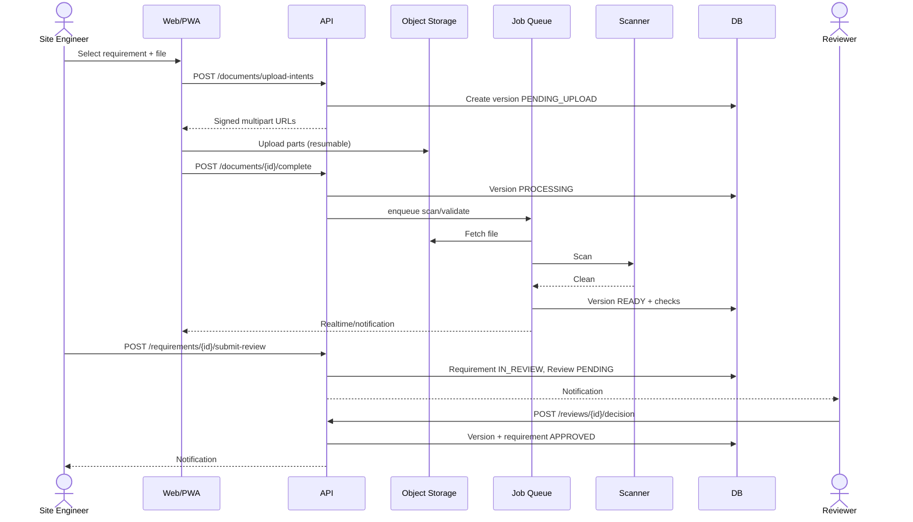

## 6. Failure-handling rules (summary)

| Failure | Rule |
|---|---|
| Transition attempted from wrong state | `409`, no partial writes |
| Duplicate request | Idempotency key returns prior result |
| Notification failure | Business transition committed; retry with backoff |
| Job crash | Job retried up to 5 times; then `FAILED` with alert |
| Concurrent review | Optimistic lock; second decision rejected |
| Storage unavailable | Upload intent fails closed; no orphan row marked ready |
| Package generation partial | Never mark `READY`; preserve diagnostics; retry |
| Timezone ambiguity | Store UTC; compute deadlines in project timezone |

## 7. Version log

| Version | Date | Change |
|---|---|---|
| 0.1 | 2026-10-31 | Initial workflows and state machines |
| 0.2 | 2026-10-31 | Remediation: WF-23 external approval, WF-24 warranty, WF-25 DLP, WF-26 variation; approval-race rule; `due_at IS NULL`; multi-recipient submission; package requirement snapshot; warranty precedence; reopen-after-purge guard; asset-scoped instantiation; waiver-with-evidence |
