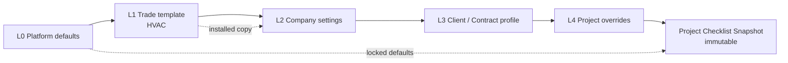
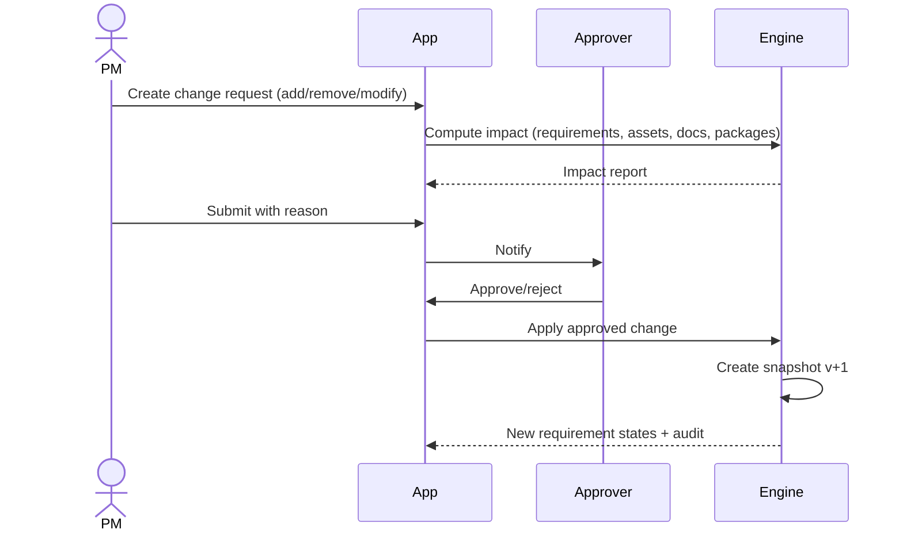

# 07 — Customisation Engine

**Status:** Draft v0.2 — authoritative for configuration
**Change history:** v0.2 resolves AUD-011 (variations as L4), AUD-002 (single scoping model), AUD-P-17/18/19/20.
**Principle:** customise without code; never silently mutate an active project.
**Related:** `03` FR-CFG/FR-CHK, `06` WF-06/WF-20, `08` entities

---

## 1. Goals and non-goals

### 1.1 Goals

1. A new HVAC contractor gets a usable project in minutes from a curated template.
2. A contractor can adapt document types, checklists, fields, reminders, approvals, naming and package layout without vendor involvement.
3. A consultant/client can impose additional requirements per project.
4. Existing projects remain stable when templates change.
5. Every configuration change is versioned, attributable and reversible.

### 1.2 Non-goals

- A general-purpose workflow/BPM engine.
- Arbitrary scripting by customers.
- Per-user bespoke code.
- Unlimited nesting or unlimited custom entities.
- Real-time collaborative template editing.

## 2. Configuration hierarchy



| Level | ID | Owner | Examples | Mutability |
|---|---|---|---|---|
| L0 | `PLATFORM` | TradeCloseout | Safety rules, file limits, base document types, default package layout | Platform admin |
| L1 | `TRADE` | TradeCloseout | HVAC catalogue, default checklist, HVAC asset categories | Platform admin; installed as a copy |
| L2 | `ORG` | Contractor admin | Company branding, custom types, default reviewers, naming, reminders | Org admins |
| L3 | `CLIENT_CONTRACT` | Org admin/PM | Client-specific checklist, consultant review stages, package format. **Single profile per project** (`client_profiles` referenced by `client_party_id`) | Org admins/PM |
| L4 | `PROJECT` | PM (pre-activation) | Project-specific additions, due dates, owners. **Variation-order requirements are modelled here with provenance** (`contract_id` / `variation_id`) — there is no multi-L3 resolver (`AUD-011`) | PM; post-activation via change request |

**Important:** L1 is **copied** into the org on installation. Platform template updates do not propagate automatically. The org sees a diff and chooses to apply, merge or ignore.

## 3. What is configurable

| Domain | Configurable elements | Level(s) | MVP |
|---|---|---|---|
| Document types | Code, name, category, mandatory metadata, validity rule, reuse policy, package section, allowed formats | L1–L4 | Partial (L1/L2) |
| Categories | Document category tree, equipment categories | L0–L4 | Yes |
| Requirements | Title, description, document type, mandatory flag, satisfaction rule (1:1 in MVP, RT-005), owner role, reviewer role, due offset, applicability rule | L1–L4 | Yes |
| Checklist groups | Group name, order, requirements | L1–L4 | Yes |
| Custom fields | Field key, label, type (text/number/date/select/boolean), required, options, applies-to entity | L2–L4 | V1 |
| Approval workflows | Stages, sequential/parallel, approver role/party, SLA, rejection behaviour | L2–L4 | V1 (single-stage MVP) |
| Review responsibility | Default reviewer by type/asset category | L2–L4 | Yes |
| Naming convention | Pattern tokens, revision format, allowed characters | L2–L4 | Yes |
| Folder structure | Virtual folders/views by type/asset/status | L2–L4 | Yes (views) |
| Reminder schedule | Offsets, channels, escalation, quiet hours, **per-requirement override** | L2–L4 | Yes |
| Submission formats | Package types (PDF/ZIP), cover text, index columns | L2–L4 | Partial |
| Package layout | Section order, inclusion rules, cover, approval summary | L2–L4 | Partial (L2), full V1 |
| Branding | Logo, colour, footer, signatory | L2 | Yes |
| Language/notifications | UI language, date format, digest settings | L2 (user override) | English MVP |
| Applicability rules | Conditions and effects | L1–L4 | V1 |

## 4. Resolution algorithm

### 4.1 Inputs and Versioned Schema Registry (RT-020)

- `levels`: for preview/installation `[PLATFORM, TRADE]`; for an installed org `[PLATFORM, ORG, CLIENT, PROJECT]`, where the ORG payload already contains the installed trade defaults (see §4.2, RT-019).
- Each level may have zero or one active `config_version` for a given scope.
- Each field path has an explicit `overridePolicy` defined in code via the static `ConfigSchemaRegistry`:

```typescript
// Static versioned registry in code (RT-020)
export interface FieldSchema {
  path: string;
  type: 'scalar' | 'keyed_array' | 'unkeyed_array' | 'map';
  overridePolicy: 'LOCKED' | 'INHERIT_ONLY' | 'REPLACE' | 'APPEND' | 'MERGE_MAP';
  ownerLevel?: 'PLATFORM' | 'ORG' | 'CLIENT' | 'PROJECT';
  defaultValue?: unknown;
}

export const ConfigSchemaRegistry: Record<string, Record<string, FieldSchema>> = {
  'v1.0': {
    'security.retention_days':  { path: 'security.retention_days',  type: 'scalar',       overridePolicy: 'LOCKED',       ownerLevel: 'PLATFORM' },
    'branding.primary_color':   { path: 'branding.primary_color',   type: 'scalar',       overridePolicy: 'REPLACE' },
    'handover.ordering':        { path: 'handover.ordering',        type: 'keyed_array',  overridePolicy: 'MERGE_MAP' },
    'notifications.recipients': { path: 'notifications.recipients', type: 'unkeyed_array',overridePolicy: 'APPEND' },
    'rules.custom_matrix':      { path: 'rules.custom_matrix',      type: 'map',          overridePolicy: 'MERGE_MAP' },
  }
};
```

Override policy semantics:
- `LOCKED`: Value cannot be overridden by any higher/downstream layer (e.g., statutory data retention, security baselines).
- `INHERIT_ONLY`: Can only be authored at its designated `ownerLevel`; downstream layers cannot modify it.
- `REPLACE`: Scalar or leaf value where most-specific non-null layer wins.
- `APPEND`: Lists or arrays where values from all applicable levels are concatenated.
- `MERGE_MAP`: Dictionaries or keyed arrays merged by key across layers.

### 4.2 Installed trade packs

Once an org installs a trade pack, the **org's installed configuration (L2) becomes the effective base**. L1 is not applied live on top of L2. Platform L1 updates are offered as an upgrade diff; the org chooses to apply them, which creates a new L2 version. This prevents a platform edit from silently changing customer behaviour.

For an org that has not installed a pack, L1 is used to preview and install. The algorithm below therefore iterates `PLATFORM → ORG → CLIENT → PROJECT` for installed orgs, treating the org payload as already containing the L1 defaults.

### 4.3 Variations and multiple contracts

A project may have a base contract and one or more variation orders (`08` §3.2 `contracts.parent_contract_id`, `variations`). **There is exactly one L3 client profile per project.** Requirement changes arising from variations are expressed as **L4 project overrides** carrying a `provenance` reference to the contract or variation that introduced them. The resolver applies L3 once, then applies each L4 override in ascending `effective_from` order.

This avoids an unbounded multi-L3 resolver while still recording which contract clause drove each requirement.

### 4.4 Algorithm (RT-019, RT-020)

```
resolve(scope, is_preview = false):
  result = {}
  provenance = {}
  
  // RT-019: Eliminate double-application of TRADE (L1) for installed orgs
  levels = is_preview ? [PLATFORM, TRADE] : [PLATFORM, ORG, CLIENT, PROJECT]
  
  for level in levels:
    cfg = active_config(level, scope)
    if cfg is null: continue
    for (path, value) in flatten(cfg.payload):
      policy = ConfigSchemaRegistry[cfg.schema_version][path].overridePolicy
      if policy == 'LOCKED' and provenance[path] exists:
          if value != result[path]: record_conflict(path, level)
          continue
      if policy == 'INHERIT_ONLY' and level != ConfigSchemaRegistry[cfg.schema_version][path].ownerLevel:
          continue
      if policy == 'APPEND':
          result[path] = union(result[path], value)
      elif policy == 'MERGE_MAP':
          result[path] = merge_by_key(result[path], value)
      else: // REPLACE / overridable
          if value is INHERIT: continue
          if value is CLEAR: result[path] = null
          else: result[path] = value
      provenance[path] = level
  validate(result)
  return {payload: result, provenance, conflicts}
```

### 4.5 Merge semantics

| Type | Default | Notes |
|---|---|---|
| Scalar (`string`, `number`, `boolean`, `date`) | Most-specific non-null wins | `null` = inherit; explicit `{ "$clear": true }` = clear |
| Keyed array (objects with `key`) | Merge by `key`; higher level overrides fields; `$remove: true` removes | Order: explicit `order` at the most-specific level, otherwise base order |
| Unkeyed array (strings) | Replace | Use `additive` policy for union |
| Rule set | Merge by `ruleId`; same ID overrides; different IDs combine | Conflicts detected after merge |
| Map/object | Deep merge | Recursion follows field policies |

### 4.6 Precedence examples

| Field | L1 | L2 | L3 | L4 | Resolved |
|---|---|---|---|---|---|
| Warranty requirement mandatory | true | false | – | – | false (L2) |
| Package section order | default | – | client order | – | client order (L3) |
| Safety plan requirement | locked true | false | – | – | **conflict**: rejected at validation |
| Allowed formats | PDF/JPG | +PNG (additive) | – | – | PDF/JPG/PNG |
| Client-specific certificate | – | – | added | – | included |
| Due offset for O&M | 30 days | – | 15 days | 7 days | 7 days |

## 5. Locking and guardrails

1. **Platform safety locks** (L0): file-size ceiling, allowed MIME types, mandatory audit events, tenant isolation, malware scan requirement. These cannot be configured away.
2. **Legal/format locks** (L1): package must include approval summary and waiver list; document types must declare retention class.
3. **Org locks** (L2): an org may lock a field so project managers cannot change it.
4. **Immutable after activation:** checklist structure in a project is locked; changes go through WF-20.
5. **No silent defaults:** every resolved value has provenance.

### 5.1 Complexity limits

| Limit | Value (proposed) |
|---|---|
| Document types per org | 200 |
| Requirements per checklist template | 1,000 |
| Groups per template | 50 |
| Custom fields per entity | 50 |
| Applicability rules per template | 200 |
| Approval stages per workflow | 10 |
| Naming pattern length | 200 chars |
| Package sections | 30 |
| Projects per org (trial) | plan limit enforced at creation (`AUD-P-20`) |
| Config payload size | 2 MB |

Exceeding a limit is a validation error, not a silent truncation.

## 6. Versioning

### 6.1 Config versions

`config_versions(id, org_id?, level, scope_type, scope_id, version_no, schema_version, payload_json, checksum, status, created_by, created_at, published_at)`

- Versions are immutable once `ACTIVE`.
- Editing creates a new `DRAFT` version; publishing activates it and archives the prior version.
- `schema_version` allows migrations; old versions remain readable.
- An org can roll back by activating a prior version (creates a new version number).

### 6.2 Template packs

`template_packs(id, trade, name, version, schema_version, payload, status)`

- Platform-owned, versioned, immutable.
- Installation copies the pack into an org config version, recording `source_pack_id` and `source_version`.
- Upgrades show a diff: added/removed/changed items; org chooses apply/merge/skip.
- Template upgrades never alter an active project snapshot.

### 6.3 Project snapshot

`checklist_snapshots(id, project_id, version_no, status, resolved_payload_json, provenance_json, source_config_versions_json, checksum, created_by, created_at)`

Snapshot content includes:

- Resolved requirements with stable `requirement_key`.
- Resolution provenance (which level set each value).
- Rule evaluation results and the input attributes (project type, assets, contract flags).
- Template and config version IDs.
- Checksum over the canonical JSON.

Requirement instances are project-level rows keyed by `requirement_key` + `scope_key` and point to the current snapshot (`08` §5.4). When a new snapshot is applied, the system maps by `requirement_key` and `scope_key`:

- unchanged key → keep requirement row, update definition fields **and write a `requirement_revisions` row**;
- removed key → mark `SUPERSEDED`, keep evidence;
- added key → create new requirement;
- changed definition → update row, preserve evidence but re-evaluate validity.

## 7. Controlled change process (post-activation)



Rules:

1. Reason is mandatory.
2. Requester cannot approve their own change (unless org override with reason).
3. Impact report lists affected requirements, approved documents that may no longer satisfy, open reviews, and generated packages (which remain valid for their point in time).
4. Applying a change creates a new snapshot; the prior snapshot remains.
5. Removed requirements are archived, never deleted.
6. New mandatory requirements may immediately show as `MISSING` if past due; due date defaults to activation date + offset.
7. Package generation after a change shows a warning that the snapshot differs from a prior package.

## 8. Conflict handling

| Conflict | Detection | Resolution |
|---|---|---|
| Locked field overridden | Schema policy + differing value | Reject save with field-level error |
| Duplicate key at same level | Validation | Reject; require unique key |
| Duplicate requirement key across groups | Validation | Reject |
| Rule contradiction (mandatory + not applicable) | Rule engine | Mark invalid; require explicit resolution |
| Two rules assign different reviewers | Rule priority + specificity | Higher priority wins; show warning |
| Org template edited while project uses it | Snapshot isolation | No effect; diff available |
| Concurrent config edits | Optimistic version check | 409; reload and merge |
| Template upgrade removes used field | Diff analysis | Block removal or migrate values |
| Package layout references missing section | Validation | Block publish; show section |

## 9. Naming, folders and package configuration

### 9.1 Naming

Pattern tokens: `{project_code}`, `{discipline}`, `{doc_type}`, `{asset_tag}`, `{revision}`, `{issue_date}`, `{seq}`, `{client_name}`, `{contract_ref}`.

Validation:

- Result must match `^[A-Z0-9][A-Z0-9._-]{2,120}$` (configurable).
- Unknown token → error.
- Token producing empty value → remove with warning (or block if mandatory).
- Duplicate resulting names are allowed for files (storage is keyed by ID) but warned.

### 9.2 Folder structure (virtual)

Projects expose virtual views, not physical folders:

- By document type
- By asset
- By requirement group
- By status
- By review queue

Physical storage keys are fixed and never user-configurable (security).

### 9.3 Package layout

`package_layout` defines sections and inclusion rules:

```
sections:
  - key: cover, source: generated
  - key: signature_block, source: generated   # approver names, dates, stamp placeholders
  - key: approval_register, source: generated # required for government handover registers
  - key: index, source: generated
  - key: completion, include: [DT-062, DT-065, DT-069]
  - key: as_built, include: [DT-011]
  - key: oem, include: [DT-013, DT-026, DT-058, DT-060, DT-028]
  - key: tests, include: [DT-033, DT-035, DT-049, DT-050, DT-051]
  - key: waivers, source: generated
```

> A `signature_block` and `approval_register` section are **required** for government and PSU handovers (`AUD-P-18`).

Rules:

- A document appears in the first matching section unless `allow_duplicates`.
- Missing mandatory sections block publish.
- Custom sections are allowed but limited.

## 10. Reminder configuration

```
reminders:
  schedule: [T-7, T-3, T-1, T+1, T+7]   # days around due date
  channels: [in_app, email, whatsapp_link]
  quiet_hours: "20:00-08:00 Asia/Kolkata"
  max_per_day: 1
  escalation:
    after_days: 7
    to_role: PROJECT_MANAGER
  digest: weekly
```

Validation: no more than 20 reminders per requirement per month; quiet hours respected; transactional messages exempt.

## 11. Approval-workflow configuration

```json
{
  "workflowKey": "consultant-review",
  "stages": [
    {"key": "qc", "mode": "SEQUENTIAL", "approvers": [{"type": "ROLE", "value": "QC_ENGINEER"}], "slaHours": 24},
    {"key": "consultant", "mode": "PARALLEL", "approvers": [{"type": "PARTY", "value": "client_consultant"}], "slaHours": 72, "rejectBehaviour": "TERMINATE"}
  ],
  "allowSelfApproval": false,
  "onReject": "RETURN_TO_UPLOADER"
}
```

Validation: at least one stage; each stage has ≥1 approver; no duplicate stage keys; SLA 1–720 hours; guest approvers must be linked Parties.

MVP uses a single-stage internal review; the schema supports multi-stage from day one but the UI may hide it until V1.

## 12. Worked example: hospital HVAC project

**Base:** `TPL-HVAC-IN-001` (L1) requires 72 items.

**Org (L2):** adds "Client safety induction certificate" (mandatory), sets reviewer = QC for tests, package section order, naming pattern.

**Client profile (L3):** hospital requires room pressure/ACH, IAQ, IST; adds "Infection-control method statement"; consultant approval stage 72h SLA.

**Project (L4):** adds "Chiller-2 extended warranty" due before final bill; sets O&M due offset to 15 days.

**Resolved snapshot:** 77 requirements, 14 asset-scoped instances × 6 assets, 3 approval stages for commissioning docs, naming `HOSP-HVAC-{doc_type}-{asset_tag}-{revision}`.

**Variation (L4, `AUD-011`):** the client issues Variation 02 adding a second AHU and requiring a "Fire damper test certificate per damper". The PM creates a `variation` record; requirement additions are applied as L4 overrides with `provenance = variation:V02`; a change request produces snapshot v2. The base L3 hospital profile is untouched.

**Later:** client adds a requirement after activation → change request → impact report (3 approved docs affected, 2 new items) → approver accepts → snapshot v2. Package v1 remains valid and unchanged, and its `snapshot_checksum` proves which requirement set it was generated from.

## 13. Validation and tests

| Test | Expectation |
|---|---|
| Locked field override | Rejected with field path |
| Keyed merge | Higher level overrides only specified fields |
| Removal marker | Item removed, others retained |
| Additive list | Union without duplicates |
| Snapshot isolation | Editing org template does not change active project |
| Change request approval | New snapshot; old package unchanged |
| Rule contradiction | Validation error, cannot publish |
| Concurrent edit | 409, no lost update |
| Template upgrade diff | Shows additions/removals, no auto-apply |
| Rollback | Prior version reactivated with new version number |
| Limit exceeded | Clear validation error |

## 14. Open questions

- Should L3 (client/contract) be a reusable profile across projects, or always project-specific? **Proposed:** reusable `ClientProfile`, referenced by projects.
- How much rule expressiveness is safe without a scripting engine? **Proposed:** condition DSL over enumerated fields only.
- Should suppliers be able to see the requirement description only, or the full checklist? **Proposed:** description only.
- Who approves checklist changes in a small org where the PM is also the owner? **Proposed:** allow owner override with recorded reason.

## 15. Version log

| Version | Date | Change |
|---|---|---|
| 0.1 | 2026-10-31 | Initial customisation engine |
| 0.2 | 2026-10-31 | Remediation: variations as L4 with provenance (AUD-011); single scoping model (AUD-002); naming tokens; package signature/approval sections; per-requirement reminder override; project-count limit |
