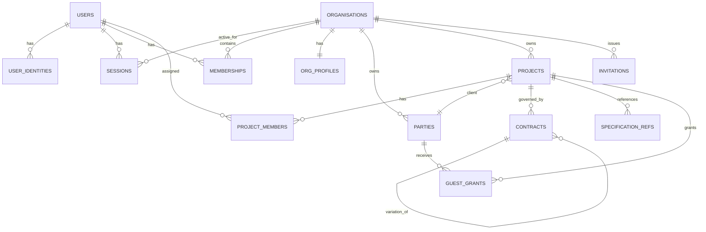
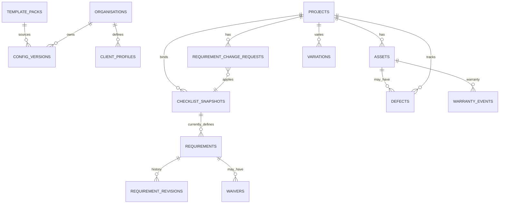
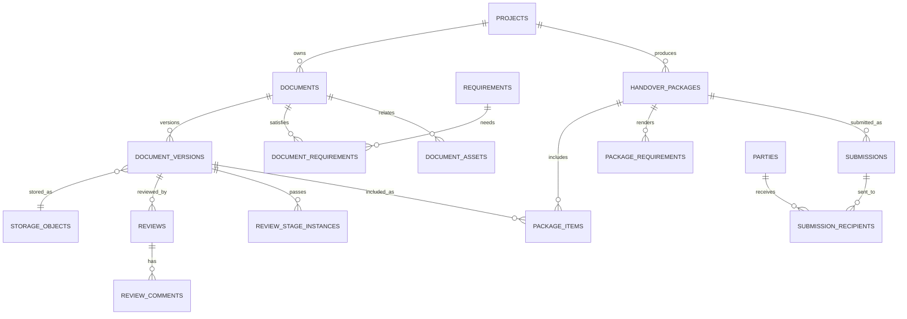
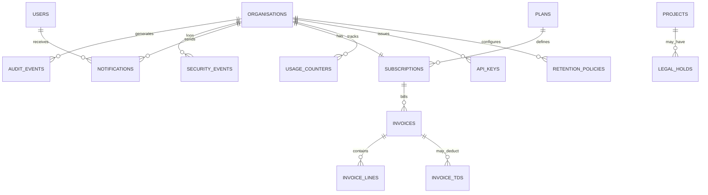

# 08 — Data Model and ERD

**Status:** Draft v0.2 — logical schema; physical migrations to follow
**Database:** PostgreSQL 16+
**Related:** `06` states, `07` configuration, `09` architecture, `13` security
**Change history:** v0.2 applies remediation items AUD-002, AUD-004, AUD-007, AUD-008, AUD-014, AUD-015, AUD-A-03…AUD-A-18 from `TRADECLOSEOUT-AUDIT`.

---

## 1. Principles

1. **Tenant column everywhere.** Every tenant-owned table has `org_id UUID NOT NULL`. Row-Level Security (RLS) enforces isolation.
2. **Project column on every project-scoped child.** Every table that references a project-owned object also carries `project_id`, and composite FKs `(org_id, project_id, …)` prevent cross-project references at the database level.
3. **UUIDv7 primary keys** for time-sortable, non-enumerable IDs.
4. **Immutable evidence.** Document versions, checklist snapshots, reviews, generated packages and audit events are never updated in place (except explicit status transitions).
5. **Soft delete with explicit policy.** `deleted_at` for reversible records; hard purge only via retention jobs.
6. **Money as integers.** `BIGINT` paise; never floating point.
7. **Time in UTC.** `TIMESTAMPTZ`; business rules evaluate in project time zone (`Asia/Kolkata` default).
8. **JSONB only for configuration and flexible metadata**, never for core relational links.
9. **Every mutable row has `row_version`** for optimistic concurrency.
10. **Statuses are text with CHECK constraints**, not PostgreSQL enums, to allow additive changes without locking.
11. **Composite foreign keys** `(org_id, id)` and `(org_id, project_id, id)` prevent cross-tenant and cross-project references.
12. **Definition vs state is separated.** Immutable definition history lives in revision tables; mutable state lives on the current row.

## 2. Naming and common columns

- Tables: plural `snake_case`.
- PK: `id UUID PRIMARY KEY`.
- Tenant: `org_id UUID NOT NULL REFERENCES organisations(id)`.
- Project scope: `project_id UUID NOT NULL` where the table is project-owned.
- Timestamps: `created_at`, `updated_at` `TIMESTAMPTZ NOT NULL DEFAULT now()`.
- Actor: `created_by`, `updated_by` `UUID REFERENCES users(id)`.
- Soft delete: `deleted_at TIMESTAMPTZ`, `deleted_by UUID`.
- Concurrency: `row_version INTEGER NOT NULL DEFAULT 1`.

**Parent tables that are referenced by composite FKs must carry `UNIQUE (org_id, id)` and, where project-scoped, `UNIQUE (org_id, project_id, id)`:** `organisations`, `projects`, `documents`, `document_versions`, `requirements`, `assets`, `handover_packages`, `submissions`, `contracts`.

## 3. Entity catalogue

### 3.1 Identity and tenancy

| Entity | Purpose | Key fields / constraints |
|---|---|---|
| `users` | Global human identity (display only) | `id`, `name`, `status`, `last_login_at`. **Not the login source of truth.** |
| `user_identities` | **Source of truth for login** | `user_id`, `type` (EMAIL/PHONE), `value`, `verified_at`; `UNIQUE(type, value)`; at least one verified row per user |
| `sessions` | Active sessions (opaque hashed tokens) | `user_id`, `token_hash UNIQUE`, `active_org_id UUID?` (nullable until first org created/selected during onboarding; `RT-002`), `expires_at`, `revoked_at`, `ip`, `user_agent`, `created_at` |
| `organisations` | Tenant | `legal_name`, `display_name`, `entity_type`, `status`, `country`, `state`; `UNIQUE(org_id, id)` |
| `org_profiles` | Company details/branding | PK `org_id`; `gstin`, `pan`, `address_json`, `logo_object_id`, `signatory_name`, `signatory_designation`, `brand_color` |
| `memberships` | User ↔ Org role | `org_id`, `user_id`, `role`, `status`, `joined_at`; `UNIQUE(org_id, user_id)` |
| `invitations` | Pending member/guest invites | `org_id`, `email`/`phone`, `role`, `token_hash UNIQUE`, `expires_at`, `status`, `invited_by` |
| `guest_grants` | Project-scoped external access | `org_id`, `project_id`, `party_id`, `user_id?`, `role`, `capabilities TEXT[]`, `scope_json`, `otp_required`, `target_phone_e164?`, `target_email?`, `otp_attempts_count INT DEFAULT 0`, `cooldown_until TIMESTAMPTZ?`, `expires_at`, `status`, `token_hash` (`RT-014`) |
| `delegations` | Temporary authority *(V1 — not in MVP schema)* | `org_id`, `project_id`, `from_user_id`, `to_user_id`, `permission_class`, `starts_at`, `ends_at`, `status` |

> **Identity rule:** `user_identities` is authoritative for authentication. `users.email`/`users.phone_e164` are **derived display columns** maintained by trigger, or may be dropped entirely. A user verifies a second channel by adding a `user_identities` row; the display columns then follow a documented precedence (verified email > verified phone).

### 3.2 Parties and projects

| Entity | Purpose | Key fields / constraints |
|---|---|---|
| `parties` | External counterparty directory | `org_id`, `name`, `types TEXT[]` (CLIENT, MC, CONSULTANT, SUPPLIER_OEM, SUB_SUBCONTRACTOR, LAB, INSURER, OTHER), `gstin`, `email`, `phone`, `address_json`, `status`; index (`org_id`, lower(name)) |
| `projects` | Contractual engagement | `org_id`, `code`, `name`, `client_party_id`, `mc_party_id`, `consultant_party_id`, `status`, `site_json`, `start_date`, `target_handover_date`, `currency`, `settings_json`, `reopen_count`, `purged_at`, `closed_at`, `archived_at`; `UNIQUE(org_id, upper(code))`; `UNIQUE(org_id, id)` |
| `project_members` | Project-scoped roles | `org_id`, `project_id`, `user_id`, `role`, `scope_json`, `status`; `UNIQUE(project_id, user_id)` |
| `contracts` | Commercial instrument (base + variations) | `org_id`, `project_id`, `reference`, `parent_contract_id?`, `type`, `value_paise`, `retention_bps`, `dlp_months`, `start_date`, `end_date`, `status`; `UNIQUE(project_id, reference)` |
| `specification_refs` | Specification/contract references | `org_id`, `project_id`, `contract_id?`, `title`, `issuer`, `revision`, `issue_date`, `object_id?`, `notes` |
| `party_contacts` | Multiple contacts per party | `org_id`, `party_id`, `name`, `email`, `phone`, `designation`, `is_primary` |

> **Multi-contract rule (`AUD-011`):** variations are modelled as `contracts` rows with `parent_contract_id` pointing at the base contract. They contribute requirement additions/overrides at **L4 (project override)** with provenance back to the contract reference (`07` §4.2). There is no multi-L3 resolver.

### 3.3 Configuration and checklist

| Entity | Purpose | Key fields / constraints |
|---|---|---|
| `template_packs` | Platform trade packs | `trade`, `name`, `version`, `schema_version`, `payload_json`, `status`; `UNIQUE(trade, version)` |
| `config_versions` | Versioned configuration at a level | `org_id?`, `level`, `scope_type`, `scope_id` (sentinel UUID `00000000-0000-0000-0000-000000000000` when not scoped), `version_no`, `schema_version`, `payload_json`, `checksum`, `status`, `source_pack_id?`; `UNIQUE(level, scope_type, scope_id, version_no)` |
| `client_profiles` | Reusable client/contract config | `org_id`, `name`, `client_party_id?`, `payload_json`, `status` |
| `checklist_snapshots` | **Immutable** project requirement set | `org_id`, `project_id`, `version_no`, `status`, `resolved_payload_json`, `provenance_json`, `source_json`, `checksum`, `created_by`; `UNIQUE(project_id, version_no)` |
| `requirements` | **Persistent** requirement instance | `org_id`, `project_id`, `current_snapshot_id`, `requirement_key`, `asset_id?` (FK to `assets(org_id, project_id, id)`), `scope_key` (`project` or `asset:{asset_id}`), `milestone_key` (CHECK in 'MOBILISATION','SUBMISSION','DELIVERY','INSTALLATION','COMMISSIONING','HANDOVER','FINAL_BILL','DLP_END'), `group_key`, `title`, `doc_type_key`, `mandatory`, `owner_user_id?`, `owner_party_id?`, `reviewer_role?`, `due_at` (business DATE / 23:59:59 IST), `status`, `validity_rule_json`, `metadata_json`, `superseded_at?`; `UNIQUE(project_id, requirement_key, scope_key) WHERE superseded_at IS NULL`; `UNIQUE(org_id, project_id, id)` (`RT-003`, `RT-008`, `RT-040`) |
| `requirement_revisions` | **Append-only definition history** | `org_id`, `project_id`, `requirement_id`, `snapshot_id`, `change_request_id?`, `field_diff_json`, `reason`, `changed_by`, `effective_from` |
| `requirement_change_requests` | Controlled post-activation changes | `org_id`, `project_id`, `requested_by`, `reason`, `items_json`, `impact_json`, `status`, `approved_by`, `applied_snapshot_id` |
| `waivers` | Waiver / not-applicable decisions | `org_id`, `project_id`, `requirement_id`, `type` (WAIVE/NOT_APPLICABLE), `reason`, `evidence_object_id?`, `approved_by`, `second_approved_by?`, `approved_at`, `status` |

> **One evidence document per requirement in MVP (`AUD-015`).** `evidence_count` has been removed. A requirement is satisfied by exactly one approved `document_version` of the matching `doc_type_key`, or by a `waiver`. Multi-evidence ("warranty **and** O&M **and** spares") is modelled as **separate requirements**. A future `requirement_evidence_slots` table can generalise this in V1 without breaking the model.

> **Asset scoping (`AUD-002`)** uses **only** `requirements.scope_key`. The previous `requirement_assets` join table has been removed. Asset-category requirements are instantiated as one requirement row per matching asset at snapshot creation **and** at asset creation.

> **Snapshot immutability (`AUD-008`):** `checklist_snapshots` and `requirement_revisions` together are the immutable record. Editing a definition field on `requirements` must write a `requirement_revisions` row in the same transaction. Generated packages capture requirement fields in `package_requirements` (see §3.7).

### 3.4 Assets

| Entity | Purpose | Key fields / constraints |
|---|---|---|
| `asset_categories` | Configurable HVAC categories | `org_id?` (null = platform), `key`, `name`, `parent_key`, `metadata_schema_json`; `UNIQUE(org_id, key)` |
| `assets` | Installed equipment | `org_id`, `project_id`, `tag`, `name`, `category_key`, `make`, `model`, `serial_no`, `location`, `capacity_json`, `refrigerant`, `install_date`, `warranty_start`, `warranty_start_basis` (COMMISSIONING/HANDOVER/ACCEPTANCE/SUPPLY), `warranty_end`, `status`, `replaced_by_asset_id?`, `metadata_json`; `UNIQUE(project_id, upper(tag))`; `UNIQUE(org_id, project_id, id)` |
| `asset_relations` | Replacement/grouping links *(V2)* | `org_id`, `project_id`, `from_asset_id`, `to_asset_id`, `relation` (REPLACED_BY, PART_OF, SERVES) |

> `replaced_by_asset_id` on `assets` is sufficient for MVP; `asset_relations` is deferred.

### 3.5 Storage and documents

| Entity | Purpose | Key fields / constraints |
|---|---|---|
| `storage_objects` | Every stored file | `org_id`, `provider`, `bucket`, `object_key`, `mime`, `size_bytes`, `sha256`, `status` (PENDING/READY/QUARANTINED/FAILED/DELETED), `retention_class`, `created_by`; `UNIQUE(provider, bucket, object_key)` |
| `documents` | Logical deliverable | `org_id`, `project_id`, `title`, `doc_type_key`, `category_key`, `status` (ACTIVE/SUPERSEDED/ARCHIVED), `latest_version_id?`, `current_approved_version_id?`, `language`, `metadata_json` (**type-level, stable:** title, category, language, retention class), `retention_class`; index (`project_id`,`status`); `UNIQUE(org_id, project_id, id)` |
| `document_versions` | Immutable file version | `org_id`, `project_id`, `document_id`, `version_no`, `revision_code`, `object_id`, `file_status`, `review_status`, `supersedes_version_id?`, `superseded_at?`, `issue_date`, `expiry_date?`, `validity_basis`, `metadata_json` (**version-level:** revision, issue/expiry date, issuer, accreditation_id, custom fields), `checks_json`, `uploaded_by`, `submitted_at?`; `UNIQUE(document_id, version_no)`; partial unique index on active `(document_id, upper(revision_code))` (`RT-011`) |
| `document_requirements` | Document ↔ requirement links | `org_id`, `project_id`, `document_id`, `requirement_id`; `UNIQUE(document_id, requirement_id)`; FK `(org_id, project_id, document_id)` and `(org_id, project_id, requirement_id)` |
| `document_assets` | Document ↔ asset links | `org_id`, `project_id`, `document_id`, `asset_id`, `is_primary BOOLEAN`; `UNIQUE(document_id, asset_id)`; **exactly one `is_primary = true` per document** (partial unique index); FK to `assets(org_id, project_id, id)` |
| `document_contracts` | Document ↔ contract links | `org_id`, `project_id`, `document_id`, `contract_id`; `UNIQUE(document_id, contract_id)` |
| `document_events` | Lightweight per-document timeline | `org_id`, `project_id`, `document_id`, `event_type`, `payload_json`, `actor_id`, `created_at` |
| `bulk_import_jobs` | In-flight bulk document migrations | `org_id`, `project_id`, `zip_object_id`, `manifest_object_id?`, `status` (UPLOADED/DRY_RUN_READY/PROCESSING/COMPLETED/FAILED), `dry_run_report_json`, `outcome_report_json`, `created_by`, `created_at`, `completed_at`; FK `(org_id, project_id)` to `projects(org_id, id)` (`RT-001`) |
| `custom_field_defs` | Configurable metadata fields *(V1)* | `org_id`, `entity_type`, `key`, `label`, `type`, `options_json`, `required`, `scope_json`; `UNIQUE(org_id, entity_type, key)` |
| `custom_field_values` | Values for custom fields *(V1)* | `org_id`, `field_id`, `entity_id`, `value_json`; `UNIQUE(field_id, entity_id)` |

> **Document/asset relationship (`AUD-A-03`):** `documents.asset_id` has been removed. Use `document_assets.is_primary` for the primary asset and additional rows for secondary assets. Exactly one primary per document is enforced by a partial unique index.

> **Revision codes (`AUD-P-04`):** a soft-deleted version **reserves** its `revision_code`. Re-uploading the same code returns `409 DUPLICATE_REVISION` until the row is purged or the code is changed.

### 3.6 Review and approval

| Entity | Purpose | Key fields / constraints |
|---|---|---|
| `reviews` | Per-reviewer decision record | `org_id`, `project_id`, `document_version_id`, `stage_key`, `reviewer_subject_type` (USER/PARTY), `reviewer_subject_id`, `reviewer_user_id?`, `reviewer_party_id?`, `method` (IN_APP/EXTERNAL), `external_method?` (STAMPED_PDF/EMAIL/PORTAL/PHYSICAL), `external_reference?`, `evidence_object_id?`, `status`, `decision`, `comment`, `due_at`, `decided_at`, `on_behalf_of_user_id?`, `is_override`; CHECK tying `reviewer_subject_type` to `reviewer_user_id`/`reviewer_party_id`; `UNIQUE(document_version_id, stage_key, reviewer_subject_type, reviewer_subject_id)` (`RT-032`) |
| `review_comments` | Page/general comments | `org_id`, `project_id`, `review_id`, `page_no?`, `body`, `visibility` (INTERNAL/EXTERNAL), `created_by` |
| `review_stage_instances` | Multi-stage workflow state *(V1)* | `org_id`, `project_id`, `document_version_id`, `stage_key`, `status`, `started_at`, `completed_at` |
| `approval_overrides` | Admin override records | `org_id`, `project_id`, `review_id`, `actor_id`, `reason`, `previous_decision`, `new_decision` |

> **External approval (`AUD-010`, `D-036`)** is a first-class review method. `method = EXTERNAL` records how the consultant/main contractor actually approved (stamped PDF, email, portal transmittal, physical), with an optional evidence file. It satisfies the requirement and is labelled distinctly in the UI and package index.

> **Reviewer uniqueness (`AUD-A-07`):** `reviewer_subject_type` + `reviewer_subject_id` gives exactly one decision per reviewer per stage per version, whether the reviewer is an internal user or an external party.

### 3.7 Handover and submissions

| Entity | Purpose | Key fields / constraints |
|---|---|---|
| `handover_packages` | Generated package | `org_id`, `project_id`, `version_no`, `status`, `scope_json`, `snapshot_id`, `snapshot_checksum`, `pdf_object_id?`, `zip_object_id?`, `manifest_object_id?`, `checksum`, `requested_by`, `error_code?`, `error_detail?`; `UNIQUE(project_id, version_no)`; `UNIQUE(org_id, project_id, id)` |
| `package_items` | Contents and ordering | `org_id`, `project_id`, `package_id`, `document_version_id`, `section_key`, `sort_order`, `page_start`, `page_end`, `included`, `exclusion_reason?`; FK `(org_id, project_id, document_version_id)` **enforces same-project contents** |
| `package_requirements` | Requirement fields rendered into the index at generation time | `org_id`, `project_id`, `package_id`, `requirement_id`, `requirement_key`, `scope_key`, `title`, `doc_type_key`, `mandatory`, `status_at_generation`, `due_at_at_generation`, `asset_tag`, `decision`, `decided_by`, `decided_at`, `decision_method` |
| `submissions` | Sending package to external party | `org_id`, `project_id`, `package_id?`, `method`, `reference`, `status` (SUBMITTED/PARTIALLY_ACCEPTED/ACCEPTED/REJECTED), `sent_at`, `acknowledged_at`, `decided_at`, `notes`; `UNIQUE(org_id, project_id, id)` (`RT-007`) |
| `submission_recipients` | **Multi-recipient** submissions | `org_id`, `project_id`, `submission_id`, `recipient_party_id`, `recipient_role` (CLIENT/MC/CONSULTANT/OTHER), `is_required_approver BOOLEAN DEFAULT true`, `status`, `decided_at`, `decision` (`RT-007`) |
| `submission_events` | Status timeline | `org_id`, `project_id`, `submission_id`, `event_type`, `payload_json`, `actor_id`, `created_at` |
| `package_layouts` | Configurable layouts | `org_id`, `key`, `name`, `payload_json`, `status` |

> **Multi-recipient submissions (`AUD-020`)**: a handover normally goes to the client, main contractor and consultant simultaneously. `submission_recipients` models this; `submissions` remains the single sending event.

### 3.8 Notifications, audit, jobs

| Entity | Purpose | Key fields / constraints |
|---|---|---|
| `notification_templates` | Localisable templates | `org_id?`, `key`, `channel`, `locale`, `subject`, `body`, `status`; `UNIQUE(org_id, key, channel, locale)` |
| `notifications` | Delivery records | `org_id`, `recipient_user_id?`, `recipient_party_id?`, `channel` (IN_APP/EMAIL/SMS/WHATSAPP), `event_key`, `payload_json`, `status`, `dedup_key`, `sent_at`, `error`; `UNIQUE(org_id, dedup_key, channel, COALESCE(recipient_user_id, recipient_party_id))` |
| `notification_preferences` | Per-user settings | `org_id`, `user_id`, `category`, `channel`, `enabled`, `digest` |
| `audit_events` | Append-only business audit | `id`, `org_id?`, `project_id?`, `actor_type`, `actor_user_id?`, `action`, `entity_type`, `entity_id`, `before_json`, `after_json`, `ip`, `user_agent`, `request_id`, `prev_hash`, `hash`, `created_at`; monthly partitions |
| `security_events` | Auth/access/security log (**separate from business audit**, `AUD-S-30`) | `id`, `org_id?`, `actor_user_id?`, `event_type`, `ip`, `user_agent`, `request_id`, `created_at`; 180-day minimum retention |
| `admin_audit_events` | Platform staff actions | Same shape as `audit_events`, separate stream |
| `job_executions` | Background job outcomes | `org_id?`, `job_type`, `job_id`, `status`, `attempts`, `started_at`, `finished_at`, `error` |
| `idempotency_keys` | Request deduplication | `org_id`, `key`, `endpoint`, `request_hash`, `response_json`, `expires_at`; `UNIQUE(org_id, key, endpoint)` |

> **Audit hash chain (`AUD-S-29`):** `prev_hash`/`hash` columns are present from day one; the chain is computed asynchronously in a worker (`D-024`) and verified by a scheduled job. Redaction rules (`AUD-S-31`) apply before writing `before_json`/`after_json`.

### 3.9 Search *(V1 — not in MVP schema)*

| Entity | Purpose | Key fields |
|---|---|---|
| `document_search` | Full-text index | `org_id`, `project_id`, `document_version_id`, `content TSVECTOR`, `metadata JSONB`; GIN indexes; partitioned by `org_id` |

### 3.10 Billing

| Entity | Purpose | Key fields / constraints |
|---|---|---|
| `plans` | Product plans | `code`, `name`, `limits_json`, `price_paise`, `interval`, `status`. `limits_json` shape: `{"maxActiveProjects":int,"maxSeats":int,"maxStorageBytes":bigint,"maxPackageGenerationsPerMonth":int}` |
| `subscriptions` | Org subscription | `org_id`, `plan_id`, `status`, `provider`, `provider_ref`, `current_period_start`, `current_period_end`, `cancel_at` |
| `invoices` | GST invoices | `org_id`, `number UNIQUE`, `status`, `subtotal_paise`, `tax_paise`, `total_paise`, `tax_rate_bps`, `sac`, `place_of_supply`, `irn?`, `qr_payload?`, `einvoice_status`, `issued_at`, `paid_at`, `pdf_object_id` |
| `invoice_lines` | Line items | `invoice_id`, `description`, `quantity`, `unit_paise`, `tax_rate_bps`, `amount_paise` |
| `invoice_tds` | Customer TDS deductions (`AUD-013`) | `org_id`, `invoice_id`, `section`, `rate_bps`, `amount_paise`, `certificate_reference?` (nullable at deduction time, quarterly Form 16A uploaded later), `status` (DEDUCTED_PENDING_CERT/CERT_UPLOADED/RECONCILED), `deducted_at` (`RT-030`) |
| `payment_events` | Gateway webhooks | `org_id`, `provider`, `event_id UNIQUE`, `type`, `payload_json`, `processed_at` |
| `usage_counters` | Plan enforcement | `org_id`, `metric`, `period`, `value`; `UNIQUE(org_id, metric, period)`; **rows are locked `FOR UPDATE` inside the transaction that consumes them** (`AUD-A-08`) |
| `credit_notes` | Refunds/adjustments | `org_id`, `invoice_id`, `number UNIQUE`, `amount_paise`, `reason`, `approved_by` |

> **E-invoicing (`AUD-013`):** `irn`, `qr_payload` and `einvoice_status` are present but **inactive until a CA confirms applicability** (`SOURCES-VERIFICATION.md` SRC-008, SRC-033). The system must never claim statutory compliance.

### 3.11 Warranty, defects and variations

| Entity | Purpose | Key fields / constraints |
|---|---|---|
| `warranty_events` | OEM warranty registration and start-date reconciliation (`AUD-D-03`) | `org_id`, `project_id`, `asset_id`, `event_type` (REGISTRATION/CONFIRMATION/CLAIM/EXTENSION), `oem_reference`, `registered_at`, `warranty_start`, `warranty_end`, `basis`, `evidence_object_id`, `notes` |
| `defects` | Snag/DLP items (`AUD-D-04`) | `org_id`, `project_id`, `asset_id?`, `requirement_id?`, `title`, `description`, `severity`, `raised_by`, `raised_at`, `due_at`, `status` (OPEN/IN_PROGRESS/RECTIFIED/CLOSED/WAIVED), `closure_evidence_object_id?`, `closed_at`, `closed_by` |
| `variations` | Variation orders (`AUD-011`) | `org_id`, `project_id`, `contract_id`, `reference`, `description`, `value_paise_delta`, `time_days_delta`, `status`, `approved_by`, `approved_at`, `change_request_id?` |

### 3.12 Integrations and retention *(webhook tables are V2)*

| Entity | Purpose | Key fields |
|---|---|---|
| `api_keys` | Scoped API tokens *(V2)* | `org_id`, `name`, `token_hash`, `scopes TEXT[]`, `expires_at`, `last_used_at`, `revoked_at` |
| `webhook_endpoints` | Outbound webhooks *(V2)* | `org_id`, `url`, `secret_hash`, `events TEXT[]`, `status` |
| `webhook_deliveries` | Delivery attempts *(V2)* | `org_id`, `endpoint_id`, `event_id`, `status`, `attempts`, `response_code`, `next_retry_at` |
| `retention_policies` | Retention rules | `org_id?`, `code`, `entity_type`, `retention_months`, `basis`, `status` |
| `legal_holds` | Prevent deletion | `org_id`, `project_id`, `reason`, `created_by`, `released_at` |
| `deletion_requests` | DSR workflow | `org_id`, `subject_type`, `subject_id`, `status`, `requested_at`, `acknowledged_at`, `completed_at`, `owner_user_id` |

> `documents.retention_class` is a **policy code** resolved at purge time against `retention_policies.code` (`AUD-A-12`).

## 4. ER diagrams

### 4.1 Tenancy and projects



### 4.2 Configuration and requirements



### 4.3 Documents, reviews and packages



### 4.4 Audit, notifications and billing



## 5. Key DDL patterns

### 5.1 Tenant + project-scoped table template

```sql
CREATE EXTENSION IF NOT EXISTS citext;   -- AUD-A-15

-- 1. Role separation so RLS is never bypassed at runtime (RT-005)
-- Run migrations as `tc_migrator` (table owner); run API/Workers as `tc_app`:
-- CREATE ROLE tc_app LOGIN PASSWORD '...' NOSUPERUSER NOCREATEDB NOCREATEROLE NOBYPASSRLS;

CREATE TABLE documents (
  id              UUID PRIMARY KEY,                 -- UUIDv7
  org_id          UUID NOT NULL REFERENCES organisations(id),
  project_id      UUID NOT NULL,
  title           TEXT NOT NULL CHECK (char_length(title) BETWEEN 1 AND 300),
  doc_type_key    TEXT NOT NULL,
  status          TEXT NOT NULL DEFAULT 'ACTIVE'
                    CHECK (status IN ('ACTIVE','SUPERSEDED','ARCHIVED')),
  latest_version_id UUID,
  current_approved_version_id UUID,
  language        TEXT NOT NULL DEFAULT 'en',
  metadata_json   JSONB NOT NULL DEFAULT '{}'::jsonb,
  retention_class TEXT NOT NULL DEFAULT 'PROJECT_PLUS_8Y',
  row_version     INTEGER NOT NULL DEFAULT 1,
  created_at      TIMESTAMPTZ NOT NULL DEFAULT now(),
  created_by      UUID NOT NULL REFERENCES users(id),
  updated_at      TIMESTAMPTZ NOT NULL DEFAULT now(),
  deleted_at      TIMESTAMPTZ,
  deleted_by      UUID,
  FOREIGN KEY (org_id, project_id) REFERENCES projects(org_id, id)
);
CREATE INDEX documents_project_status_idx
  ON documents (org_id, project_id, status) WHERE deleted_at IS NULL;
```

Parents referenced by composite FKs enforce exact parent composite unique constraints (fixed: no circular self-FKs, no non-existent columns; `RT-003`):

```sql
ALTER TABLE projects          ADD CONSTRAINT projects_org_id_id_uq          UNIQUE (org_id, id);
ALTER TABLE contracts         ADD CONSTRAINT contracts_org_proj_id_uq       UNIQUE (org_id, project_id, id);
ALTER TABLE checklist_snapshots ADD CONSTRAINT snaps_org_proj_id_uq         UNIQUE (org_id, project_id, id);
ALTER TABLE assets            ADD CONSTRAINT assets_org_proj_id_uq          UNIQUE (org_id, project_id, id);
ALTER TABLE requirements      ADD CONSTRAINT requirements_org_proj_id_uq    UNIQUE (org_id, project_id, id);
ALTER TABLE documents         ADD CONSTRAINT documents_org_proj_id_uq       UNIQUE (org_id, project_id, id);
ALTER TABLE document_versions ADD CONSTRAINT doc_versions_org_proj_id_uq    UNIQUE (org_id, project_id, id);
ALTER TABLE handover_packages ADD CONSTRAINT packages_org_proj_id_uq        UNIQUE (org_id, project_id, id);
ALTER TABLE submissions       ADD CONSTRAINT submissions_org_proj_id_uq     UNIQUE (org_id, project_id, id);
```

### 5.2 Row-Level Security

```sql
-- Forced Row-Level Security on every tenant table (RT-005)
ALTER TABLE documents ENABLE ROW LEVEL SECURITY;
ALTER TABLE documents FORCE ROW LEVEL SECURITY;

CREATE POLICY documents_tenant_isolation ON documents
  AS PERMISSIVE FOR ALL TO tc_app
  USING (org_id = NULLIF(current_setting('app.current_org', true), '')::uuid)
  WITH CHECK (org_id = NULLIF(current_setting('app.current_org', true), '')::uuid);
```

Session setup (transaction-local, never pooled across requests):

```sql
BEGIN;
SET LOCAL app.current_org = '...';
SET LOCAL app.current_user = '...';
-- queries
COMMIT;
```

RLS is defence in depth. Application queries must still include `org_id` **and** `project_id`, and all data access must go through a repository layer that injects both from the request context (`AUD-S-03`). If `app.current_org` is unset, `current_setting(..., true)` returns `NULL` and the policy yields zero rows — **fail closed**, which is the intended behaviour (`AUD-035`).

### 5.3 Current approved version per document

`latest_version_id` is the most recent upload in any review state. `current_approved_version_id` is the version that satisfies linked requirements. A new upload does not displace an approved version.

```sql
CREATE UNIQUE INDEX document_versions_one_approved_current
  ON document_versions (document_id)
  WHERE deleted_at IS NULL
    AND review_status = 'APPROVED'
    AND superseded_at IS NULL;

-- Active revision code unique index (RT-011: soft-deleted/withdrawn/failed versions do not burn revision codes)
CREATE UNIQUE INDEX document_versions_rev_code_active_uq
  ON document_versions (document_id, upper(revision_code))
  WHERE deleted_at IS NULL
    AND file_status NOT IN ('FAILED', 'QUARANTINED')
    AND review_status <> 'WITHDRAWN';

CREATE INDEX document_versions_latest
  ON document_versions (document_id, version_no DESC);
```

**Approval transaction (`AUD-007`):**

```sql
SELECT * FROM documents WHERE org_id = $1 AND project_id = $2 AND id = $3 FOR UPDATE;
-- then, in the same transaction:
--   1. set prior approved version.superseded_at = now()
--   2. set this version.review_status = 'APPROVED'
--   3. set documents.current_approved_version_id = this version
--   4. update the requirement state
--   5. write audit_events
```

**Business rule (`06` §3.8):** only the version that is the **most recently submitted** for review may be approved. Approving a superseded or older-submitted version returns `409 INVALID_STATE_TRANSITION`.

### 5.4 Requirement identity and definition history

Requirements are **project-level rows**, not duplicated per snapshot. Each row references the `current_snapshot_id` that currently defines it. Historical definitions are preserved in `checklist_snapshots.resolved_payload_json` **and** in `requirement_revisions`.

```sql
ALTER TABLE requirements
  ADD COLUMN scope_key TEXT NOT NULL DEFAULT 'project'
    CHECK (scope_key = 'project' OR scope_key LIKE 'asset:%'),
  ADD COLUMN asset_id UUID,
  ADD COLUMN milestone_key TEXT NOT NULL DEFAULT 'HANDOVER'
    CHECK (milestone_key IN (
      'MOBILISATION','SUBMISSION','DELIVERY','INSTALLATION',
      'COMMISSIONING','HANDOVER','FINAL_BILL','DLP_END'
    )),
  ADD CONSTRAINT requirements_asset_same_project_fk
    FOREIGN KEY (org_id, project_id, asset_id) REFERENCES assets(org_id, project_id, id)
    ON DELETE RESTRICT,
  ADD CONSTRAINT requirements_scope_key_consistency_chk
    CHECK (
      (asset_id IS NULL AND scope_key = 'project') OR
      (asset_id IS NOT NULL AND scope_key = ('asset:' || asset_id::text))
    );

CREATE UNIQUE INDEX requirements_stable_key_uq
  ON requirements (project_id, requirement_key, scope_key)
  WHERE superseded_at IS NULL;

-- Definition edits must write history (enforced by repository layer + trigger):
CREATE TABLE requirement_revisions (
  id UUID PRIMARY KEY,
  org_id UUID NOT NULL REFERENCES organisations(id),
  project_id UUID NOT NULL,
  requirement_id UUID NOT NULL REFERENCES requirements(id),
  snapshot_id UUID NOT NULL REFERENCES checklist_snapshots(id),
  change_request_id UUID REFERENCES requirement_change_requests(id),
  field_diff_json JSONB NOT NULL,
  reason TEXT NOT NULL,
  changed_by UUID NOT NULL REFERENCES users(id),
  effective_from TIMESTAMPTZ NOT NULL DEFAULT now()
);
```

`checklist_snapshots` stores the full resolved requirement set for audit and regeneration; `requirements` stores the current state; `requirement_revisions` stores every definition change.

### 5.5 Cross-project integrity

```sql
ALTER TABLE package_items ADD COLUMN project_id UUID NOT NULL;
ALTER TABLE package_items
  ADD CONSTRAINT package_items_same_project_fk
  FOREIGN KEY (org_id, project_id, package_id) REFERENCES handover_packages(org_id, project_id, id),
  ADD CONSTRAINT package_items_version_same_project_fk
  FOREIGN KEY (org_id, project_id, document_version_id) REFERENCES document_versions(org_id, project_id, id);

ALTER TABLE document_requirements ADD COLUMN project_id UUID NOT NULL;
ALTER TABLE document_requirements
  ADD CONSTRAINT dr_document_same_project_fk
  FOREIGN KEY (org_id, project_id, document_id) REFERENCES documents(org_id, project_id, id),
  ADD CONSTRAINT dr_requirement_same_project_fk
  FOREIGN KEY (org_id, project_id, requirement_id) REFERENCES requirements(org_id, project_id, id);
```

A cross-project insert now fails at the database, not only in application code (`AUD-004`).

### 5.6 Audit partitioning and hash chain

```sql
CREATE TABLE audit_events (
  id UUID NOT NULL,
  org_id UUID, project_id UUID,
  actor_type TEXT NOT NULL, actor_user_id UUID,
  action TEXT NOT NULL, entity_type TEXT NOT NULL, entity_id UUID,
  before_json JSONB, after_json JSONB,
  ip INET, user_agent TEXT, request_id TEXT,
  prev_hash TEXT, hash TEXT,
  created_at TIMESTAMPTZ NOT NULL DEFAULT now()
) PARTITION BY RANGE (created_at);
```

A scheduled job creates monthly partitions ahead of time and drops partitions past retention. `hash = sha256(prev_hash || canonical_json(row_without_hash))`, computed by the audit writer.

## 6. Indexing strategy

| Query pattern | Index |
|---|---|
| Project dashboard counts | `requirements (org_id, project_id, status)` |
| Missing/overdue | `requirements (org_id, project_id, due_at) WHERE status NOT IN ('APPROVED','WAIVED','NOT_APPLICABLE') AND due_at IS NOT NULL` |
| Review queue | `reviews (org_id, reviewer_subject_id, status, due_at)` |
| Document by asset | `document_assets (org_id, project_id, asset_id)` |
| Version lookup | `document_versions (org_id, project_id, document_id, version_no DESC)` |
| Duplicate detection (project) | `document_versions (org_id, project_id, object_id)`; `storage_objects (org_id, sha256)` |
| Duplicate detection (org) | `storage_objects (org_id, sha256)` for cross-project warning |
| Audit by entity | `audit_events (org_id, entity_type, entity_id, created_at DESC)` |
| Audit by project | `audit_events (org_id, project_id, created_at DESC)` |
| Security log | `security_events (org_id, actor_user_id, created_at DESC)` |
| Notifications dedup | `notifications (org_id, dedup_key, channel, COALESCE(recipient_user_id, recipient_party_id))` (`AUD-A-06`) |
| Search *(V1)* | GIN on `document_search.content`, metadata JSONB |
| Asset tag | `assets (project_id, upper(tag))` |
| Party lookup | `parties (org_id, lower(name))`, `parties (org_id, gstin)` |
| Defects by due date | `defects (org_id, project_id, due_at) WHERE status NOT IN ('CLOSED','WAIVED')` |

## 7. Soft delete and retention

| Entity | Delete behaviour | Purge |
|---|---|---|
| Document | Soft delete → trash 30 days → restore or purge | Retention policy |
| Document version | Never deleted while current; revision code reserved | With document |
| Asset | Soft delete if no approved docs; otherwise retire | With project |
| Party | Soft delete; referenced parties remain | With org |
| Project | Archive; purge only after retention and with legal-hold check | Org deletion |
| Requirement | `superseded_at` set; never hard-deleted before project purge | Project purge |
| Audit event | Never deleted by customer | Retention partition drop |
| Security event | Never deleted by customer | 180-day minimum |
| Notification | 90-day purge | Automatic |
| Session | 30-day purge | Automatic |
| Storage object | Marked deleted; bytes purged after grace | Job |

Default retention (configurable, `13` §14):

- Project documents and audit: closure + 8 years.
- Generated packages: closure + 3 years.
- Billing records: 8 years.
- Security events: 365 days (1 year per DPDP Rules 2025 Rule 8; `RT-027`).
- Notifications and job logs: 90 days.
- Soft-deleted items: 30 days.
- Backups: 35 days.

## 8. Data integrity rules

Each rule is expressed as a CHECK constraint, trigger or transaction rule, and each has a test in `14` §11 (`AUD-T-07`).

1. A `document_version` cannot be `APPROVED` unless `file_status = 'READY'`.
   `CHECK (review_status <> 'APPROVED' OR file_status = 'READY')`
2. A `review` cannot be `APPROVED` if the reviewer is the uploader, unless `is_override = true`.
3. A `waiver` requires `approved_by`, a non-empty `reason`, and a `second_approved_by` when the requirement is `mandatory`.
4. A `package_item` must reference a version in the same `org_id` **and `project_id`** as the package (FK, §5.5).
5. A `submission` recipient must be a Party in the same org (FK on `submission_recipients`).
6. A `guest_grant` must reference a Party and a Project in the same org.
7. A `requirement` must belong to the snapshot of the same project (FK).
8. A `package` cannot become `READY` without at least one item and a stored PDF **or** ZIP, and all referenced objects must exist (pre-flight HEAD).
9. A `project` cannot become `ACTIVE` without an active snapshot and at least one manager.
10. A `project` cannot become `CLOSED` without an accepted submission **or** an explicit override with reason.
11. Money fields are non-negative; `retention_bps` is 0–10000.
12. `valid_until >= valid_from` when both present; `expiry_date >= issue_date`.
13. `requirements.due_at IS NULL` ⇒ the requirement is never `MISSING`.
14. `document_assets` has exactly one `is_primary = true` per document.
15. A soft-deleted `document_versions` row reserves its `revision_code`.
16. `storage_objects.sha256` is non-null once `status = 'READY'`.
17. `handover_packages.snapshot_checksum` is non-null once `status <> 'DRAFT'`.
18. `requirements.scope_key LIKE 'asset:%'` ⇒ the referenced asset belongs to the same project.

## 9. Multi-tenancy and referential integrity

- Composite FKs for all parent-child relations: `(org_id, project_id)`, `(org_id, project_id, id)`.
- `UNIQUE (org_id, id)` and `UNIQUE (org_id, project_id, id)` on every referenced parent.
- Never allow a child row to reference a parent from another org **or another project**, even if the UUID is known.
- Storage keys: `org/{org_id}/project/{project_id}/doc/{document_id}/v{version_no}/{uuid}`.
- Package keys: `org/{org_id}/project/{project_id}/packages/{package_id}/`.
- RLS enabled on all tables containing `org_id`; `users`, `user_identities`, `template_packs`, `plans` are global.

## 10. Entity lifecycle summary

| Entity | Created | Active | Terminal |
|---|---|---|---|
| Project | Draft | Active / Suspended / Handover | Closed / Cancelled / Archived / Purged |
| Requirement | Snapshot creation | Requested/Uploaded/In review | Approved / Waived / N/A / Handed over / Superseded |
| Document | First upload | Active | Superseded / Archived / Deleted |
| Version | Upload | Processing/Ready/In review | Approved / Rejected / Superseded |
| Review | Submit | In review | Approved / Changes requested / Rejected / Cancelled |
| Package | Request | Queued/Generating/Ready/Submitted | Accepted / Rejected / Superseded |
| Submission | Created | Sent/Acknowledged | Accepted / Rejected / Withdrawn |
| Defect | Raised | In progress | Rectified / Closed / Waived |

## 11. Scope by phase

| Table group | MVP | V1 | V2 |
|---|---|---|---|
| Identity, org, parties, projects, contracts, assets, documents, versions, reviews, packages, submissions, audit, notifications, billing | ✅ | | |
| `requirement_revisions`, `package_requirements`, `submission_recipients`, `defects`, `warranty_events`, `variations`, `security_events`, `invoice_tds` | ✅ (required by remediation) | | |
| `delegations`, `custom_field_*`, `review_stage_instances`, `document_search` | | ✅ | |
| `api_keys`, `webhook_*`, `asset_relations` | | | ✅ |

## 12. Open schema questions

| ID | Question | Proposed |
|---|---|---|
| Q-021 | One primary asset per document, or many? | One primary + optional secondary links — **resolved** |
| Q-022 | Approvals on versions or documents? | Versions — **resolved** |
| Q-023 | Store rendered package pages or source versions? | Source versions + generated PDF; `package_requirements` captures rendered fields — **resolved** |
| Q-024 | Hash chain from day one? | Yes, computed asynchronously — **resolved** |
| Q-025 | Materialised satisfaction table? | Derive first; cache later — **open** |
| Q-035 | Should `document_search` partition by org or date? | By org when V1 ships — **open** |

## 13. Version log

| Version | Date | Change |
|---|---|---|
| 0.1 | 2026-10-31 | Initial logical data model |
| 0.2 | 2026-10-31 | Remediation of AUD-002/004/007/008/014/015 and AUD-A-03…A-18; added warranty/defect/variation/security entities; one evidence per requirement; cross-project FKs; external review method; multi-recipient submissions |
