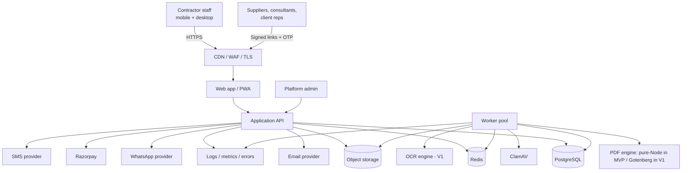
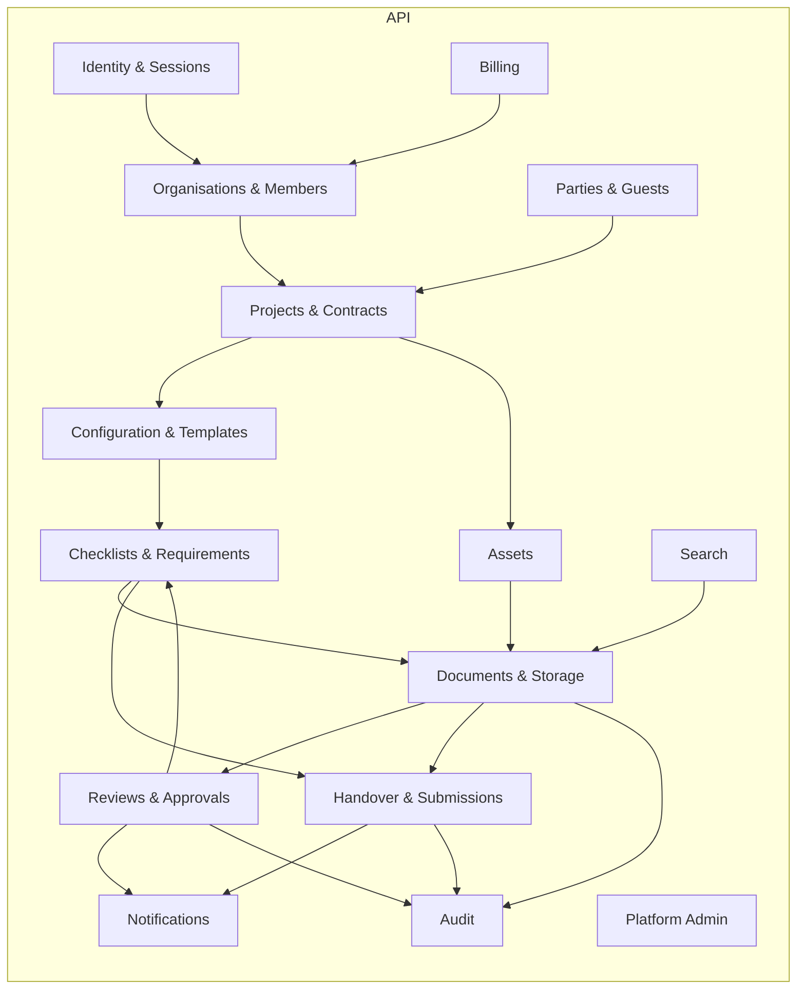
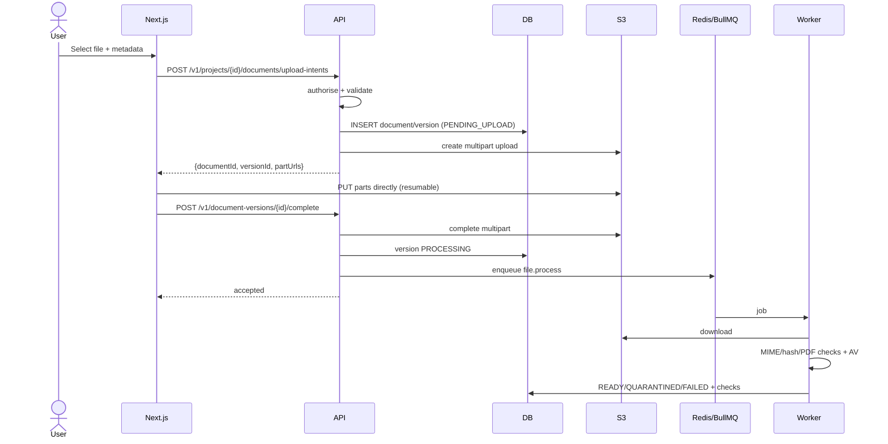
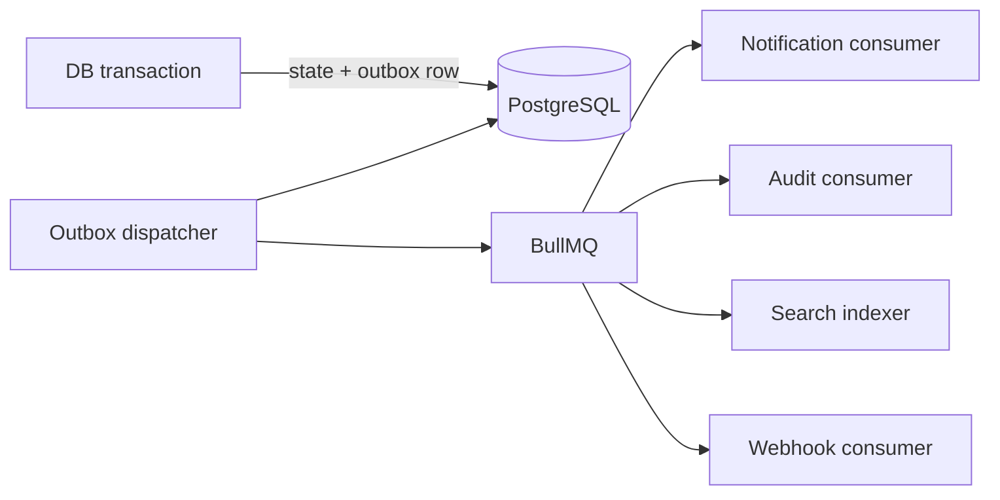
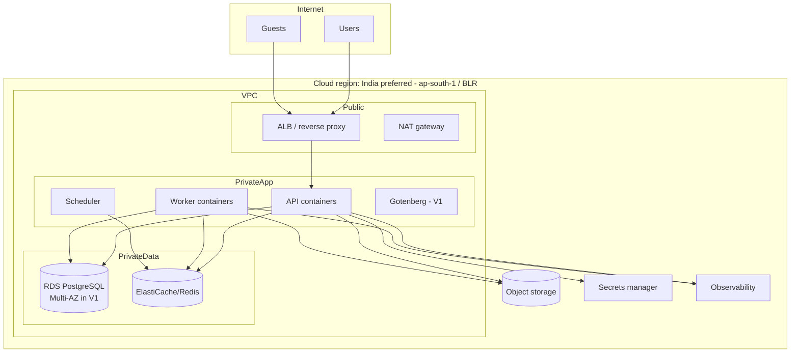
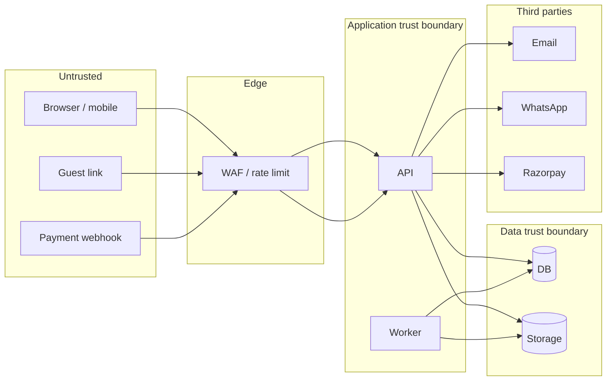

# 09 — System Architecture

**Status:** Draft v0.2
**Change history:** v0.2 applies AUD-006 (PDF injection), AUD-001 (SMS), AUD-A-01 (deployment target), AUD-A-02 (rejection wording), and the PDF-only MVP option (AUD-A-33 mitigation).
**Style:** Modular monolith + asynchronous workers
**Related:** `08` data model, `10` API, `13` security, `15` operations

---

## 1. Architectural drivers

| Driver | Implication |
|---|---|
| Solo developer initially | One deployable, one database, minimal moving parts |
| Document-heavy, long-running jobs | Durable queue and object storage, not app-server disk |
| Strict tenant isolation | RLS + app-level scoping + private storage |
| Immutable evidence | Append-only versions, snapshots, packages, audit |
| Low-bandwidth users | Direct-to-storage uploads, resumable, CDN previews |
| Variable load | Queue-based scaling; package generation isolated |
| Indian customers | India-region hosting preferred; INR billing; IST |
| Future trades | Config-driven, not code-per-trade |

**Decision D-001:** Start with a modular monolith, not microservices. Split only when a measured bottleneck or reliability requirement demands it.

**Decision D-002:** Use a single PostgreSQL primary for transactional data; use object storage for files. Do not store large blobs in the database.

## 2. System context



## 3. Container architecture

```mermaid
flowchart TB
  subgraph Client
    PWA[Next.js PWA<br/>server components + client islands]
  end
  subgraph Edge
    CDN[CDN + WAF + rate limit]
  end
  subgraph Application
    API[API container<br/>NestJS modular monolith]
    WORK[Worker container<br/>BullMQ processors]
    SCHED[Scheduler<br/>cron / repeatable jobs]
  end
  subgraph Data
    PG[(PostgreSQL 16<br/>RLS + PITR)]
    RDS[(Redis 7<br/>queues + cache)]
    S3[(S3-compatible object storage<br/>private buckets)]
  end
  subgraph Processing
    GOT[Gotenberg - V1<br/>HTML/DOCX → PDF]
    QPDF[qpdf / pdf-lib (MVP)<br/>merge, validate, bookmarks, cover/TOC]
    CLAM[ClamAV]
    TESS[Tesseract OCR]
  end
  subgraph ThirdParty
    SES[Email]
    SMS2[SMS provider]
    WAPI[WhatsApp]
    RAZOR[Razorpay]
  end
  PWA --> CDN --> API
  API --> PG
  API --> RDS
  API --> S3
  API --> SES
  API --> SMS2
  API --> WAPI
  API --> RAZOR
  API --> WORK
  SCHED --> RDS
  WORK --> PG
  WORK --> S3
  WORK --> GOT
  WORK --> QPDF
  WORK --> CLAM
  WORK --> TESS
```

| Component | Responsibility | Scaling |
|---|---|---|
| Web (Next.js) | UI, routing, server-side session read, PWA shell | Stateless, CDN-cacheable static assets |
| API (NestJS) | Auth, authorisation, CRUD, transactions, presigned URLs, webhooks | Horizontal behind ALB |
| Worker | File validation/scan, thumbnails, OCR, PDF conversion, packages, notifications, reminders, retention | Separate pool; concurrency per queue |
| Scheduler | Repeatable jobs (reminders, expiry, billing sync, purge) | Single leader via Redis lock |
| PostgreSQL | Source of truth, RLS, audit, search | Vertical + read replica; partition audit |
| Redis | Queues, short-lived cache, rate limits, locks | Managed instance |
| Object storage | Files, previews, packages | Provider-managed |
| Pure-Node PDF (MVP) | PDF merge, sanitisation, bookmarks, cover/TOC (RT-025) | In-worker via pdf-lib + qpdf (no Gotenberg container in MVP) |
| Gotenberg (V1) | DOCX/XLSX/HTML → PDF; HTML templates (deferred to V1, RT-025) | Separate container in V1; CPU-heavy |
| ClamAV | Malware scanning | Sidecar/worker |
| Tesseract | OCR (V2) | Worker-only |

## 4. Module boundaries (modular monolith)



Rules:

1. Each module owns its tables; no module reads another's tables directly.
2. Synchronous calls use module services/interfaces; cross-module side effects use domain events via an outbox.
3. Shared kernel: IDs, money, time, result types, authorisation context.
4. No circular dependencies; enforce with lint rules.
5. The audit module subscribes to domain events; business modules do not write audit tables directly (except critical security events through the audit service).

## 5. Request and data flow

### 5.1 Upload flow (direct-to-storage)



Why direct upload: avoids proxying large files through Node, reduces memory pressure, supports resumability, and keeps the API stateless.

### 5.2 Transactional outbox

Domain events (`DocumentApproved`, `PackageReady`, `RequirementChanged`) are written to `outbox_events` in the same transaction as the state change. A dispatcher publishes to BullMQ/Redis and marks dispatched. Consumers are idempotent by event ID.



This prevents "state committed but notification lost" and "notification sent but state rolled back".

### 5.3 Package generation (RT-006, RT-025, RT-034)

**Output escaping and asset safety (`AUD-006`, `D-037`, `RT-006`) are mandatory:**
- Every user-controlled value (project name, client name, asset tag, requirement title, remarks, custom fields, reviewer comments, filenames) is strictly text-sanitised.
- **SVG Upload Ban (`RT-006`):** Branding logos must be raster images only (`image/png`, `image/jpeg`, `image/webp`). SVG is strictly banned to eliminate SSRF, Local File Inclusion (LFI), and XML Entity (XXE) vulnerabilities.
- **Pure-Node PDF Generation in MVP (`RT-025`):** To avoid Gotenberg/Chromium vulnerabilities and 1.5 GB memory overhead, MVP generates cover pages and table-of-contents indices using pure-Node `pdfmake` and `pdf-lib`. (Gotenberg/headless Chrome is deferred to post-MVP custom HTML template rendering).

**Generation pipeline:**
1. API validates permission and scope; creates `handover_packages` row (`QUEUED`) with an immutable snapshot of selected version IDs in `package_items`.
2. Worker acquires a per-package lock; downloads versions; validates checksums.
3. Renders cover page, index, and approval summary via pure Node.js (`pdfmake`/`pdf-lib`).
4. **Decompression Bomb Protection (`RT-034`):** Worker runs `qpdf` pre-checks under a 512 MB memory limit; rejects any submittal PDF exceeding 1,000 pages or 25,000 objects. Normalises PDF structure and removes active JavaScript, embedded launch actions, and unrecognised annotations.
5. Merges normalised PDFs with `pdf-lib`, inserts visual page bookmarks, and stamps running page numbers.
6. Renders requirement snapshot metadata captured at generation time (`package_requirements`) so the index cannot drift from the snapshot (`AUD-008`).
7. Builds ZIP + manifest + checksums; uploads to storage.
8. Updates package `READY`; emits event.

Failure at any step → `FAILED` with `error_code`/`error_detail`; no partial `READY`.

## 6. Deployment architecture



### 6.1 MVP hosting (cost-conscious)

| Concern | Choice | Rationale |
|---|---|---|
| Compute | **Single VM + Docker Compose** (1× API, 1× worker, 1× ClamAV sidecar) on 8 GB RAM instance (e.g. AWS `t4g.xlarge` or equivalent) to accommodate `clamd` (~1.5 GB RAM) and worker PDF jobs without OOM risk (`RT-026`). Move to ECS Fargate only when a measured bottleneck appears (`AUD-A-01`). | Enough for first 10–30 orgs; simplest ops |
| Database | Managed PostgreSQL, daily backups + PITR | Avoid self-managed backups |
| Redis | Managed small instance | Queue durability |
| Storage | S3-compatible with versioning and private ACL | Durable, cheap |
| CDN/WAF | Cloudflare or cloud-native | TLS, rate limiting, caching |
| Email | SES/Postmark | Deliverability |
| PDF | Pure-Node (`pdfmake` + `pdf-lib` + `qpdf`) in MVP (`RT-025`) | Zero external browser vulnerability, saves 1.5 GB RAM, cuts 4 dev-weeks |
| Region | India (Mumbai/Bangalore) | Latency + customer preference |

### 6.2 V1 hardening

- Multi-AZ database, automated failover.
- Separate worker pool for PDF jobs.
- Read replica for reporting/search.
- WAF rules and bot protection.
- PITR tested monthly.
- Blue/green or rolling deploys with migrations gated.

## 7. Trust boundaries and threats



Boundary rules:

1. **Browser is untrusted.** Never trust `org_id`, role, project ID or file metadata from the client. Resolve tenant from the session; re-check every object relationship.
2. **Signed URLs are bearer capabilities.** Short expiry, single object, no listing, audited issuance.
3. **Webhooks are untrusted until signature-verified.** Verify HMAC/timestamp, reject replays, process idempotently.
4. **Guest links are untrusted.** Token is high-entropy, hashed at rest, expiring, revocable; OTP verification for access beyond upload.
5. **Workers are inside the trust boundary** but still re-validate tenant and state before acting.
6. **Third parties receive minimal data.** No document content in email/WhatsApp bodies; use links.
7. **Platform admin is break-glass**, not part of normal trust.

## 8. Technology choices and trade-offs

| Layer | Choice | Alternatives considered | Why | Trade-off |
|---|---|---|---|---|
| Language | TypeScript end-to-end | Python, Go, PHP | Shared types, hiring, speed for solo dev | Runtime performance lower than Go |
| Frontend | Next.js (React) + Tailwind + shadcn/ui | SvelteKit, Remix, Vue | Ecosystem, SSR, PWA support, component availability | Framework churn; server/client boundary complexity |
| Backend | NestJS modular monolith | Fastify + custom, Django, Laravel | Modules, DI, guards, testability, clear boundaries | Boilerplate; heavier than Fastify |
| ORM | Drizzle ORM + SQL | Prisma, TypeORM, raw SQL | SQL visibility, RLS friendliness, migrations | Smaller ecosystem than Prisma |
| DB | PostgreSQL 16 | MySQL, MongoDB | RLS, JSONB, constraints, full-text, maturity | Vertical scaling limits |
| Queue | BullMQ + Redis | SQS, RabbitMQ, Temporal | Simple, retries, scheduling, low ops | Redis durability must be managed |
| Storage | S3-compatible | Local disk, DB blobs | Durability, signed URLs, scale | Egress cost; eventual consistency edge cases |
| PDF | Pure Node (pdf-lib + qpdf in MVP, RT-025); Gotenberg in V1 | Chromium custom, commercial SDK | Lightweight, 0 MB extra container in MVP, reliable merge | Office conversion deferred to V1 |
| AV | ClamAV | Cloud scanner | Self-hosted, no per-file cost | Signature freshness, CPU |
| OCR | Tesseract (V1) | Cloud OCR, LLM | Cheap, on-prem | Accuracy; not MVP-critical |
| Auth | Own OTP/magic-link sessions | Auth0, Clerk, Supabase Auth | Cost, India phone OTP control, data residency | Build/maintain security |
| Payments | Razorpay | Stripe (India support), PayU | INR subscriptions, UPI, invoices | Webhook complexity, onboarding |
| Hosting | AWS ap-south-1 or equivalent | Render/Railway/Fly (limited India) | Region, managed services | Cost, complexity |
| Observability | OpenTelemetry + Sentry + managed Grafana | Datadog | Cost, standard | Integration work |

**Rejected for MVP:** microservices, Kubernetes, Kafka, event sourcing, GraphQL, native mobile apps, custom PDF engine, self-hosted MTA. **MVP accepts PDF and image input only** (see §12); DOCX/XLSX conversion is V1.

## 9. Availability and failure handling

| Failure | Behaviour | Recovery |
|---|---|---|
| API instance dies | ALB routes to healthy instance; in-flight requests fail | Client retry with idempotency |
| Worker dies mid-job | BullMQ returns job to queue after lock expiry | Job idempotent; package regenerated safely |
| Redis unavailable | Uploads/reviews still work if not queued; jobs pause | Restore Redis; outbox replays |
| PostgreSQL failover | Brief write outage | Managed failover; retry with backoff |
| Object storage error | Upload intent fails; processing retries | Retry; alert; no partial ready |
| Email provider down | Notifications queued/retried | Fallback provider (V1); in-app remains |
| Gotenberg crash | Package job fails | Retry; isolate container; alert |
| Disk full on worker | Jobs fail fast | Temp cleanup; alert; scale disk |
| Payment webhook lost | Subscription stale | Reconcile job against Razorpay API |
| DB migration failure | Deploy blocked | Roll forward/back per runbook |

Retry policy: exponential backoff with jitter; max 5 attempts; then dead-letter queue with alert and admin retry.

## 10. Scalability path

| Stage | Trigger | Change |
|---|---|---|
| 1 (MVP) | <50 orgs | Single API + worker, small DB |
| 2 | PDF backlog, CPU | Dedicated PDF worker pool; larger instance |
| 3 | Read load | Read replica for dashboards/search |
| 4 | Audit growth | Monthly partitions + archive to cold storage |
| 5 | Queue contention | Split queues: `file`, `pdf`, `notify`, `retention` |
| 6 | Team growth | Extract Document/Package service; keep monolith for CRUD |
| 7 | Multi-region | Only if customers require; data residency complexity |

Do not pre-build stages 5–7.

## 11. Data residency and backups

- Primary region: India (Mumbai/Bangalore) where available.
- Backups encrypted, stored in the same jurisdiction unless customer agrees otherwise.
- Cross-region DR optional in V1; document RPO/RTO.
- Subprocessors disclosed (`13`).

## 12. MVP input-format decision

**MVP accepts PDF, JPEG, PNG, WebP, DWG, and ZIP (for bulk import). DOCX/XLSX are accepted for storage and download but are NOT converted for preview or for inclusion in generated packages** (`AUD-A-33`, `16` §10 scope-cut list). Rationale:

- Gotenberg/LibreOffice is the most fragile and heaviest dependency in the design.
- Every Indian closeout deliverable is ultimately a PDF or a scan.
- Removing Office conversion removes the largest class of rendering failure and the hardest sandboxing requirement.

**Consequence:** if a consultant's handover register is an XLSX, it must be exported to PDF by the customer before inclusion. This is an accepted limitation of MVP and must be stated in `16` §2.2 and in customer-facing documentation.

## 13. Architecture decisions

| ID | Decision | Status |
|---|---|---|
| D-001 | Modular monolith | Confirmed |
| D-002 | PostgreSQL + object storage | Confirmed |
| D-003 | Direct-to-storage resumable uploads | Confirmed |
| D-004 | BullMQ/Redis for jobs | Confirmed |
| D-005 | Transactional outbox for events | Confirmed |
| D-006 | Next.js + NestJS + Drizzle | Proposed |
| D-007 | India-region hosting | Confirmed preference |
| D-008 | Gotenberg + pdf-lib | Proposed |
| D-009 | Own OTP auth | Proposed (revisit if security burden) |
| D-010 | Razorpay | Proposed |
| D-011 | RLS + app scoping | Confirmed |
| D-012 | No microservices before product-market fit | Confirmed |

## 14. Version log

| Version | Date | Change |
|---|---|---|
| 0.1 | 2026-10-31 | Initial architecture |
| 0.2 | 2026-10-31 | Remediation: mandatory output escaping + PDF active-content stripping + Gotenberg sandboxing (AUD-006); SMS provider (AUD-001); single-VM deployment target (AUD-A-01); PDF-only MVP input (AUD-A-33); self-hosted MTA wording |
