# 15 — Deployment and Operations

**Status:** Draft v0.2
**Change history:** v0.2 aligns the deployment target (AUD-A-01), moves the restore drill to a pre-invoice gate (AUD-S-42), and adds runbooks RB-11/RB-12 and a pre-launch tabletop.
**Operating model:** Solo founder initially; managed services preferred over self-hosted infrastructure.
**Related:** `09` architecture, `13` security, `12` failure modes

---

## 1. Environments

| Environment | Purpose | Data | Access |
|---|---|---|---|
| Local | Development | Synthetic fixtures | Developer |
| CI | Automated tests | Ephemeral | CI only |
| Staging | Pre-release, UAT, restore drills | Synthetic only | Founder + pilot testers |
| Production | Customers | Real | Founder (break-glass), least privilege |

Rules:

- No production data in staging. If a bug requires it, use a redacted export with customer approval.
- Separate credentials, buckets, databases and payment keys per environment.
- Staging runs the same container images and migrations as production.
- Production secrets are never available to CI.

## 2. Environments and hosting

| Component | MVP | V1 |
|---|---|---|
| App/API | **Single VM + Docker Compose** (1× API, 1× worker, 1× ClamAV) on 8 GB RAM host (t4g.xlarge / CX41) to handle ClamAV (~1.5 GB RAM) and worker tasks without OOM risk (RT-026). PDF generation uses pure Node.js in MVP (RT-025). | Autoscaling group behind ALB / ECS Fargate |
| Worker | 1 container, queues `file`, `notify`, `pdf`, `retention` | Separate pools per queue |
| Scheduler | 1 instance with Redis leader lock | Same |
| Database | Managed PostgreSQL, daily backup + PITR | Multi-AZ, read replica |
| Redis | Managed small | Managed HA |
| Storage | S3-compatible, private, versioned | Lifecycle policies, replication |
| PDF | **Pure Node.js in worker (`pdf-lib` + `qpdf`, RT-025)**; no Gotenberg container in MVP | Gotenberg container with dedicated CPU pool + Office conversion |
| CDN/WAF | Cloudflare/cloud-native | Same |
| Email | SES/Postmark | Same + fallback |
| Payments | Razorpay | Same |
| Observability | Sentry + hosted metrics/logs | OTel + dashboards |

Region: India (Mumbai/Bangalore) preferred. Document actual region in the DPA and privacy notice.

## 3. Infrastructure as code

- All infrastructure defined in Terraform (or equivalent) committed to the repo.
- No manual console changes except documented break-glass.
- State stored remotely with locking and encryption.
- Plan reviewed before apply; production apply only from CI with approval.
- Drift detection weekly.

Minimum resources:

- Host VM NTP synchronization: System NTP daemon explicitly configured with Indian reference clocks `time.nplindia.org` (NPL) and `samay1.nic.in` (NIC); alerts trigger if clock drift exceeds 1,000 ms per CERT-In Directions 2022 (RT-013).
- VPC, public/private subnets, NAT, security groups.
- ALB/reverse proxy, TLS certificates.
- Container service/cluster, task definitions.
- RDS PostgreSQL, ElastiCache Redis.
- S3 buckets (uploads, packages, backups, logs) with block-public-access.
- Secrets manager, KMS keys.
- CloudWatch/Grafana/Sentry integration.
- WAF, rate-limit rules.
- DNS.

## 4. CI/CD

```mermaid
flowchart LR
  DEV[Developer push/PR] --> LINT[Lint + typecheck]
  LINT --> UNIT[Unit tests]
  UNIT --> BUILD[Build images]
  BUILD --> SCAN[SAST + dependency + container scan]
  SCAN --> INT[Integration tests + Testcontainers]
  INT --> E2E[Playwright critical flows]
  E2E --> MIG[Migration check]
  MIG --> STG[Deploy staging]
  STG --> SMOKE[Smoke + synthetic]
  SMOKE --> APPROVE[Manual approval]
  APPROVE --> PROD[Blue/green or rolling deploy]
  PROD --> VERIFY[Post-deploy verification]
```

Pipeline rules:

1. Every PR: lint, typecheck, unit, integration, security scans, contract tests.
2. Main branch: build immutable image tagged with commit SHA; deploy staging.
3. Production: manual approval; deploy same image.
4. Migrations run as a separate step before app rollout; backward-compatible migrations only.
5. Rollback: previous image + forward-compatible schema; never auto-rollback a destructive migration.
6. Feature flags gate risky features; flags removed after rollout.

## 5. Database migrations

- Versioned migration files, reviewed.
- Expand/contract pattern:
  1. add nullable column/table,
  2. deploy code writing both/reading old,
  3. backfill in batches,
  4. switch reads,
  5. remove old after a release.
- No long locks on large tables; use `CONCURRENTLY` for indexes.
- Every migration tested on a production-like snapshot (staging).
- Backups taken before destructive changes.
- Database Roles & RLS Enforcement (RT-005): Run migrations as `tc_migrator` (table owner); application and worker services connect exclusively as runtime role `tc_app` (`NOBYPASSRLS`). Every tenant table migration enforces `ALTER TABLE ... FORCE ROW LEVEL SECURITY;`.
- RLS policies created with tables, not later.

## 6. Configuration and secrets

| Item | Mechanism |
|---|---|
| App config | Environment variables, validated at boot |
| Secrets | Secret manager; injected at runtime |
| Feature flags | DB/config service, org-scoped where needed |
| Tax rates/SAC | Configuration table, not code |
| File limits | Config with hard safety ceiling |
| Provider keys | Per environment |

Boot fails fast if required config is missing or invalid. Never log secret values.

## 7. Backups and restore

| Item | Policy |
|---|---|
| PostgreSQL | Daily automated snapshot + PITR (35 days); monthly retained 12 months |
| Object storage | Versioning + lifecycle; cross-region copy in V1 |
| Config/secrets | IaC + secret manager backups |
| Restore test | Quarterly to staging; record RTO/RPO actuals |
| Encryption | Provider-managed keys; backups encrypted |

Restore runbook:

1. Declare incident and freeze writes if needed.
2. Provision/restore DB to target time.
3. Restore/verify storage objects referenced by restored rows.
4. Run integrity checks (counts, checksums, orphan scan).
5. Replay outbox events if applicable.
6. Smoke test, then re-enable writes.
7. Notify customers of data-loss window.
8. Post-incident review.

## 8. Monitoring and alerting

### 8.1 Signals

| Category | Metrics |
|---|---|
| Availability | Uptime, 5xx rate, latency p50/p95/p99 |
| Database | Connections, CPU, slow queries, replication lag, disk |
| Queue | Depth, age of oldest job, failure rate, retries |
| Storage | Upload errors, 4xx/5xx, bucket size, egress |
| Auth | OTP failures, login rate, 429s, denial spikes |
| Files | Processing failures, quarantine count, AV errors |
| Packages | Generation success, duration, failures by stage |
| Billing | Webhook failures, past-due count, reconciliation drift |
| Business | Daily active orgs, requirements approved, packages generated |
| Security | 401/403/404 spikes, cross-tenant denials, break-glass |

### 8.2 Alerts

| Alert | Threshold | Route |
|---|---|---|
| API 5xx | >2% for 5 min | Page founder |
| DB unavailable | 1 min | Page |
| Queue oldest job | >15 min | Page |
| Package failures | >20% in 1 h | Page |
| Storage errors | >5% in 5 min | Page |
| Auth abuse | >100 429/min | Notify |
| Cross-tenant denial | Any confirmed | Page + security |
| Backup failure | Any | Page |
| Payment webhook failure | >5 in 1 h | Notify |
| Disk >80% | 15 min | Notify |

Solo-founder on-call: use phone push + SMS; define business-hours vs best-effort after hours in the SLA. Consider a part-time ops contractor in V1.

## 9. SLOs and error budget

| SLI | SLO |
|---|---|
| API availability | 99.5% monthly |
| Upload success (server-side) | 99.5% |
| Review decision latency p95 | <500 ms |
| Package success | ≥95% |
| Notification delivery (email) | ≥98% accepted by provider |

Error budget policy: if the monthly budget is exhausted, freeze feature work and fix reliability.

## 10. Runbooks (12) (RT-039)

### RB-01 API down

1. Check status page/provider status.
2. Inspect ALB health, container logs, recent deploy.
3. Roll back last deploy if correlated.
4. Scale/restart; verify DB/Redis connectivity.
5. Communicate; post-incident.

### RB-02 Database failover/outage

1. Confirm provider failover.
2. Set app to read-only or 503 if writes unsafe.
3. Verify connections and migrations.
4. Reconcile in-flight jobs.
5. Communicate.

### RB-03 Queue backlog

1. Check depth and oldest job by queue.
2. Scale workers; pause low-priority jobs.
3. Inspect poison messages; move to DLQ.
4. Verify no duplicate side effects.
5. Communicate processing delay.

### RB-04 Package generation failures

1. Identify stage (fetch, render, merge, upload).
2. Check worker memory, qpdf bomb limits (512 MB cgroup), disk space, source PDFs.
3. Retry a single package; capture logs.
4. If source corrupt, mark item and notify PM.
5. Patch and reprocess.

### RB-05 Storage outage

1. Check provider status.
2. Upload intents fail closed; inform users.
3. Retry processing; do not mark ready.
4. Verify integrity after recovery.

### RB-06 Email/WhatsApp failure

1. Check provider status and credentials.
2. Switch to fallback provider (V1) or queue.
3. In-app notifications continue.
4. Resend failed notifications idempotently.

### RB-07 Payment webhook failure

1. Verify signature and endpoint health.
2. Reconcile with Razorpay API.
3. Fix subscription states manually with audit.
4. Prevent duplicate invoices.

### RB-08 Suspected tenant isolation breach

1. Contain: revoke sessions/tokens, disable endpoint.
2. Preserve logs and DB snapshots.
3. Determine scope and affected orgs.
4. Notify per incident policy and law.
5. Patch, test, post-mortem.

### RB-09 Malware upload

1. Confirm quarantine; block download.
2. Identify uploader/tenant and other files.
3. Preserve sample for analysis.
4. Purge if confirmed; notify.
5. Review AV signatures and limits.

### RB-10 Accidental data deletion

1. Stop purge jobs.
2. Restore from backup/PITR to a staging copy.
3. Extract affected records/files.
4. Reinsert with audit and customer confirmation.
5. Fix root cause.

### RB-11 SMS/OTP provider outage

1. Check provider status and delivery receipts.
2. Confirm email magic-link fallback is issuing (`FR-INT-012`).
3. If both channels fail, block new signups with a clear message; existing sessions continue.
4. Rotate to a secondary SMS provider if contracted.
5. Post-incident: confirm DLT registration and sender ID are still valid.

### RB-12 Suspected PDF injection in a generated package

1. Stop package generation for the affected org.
2. Identify the offending user value from the render log.
3. Mark the package `REJECTED` and notify the customer not to submit it.
4. Regenerate after confirming escaping covers the field.
5. Review all packages generated since the last deployment.

## 11. Release process

1. Feature complete on branch; tests pass.
2. Changelog and migration notes.
3. Deploy to staging; run smoke + UAT script subset.
4. Production deploy in low-traffic window (IST evening) for risky changes.
5. Post-deploy checks: login, upload, review, package, payment webhook.
6. Monitor 30 minutes.
7. Announce to customers if user-visible.
8. Rollback plan documented.

Versioning: semantic for API; internal releases by commit SHA. Public changelog for material changes.

## 12. Capacity and cost

| Resource | MVP assumption | Cost control |
|---|---|---|
| API | 2 × 1 vCPU / 2 GB | Scale to zero in non-prod |
| Worker & ClamAV | 1 × 2 vCPU / 4 GB (host VM minimum 8 GB RAM per RT-026) | Separate PDF concurrency and isolate clamd memory |
| Postgres | 2 vCPU / 4 GB, 100 GB | Retention, archive |
| Redis | 1 GB | Short TTLs |
| Storage | 1 TB | Lifecycle, package retention |
| Egress | Moderate | Signed URLs, CDN |
| Email | 10k/month | Bounce suppression |
| WhatsApp | V1 per message | Opt-in, fallback |

Review cloud cost monthly; set budget alerts at 50/80/100%. Unit economics target: infrastructure + payment fees <25% of revenue at 50 orgs.

## 13. Support operations

- In-app help + email + WhatsApp link.
- Status page for incidents.
- Support cannot read document content by default.
- Break-glass requires reason and is logged.
- Common requests: invitation resend, supplier link reissue, package retry, billing change, deletion.
- Knowledge base articles for top 20 tasks.
- Track tickets per active project; target <0.5.

## 14. Maintenance

| Task | Cadence |
|---|---|
| Dependency updates | Weekly (security), monthly (minor) |
| OS/base image rebuild | Monthly |
| Backup restore test | Quarterly |
| Access review | Quarterly |
| Pen test | Annual + before launch |
| Retention/purge verification | Monthly |
| Certificate/domain renewal | Automated + alert 30 days |
| Incident drill | Quarterly; **one pre-launch tabletop** |
| Runbook review | Quarterly |

## 15. Data operations

- Seed platform templates via migration/seed script.
- No manual production data edits without a scripted, audited path.
- Support corrections use admin APIs with audit, never direct SQL.
- Exports are generated asynchronously for large orgs and expire.
- Deletion requests tracked to completion.

## 16. Launch checklist

- [ ] Production domain, TLS, HSTS.
- [ ] Private buckets, versioning, lifecycle.
- [ ] RLS enabled and tested.
- [ ] Backups + PITR verified.
- [ ] Restore drill passed **before the first paid invoice**.
- [ ] Pre-launch incident tabletop completed.
- [ ] Monitoring, alerts, status page.
- [ ] Sentry with PII scrubbing.
- [ ] Rate limits/WAF.
- [ ] Payment live keys + webhook verified.
- [ ] GST invoice template reviewed by CA.
- [ ] Privacy notice, terms, DPA published.
- [ ] Pen test critical/high resolved.
- [ ] Runbooks printed/accessible.
- [ ] Support inbox and WhatsApp monitored.
- [ ] SMS provider contracted, DLT sender ID registered and tested.
- [ ] e-invoice/TDS position confirmed by a CA (`SOURCES-VERIFICATION.md`).
- [ ] Synthetic project demo works.
- [ ] On-call phone tested.

## 17. Version log

| Version | Date | Change |
|---|---|---|
| 0.1 | 2026-10-31 | Initial deployment and operations |
| 0.2 | 2026-10-31 | Remediation: single-VM deployment target; PDF-only MVP; restore drill moved to pre-invoice gate; RB-11/RB-12; SMS and e-invoice launch checklist items |
