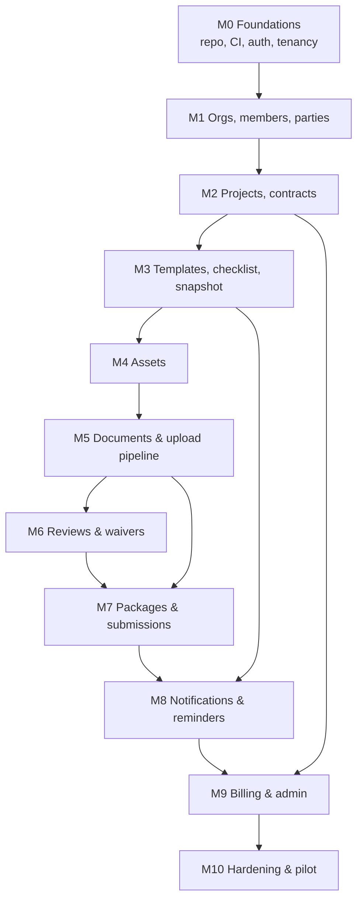

# 16 — MVP and Implementation Roadmap

**Status:** Draft v0.2
**Change history:** v0.2 revises the estimate (AUD-A-33), adds bulk import and external approval to MVP, and records the PDF-only decision.
**Constraint:** one full-time developer/founder, part-time design/QA.
**Principle:** ship a narrow closeout product that is secure and trustworthy, not a broad construction platform.

---

## 1. Phase definitions

| Phase | Goal | Commercial gate |
|---|---|---|
| **MVP** | First 3–5 paying HVAC contractors can run real closeouts | Paid pilots signed |
| **V1** | Reliable commercial use for 10–30 orgs | Retention and support load acceptable |
| **V2** | Expansion and integrations | Proven unit economics |
| **Future** | Automation and multi-party network | Scale evidence |

## 2. MVP scope (must ship)

### 2.1 Included

| Capability | Included in MVP | Notes |
|---|---|---|
| Auth | Email magic link + mobile OTP, sessions | No passwords, no SSO |
| Orgs | Create, profile, members, roles, invitations | Owner/Admin/PM/Site/Doc/Proc/QC/Reviewer |
| Parties | Client, MC, consultant, supplier directory | Guest invites via link |
| Projects | Create, activate, suspend, close, archive; dashboard | Single contract register |
| Checklist | HVAC template, project customisation pre-activation, immutable snapshot | No post-activation editing without change request |
| Change requests | Add/remove/modify requirements | Simple single approver |
| Assets | CRUD + CSV import + asset-scoped requirements | No QR labels |
| Documents | Direct resumable upload, versions, metadata, links, preview, download, soft delete | PDF/image preview only |
| Review | Single-stage review, approve/request changes/reject, comments | No multi-stage (V1) |
| Waivers | Waive/N/A with reason and approver | |
| Missing docs | Derived flags, dashboard, reminders, digest | Email + in-app + WhatsApp deep link |
| Supplier links | Scoped, expiring upload links | No supplier account required |
| Handover | Package builder, index PDF, merged PDF, ZIP + manifest, versioning | Basic layout template |
| Submissions | Record submission, acceptance/rejection | No full client portal (V1) |
| Audit | Append-only events, project view, export | Hash chain if feasible |
| Billing | Plans, Razorpay, GST invoice fields, dunning | Manual reconciliation fallback |
| Admin | Org list, suspend, template management, job retry | Minimal |
| Exports | Requirement register, assets, audit | CSV/Excel |

### 2.2 Explicitly excluded from MVP

- Multi-stage approval workflows.
- Custom fields and custom document types (beyond config keys).
- Full client portal with document browsing.
- WhatsApp Business API (deep links only).
- OCR, AI classification, extraction.
- E-signature.
- Accounting integrations.
- Multi-trade packs (HVAC only).
- Native mobile apps.
- SSO, MFA, API tokens, outbound webhooks.
- Partial handover (V1) and project reopen (V1).
- Advanced analytics/benchmarks.
- White-label/custom domains.

### 2.3 MVP success criteria

1. A contractor can complete the UAT script (`14` §18) without vendor help.
2. 3 paid pilots run at least one real project each.
3. ≥90% of requirements in a pilot project correctly tracked.
4. Package generation succeeds ≥95% of attempts.
5. No cross-tenant or data-integrity defects.
6. Support load <1 ticket per project per week during pilot.
7. Owner can export all project data.

## 3. Implementation order and dependencies

### 3.1 Milestones

| ID | Milestone | Key deliverables | Depends on | Complexity | Acceptance |
|---|---|---|---|---|---|
| M0 | Foundations | Monorepo, CI, Docker, Postgres/Redis/MinIO, migrations, RLS scaffold, auth OTP/magic link, session, audit skeleton, observability | — | L | Signup/login works; RLS test passes; deploy to staging |
| M1 | Org, members, parties | Org profile, branding, invitations, roles, project memberships, party directory, guest grants | M0 | L | Permission matrix tests; invite/revoke; tenant tests |
| M2 | Projects & contracts | Project CRUD, status machine, contract/spec refs, dashboard shell | M1 | M | Activation guards; suspend/close; dashboard counts |
| M3 | Templates & checklist | HVAC template pack, config resolution, preview, snapshot, requirement instances, change request v1. **Gate: 5 real checklists obtained and `04` §6 revised.** | M2 | XL | Snapshot immutability; resolution tests; 72-item template validated |
| M4 | Assets | Asset CRUD, categories, CSV import, asset-scoped requirements, matrix | M3 | M | Duplicate tag; import errors; matrix counts |
| M5 | Documents | Upload intents, multipart, processing, AV, metadata, links, versions, preview, download, trash, **bulk import (ZIP + mapping)** | M4 | XL | File corpus tests; resumable upload; signed URLs; 240-file import |
| M6 | Reviews | Submit, queue, decision, comments, waiver, **external approval recording**, notifications (basic), requirement aggregation | M5 | L | Self-approval blocked; concurrent decisions; external approval recorded; audit |
| M7 | Packages | Builder, **preview**, readiness, pure-Node PDF/image merge (`pdfmake`/`pdf-lib`/`qpdf`, RT-025) with escaping + sanitisation, index, manifest, versioning, multi-recipient submissions (RT-007) | M6 | XL | 500-page package; injection test passes; no cross-project files |
| M8 | Notifications | Reminder scheduler, digest, dedup, quiet hours, supplier reminders, email templates | M3, M6 | M | Dedup; failure fallback; no content leakage |
| M9 | Billing & admin | Plans, limits, Razorpay, Rule 46 GST tax invoices with SAC 998315 and TDS recording (e-invoice/IRN deferred to V2 under ₹5 Cr threshold per CBIC Notification 10/2023-CT, RT-015), dunning, admin console, exports | M2, M7 | L | Webhook idempotency; limit enforcement; CA-confirmed invoice fields |
| M10 | Hardening & pilot | Pen test fixes, backup restore, performance, UAT, docs, status page | All | L | Launch checklist complete; 3 pilots |

## 4. Effort estimate (hypothesis)

| Phase | Solo developer | Calendar (with part-time help) |
|---|---|---|
| M0–M2 | 5–7 weeks | 6–8 weeks |
| M3–M4 | 4–5 weeks | 4–6 weeks |
| M5–M6 | 6–7 weeks | 6–8 weeks |
| M7 | 4–5 weeks | 4–6 weeks |
| M8–M9 | 3–4 weeks | 3–5 weeks |
| M10 | 3–4 weeks | 3–5 weeks |
| **MVP total (v0.2.1 re-baseline)** | **36–42 weeks** | **38–46 weeks (9–11 months)** |

> **Re-baseline note (`AUD-A-33`, `RT-025`):** While v0.2 added bulk import, external approval recording, and security escaping, replacing Gotenberg with pure-Node PDF generation (`pdfmake`/`pdf-lib`) and deferring IRP e-invoicing to V2 saves ~4–5 developer-weeks, keeping the realistic solo-developer schedule at 36–42 weeks.

These are estimates, not commitments. The largest uncertainty is PDF/package generation and configuration resolution; both should be prototyped early (spikes) before committing to the timeline.

### 4.1 Technical spikes (before M3/M7)

1. Direct multipart upload + resume with the chosen storage.
2. PDF merge with bookmarks and 500-page performance.
3. Gotenberg conversion of DOCX/XLSX.
4. RLS + Drizzle/ORM transaction-scoped session.
5. Config resolution and snapshot diff with a 100-item template.

Each spike ≤3 days; outcomes recorded as decisions. Spike results gate commitments (**AUD-A-33 / N-7**): if Spikes 2 or 3 fail to meet performance thresholds, fallback to PDF-only mode saves ~4 developer-weeks from M5/M7, holding the total to 36–42 weeks.

## 5. Parallelisation

With one developer, parallelisation is limited. If a second developer/contractor joins:

- **Track A:** backend documents/pipeline/packages.
- **Track B:** frontend screens/onboarding.
- **Track C:** billing/admin/infra.

Do not parallelise the data model or permission layer; they must have one owner.

## 6. V1 scope (reliable commercial use)

| Feature | Why | Complexity | Depends |
|---|---|---|---|
| Multi-stage approval workflows | Consultant + QC stages | L | Reviews |
| Custom fields & document types | Client-specific requirements | L | Config |
| Full client/consultant portal | Review and accept in-app | L | Guest grants, packages |
| WhatsApp Business API | Reliable reminders at scale | M | Notifications |
| OCR + full-text search (metadata + content) | Find documents faster | L | Documents |
| Partial handover | Phased projects | M | Packages |
| Project reopen | After-closure corrections | S | Projects |
| Advanced reports & saved views | PM/owner visibility | M | Reporting |
| MFA for owners/admins | Security for larger customers | S | Auth |
| Hindi UI | Site usability | M | i18n |
| Retention automation + legal hold UI | Compliance | M | Data |
| Backup/DR hardening, Multi-AZ | Reliability | M | Infra |
| Pen test remediation + SOC-style controls | Trust | M | Security |

## 7. V2 scope

| Feature | Why | Complexity |
|---|---|---|
| Electrical/plumbing/fire trade packs | Expansion | L |
| Main-contractor multi-subcontractor workspace | New buyer | XL |
| E-signature (Aadhaar eSign/DSC) | Completion certificates | M |
| Accounting exports (Tally/Zoho) | Finance workflow | M |
| Package watermarking/branding pro | Client-facing polish | S |
| Asset QR labels + mobile scanning | Site efficiency | M |
| AI-assisted classification/extraction | Reduce metadata effort | L |
| Benchmark checklists from anonymised data | Differentiation | L (privacy-sensitive) |
| SSO (Google/Microsoft) | Larger customers | M |
| Email ingestion to project inbox | Forward supplier docs | M |
| Public API + webhooks | Integrations | L |
| Regional languages (Marathi/Tamil/Telugu) | Market depth | M |
| Mobile app (if PWA insufficient) | Offline/camera | L |
| Public checklist library/marketplace | Content moat | L |

## 8. Future (not committed)

- AI validation of document completeness against contract clauses.
- Automated cross-document consistency checks (serial/model/rating).
- Main-contractor network with shared requirement graph.
- Insurance/warranty registry integration.
- Internationalisation (Gulf/South Asia) after India retention.
- Financing/retention marketplace (requires regulatory review).

## 9. Engineering sequencing rules

1. Build the data model and permissions before screens.
2. Build the upload pipeline before package generation.
3. Build audit alongside each action, not afterwards.
4. Implement state machines as explicit code, not scattered conditionals.
5. Implement idempotency before exposing retry buttons.
6. Do not build a feature that cannot be tested with a seeded project.
7. Cut scope by removing a capability, not by weakening security or history.
8. Every milestone ends with a demo on staging using synthetic data.

## 9b. Confirmed MVP additions (from audit remediation)

| Item | Why it is MVP | Cost |
|---|---|---|
| SMS/OTP provider | Authentication cannot work without it (`AUD-001`) | ~2 days + provider contract |
| External approval recording | Consultants do not approve in-app (`AUD-010`) | ~4 days |
| Bulk document import | Every customer is mid-project (`AUD-009`) | ~8 days |
| Output escaping + PDF sanitisation | Security non-negotiable (`AUD-006`) | ~3 days |
| Cross-project FK integrity | Isolation non-negotiable (`AUD-004`) | ~2 days |
| Requirement definition history | Audit credibility (`AUD-008`) | ~3 days |
| Package preview + snapshot checksum | Prevents package/requirement drift (`AUD-008`) | ~3 days |
| e-invoice/TDS fields (configuration-driven) | Indian B2B invoicing (`AUD-013`) | ~3 days + CA confirmation |
| Warranty/DLP basics | Half the value of "closeout" (`AUD-D-03/04`) | ~5 days |

## 10. Scope-cut options if behind schedule

In order of preference:

1. Defer WhatsApp deep links to a manual "copy message" action.
1b. **MVP accepts PDF/image input only**; DOCX/XLSX are stored and downloaded but not converted (`09` §12).
2. Defer DOCX/XLSX preview; allow download only.
3. Defer asset CSV import; manual entry only.
4. Defer package ZIP (PDF only) — but keep manifest.
5. Defer client acceptance screen; record acceptance manually with evidence upload.
6. Defer billing self-serve; manual invoicing for first 5 customers; Razorpay in V1 (**AUD-16-N5**).
7. Defer custom change requests UI; use admin-assisted changes.

**Never cut:** tenant isolation, audit trail, immutable versions, signed URLs, malware scanning, backups, permission tests.

## 11. Pilot readiness checklist

- [ ] 3 signed paid pilots with real projects.
- [ ] Data processing agreement signed.
- [ ] HVAC template validated against 5 real checklists.
- [ ] Onboarding runbook and 30-minute training call.
- [ ] Support channel staffed.
- [ ] Backup restore tested.
- [ ] Pen test highs fixed.
- [ ] Billing/invoice reviewed by CA.
- [ ] Pricing and cancellation terms clear.
- [ ] Feedback loop and weekly check-in scheduled.

## 12. Risks to schedule

| Risk | Impact | Mitigation |
|---|---|---|
| Package generation complexity | Slips M7 | Spike early; limit formats; PDF-only fallback |
| Config engine over-engineering | Slips M3 | Start with a fixed template + simple overrides; defer rules DSL |
| Checklist content quality | Pilots fail | Validate with 3 contractors/consultants before build |
| Scope creep from pilots | Delay | Paid pilot scope agreement; log requests, don't build immediately |
| Payment onboarding delay | No revenue | Start Razorpay onboarding during M1 |
| Solo-founder illness/bandwidth | Stall | Document runbooks; keep architecture simple |
| Security incident | Existential | Security-first milestones; pen test before launch |

## 13. Version log

| Version | Date | Change |
|---|---|---|
| 0.1 | 2026-10-31 | Initial roadmap |
| 0.2 | 2026-10-31 | Remediation: estimate re-baselined to 40–50 dev-weeks (9–12 months); bulk import and external approval added to MVP; M3 content gate; M7 escaping/preview; M9 e-invoice/TDS; PDF-only MVP input |
