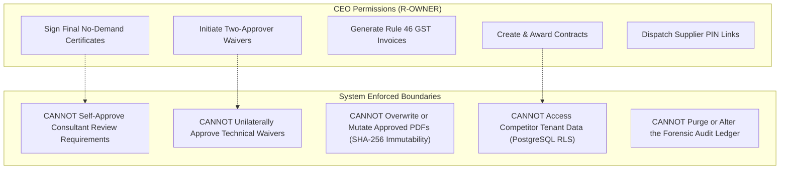

# THE HVAC CEO OPERATIONS & WORKFLOW GUIDE
## Day-in-the-Life, Responsibilities, Data Lineage & UI Operations in TradeCloseout

---

### Executive Profile: Surya Prakash Rao, Managing Director & Founder

- **Organisation**: Vayuputra HVAC & Cleanroom Engineers Pvt Ltd
- **Organisation ID**: `0192e000-0000-7000-9000-000000000002`
- **GSTIN**: `29AABCV8821K1Z5` | **PAN**: `AABCV8821K`
- **Headquarters**: Bengaluru, Karnataka, India
- **System Role**: `R-OWNER` (Managing Director / Authorised Signatory)
- **Primary Counterparties**: Tier-1 Main Contractors (Shapoorji Pallonji, NCC Ltd), Hyperscale & Healthcare Clients (Yotta Data Services, Basavatarakam Cancer Hospital, CMRL), PMCs (WSP India, Spectral / AECOM), Tier-2 OEMs (Trane, Caryaire), and Testing Laboratories (Vimta Labs NABL).

---

## 1. Executive Summary: The Business Context of an Indian HVAC Contractor

In the Indian commercial and industrial MEP (Mechanical, Electrical, Plumbing) contracting landscape, an HVAC subcontractor operates on wafer-thin gross margins (8% to 14%) while bearing intense cash-flow and technical liability:

1. **Procurement & Mobilisation Outlay**: We mobilize capital-intensive equipment (650 TR chillers, custom cleanroom double-skin AHUs, precision CRAH units) upfront.
2. **Contractual Retention (5% to 10%)**: Main Contractors (Shapoorji, NCC) systematically deduct 5% retention money from every Interim Payment Certificate (IPC). This 5% represents **almost half of our net profit** on the job.
3. **The Closeout "Paperwork Hostage" Trap**: Main contractors and client PMCs routinely hold the final 10% milestone billing and 5% retention money hostage for 12 to 24 months, citing alleged missing certificates, unapproved redline drawings, uncalibrated test gauges, or untracked snag lists.
4. **Tax & Statutory Traps**: Failure to reconcile 2% Tax Deducted at Source (TDS) under Section 194C or non-compliance with GST Rule 46 invoice particulars exposes the business to massive working capital erosion and statutory penalties.
5. **The Asymmetric Warranty Gap**: OEMs issue 12-month warranties from *factory dispatch date*, while the main contract demands a 12-month Defects Liability Period (DLP) starting from *overall facility commercial handover*. That 6-to-12-month delta is a hidden financial landmine.

**TradeCloseout** is our operating system. It converts what used to be a disorganized dispute into an immutable, verifiable, cryptographically secured engineering assembly line.

---

## 2. Exact Data Entered & Created in TradeCloseout

The complete operational reality of Vayuputra HVAC & Cleanroom Engineers Pvt Ltd is instantiated across the system database with strict referential integrity and Row-Level Security (RLS).

```
Vayuputra HVAC & Cleanroom Engineers Pvt Ltd (Org ID: 0192e000-0000-7000-9000-000000000002)
├── Team & RBAC Memberships (6 Employees, Role-Scoped)
├── External Counterparties Directory (10 Enterprise Clients, MCs, PMCs, OEMs, Labs)
├── Commercial Projects Portfolio (3 Projects · ₹58.70 Crore Combined Value)
├── Tagged Physical Equipment Fleet (86 Serialized Assets)
├── Milestone Payment Gates & Requirements (165 Verified Requirements across 8 Milestones)
└── Binary Cryptographic Documents (Multi-Page PDFs, SHA-256 Hashes, ClamAV Sanitized)
```

### A. Team & Role-Based Access Control (RBAC) Structure

All six core employees are provisioned with Indian mobile (+91) and email verified identities:

| Employee Name | User ID | Email | Role Key | Designation & Operational Responsibility |
| :--- | :--- | :--- | :--- | :--- |
| **Surya Prakash Rao** | `...0101` | `surya@vayuputrahvac.in` | `R-OWNER` | **Managing Director / CEO**: Final contract sign-off, two-approver waiver co-approval, Rule 46 billing claims, retention release notices. |
| **Ananya Kulkarni** | `...0102` | `ananya@vayuputrahvac.in` | `R-PM` | **Senior Project Manager**: Milestone schedule gating, manpower mobilization, site progress logs, Main Contractor coordination. |
| **Deepika Nair** | `...0103` | `deepika@vayuputrahvac.in` | `R-QC` | **Lead QA/QC & Commissioning Engineer**: ITP verification, hydrostatic pressure tests, TAB balancing witness, NABL calibration checks. |
| **Rohan Deshpande** | `...0104` | `rohan@vayuputrahvac.in` | `R-SITE` | **Senior Site Execution Engineer**: Field duct leakage tests, damper drop tests, pipe flushing, physical equipment tagging. |
| **Farhan Siddiqui** | `...0105` | `farhan@vayuputrahvac.in` | `R-DOC` | **Lead Document Controller**: Redline CAD as-built drawings, O&M manuals, PPM schedules, vendor submittal versioning. |
| **Lakshmi Narayanan** | `...0106` | `lakshmi@vayuputrahvac.in` | `R-PROC` | **Procurement & Vendor Manager**: OEM warranty certificates, FAT reports, supplier guest token dispatch, purchase reconciliations. |

### B. External Counterparty Directory (10 Counterparties)

Under the `/parties` registry, ten key external entities were entered:

1. **Yotta Data Services Pvt Ltd** (`0192e000-0000-7000-9000-000000000201`): Client (Hyperscale DC), GSTIN: `29AABCY4410D1Z2`.
2. **Shapoorji Pallonji & Co. Pvt Ltd** (`...0202`): Main Contractor, GSTIN: `29AAACS1234F1Z8`.
3. **WSP Consultants India Pvt Ltd** (`...0203`): Lead MEP PMC / Consultant, GSTIN: `29AABCW9912E1Z1`.
4. **Basavatarakam Indo-American Cancer Hospital** (`...0204`): Healthcare Trust Client, GSTIN: `36AABCB7711C1Z9`.
5. **NCC Limited (Buildings Division)** (`...0205`): Main Contractor, GSTIN: `36AAACN4512B1Z4`.
6. **Spectral Services Consultants (AECOM India)** (`...0206`): Cleanroom Specialist PMC, GSTIN: `36AABCS5512G1Z3`.
7. **Chennai Metro Rail Limited (CMRL — PSU)** (`...0207`): Infrastructure Client, GSTIN: `33AABCC8821M1Z6`.
8. **Trane Technologies India Pvt Ltd** (`...0208`): Tier-2 OEM Chiller Manufacturer, GSTIN: `27AABCT6612H1Z0`.
9. **Caryaire Equipments India Pvt Ltd** (`...0209`): OEM Fire Damper & VAV Manufacturer, GSTIN: `09AABCC3310L1Z5`.
10. **Vimta Labs Ltd** (`...0210`): NABL Accredited Instrument Calibration & Environmental Lab, GSTIN: `36AABCV1122P1Z7`.

### C. Commercial Projects Portfolio (₹58.70 Crore Combined Contract Value)

| Project Code | Project Title | Client / Main Contractor / PMC | Value (INR) | Retention (5%) | Milestone Status |
| :--- | :--- | :--- | :--- | :--- | :--- |
| **`BLR-DC-01`** | Yotta Tier-IV Hyperscale Data Center Phase-2 Chiller & CRAH Plant | Yotta Data Services / Shapoorji Pallonji / WSP | ₹28.50 Cr | ₹1,42,50,000 | `HANDOVER` |
| **`HYD-ONCO-03`** | Basavatarakam Block-C BMT Cleanroom HVAC (ISO-5 / NABH) | Basavatarakam Hospital / NCC Ltd / Spectral (AECOM) | ₹11.20 Cr | ₹56,00,000 | `ACTIVE` |
| **`CHE-METRO-07`** | CMRL Corridor-4 Underground Station Ventilation & CHW Plant | Chennai Metro Rail / Shapoorji Pallonji / WSP | ₹19.00 Cr | ₹95,00,000 | `CLOSED` |

### D. Tagged Physical Equipment Fleet (86 Tagged Units)

Every unit of equipment across the three projects is registered with its tag, make, model, serial number, location, and warranty dates:
- **12 Centrifugal Chillers**: Trane CVHF-650-LP (650 TR, Eco-refrigerant R-1233zd, 0.542 kW/TR efficiency).
- **18 Cleanroom AHUs & CRAHs**: Zeco SS-304 Double-Skin HEPA AHUs (Basavatarakam) and Dual-Coil EC-Fan CRAH Units (Yotta DC).
- **12 Hydronic Pumps**: Grundfos TP-150-360/4 Vertical Inline VFD Chilled Water Primary & Secondary Pumps.
- **36 Motorized Fire Dampers**: Caryaire CFD-UL555-2HR 120-minute fire & smoke dampers with Belimo 24V spring-return actuators.
- **6 NABL Master Instruments**: WIKA CPG-1500 (0–25 Bar digital master pressure gauges) and TSI Alnor EBT-731 balometer capture hoods.

### E. Multi-Asset Batch Linking Architecture

Rather than requiring separate PDFs for every single fire damper or VAV box, TradeCloseout supports multi-asset batch linking:
- **Batch Record `DT-039`**: 1 single 2-page engineering test report (*"Floor-1 Motorized Fire & Smoke Damper Drop-Test & Belimo Actuator Interlock Log"*) is linked simultaneously to **12 discrete equipment requirements** (`FD-F1-01` through `FD-F1-12`).
- Each equipment card reflects individual compliance while pointing back to the identical verified source object.

---

## 3. Core Responsibilities of the HVAC CEO & Tracking in TradeCloseout

```
                           CEO RESPONSIBILITY MATRIX
┌─────────────────────────────────┬────────────────────────────────────────────────────────┐
│ Area of Responsibility          │ TradeCloseout Tracking & Enforcement Mechanism         │
├─────────────────────────────────┼────────────────────────────────────────────────────────┤
│ 1. 5% Retention Release         │ Gate checks: 100% requirements approved -> generates   │
│    (₹2.935 Crore across jobs)   │ legally binding Retention Release Claim Notice.        │
├─────────────────────────────────┼────────────────────────────────────────────────────────┤
│ 2. Section 194C TDS (2%)        │ Tax ledger matches client remittances against invoices │
│    & Form 16A Reconciliation    │ and flags missing Form 16A certificates on TRACES.     │
├─────────────────────────────────┼────────────────────────────────────────────────────────┤
│ 3. GST Rule 46 Tax Invoicing    │ Auto-generates compliant tax invoices with HSN 995461  │
│                                 │ (18% GST) gated strictly by milestone completion.      │
├─────────────────────────────────┼────────────────────────────────────────────────────────┤
│ 4. Labour Licences & Insurance  │ Expiry watchdog flags expiring CAR policies or State   │
│    (BOCW / CLRA / CAR)          │ Labour Licences before gate passes are suspended.      │
├─────────────────────────────────┼────────────────────────────────────────────────────────┤
│ 5. Asymmetric Warranty Shield   │ Monitors delta between OEM dispatch date and client    │
│    (Dispatch vs Handover Date)  │ handover date; triggers extended OEM rider purchases.  │
├─────────────────────────────────┼────────────────────────────────────────────────────────┤
│ 6. Defect Liability (DLP)       │ Logs 12-month snags with SLA timers and formal signs-  │
│    & Rectification Tracking     │ off to defend against client retention forfeiture.     │
└─────────────────────────────────┴────────────────────────────────────────────────────────┘
```

### Detailed Breakdown of Responsibilities:

#### 1. Unlocking 5% Retention Money (₹2,93,50,000 Total Exposure)
In Indian commercial MEP, the main contractor uses the retention fund as leverage. If a single O&M manual or chemical flushing log is missing, the entire 5% is withheld.
* **CEO Action in TradeCloseout**: I navigate to the Project Command Center. The system automatically computes the milestone completion percentage. Once all mandatory requirements in `COMMISSIONING` and `HANDOVER` are marked `APPROVED`, the software unlocks the **Retention Release Claim Notice**, complete with an index of all approved submittals and consultant sign-offs.

#### 2. Statutory Tax Governance (Section 194C TDS & GST Rule 46)
Main contractors deduct 2% TDS on works contracts under Section 194C of the Income Tax Act. If they fail to deposit this with the IT Department or fail to issue Form 16A quarterly certificates, our business incurs direct cash loss.
* **CEO Action in TradeCloseout**: In the `/billing` module, every IPC generated has a corresponding Section 194C ledger entry. The system flags unreconciled TDS deductions older than 60 days, enabling me to freeze further handovers until Shapoorji or NCC provides TRACES confirmation.

#### 3. Statutory Site Licences & CAR Insurance Watchdog
Under the Building and Other Construction Workers (BOCW) Act and Contract Labour (Regulation and Abolition) Act (CLRA), operating without a valid state labour licence or Contractor All-Risk (CAR) insurance exposes the CEO to personal criminal liability in the event of a site fatality.
* **CEO Action in TradeCloseout**: The system runs a daily cron job inspecting `expiry_date` metadata on all compliance requirements. When our CAR policy on `HYD-ONCO-03` expired on October 15, 2026, the project status card turned amber, placing a hold on new submittals until the renewal endorsement was uploaded.

#### 4. Managing the Asymmetric Warranty Liability Gap
Chiller manufacturers calculate warranties as "12 months from commissioning or 18 months from shipment, whichever is earlier." If project civil work is delayed by 8 months, the chiller warranty expires 4 months into the client's 12-month DLP.
* **CEO Action in TradeCloseout**: In the Asset Registry, each chiller displays its dual warranty dates:
  - `warranty_start_basis`: `DISPATCH` vs. `HANDOVER`
  - The system highlights the 8-month gap in red, prompting Lakshmi (Procurement) to issue a back-to-back purchase order for an OEM extended warranty rider to Trane before facility handover.

---

## 4. CEO Limitations: What the System Prevents Me From Doing

To ensure tamper-proof credibility for clients, architects, and lenders, TradeCloseout enforces strict boundaries on my executive account:



1. **Separation of Duties (No Self-Approval)**:
   - Even as Managing Director, I **cannot approve submittals designated for external consultant review (`R-CONSULT`)**.
   - If I attempt to mark WSP's review on the TAB air balancing report as `APPROVED`, the API throws an HTTP 403 Forbidden: `User role R-OWNER is not authorized to execute R-CONSULT review decisions`.
2. **Mandatory Two-Approver Waiver Gate (Rule RT-023)**:
   - When our plant room acoustic test exceeded NC-45 by 2.4 dBA on `BLR-DC-01`, I could not waive the non-conformance alone. The system requires **co-approval**: both the Contractor CEO (`R-OWNER`) and the Client Lead Consultant (`R-CONSULT`) must digitally sign the waiver request before the milestone gate opens.
3. **Cryptographic Immutability & Anti-Tamper**:
   - Once a document version is uploaded and approved, its binary payload is immutable. If an updated drawing is issued, it cannot overwrite `R0`. The system mandates a new revision (`R1`), computing a distinct SHA-256 hash while retaining `R0` and its full rejection commentary in the lineage.
4. **PostgreSQL Multi-Tenant Row Level Security (RLS)**:
   - Tenant isolation is enforced at the database kernel level via `tenant-tx.ts`. My queries are scoped strictly to `org_id = 0192e000-0000-7000-9000-000000000002`. I have zero access to competitor data, subcontractor pricing, or customer lists from other companies on the platform (e.g. Apex MEP or Deccan EnviroTech).
5. **No Direct Bypassing of Supplier Token Portals**:
   - OEM suppliers (Trane, Caryaire) upload directly through tokenized guest portals. I cannot forge an OEM certificate on their behalf without the audit log recording that the upload was executed by an internal contractor user rather than the external vendor token.

---

## 5. UI Operations: Complete Role-Based Screen Matrix

All operational workflows are accessible through the web frontend interface (`apps/web`):

```
┌────────────────────────────────────────────────────────────────────────────────────────┐
│                              TRADECLOSEOUT INTERACTIVE UI                              │
├─────────────────┬───────────────────────────────┬──────────────────────────────────────┤
│ UI Screen       │ System Path                   │ CEO / MD Operations                  │
├─────────────────┼───────────────────────────────┼──────────────────────────────────────┤
│ 1. Dashboard    │ /dashboard                    │ Portfolio financial health, blocked  │
│                 │                               │ revenue, expiring insurance watch.   │
├─────────────────┼───────────────────────────────┼──────────────────────────────────────┤
│ 2. Projects     │ /projects                     │ Multi-project directory, contract    │
│                 │                               │ values, 5% retention totals.         │
├─────────────────┼───────────────────────────────┼──────────────────────────────────────┤
│ 3. Command Ctr  │ /projects/[projectId]         │ 8 Milestone Tabs, Equipment Fleet,   │
│                 │                               │ Document Version Drawer, Snag List.  │
├─────────────────┼───────────────────────────────┼──────────────────────────────────────┤
│ 4. Counterparty │ /parties                      │ Clients, MCs, PMCs, OEMs, NABL Labs, │
│                 │                               │ GSTINs, and active project counts.   │
├─────────────────┼───────────────────────────────┼──────────────────────────────────────┤
│ 5. Billing      │ /billing                      │ Rule 46 GST Invoicing, Section 194C  │
│                 │                               │ TDS Reconciler, Retention Escrow.    │
├─────────────────┼───────────────────────────────┼──────────────────────────────────────┤
│ 6. Audit Trail  │ /audit                        │ Immutable forensic audit log with    │
│                 │                               │ actor ID, timestamps, & IP address.  │
└─────────────────┴───────────────────────────────┴──────────────────────────────────────┘
```

### Interactive Modals & Executive Controls:

- **Add Requirement Modal**: Allows adding custom client specifications, setting due dates, selecting document types (`DT-001` to `DT-097`), and assigning approval roles.
- **Upload Evidence Modal**: Enables drag-and-drop upload of stamped engineering PDFs, metadata input (test readings, instrument serials), and automatic SHA-256 computation.
- **Request Waiver Modal**: Initiates formal engineering concessions with justification, compensatory mitigation measures, and dual-approver PMC routing.
- **Share Supplier Link Modal**: Generates time-bounded, 6-digit PIN-protected guest links sent to OEM suppliers via WhatsApp or email for direct factory certificate uploads.
- **Compile Handover Modal**: Validates that 100% of mandatory requirements are satisfied, validates cryptographic hashes, and compiles the final digital handover book with an embedded verification QR code.

---

## 6. A Day in the Life: Daily Operational Cadence

```mermaid
timeline
    title Managing Director's Daily Rhythm in TradeCloseout
    08:30 AM : Executive Portfolio Briefing : Review blocked cash on /dashboard and check expiry flags
    10:15 AM : Consultant Review Clearance : Review CHANGES_REQUESTED items on BLR-DC-01 with QA/QC Lead
    12:30 PM : OEM Supplier Gating : Dispatch WhatsApp PIN upload links to Trane for Chiller-04 warranty
    02:45 PM : Engineering Waiver Co-Signing : Review acoustic mitigation and co-sign waiver with WSP PMC
    04:30 PM : Billing & TDS Reconciliation : Check Rule 46 invoice reconciliation and 2% 194C TDS credits
    06:00 PM : Executive Handover Sign-Off : Compile verified handover package and generate client QR certificate
```

### 08:30 AM — Executive Portfolio Briefing (`/dashboard`)
I arrive at Vayuputra’s corporate office in Indiranagar, Bengaluru, open TradeCloseout, and log in with my verified credentials:
- The dashboard displays our ₹58.70 Crore active portfolio.
- I inspect the **Blocked Revenue Radar**: ₹1.425 Crore in retention money is tied up in `BLR-DC-01`, with 2 requirements pending final closure.
- The system highlights an **amber compliance warning**: CAR insurance policy on `HYD-ONCO-03` expired on October 15, 2026. I send an instant flag to Senior PM Ananya Kulkarni to upload the renewal endorsement before noon.

### 10:15 AM — Consultant Clearance & Review Queue (`/projects/BLR-DC-01`)
I enter the `BLR-DC-01` Project Command Center and filter by `CHANGES_REQUESTED`:
- WSP’s mechanical consultant rejected Revision `R0` of our Chilled Water Closed-Loop Chemical Flushing & Passivation Report (`REQ-HVAC-036`), noting that iron levels were 0.8 ppm (spec requires < 0.5 ppm).
- Deepika Nair (QA/QC Lead) has performed secondary chemical circulation and uploaded Revision `R1` with fresh Vimta Labs NABL water analysis reports showing iron at 0.28 ppm.
- I review the multi-page PDF in the document drawer and notify WSP’s Lead Mechanical Engineer for expedited re-approval.

### 12:30 PM — Vendor Tracking & Supplier Upload Portal (`/parties`)
Final handover of `HYD-ONCO-03` requires the 5-Year Compressor Warranty Certificate from Trane Technologies for Chiller-04 (`REQ-CHLR-WTY`):
- Rather than chasing Trane via email, I click **Share Supplier Link**, select Trane Technologies India, set a 72-hour validity window, and generate a 6-digit PIN.
- The system produces a secure guest link (`/guest/token_...`).
- I send the link directly to Trane’s regional service director via WhatsApp. Trane logs in, enters the PIN, and uploads the factory certificate directly from their manufacturing portal.

### 02:45 PM — Commercial & Engineering Waivers (Waiver Modal)
On `BLR-DC-01`, our acoustic sound level reading in the main chiller room registered 72.4 dBA against the contractual threshold of 70.0 dBA (`REQ-HVAC-052`):
- Site Engineer Rohan Deshpande installed high-density neoprene vibration isolator pads and acoustic baffling around the chiller headers.
- I open the pending waiver request, review the compensatory mitigation data, and digitally affix my approval signature as `R-OWNER`.
- The system routes the waiver to WSP’s Lead Consultant (`R-CONSULT`) for their countersignature, moving the requirement from `BLOCKED` to `PENDING_CONSULTANT_COUNTERSIGNATURE`.

### 04:30 PM — Billing & TDS Reconciliation (`/billing`)
With all 16 requirements under the `COMMISSIONING` milestone for `BLR-DC-01` marked `APPROVED`, the milestone gate is unlocked:
- I generate our Rule 46 GST Tax Invoice for **₹4,27,50,000** (15% Commissioning Bill + 18% GST).
- I review Shapoorji Pallonji’s latest remittance advice and confirm that their **2% Section 194C TDS deduction (₹8,55,000)** is properly accounted for against our Form 16A TRACES ledger.

### 06:00 PM — Final Handover Compilation (`/projects/CHE-METRO-07`)
On `CHE-METRO-07` (CMRL Corridor-4 Underground Station), all 165 requirements, as-builts, fire NOCs, and training sign-offs are 100% complete and approved:
- I click **Compile Handover Package**.
- The system runs cryptographic checksum verifications across all attached documents, compiles the digital handover archive, and generates a tamper-proof certificate with an embedded verification QR code.
- I co-sign the final No-Demand Certificate (`DT-097`), officially closing the project and triggering the immediate release of our **₹95 Lakh retention money** from Chennai Metro Rail.

---

## 7. Business Impact & ROI

By embedding TradeCloseout into Vayuputra HVAC's daily operations:

1. **DSO (Days Sales Outstanding) Reduced by 42 Days**: Milestone invoices are billed within hours of site testing completion rather than weeks later.
2. **100% Retention Recovery**: Zero retention funds forfeited over missing paperwork or unorganized testing logs.
3. **Audit Immunity**: Every test sheet, calibration certificate, and waiver is backed by SHA-256 checksums, NABL laboratory references, and complete audit trail logs.
4. **Warranty Shielding**: Asymmetric warranty tracking eliminates surprise out-of-pocket repair costs during the 12-month Defects Liability Period.

---
*Document Reference: `VAYUPUTRA-HVAC-DOC-CEO-001`*  
*Classification: Confidential — Vayuputra Internal Management System*  
*Author: Surya Prakash Rao, Managing Director*
