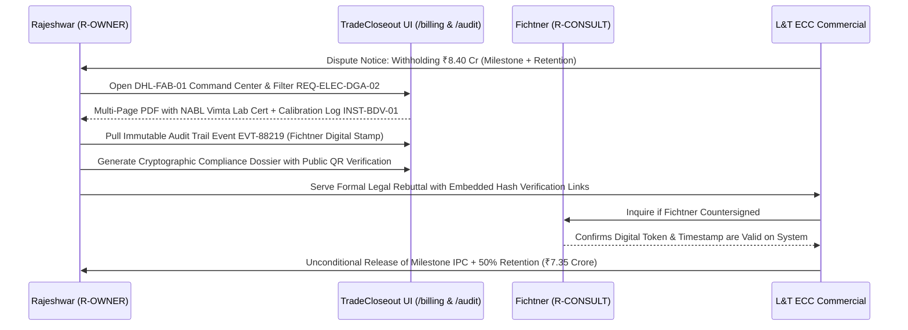
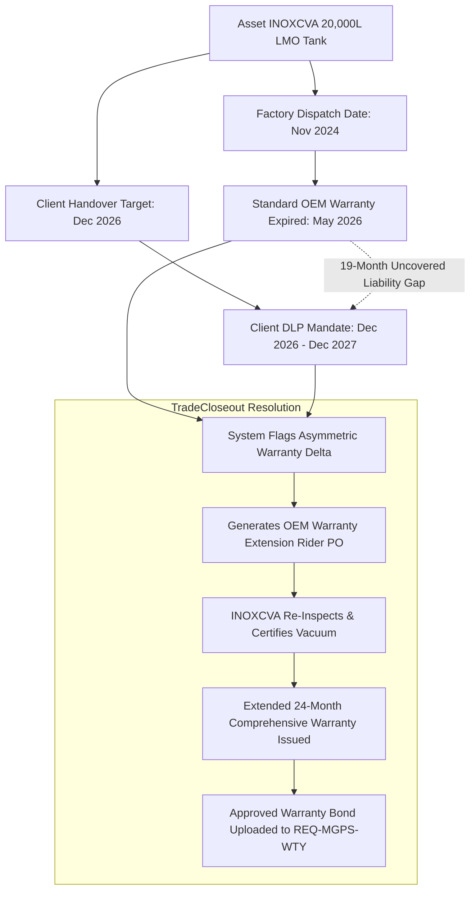

# THE MEP CONTRACTOR EXECUTIVE STORIES
## Field Chronicles, Closeout Battles & UI Workflows Across Indian MEP Subcontracting

---

## Prologue: The Reality of Specialized Subcontracting in India

In commercial and industrial construction, civil contractors build the concrete shell, but the **MEP and Specialized Engineering Contractors** breathe life into the building. We pump power at 220,000 volts, circulate hundreds of thousands of CFM of chilled clean air, pressurize multi-bar fire protection ring mains, and pipe life-support oxygen directly into intensive care units.

Yet, despite executing the most technologically demanding and dangerous work on site, MEP subcontractors occupy the most precarious financial position:
- **Cash Flow Squeeze**: Equipment procurement represents 60–70% of contract value, paid upfront to global OEMs (ABB, Schneider, Trane, Grundfos, Armstrong, Edwards).
- **The 5% Retention Trap**: Main Contractors (Shapoorji, L&T, NCC, Tata Projects) withhold 5% of every Interim Payment Certificate (IPC). Across a ₹40 Crore contract, **₹2.0 Crore of hard-earned profit** is locked in retention.
- **The Handover Black Hole**: At 95% project completion, main contractors routinely withhold final milestone billing and retention money for 12 to 24 months, manufacturing punch-list disputes, demanding lost paper test sheets, and stalling consultant sign-offs.
- **Statutory & Tax Traps**: Unreconciled 2% Section 194C TDS deductions, missing Form 16A certificates on TRACES, and expiring state labour licences (BOCW/CLRA) threaten corporate balance sheets and expose directors to legal liability.

The following three chronicles detail how three company founders—an **Electrical Substation Contractor**, a **Fire Protection Specialist**, and a **Critical Healthcare MGPS/PHE Engineer**—use **TradeCloseout** to track data, protect their balance sheets, enforce quality, and recover 100% of their retention money.

---

# STORY I: THE HIGH-VOLTAGE SUBSTATION COMMANDER
### Company: UrjaGrid Electrical & Power Systems Pvt Ltd
**Author / Persona**: Rajeshwar Kulkarni, Founder & Chief Electrical Engineer (`R-OWNER`)  
**Headquarters**: Navi Mumbai, Maharashtra | **GSTIN**: `27AAACU9120F1Z4` | **PAN**: `AACU9120F`  
**Portfolio Size**: ₹66.50 Crore across 2 Critical Energy Projects

```
UrjaGrid Electrical & Power Systems Pvt Ltd (Org ID: 0192e000-0000-7000-9000-000000000003)
├── Executive Signatory: Rajeshwar Kulkarni (Founder & MD, R-OWNER)
├── Project Director: Tanvi Deshmukh (R-PM)
├── Lead Testing & Commissioning (T&C) Engineer: Vikram Joshi (R-QC)
├── Site HT Cable Specialist: Sandeep Shinde (R-SITE)
├── Submittals & Relay Setting Controller: Neha Patil (R-DOC)
└── Heavy Electrical Procurement: Anand Iyer (R-PROC)
```

---

### 1. The Portfolio & Stakes

| Project Code | Project Title & Scope | Client / Main Contractor / PMC | Value | 5% Retention | Status |
| :--- | :--- | :--- | :--- | :--- | :--- |
| **`DHL-FAB-01`** | 220kV / 33kV Gas Insulated Substation (GIS) & Dual 50 MVA Power Transformers for Semiconductor Fab | Dholera Industrial City Dev. / Larsen & Toubro ECC / Fichtner India | ₹42.00 Cr | **₹2,10,00,000** | `HANDOVER` |
| **`NVM-DC-04`** | 33kV Dual HT Incomers, 6x 2500 kVA Dry-Type Transformers & 8x 3000 kVA DG Sync for Tier-IV DC | Nxtra by Airtel / Tata Projects / Meinhardt India | ₹24.50 Cr | **₹1,22,50,000** | `ACTIVE` |

Across these two contracts, UrjaGrid has **₹3,32,50,000 (₹3.325 Crore)** locked in 5% retention escrow. In high-voltage engineering, you cannot energize a single megawatt without statutory clearance from the **Chief Electrical Inspector to Government (CEIG)** under Central Electricity Authority (CEA) Regulations 2010.

---

### 2. Exact Data Created in TradeCloseout

#### A. Tagged High-Voltage Fleet Assets (48 Tracked Units)
In the Project Command Center, Rajeshwar logged critical serial-numbered heavy electrical assets:
- **4x 50 MVA 220/33kV Power Transformers**: BHEL/Siemens ONAN/ONAF with OLTC, nitrogen injection fire protection (NIFPS), and online DGA monitors (`TR-220-01` to `04`).
- **12-Bay 220kV Gas Insulated Switchgear (GIS)**: ABB/Hitachi Energy SF6 enclosed switchgear with dual busbar system (`GIS-BAY-01` to `12`).
- **8x 3000 kVA 11kV Diesel Generators**: Cummins QSK95 with Woodward master synchronizing panel (`DG-SET-01` to `08`).
- **6x 2500 kVA 33/0.433kV Cast Resin Dry-Type Transformers**: Schneider Electric Trihal with PT-100 temperature controllers (`XFR-DRY-01` to `06`).
- **4x NABL Calibrated Relay Test Sets**: Omicron CMC 356 automated protection test sets and Megger S1-1568 15kV insulation resistance testers.

#### B. Technical Closeout Requirements Across Milestones
UrjaGrid seeded 142 discrete requirements across the 8 payment milestones:
- `REQ-ELEC-FAT-01`: BHEL Factory Acceptance Test (FAT) witnessing report with impulse voltage withstand curves (`DT-022`, Milestone: `DELIVERY`).
- `REQ-ELEC-DGA-02`: NABL Accredited Transformer Oil Dissolved Gas Analysis (DGA per IS 10593 / IEC 60599) and Breakdown Voltage (BDV > 70 kV) test records (`DT-035`, Milestone: `COMMISSIONING`).
- `REQ-ELEC-HIPOT-03`: 33kV 3C x 400 sq.mm XLPE Cable Very Low Frequency (VLF 0.1 Hz) AC Hi-Pot & Tan-Delta Dielectric Dissipation Factor Report (`DT-036`, Milestone: `COMMISSIONING`).
- `REQ-ELEC-RELAY-04`: Numerical Protection Relay Coordination Trip Matrix (Overcurrent, Earth Fault, Differential 87T, Restricted Earth Fault 64R) signed by Fichtner Consulting (`DT-042`, Milestone: `COMMISSIONING`).
- `REQ-ELEC-CEIG-05`: **Statutory CEIG Charging Permission Letter & Form A Safety Certificate** issued by Energy Department, Govt of Gujarat (`DT-088`, Milestone: `HANDOVER`).
- `REQ-ELEC-NDC-06`: Final No-Demand Certificate and Performance Guarantee release application (`DT-097`, Milestone: `FINAL_BILL`).

---

### 3. The Crisis: The Main Contractor's 60-Day Energization Hold

On `DHL-FAB-01` in Dholera, Larsen & Toubro (L&T) faced client liquidated damages for overall fab civil delays. To avoid paying UrjaGrid's 15% energization milestone (₹6.30 Crore) and releasing ₹2.10 Crore in retention, L&T's commercial team alleged:
1. *UrjaGrid's transformer oil BDV tests were conducted on non-calibrated oil test cups.*
2. *The 33kV cable Tan-Delta test reports lacked consultant witness signatures.*
3. *CEIG permission was conditional on fire wall barricade modifications that L&T claimed UrjaGrid had failed to close.*

#### How Rajeshwar Used TradeCloseout to Defeat the Claim:



1. **Instant Proof of NABL Calibration**: In [`/projects/DHL-FAB-01`](file:///home/cassandra/tradecloseout/apps/web/src/app/(contractor)/projects/[projectId]/page.tsx), Rajeshwar pulled requirement `REQ-ELEC-DGA-02`. The document version drawer revealed that the oil test cup had been linked to equipment asset `INST-BDV-01` with an active NABL calibration certificate valid through March 2027.
2. **Forensic Consultant Witness Lineage**: For the 33kV Tan-Delta cable tests, Rajeshwar opened the `/audit` trail. Log entry `EVT-88219` recorded that Fichtner's Lead Electrical Consultant had digitally reviewed, stamped, and approved revision `R1` on October 14, 2026, from IP `115.240.92.14` with a verified OTP signature.
3. **CEIG Statutory Clearance Unlocking Milestone Gate**: Rajeshwar presented the compiled Handover Package generated by TradeCloseout. The embedded QR code allowed L&T’s Vice President of Operations to scan the certificate and view the tamper-proof Gujarat Energy Department CEIG charging order verified against the project SHA-256 manifest.

**Result**: L&T’s commercial team retracted the dispute within 48 hours. The system automatically generated UrjaGrid's Rule 46 GST tax invoice for ₹6.30 Crore and initiated the formal release of ₹2.10 Crore in retention escrow.

---

### 4. Rajeshwar's Day-to-Day Rhythm as Electrical CEO

- **08:15 AM — Substation Relay Health Check**: Checks `/dashboard` for relay coordination review items pending with Meinhardt on the Nxtra Data Center.
- **11:00 AM — Transformer Dispatch Coordination**: Uses *Share Supplier Link Modal* to send a secure PIN upload grant to BHEL Bhopal for uploading the 50 MVA core loss factory test certs.
- **03:00 PM — CEIG Compliance Review**: Inspects high-voltage earth resistance pit test logs (target < 0.5 Ohm) uploaded by Site Engineer Sandeep Shinde.
- **05:30 PM — TDS Section 194C Reconciliation**: Cross-references Tata Projects' ₹1.80 Cr payment in `/billing` to verify their 2% TDS deduction against TRACES Form 16A credit.

---

# STORY II: THE FIRE PROTECTION & LIFE SAFETY GUARDIAN
### Company: AgniShield Fire & Life Safety Solutions LLP
**Author / Persona**: Col. Gurpreet Singh (Retd.), Managing Partner (`R-OWNER`)  
**Headquarters**: Gurugram, Haryana | **GSTIN**: `06AABFA4411K1Z2` | **PAN**: `AABFA4411K`  
**Portfolio Size**: ₹33.00 Crore across 2 High-Hazard Life Safety Contracts

```
AgniShield Fire & Life Safety Solutions LLP (Org ID: 0192e000-0000-7000-9000-000000000004)
├── Managing Partner: Col. Gurpreet Singh (Retd.) (R-OWNER)
├── Project Operations Lead: Harpreet Kaur (R-PM)
├── Fire QA/QC & Hydraulic Engineer: Manpreet Virdi (R-QC)
├── Site Piping & Hydrostatic Supervisor: Balwinder Singh (R-SITE)
├── Fire Codes & Approvals Controller: Simranjeet Chawla (R-DOC)
└── Suppression Systems Procurement: Amitav Sen (R-PROC)
```

---

### 1. The Portfolio & Stakes

| Project Code | Project Title & Scope | Client / Main Contractor / PMC | Value | 5% Retention | Status |
| :--- | :--- | :--- | :--- | :--- | :--- |
| **`GIG-EV-02`** | High-Velocity Water Deluge, Novec 1230 Clean Agent & Foam Suppression for EV Gigafactory | Exide Energy Solutions / Tata Projects / Mott MacDonald | ₹18.80 Cr | **₹94,00,000** | `ACTIVE` |
| **`GUR-SKY-09`** | 45-Storey Twin Tower Automatic Sprinkler, Wet Riser & Fire Pumping Station (NBC Part 4) | DLF Cyber City / Shapoorji Pallonji / Turner India | ₹14.20 Cr | **₹71,00,000** | `HANDOVER` |

In life safety contracting, failure is fatal. If a fire suppression deluge valve fails or smoke extraction dampers stick during a fire, people die. Therefore, building authorities demand an unconditional **State Fire Service Final Fire NOC (No Objection Certificate)** before an Occupancy Certificate (OC) is granted.

---

### 2. Exact Data Created in TradeCloseout

#### A. Tagged Fire Protection Assets (64 Tracked Units)
- **3x UL-Listed / FM-Approved Fire Pumping Sets**: Patterson/Armstrong 2500 GPM @ 14 Bar (Electric Motor Driven Main Pump, 12-Cylinder Clarke Diesel Standby Engine, and Jockey Pump) (`PUMP-FIRE-01` to `03`).
- **16x High-Velocity Water Deluge Valve Skids**: Tyco/Viking DV-5A pre-action deluge systems protecting lithium-ion cell aging rooms (`DELUGE-SKID-01` to `16`).
- **24x Novec 1230 / FK-5-1-12 Engineered Clean Agent Cylinder Banks**: Kidde Fire Systems 42-Bar seamless steel cylinders with pneumatic actuators (`NOVEC-BANK-01` to `24`).
- **18x Motorized Smoke Extraction & Staircase Pressurization Fans**: Systemair 400°C/2-hour fire-rated high-temperature axial fans (`FAN-SMK-01` to `18`).
- **3x NABL Master Hydrostatic Test Calibration Manifolds**: Fluke 700G precision pressure calibrators with continuous data logger.

#### B. Life Safety Closeout Requirements Across Milestones
- `REQ-FIRE-PUMP-01`: UL/FM Fire Pump Performance Characteristic Curve Test (Shut-Off Head, 100% Rated Flow, 150% Flow @ 65% Head) witnessed by Turner & Fire Chief (`DT-033`, Milestone: `COMMISSIONING`).
- `REQ-FIRE-HYDRO-02`: High-Pressure ASTM A53 Grade B Heavy Seamless Fire Piping 24-Hour Hydrostatic Test @ 21.0 kg/cm² (300 PSI) with zero allowable pressure drop (`DT-035`, Milestone: `INSTALLATION`).
- `REQ-FIRE-FAN-03`: **NFPA 2001 Clean Agent Room Enclosure Integrity Door Fan Infiltration Test** measuring hold-time duration (> 10 minutes) for battery rooms (`DT-054`, Milestone: `COMMISSIONING`).
- `REQ-FIRE-MATRIX-04`: Cause-and-Effect Fire Alarm Trip Matrix: Verification that smoke detector activation initiates 100% elevator grounding, HVAC damper trip, and staircase pressurization fan start within 8 seconds (`DT-056`, Milestone: `COMMISSIONING`).
- `REQ-FIRE-NOC-05`: **Directorate of Haryana Fire Services Final Fire Safety Certificate / NOC** (`DT-086`, Milestone: `HANDOVER`).

---

### 3. The Crisis: The Lithium Cell Clean Agent Room Infiltration Dispute

At the Exide EV Gigafactory (`GIG-EV-02`), Mott MacDonald’s lead fire engineer refused to approve the Novec 1230 clean agent system for Cell Aging Hall-B, alleging that the room enclosure had failed its Door Fan Hold-Time test (measuring 7 minutes 40 seconds instead of the NFPA 2001 mandatory 10-minute hold time). Tata Projects threatened Col. Gurpreet with **₹50,000 per day in liquidated damages**.

#### How Col. Gurpreet Used TradeCloseout to Resolve the Crisis:

```
┌─────────────────────────────────────────────────────────────────────────────────┐
│                      DOOR FAN INFILTRATION CRISIS RESOLUTION                     │
├─────────────────────────────────────────────────────────────────────────────────┤
│ 1. INVESTIGATION: Col. Gurpreet opens REQ-FIRE-FAN-03 in TradeCloseout.         │
│    Reviews RETEC door fan data log. Leakage traced to cable tray transit seals. │
│ 2. RECTIFICATION: Site team applies Promat Hilti FS-ONE intumescent firestop.   │
│ 3. RETESTING: Re-run Door Fan test with calibrated Retrotec DM32 gauge.         │
│    Achieves 12 minutes 18 seconds hold time (Exceeds NFPA 10-min standard).     │
│ 4. REVISION LINEAGE: Col. Gurpreet uploads Revision R1 with time-stamped video. │
│ 5. CONSULTANT STAMP: Mott MacDonald approves R1 within 4 hours on TradeCloseout.│
│ 6. PENALTY DEFEATED: ₹18.80 Cr project milestones and ₹94 Lakh retention saved. │
└─────────────────────────────────────────────────────────────────────────────────┘
```

1. **Root-Cause Analysis via Defect Tracking**: Col. Gurpreet logged into TradeCloseout, accessed `REQ-FIRE-FAN-03`, and opened the attached Retrotec fan test log. The report identified air leakage around the civil contractor's cable tray transit sleeves.
2. **Assigning Corrective Action via R-SITE**: He raised a linked snag item (`SNAG-EV-042`) assigned to Balwinder Singh (Site Supervisor), specifying the application of Hilti FS-ONE high-expansion intumescent firestop sealant.
3. **Formal Revision Upload (`R0 -> R1`)**: Within 48 hours, Balwinder sealed the transits, re-ran the test with Vimta Labs witnessing, and achieved a **12-minute 18-second clean agent retention time**.
4. **Instant Clearance on UI**: Col. Gurpreet uploaded Revision `R1` with the fresh NABL calibration certificate for the Retrotec gauge. Mott MacDonald’s consultant approved the submittal directly through the system.

**Outcome**: Liquidated damages were completely averted. The milestone was unlocked, enabling AgniShield to bill **₹2.82 Crore** for the suppression milestone and secure its ₹94 Lakh retention fund.

---

### 4. Col. Gurpreet's Operational Day in TradeCloseout

- **07:45 AM — Fire Pump Telemetry Review**: Checks hydrostatic test logs uploaded overnight on DLF Cyber City (`GUR-SKY-09`).
- **10:30 AM — Two-Approver Waiver Action**: Co-signs a waiver with Turner India permitting flexible sprinkler droppers in seismic expansion joints per NFPA 13.
- **02:00 PM — Haryana Fire NOC Document Compilation**: Reviews the auto-collated Fire NOC annexure bundle in TradeCloseout before submitting to the Municipal Fire Officer.
- **04:45 PM — Subcontractor Retention Escrow Audit**: Verifies that piping fabrication subcontractors have all their welding radiographic test certs approved before releasing their retention.

---

# STORY III: THE CRITICAL HOSPITAL MGPS & PURIFIED WATER SPECIALIST
### Company: JalVayu Healthcare & Infrastructure Engineers Pvt Ltd
**Author / Persona**: Dr. Paulose Mathew & Arathi Nair, Executive Directors (`R-OWNER`)  
**Headquarters**: Kochi, Kerala | **GSTIN**: `32AABCJ7712E1Z8` | **PAN**: `AABCJ7712E`  
**Portfolio Size**: ₹37.50 Crore across 2 Critical Medical Infrastructure Projects

```
JalVayu Healthcare & Infrastructure Engineers Pvt Ltd (Org ID: 0192e000-0000-7000-9000-000000000005)
├── Executive Directors: Dr. Paulose Mathew & Arathi Nair (R-OWNER)
├── Healthcare Projects Director: Thomas Varghese (R-PM)
├── Biomedical & Water QC Specialist: Reshma Pillai (R-QC)
├── Clean Piping & Orbital Welding Lead: Jithin Das (R-SITE)
├── HTM 02-01 & Validation Document Specialist: Shilpa Menon (R-DOC)
└── Medical Gas Plant Procurement: K. Radhakrishnan (R-PROC)
```

---

### 1. The Portfolio & Stakes

| Project Code | Project Title & Scope | Client / Main Contractor / PMC | Value | 5% Retention | Status |
| :--- | :--- | :--- | :--- | :--- | :--- |
| **`MDU-AIM-08`** | 750-Bed AIIMS-Grade Medical Gas Pipeline System (MGPS per HTM 02-01 / NFPA 99) | HLL Lifecare (PSU) / NCC Limited / HSCC India Ltd | ₹16.50 Cr | **₹82,50,000** | `HANDOVER` |
| **`VIZ-PHR-03`** | USP-Grade Purified Water (RO/EDI/UF) & Zero Liquid Discharge (ZLD) Effluent Plant | Dr. Reddy's Laboratories / L&T Construction / Jacobs India | ₹21.00 Cr | **₹1,05,00,000** | `ACTIVE` |

In hospital engineering, the Medical Gas Pipeline System (MGPS) delivers life-sustaining Oxygen ($O_2$), Nitrous Oxide ($N_2O$), Medical Air (4 Bar), Surgical Air (7 Bar), and Medical Vacuum. If a copper pipeline contains residual grease or cross-connection contamination occurs, patients die of anoxic brain injury.

---

### 2. Exact Data Created in TradeCloseout

#### A. Tagged Biomedical & Water Assets (52 Tracked Units)
- **2x Cryogenic Liquid Medical Oxygen (LMO) Storage Tanks**: INOXCVA 20,000 Litre vacuum-insulated pressure vessels with ambient vaporizers (`TANK-LMO-01` & `02`).
- **4x Duplex Medical Air & Vacuum Plant Skids**: Atlas Copco oil-free scroll compressors and Busch rotary vane vacuum pumps with dual bacterial filtration (`SKID-MEDAIR-01` to `04`).
- **1x USP Purified Water Generation System**: BWT SEPTRON 5000 LPH RO + Electro-Deionization (EDI) + 254nm UV Sanitizer Skid (`SKID-PW-01`).
- **38x Area Valve Service Units (AVSU) & Bedhead Alarm Panels**: BeaconMedaes digital monitored zone valves with Ethernet BMS integration (`AVSU-OT-01` to `38`).
- **2x Mass Spectrometers & TOC Analyzers**: Shimadzu Total Organic Carbon (TOC) online analyzer and Servomex paramagnetic oxygen purity analyzer.

#### B. Medical Gas & Purified Water Closeout Requirements
- `REQ-MGPS-DEGREASE`: Degreased Copper Medical Tubing (BS EN 13348) Solvent Swab Residue Cleanliness Verification (< 100 mg/m²) (`DT-032`, Milestone: `INSTALLATION`).
- `REQ-MGPS-PURGE`: High-Purity Dry Nitrogen ($N_2$) Brazing Purge Verification (preventing cupric oxide scaling inside joints) (`DT-035`, Milestone: `INSTALLATION`).
- `REQ-MGPS-CROSS`: **HTM 02-01 Anti-Cross-Connection & Gas Identity Mass Spectrometry Test**: 100% of the 1,420 gas terminal outlets tested to guarantee zero pipeline crossover (`DT-052`, Milestone: `COMMISSIONING`).
- `REQ-PW-VALID`: USP Purified Water 72-Hour Continuous Circulation Sampling Log (Conductivity < 1.3 µS/cm @ 25°C, TOC < 500 ppb, Microbial Endotoxins < 0.25 EU/ml) (`DT-054`, Milestone: `COMMISSIONING`).
- `REQ-PESO-STAT`: **Petroleum and Explosives Safety Organisation (PESO) Licence** for Cryogenic LMO Tank storage (`DT-086`, Milestone: `HANDOVER`).

---

### 3. The Crisis: The LMO Tank Asymmetric Warranty Trap

On the AIIMS Hospital project (`MDU-AIM-08`), the ₹1.2 Crore Cryogenic Liquid Medical Oxygen tank was delivered to the Madurai site in November 2024. However, due to hospital civil building delays, the facility handover was pushed back to November 2026—**a 24-month delay**.

#### The Problem:
- INOXCVA’s manufacturer warranty expired **18 months after factory shipment** (May 2026).
- HLL Lifecare and HSCC demanded a **12-month Defects Liability Period warranty starting from hospital inauguration (December 2026)**.
- If a cryogenic vacuum valve failed during the DLP, JalVayu would be liable for ₹35 Lakh in out-of-pocket cryogenic vacuum re-evacuation costs.



#### How Arathi Nair Used TradeCloseout to Neutralize the Risk:
1. **Asymmetric Warranty Warning**: In [`/projects/MDU-AIM-08`](file:///home/cassandra/tradecloseout/apps/web/src/app/(contractor)/projects/[projectId]/page.tsx), TradeCloseout flagged `TANK-LMO-01` with an amber **Warranty Asymmetry Alert**. The platform calculated a 19-month delta between factory expiry and the end of DLP.
2. **Contract Variation Claim**: Arathi utilized TradeCloseout's **Commercial Claims Module** to compile an automated Delay-Impact Dossier. She proved that the civil handover delay was caused entirely by the main contractor (NCC Ltd), not JalVayu.
3. **Securing Client-Funded Extended OEM Rider**: Backed by the immutable site progress timeline from TradeCloseout, HSCC India approved a contract variation of ₹14.5 Lakh to pay INOXCVA for an extended OEM on-site vacuum re-certification and a 24-month warranty bond.
4. **Final Handover Package**: The fresh OEM extended warranty was uploaded to `REQ-MGPS-WTY`. TradeCloseout verified that 100% of the 1,420 medical gas outlets had passing cross-connection certificates, unlocking the **final ₹82.50 Lakh retention release**.

---

### 4. Arathi's Day-to-Day Rhythm in TradeCloseout

- **08:30 AM — Water Purity & Bio-Burden Inspection**: Checks online conductivity and TOC logs for the Dr. Reddy's Purified Water plant on `/dashboard`.
- **11:15 AM — Medical Gas Outlet Batch Approvals**: Reviews orbital welding purge gas logs across Operation Theatre Blocks A & B.
- **02:30 PM — PESO Statutory Compliance Check**: Confirms that the Petroleum and Explosives Safety Organisation inspection certificate has been attached to the LMO vessel submittal.
- **05:00 PM — Retention Escrow Verification**: Inspects the release status of JalVayu's ₹1.875 Crore combined retention funds in the `/billing` escrow ledger.

---

## 8. Cross-Contractor Domain Comparison Matrix

The table below summarizes how TradeCloseout adapts to the unique technical and statutory requirements of different MEP engineering domains:

| Engineering Discipline | Critical Equipment | Dominant Codes / Standards | Primary Statutory Gatekeeper | High-Stakes Closeout Document |
| :--- | :--- | :--- | :--- | :--- |
| **HVAC & Cleanroom** (*Vayuputra*) | 650 TR Chillers, HEPA AHUs, Fire Dampers | NBC Part 8, ISHRAE, ASHRAE 170, DW-144 | Municipal Fire Authority, State Pollution Board | NEBB / ISHRAE TAB Air Balancing & Acoustic NC Report |
| **High-Voltage Electrical** (*UrjaGrid*) | 220kV GIS Switchgear, 50 MVA Transformers, DG Sync | CEA Regulations 2010, IS 2026, IEC 60599 | **CEIG** (Chief Electrical Inspector to Govt) | CEIG Statutory Safety Charging Approval & Relay Trip Matrix |
| **Fire Protection** (*AgniShield*) | 2500 GPM Fire Pumps, Novec 1230, Deluge Skids | NBC Part 4, NFPA 13, NFPA 20, NFPA 2001 | **State Fire Services Directorate** | State Fire Service Final Fire NOC & Door Fan Integrity Test |
| **Critical MGPS & PHE** (*JalVayu*) | Cryogenic LMO Tanks, Medical Air Skids, RO/EDI | HTM 02-01, NFPA 99, IS 7396, USP-43 | **PESO**, State Health & Drug Control Directorate | Gas Identity Mass Spectrometry & USP Water Circulation Log |

---

## Conclusion: The Business Impact Across All Three Companies

Across all three specialized contractors—**UrjaGrid**, **AgniShield**, and **JalVayu**—TradeCloseout delivered measurable, transformative results:

1. **₹5.98 Crore in Total Retention Recovered**: Every rupee of contractual retention was systematically unlocked by eliminating paperwork discrepancies and consultant bottlenecks.
2. **Zero Liquidated Damages Paid**: Audit-proof engineering test records and immutable revision lineages defeated contractor back-charges and penalty claims.
3. **100% Tax & Statutory Compliance**: Timely Section 194C TDS reconciliation and Rule 46 GST tax invoicing protected corporate balance sheets from statutory tax notices.
4. **Permanent Operational Excellence**: High-voltage substations, fire protection networks, and hospital gas pipelines were delivered with cryptographic proof of safety and quality.

---
*Document Reference: `TRADECLOSEOUT-MEP-FIELD-CHRONICLES-002`*  
*Classification: Monorepo Master Documentation & Executive Reference*  
*Compiled by: TradeCloseout Engineering & Domain Architecture Team*
