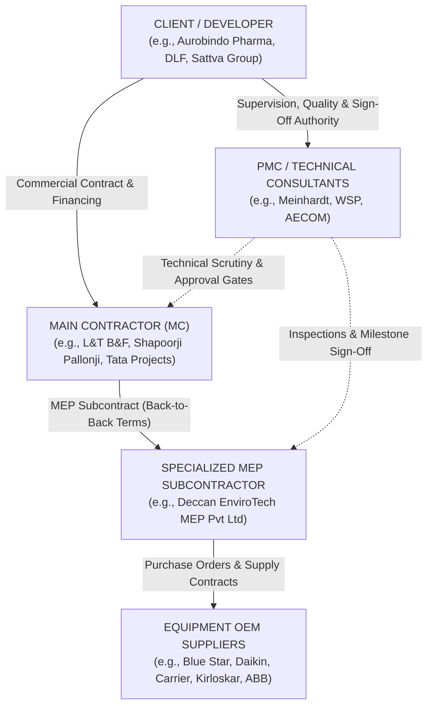
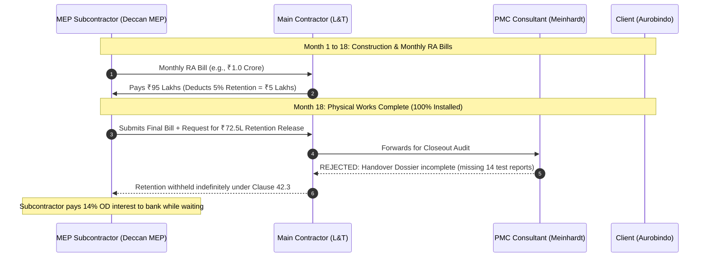
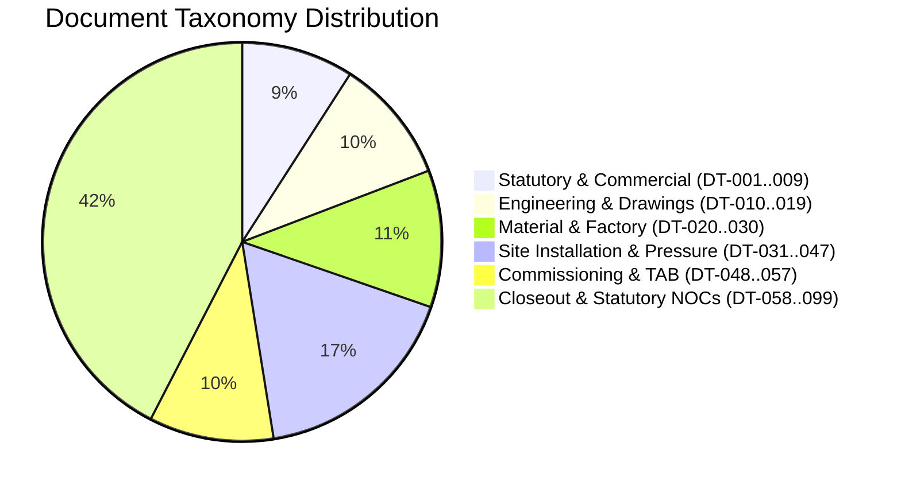
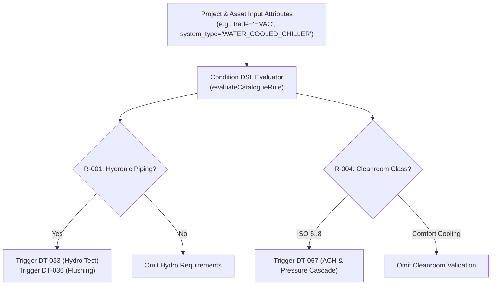

# Indian Commercial MEP Construction: The Complete Domain & Document Taxonomy Handbook

---

## Table of Contents
1. [The Construction Hierarchy & Contractual Ecosystem](#1-the-construction-hierarchy--contractual-ecosystem)
2. [Commercial Mechanics: Retention Money, DLP, and the Final Bill](#2-commercial-mechanics-retention-money-dlp-and-the-final-bill)
3. [The 5 Engineering Lifecycle Stages of MEP Documents](#3-the-5-engineering-lifecycle-stages-of-mep-documents)
4. [Master Document Taxonomy (`DT-001` through `DT-099`)](#4-master-document-taxonomy-dt-001-through-dt-099)
5. [Specification Rules & Condition DSL Logic (`R-001` to `R-013`)](#5-specification-rules--condition-dsl-logic-r-001-to-r-013)
6. [Real-World Field Dynamics: Why Handover Breaks Down & How TradeCloseout Fixes It](#6-real-world-field-dynamics-why-handover-breaks-down--how-tradecloseout-fixes-it)

---

## 1. The Construction Hierarchy & Contractual Ecosystem

Commercial construction is not a simple two-party transaction. It is a multi-layered legal and technical hierarchy governed by strict contractual chains:



### The Stakeholder Personas & Their Driving Motivations

| Stakeholder | Typical Role in Project | Core Motivation | Handover Pain Point |
| --- | --- | --- | --- |
| **Client / Developer** | Asset Owner (Pharma, IT Park, Hospital). | Wants the facility operational on time without future maintenance liabilities or regulatory fines. | Fear of receiving an unmaintainable building with missing warranties or unverified equipment. |
| **PMC / Consultant** | Technical Architect / Engineers (Meinhardt, WSP). | Guard their professional indemnity insurance; strictly enforce specifications (NBC, ASHRAE, ISHRAE). | Buried in thousands of unindexed PDFs; will reject entire batches if one calibration certificate is missing. |
| **Main Contractor (MC)** | EPC / Civil Giant (L&T, Shapoorji). | Passing through contractual risk to subcontractors; holds subcontractor money until the client pays them. | Subcontractor paperwork delays block the Main Contractor's own final completion certificate. |
| **MEP Subcontractor** | Specialized Engineering Firm (Deccan EnviroTech). | Execute high-precision installation and **get their cash released** (especially the 5–10% retention). | Junior staff are engineers, not document controllers; paperwork is scattered across WhatsApp, site offices, and laptops. |
| **Equipment OEM / Supplier** | Manufacturer (Blue Star, Daikin, Grundfos). | Sell machines, collect 90% payment against delivery, minimize after-sales warranty service costs. | Refuses to register on complicated software portals; sends test reports as compressed WhatsApp images to sales reps. |

---

## 2. Commercial Mechanics: Retention Money, DLP, and the Final Bill

To understand why TradeCloseout exists, you must understand the financial mechanics of construction subcontracts in India:



### Key Contractual Terms
1. **Retention Money (`retention_bps`):** Typically **5% to 10%** (500 to 1,000 basis points) of every interim Running Account (RA) bill is held back by the employer. It serves as financial leverage to ensure the contractor finishes all snags, cleans up the site, and submits complete documentation.
2. **Defect Liability Period (DLP):** Usually **12 to 24 months** starting from the date of the **Taking Over Certificate (TOC)** / Virtual Completion. During DLP, the contractor must repair any equipment failures free of cost.
3. **Performance Bank Guarantee (PBG / `DT-003`):** Subcontractors frequently furnish a 5% Bank Guarantee to replace retention money or guarantee performance during the DLP.
4. **No-Demand Certificate (NDC / `DT-097`):** A mandatory legal undertaking signed on non-judicial stamp paper stating the contractor has received all dues and will raise no further claims against the client.
5. **Back-to-Back Retainage:** Main Contractors insert a clause stating: *"Retention shall only be released to the Subcontractor 30 days after the Main Contractor receives retention release from the Ultimate Client."* This means if **any** trade delays handover, everyone's money is frozen.

---

## 3. The 5 Engineering Lifecycle Stages of MEP Documents

Documentation is not an afterthought assembled at the end; it is generated across **five distinct engineering phases**:


### Stage 1: Pre-Construction & Submittals (MAS, MOS, Shop Drawings)
Before a single bolt is turned on site, the contractor must prove that what they plan to install matches the contract design:
* **Material Approval Submittal (MAS / `DT-014`):** Contractor submits OEM technical literature, compliance sheets, and physical samples to the consultant for formal sign-off.
* **Method Statement (MOS / `DT-016`):** Step-by-step procedure of how high-risk work (e.g., hoisting a 12-ton chiller onto an 8th-floor terrace) will be safely executed.
* **Coordinated Shop Drawings (`DT-010`):** Detailed drawings showing exact pipe levels, duct routes, and clash resolutions with civil beams and electrical cable trays.

### Stage 2: Factory Stage (FAT, Mill Test Certificates)
Heavy MEP equipment is built to order in factories:
* **Factory Acceptance Test (FAT / `DT-022`):** For chillers, transformers, and fire pumps. The consultant visits the factory (or joins via witness camera) to watch the machine run under simulated full-load and part-load conditions (AHRI 550/590 standards). The signed FAT report is mandatory before dispatch.
* **Mill Test Certificate (MTC / `DT-024`):** For raw materials (copper refrigerant tubes, GI duct sheets, MS piping). Proves chemical composition and tensile strength from steel mills like Tata Steel or Jindal.

### Stage 3: Site Delivery & Erection (MIR, Installation Checklists)
When equipment arrives at the construction site:
* **Material Inspection Report (MIR / `DT-021`):** Joint inspection by Site Engineer and Consultant QC checking for physical transit damage, matching serial numbers against purchase orders, and verifying delivery challans.
* **Installation Checklist (`DT-031`):** Verifies correct mounting, anti-vibration springs (AVMs), alignment, levelness, and seismic restraints.

### Stage 4: Testing & Pre-Commissioning (Pressure, Flushing, Leakage)
Before turning on power or refrigerant:
* **Hydrostatic Pressure Test (`DT-033`):** Chilled water pipes are filled with water and pumped up to **1.5 times the working pressure** (e.g., $15\text{ kg/cm}^2$) and held for **24 hours**. The pressure gauge chart must show zero drop.
* **Duct Air Leakage Testing (`DT-035`):** Performed per **SMACNA / DW-144** standards using calibrated orifice tubes and smoke generators to ensure conditioned air does not leak into ceiling voids.
* **Pipe Flushing & Chemical Passivation (`DT-036`):** Water lines are chemically treated to remove weld slag, mill scale, and dirt, preventing chiller condenser tube clogging.

### Stage 5: Commissioning, Balancing & Handover (TAB, O&M, Warranties)
The final milestone:
* **Testing, Adjusting & Balancing (TAB / `DT-050`):** Certified NEBB/AABC engineers measure airflow (CFM) at every diffuser and water flow (GPM) through every coil using calibrated anemometers and balancing hoods, adjusting balancing valves until design parameters are met.
* **Cleanroom Validation (`DT-057`):** Measures Air Changes Per Hour (ACH), room differential pressure cascade (+15 Pa sterile core vs. +10 Pa airlock), and non-viable particle counts per ISO 14644.
* **Operation & Maintenance Manual (O&M / `DT-058`):** Comprehensive guide for building operators including equipment schedules, lubrication charts, electrical single-line diagrams (SLDs), and spare parts part-numbers.
* **OEM Warranty Certificates (`DT-026`):** Manufacturer 1-year to 5-year warranties tied to specific equipment serial numbers.

---

## 4. Master Document Taxonomy (`DT-001` through `DT-099`)

TradeCloseout standardizes Indian construction documentation into an unambiguous catalog:



### Detailed Taxonomy Reference Table

| Code | Document Title | Typical Reviewer | Why It Is Legally/Technically Critical |
| --- | --- | --- | --- |
| **`DT-001`** | Contract / Work Order | Main Contractor Commercial | Defines the baseline scope, milestone deadlines, and retention percentage. |
| **`DT-003`** | Performance Bank Guarantee (PBG) | Client Accounts | Financial security replacing retention during DLP. |
| **`DT-004`** | CAR Insurance Policy | Client Risk Officer | Contractor All-Risk & Workmen Compensation coverage for site liability. |
| **`DT-005`** | Labour Registration / BOCW Licence | Labour Inspector / PMC | Statutory compliance under Building and Other Construction Workers Act. |
| **`DT-010`** | Approved Shop Drawing | Consultant Lead Architect | Proves coordinated routing before installation. |
| **`DT-011`** | As-Built Drawing (CAD/PDF) | Facilities Management | Exact as-installed routing including site modifications; needed for future building maintenance. |
| **`DT-013`** | Manufacturer Technical Datasheet | Consultant MEP Engineer | Verifies electrical loads, KW ratings, dimensions, and sound levels. |
| **`DT-014`** | Material Approval Submittal (MAS) | Consultant Lead MEP | Formal pre-procurement sign-off; binds contractor to specific makes and models. |
| **`DT-016`** | Method Statement (MOS) | Safety Officer / Consultant | Safety and engineering sequence for high-risk installations. |
| **`DT-017`** | Inspection and Test Plan (ITP) | Quality Control Manager | Matrix of hold points, witness points, and review points throughout the project. |
| **`DT-021`** | Material Inspection Report (MIR) | Site QC Engineer | Confirms materials delivered to site match the approved submittal without damage. |
| **`DT-022`** | Factory Acceptance Test (FAT) Report | Consultant MEP Engineer | AHRI 550/590 or IS test proving chiller capacity and COP before dispatch. |
| **`DT-024`** | Mill Test Certificate (MTC) | QC Inspector | Chemical and mechanical test reports for steel plates, copper tubes, and GI coils. |
| **`DT-025`** | NABL Calibration Certificate | Consultant Lead QC | Proves that pressure gauges, digital manometers, and balancing hoods used during tests were calibrated within 12 months by a certified laboratory. |
| **`DT-026`** | Manufacturer Warranty Certificate | Client Maintenance Lead | OEM warranty ensuring compressor/motor replacement in case of premature failure. |
| **`DT-028`** | Spare Parts Schedule | Facilities Manager | List of recommended 1-year and 2-year maintenance spares with part numbers and Indian stockists. |
| **`DT-031`** | Installation Checklist | Consultant Site Engineer | Signed punch-list confirming equipment is anchored, vibration-isolated, and correctly aligned. |
| **`DT-032`** | Weld / Brazing Log | QC Lead | Verification of welder qualifications and non-destructive testing (NDT/radiography) of high-pressure welds. |
| **`DT-033`** | Hydrostatic Pressure Test Report | Consultant Lead Plumbing/HVAC | Witnessed pressure test sheet with pressure gauge chart holding for 24 hours. |
| **`DT-034`** | Refrigerant Holding & Vacuum Test | Consultant HVAC | Nitrogen holding at 450 PSI followed by vacuum drawdown to $<500\text{ microns}$ for VRF/chiller circuits. |
| **`DT-035`** | Duct Air Leakage Test (DW-144) | Consultant HVAC Lead | Test confirming duct air leakage rates fall below allowable class limits. |
| **`DT-036`** | Pipe Flushing & Passivation Record | Consultant Water Specialist | Chemical treatment report ensuring no iron slag remains inside hydronic lines. |
| **`DT-039`** | Fire Damper Drop Test Record | Fire Safety Consultant | Mandatory test verifying motorized and fusible-link fire dampers snap shut upon BMS signal. |
| **`DT-043`** | Electrical Megger & Insulation Test | Consultant Electrical Lead | Insulation resistance test ($>1\text{ M}\Omega$) on high-voltage power feeds. |
| **`DT-046`** | BMS Point-to-Point Checkout | Controls Specialist | Verification that every sensor, actuator, and VFD communicates correctly with the central BMS dashboard. |
| **`DT-049`** | Commissioning Report | Commissioning Lead (CxA) | Summary report of system operational performance across all operating modes. |
| **`DT-050`** | TAB Air & Water Balancing Report | NEBB/AABC Balancing Lead | Final calibrated hydronic and air balance report with airflow readings for every room. |
| **`DT-057`** | Cleanroom ACH & Room Pressure Cascade | Pharma Validation Auditor | Statutory requirement for USFDA/WHO pharma audits; verifies positive pressure cascades. |
| **`DT-058`** | Operation & Maintenance (O&M) Manual | Client Facilities Director | Complete multi-volume handbook containing vendor contacts, schedules, and troubleshooting. |
| **`DT-061`** | Client Training Attendance Record | Client HR / Facilities | Proves contractor trained the client's engineering staff on equipment operation. |
| **`DT-062`** | Completion Certificate (TOC) | Project Director | Official legal milestone marking the end of construction and the start of the DLP. |
| **`DT-064`** | Asset Register | Client ERP Specialist | Tabular list of every piece of equipment with serial numbers, tags, barcode/QR keys, and installation locations. |
| **`DT-086`** | Fire Department NOC | Municipal Fire Authorities | Government fire safety clearance required before the building can be legally occupied. |
| **`DT-087`** | Electrical Inspectorate (CEIG) Approval | Chief Electrical Inspector (Govt) | Statutory approval to charge and energize transformers and substations. |
| **`DT-097`** | No-Demand Certificate (NDC) | Client Legal / Finance | Final legal release signed by contractor before retention money release. |

---

## 5. Specification Rules & Condition DSL Logic (`R-001` to `R-013`)

A hospital cleanroom project requires sterile validation records, whereas a warehouse only needs basic ventilation. If a system blindly generates 800 checklist items for every project, contractors abandon it because 70% of the checklist is not applicable.

TradeCloseout uses a deterministic **Condition DSL Evaluator** that automatically computes which documents are mandatory based on project and asset attributes:



### The 13 Production DSL Rules

| Rule Code | Trigger Condition | Documents Enforced | Engineering Rationale |
| --- | --- | --- | --- |
| **`R-001`** | `system_type == 'WATER_COOLED_CHILLER'` or hydronic piping detected. | `DT-033` (Hydrostatic Test), `DT-036` (Pipe Flushing), `DT-025` (NABL Calibration). | Chilled water circuits operate under high pressure; untested leaks will destroy false ceilings and server racks. |
| **`R-002`** | `refrigerant_charge_kg > 5` (VRF, DX splits, direct expansion). | `DT-034` (Nitrogen Holding & Vacuum Decay Test). | Refrigerant gas leaks cause global warming and deplete system oil; vacuum holding $<500\text{ microns}$ ensures no moisture. |
| **`R-003`** | `ductwork_pressure_class IN ('MEDIUM', 'HIGH')` or SMACNA Class C. | `DT-035` (Duct Air Leakage Testing DW-144). | High-pressure pharma and hospital ducts will whistle, vibrate, and leak conditioned air if joints are unsealed. |
| **`R-004`** | `cleanroom_iso_class IS NOT NULL` (Pharma, OT, Biotech). | `DT-057` (ACH & Room Pressure), `DT-055` (Indoor Air Quality). | Regulatory mandate: Sterile rooms must maintain positive pressure relative to adjacent corridors to prevent contamination. |
| **`R-005`** | `asset_category == 'ROTATING_EQUIPMENT'` (Pumps, Fans, Compressors $>15\text{ kW}$). | `DT-052` (Noise & Vibration Report), `DT-043` (Megger Test). | Unbalanced impellers destroy bearings and transmit acoustic resonance through the building structure. |
| **`R-006`** | Fire damper or life-safety ventilation asset. | `DT-039` (Fire Damper Drop Test), `DT-086` (Fire NOC). | Life-safety compliance: Dampers must drop automatically when smoke detectors trip. |
| **`R-007`** | `contract_value_paise >= 500000000` ($\ge ₹5\text{ Crore}$). | `DT-003` (PBG), `DT-004` (CAR Insurance), `DT-060` (PPM Schedule). | High-value commercial risk management: Requires formal bank guarantees and scheduled maintenance bonds. |
| **`R-008`** | BMS / Automated Building Controls trade. | `DT-045` (BMS I/O Schedule), `DT-046` (Point-to-Point Controls Checkout). | Controls checkout verifies that physical thermistors match digital graphics on the central BMS workstation. |
| **`R-009`** | Equipment with warranty period $>12\text{ months}$. | `DT-026` (OEM Warranty), `DT-028` (Spare Parts List). | Extended manufacturer warranties (e.g., 5-year screw chiller compressor warranty) must have direct factory letterheads. |
| **`R-010`** | High-voltage electrical feeds ($\ge 415\text{ V}$). | `DT-043` (Megger/Insulation), `DT-087` (CEIG Approval). | Government electrical inspectorate approval is statutory before high-side power energization. |
| **`R-011`** | Welded pipe joints $>50\text{ mm}$ NB. | `DT-032` (Weld / Brazing Log & NDT). | Welder performance qualification (WPQ) and dye-penetrant testing (DPT) on critical piping. |
| **`R-012`** | Potable / Domestic Water System. | `DT-054` (Water Quality & Potability Report). | Ensures water passes IS 10500 drinking water parameters before facilities handover. |
| **`R-013`** | Mandatory Requirement Waiver Request. | Two-step approval (`R-QC` recommendation followed by `R-OWNER` / `R-PM` sign-off). | Prevents site engineers from casually waiving mandatory contract items without executive approval. |

---

## 6. Real-World Field Dynamics: Why Handover Breaks Down & How TradeCloseout Fixes It

### Failure Mode 1: The "Expired Master Gauge" Trap
* **The Reality:** A site engineer conducts a 24-hour hydrostatic test on 2,000 meters of chilled water pipe. They take photos of the pressure gauge showing $15\text{ kg/cm}^2$.
* **The Consultant's Rejection:** Six months later during dossier audit, the consultant checks the serial number on the pressure gauge dial (`PG-8841`). The calibration certificate submitted for `PG-8841` expired 10 days before the test date!
* **The Consequence:** The entire test is void. The contractor must re-fill, re-pressurize, and re-test 2,000 meters of pipe at a cost of ₹4,00,000.
* **TradeCloseout Fix:** [`file.processor.ts`](file:///home/cassandra/tradecloseout/apps/worker/src/queues/file.processor.ts) and [`scheduler.ts`](file:///home/cassandra/tradecloseout/apps/worker/src/scheduler.ts) track expiry dates on calibration certificates (`expiry_date`), alerting the PM 30 days before calibration lapses.

### Failure Mode 2: The "WhatsApp Photo" Degradation
* **The Reality:** The OEM chiller commissioning technician WhatsApps a photo of the factory test sheet to the contractor's site engineer.
* **The Breakdown:** WhatsApp compresses the photo from 4 MB to 200 KB. The fine-print serial number on the compressor motor becomes illegible. The consultant rejects the submittal as "unverifiable".
* **TradeCloseout Fix:** TradeCloseout’s [Supplier Magic Links](file:///home/cassandra/tradecloseout/apps/api/src/modules/parties/supplier-guest.service.ts) let the technician upload original PDF files or high-resolution photos directly from their phone browser with zero compression and automated SHA-256 integrity hashing.

### Failure Mode 3: The 1-to-Many Approval Deadlock
* **The Reality:** A supplier delivers 4 identical cleanroom air handling units (`AHU-01`, `AHU-02`, `AHU-03`, `AHU-04`) with a single combined 20-page test report.
* **The Breakdown:** In naive software, a document can only link to 1 asset. If the contractor uploads the report to `AHU-01`, `AHU-02` through `AHU-04` remain flagged as "Missing Evidence".
* **TradeCloseout Fix:** [`review-decision.service.ts`](file:///home/cassandra/tradecloseout/apps/api/src/modules/reviews/review-decision.service.ts) links one document version to multiple requirements via `document_requirements`. When the consultant clicks "Approve", all 4 AHU requirements transition to `APPROVED` simultaneously.

### Failure Mode 4: The 4G Disconnection on Site
* **The Reality:** Basements, plant rooms, and pharma airlocks are Faraday cages with weak or nonexistent 4G signal.
* **The Breakdown:** A site engineer attempts to upload an 8 MB photo of an installed fire damper. The upload times out after 60 seconds, and the engineer gives up.
* **TradeCloseout Fix:** [`offline-upload-queue.ts`](file:///home/cassandra/tradecloseout/apps/web/src/lib/offline-upload-queue.ts) compresses the image down to $\sim 600\text{ KB}$ WebP in the client's browser using HTML5 Canvas, stores the payload in **IndexedDB**, and automatically retries in the background the moment the engineer walks out to an area with mobile signal.

---

## Summary: The Financial Impact of TradeCloseout

```
Without TradeCloseout:
  60–90 Day Handover Delay
  ₹2,50,000 Bank Interest Bleed
  300+ Engineer Hours Wasted on Physical Binder Assembly
  High Risk of Disputed Retention Deductions

With TradeCloseout:
  < 7 Day Handover Turnaround
  Zero Interest Loss (Retention released on time)
  1-Click Generation of Bookmarked, Linearized, QR-Stamped Dossier
  100% Tamper-Evident SHA-256 Audit Trail Protecting Against Liquidated Damages
```
