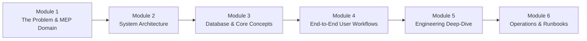
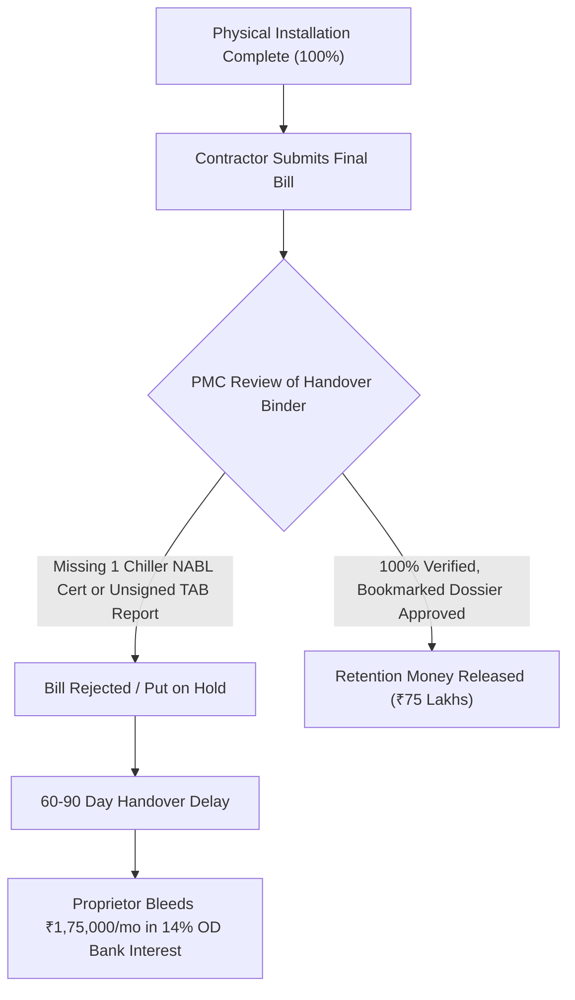
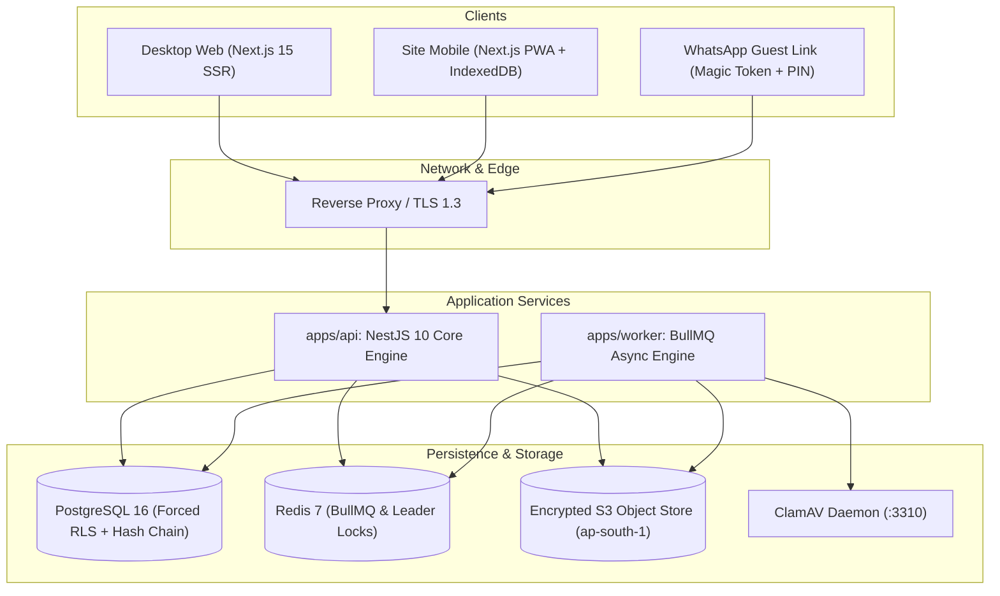
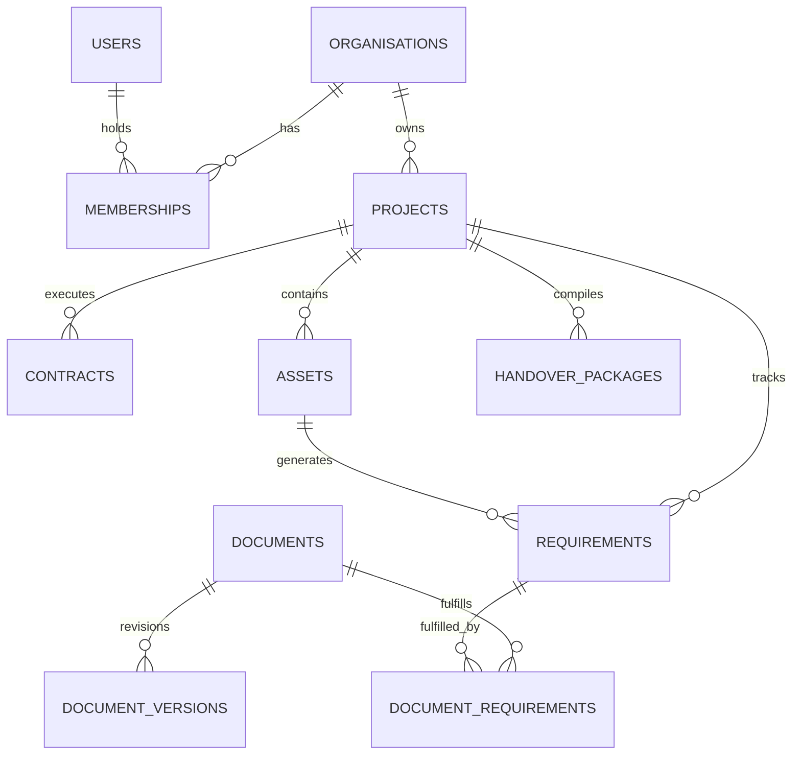
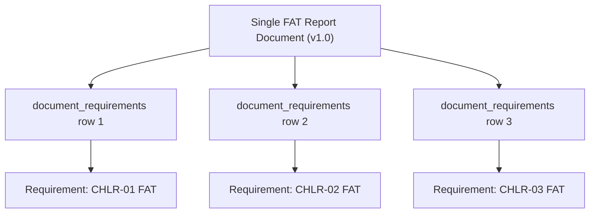
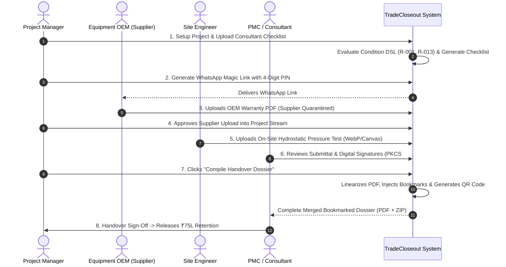
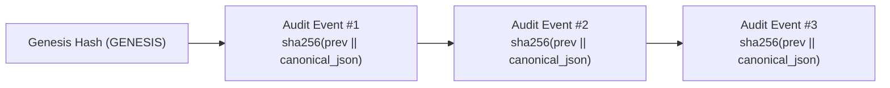

# TradeCloseout: Comprehensive Engineering & Domain Course
**A Complete Guide to Construction MEP Closeout, Retention-Money Release, and Cloud Architecture**

---

## Course Navigation



* [**Module 1: The Domain, The Problem & The Business Opportunity**](#module-1-the-domain-the-problem--the-business-opportunity)
* [**Module 2: Monorepo Architecture & Technical Blueprint**](#module-2-monorepo-architecture--technical-blueprint)
* [**Module 3: Core Domain Models & Database Design**](#module-3-core-domain-models--database-design)
* [**Module 4: End-to-End Operational Lifecycle**](#module-4-end-to-end-operational-lifecycle)
* [**Module 5: Engineering Invariants & Deep-Dive Innovations**](#module-5-engineering-invariants--deep-dive-innovations)
* [**Module 6: Operational Runbooks, Tooling & Verification**](#module-6-operational-runbooks-tooling--verification)

---

## Module 1: The Domain, The Problem & The Business Opportunity

### 1.1 What is MEP in Commercial Construction?
In high-value commercial construction (pharmaceutical formulation plants, Grade-A IT parks, multi-specialty hospitals, airports), the civil structure (concrete and steel) is only part of the building. The operational lifeblood is **MEP** (**M**echanical, **E**lectrical, and **P**lumbing) and **HVAC** (Heating, Ventilation, and Air Conditioning).

An MEP contractor installs:
* Heavy chillers, cooling towers, primary/secondary pumps, and refrigerant piping.
* Air Handling Units (AHUs), Variable Air Volume (VAV) boxes, and miles of ductwork.
* Cleanroom HEPA filters, differential pressure cascades, and air changes per hour (ACH) controls.
* Building Management Systems (BMS) with point-to-point digital automation sensors.
* Fire safety dampers, electrical switchgear, transformers, and emergency diesel generators.

### 1.2 The Project Stage: What is "Closeout & Handover"?
Construction projects have three main phases:
1. **Design & Procurement:** Drawings created, equipment ordered.
2. **Erection & Installation:** Equipment mounted, ductwork routed, cables pulled.
3. **Commissioning, Testing & Closeout (Handover):** The equipment is turned on, calibrated, tested, documented, and handed over to the building owner's facilities team.

**Trade Closeout** is this third phase. The contractor cannot simply hand over the physical keys; they must submit a massive, verified body of engineering evidence proving that every single piece of equipment was manufactured according to specification, installed safely, tested under pressure, calibrated with certified instruments, balanced for airflow, and backed by OEM warranties.

### 1.3 The Real-World Pain: "The Retention Money Trap"
In Indian commercial construction contracts:
* The Client/General Contractor holds back **5% to 10% of the entire subcontract value as "Retention Money"**.
* For a mid-sized regional HVAC contractor like *Deccan EnviroTech MEP Pvt Ltd* working on a ₹15 Crore project, **₹75,00,000 to ₹1,50,00,000 is locked up**.
* **Statutory Condition:** The retention money cannot be released until the Project Management Consultant (PMC) and Client formally sign off on the **Complete Handover Dossier & As-Built O&M Binder**.



#### Why Generic Tools Fail
Contractors historically tried solving this with WhatsApp, Google Drive, Excel sheets, and email:
1. **WhatsApp Chaos:** Equipment suppliers WhatsApp photos of test certificates to site engineers. The files get compressed, lost, or trapped on a single phone.
2. **No Equipment Linking:** A Google Drive folder with 4,000 PDFs does not tell the consultant which specific chiller tag (`CHLR-01`) is covered by which AHRI factory test certificate.
3. **No Review Audit Trail:** Consultants reject a submission via email saying *"reports are incomplete"*, with no specific redlines or clause citations.
4. **The "Binder Assembly Nightmare":** At the end of the project, junior engineers spend 4 to 6 weeks manually scanning, merging, and photocopying 3,000 pages into 10 physical lever-arch files. If 1 certificate is rejected, the entire physical binder has to be re-indexed and reprinted.

**TradeCloseout** is purpose-built to solve this exact problem: it turns closeout from a chaotic 90-day cash-flow disaster into an automated, transparent, tamper-evident digital workflow.

---

## Module 2: Monorepo Architecture & Technical Blueprint

TradeCloseout is engineered as a production-grade TypeScript monorepo using `pnpm` workspaces:

```
tradecloseout/
├── apps/
│   ├── api/          # NestJS 10 REST API backend
│   ├── web/          # Next.js 15 App Router frontend (PWA + SSR)
│   └── worker/       # BullMQ queue workers & leader-locked schedulers
├── packages/
│   ├── db/           # PostgreSQL 16 schema, migrations & RLS helpers
│   ├── pdf-engine/   # Streaming PDF merger, linearizer & signature injector
│   └── shared/       # Shared TypeScript types, Zod schemas & validators
├── docs/             # Legal, DPDP, and CA billing dossiers
├── infra/            # Terraform AWS Mumbai (ap-south-1) IaC
└── scripts/          # M3 reconciler, PITR restore drill & emergency runbooks
```

### 2.1 The Architectural Flow



### 2.2 Role of Each Package

| Package / Application | Technology | Responsibility |
| --- | --- | --- |
| [`@tradecloseout/shared`](file:///home/cassandra/tradecloseout/packages/shared/src/index.ts) | TypeScript, Zod | Canonical types, enums, error codes, and Indian validators (GSTIN Modulo-36, PAN, phone). |
| [`@tradecloseout/db`](file:///home/cassandra/tradecloseout/packages/db/src/index.ts) | PostgreSQL 16, Drizzle | Schema DDL, RLS policies, [`withTenantTransaction`](file:///home/cassandra/tradecloseout/packages/db/src/tenant-tx.ts), and [`evaluateCatalogueRule`](file:///home/cassandra/tradecloseout/packages/db/src/catalogue-rules.ts). |
| [`@tradecloseout/pdf-engine`](file:///home/cassandra/tradecloseout/packages/pdf-engine/src/package-builder.ts) | `pdf-lib`, `qpdf` | Bookmarked dossier generation, `/Outlines` dictionary injection, and fast 4G web linearization. |
| [`apps/api`](file:///home/cassandra/tradecloseout/apps/api/src/main.ts) | NestJS 10, Fastify/Express | Authenticated REST API, RBAC guards, review workflows, billing, and document metadata. |
| [`apps/worker`](file:///home/cassandra/tradecloseout/apps/worker/src/main.ts) | BullMQ, `ioredis` | ClamAV antivirus socket streaming, PDF bomb validation, office format conversion, and daily expiry crons. |
| [`apps/web`](file:///home/cassandra/tradecloseout/apps/web/src/app/page.tsx) | Next.js 15, Tailwind | Field-accessible contractor dashboard, offline IndexedDB upload queue, and supplier portal. |

---

## Module 3: Core Domain Models & Database Design

TradeCloseout models the real-world relationships of a construction project.

### 3.1 Entity Relationship Diagram



### 3.2 Core Entities Explained

1. **Organisations (`organisations`):** The top-level tenant. Each subcontractor firm (e.g. Deccan EnviroTech MEP) has its own isolated organisation. All queries are strictly isolated by `org_id` at the database level.
2. **Projects (`projects`):** A specific construction site (e.g., `HYD-BIO-09` Genome Valley Cleanroom HVAC). Projects have contractual dates, statuses (`ACTIVE`, `HANDOVER`, `CLOSED`), and counterparties (Client, Main Contractor, Consultant).
3. **Contracts (`contracts`):** Represents the commercial agreement. Stores the subcontract value in paise (`value_paise`) and retention basis points (`retention_bps`, e.g., 500 bps = 5%).
4. **Assets (`assets`):** Every physical tag on the drawings is an Asset (e.g., `CHLR-01` 500 TR Water-Cooled Screw Chiller, `AHU-04` Sterile Core Air Handling Unit).
5. **Document Types (`DT-001` to `DT-099`):** A standard Indian MEP taxonomy mapping technical submittals:
   * `DT-011`: As-Built Drawing (CAD/PDF)
   * `DT-022`: Factory Acceptance Test (FAT)
   * `DT-024`: Mill Test Certificate (MTC)
   * `DT-026`: Manufacturer Warranty Certificate
   * `DT-033`: Hydrostatic Pressure Test Report
   * `DT-050`: Testing, Adjusting & Balancing (TAB) Report
   * `DT-058`: Operation & Maintenance (O&M) Manual
   * `DT-097`: No-Demand Certificate (NDC)
6. **Requirements (`requirements`):** The checklist items that must be satisfied. A requirement links a Document Type to a scope (either project-wide or asset-specific).
7. **Documents & Versions (`documents`, `document_versions`):** A Document is the container; Document Versions represent the uploaded revisions (`v1.0`, `v1.1`, `v2.0`).

### 3.3 The 1-to-Many Evidence Architecture (`FR-DOC-011`)
A crucial domain reality in MEP: **One document often certifies multiple assets or requirements.**
For instance, a manufacturer may issue a single 15-page **AHRI 550/590 Factory Acceptance Test Report** covering all three chillers (`CHLR-01`, `CHLR-02`, and `CHLR-03`) ordered under the same purchase order.



When the consultant reviews and approves this single document, [`executeReviewDecision`](file:///home/cassandra/tradecloseout/apps/api/src/modules/reviews/review-decision.service.ts) atomically updates **all three requirements** to `APPROVED`, preventing approval deadlocks.

---

## Module 4: End-to-End Operational Lifecycle

Here is the journey of a project from onboarding to retention money release:



### Step 1: Checklist Ingestion & Condition DSL Evaluation
When a project is created, the system snapshot evaluator inspects the project's attributes (e.g. system type = `WATER_COOLED_CHILLER`, cleanroom rating = `ISO_CLASS_7`) and evaluates conditional rules:
* `R-001`: If chilled water piping is present $\rightarrow$ Require `DT-033` (Hydrostatic Test) and `DT-036` (Flushing Record).
* `R-004`: If cleanroom classification is specified $\rightarrow$ Require `DT-057` (Room Differential Pressure & ACH Report).
* `R-013`: If contract value $> ₹10\text{ Cr}$ $\rightarrow$ Require two-step mandatory waiver approval.

Implemented in [`catalogue-rules.ts`](file:///home/cassandra/tradecloseout/packages/db/src/catalogue-rules.ts).

### Step 2: Two-Tier Supplier Uploads via WhatsApp
Equipment suppliers (e.g. Blue Star or Daikin) refuse to install apps, remember passwords, or navigate complex enterprise software:
1. TradeCloseout generates a secure **Magic Link** with a 4-digit project PIN:
   `https://tradecloseout.com/guest/0192e...#pin=6088`
2. The supplier opens the link directly on their phone or browser.
3. They upload the factory test certificate or warranty.
4. **Safety Staging:** The upload is staged under `SUPPLIER_QUARANTINE_REVIEW`. It does not hit the client's live checklist until the contractor PM reviews and verifies it.

Implemented in [`supplier-guest.service.ts`](file:///home/cassandra/tradecloseout/apps/api/src/modules/parties/supplier-guest.service.ts).

### Step 3: Site Engineer 4G Field Uploads
Construction basements and plant rooms have patchy 4G connectivity:
1. The site engineer snaps a photo of an installation checklist or weld log on their 12 MP phone camera (6–8 MB JPEG).
2. The browser automatically compresses the image down to $\sim 600\text{ KB}$ WebP using HTML5 Canvas before uploading.
3. If the signal drops, the file queues in **IndexedDB** and automatically retries in the background.
4. **Soft Quota Check:** The system verifies plan quota without permanently deducting storage bytes if the upload is aborted midway.

Implemented in [`offline-upload-queue.ts`](file:///home/cassandra/tradecloseout/apps/web/src/lib/offline-upload-queue.ts) and [`documents.service.ts`](file:///home/cassandra/tradecloseout/apps/api/src/modules/documents/documents.service.ts).

### Step 4: Multi-Stage Consultant Review
The Project Management Consultant (PMC) reviews uploaded evidence:
* **Approved:** Requirement transitions to `APPROVED`.
* **Changes Requested / Rejected:** Requires explicit rejection category code and page-specific redline annotations. Internal contractor notes are never leaked to external parties (`FR-NOT-013`).

### Step 5: 1-Click Handover Dossier Compilation
Once all requirements are approved, TradeCloseout compiles the complete handover dossier:
1. Merges hundreds of engineering PDFs in $O(1)$ memory using streaming `qpdf`.
2. Injects hierarchical PDF bookmarks (`/Outlines`) matching the contractual Table of Contents.
3. Linearizes the PDF (Fast Web View) so a 500-page document loads in $<3$ seconds on 4G.
4. Generates an online verification QR stamp on the cover page.

Implemented in [`pdf-stream-compiler.ts`](file:///home/cassandra/tradecloseout/apps/worker/src/queues/pdf-stream-compiler.ts) and [`package-builder.ts`](file:///home/cassandra/tradecloseout/packages/pdf-engine/src/package-builder.ts).

---

## Module 5: Engineering Invariants & Deep-Dive Innovations

### 5.1 Fail-Closed Multi-Tenant Isolation (PostgreSQL 16 Force RLS)
In B2B SaaS, a bug that leaks one contractor's pricing or drawings to a competing contractor is catastrophic. TradeCloseout enforces tenant isolation at the database kernel level:

```sql
-- Forced RLS enabled on all tenant tables
ALTER TABLE documents ENABLE ROW LEVEL SECURITY;
ALTER TABLE documents FORCE ROW LEVEL SECURITY;

CREATE POLICY documents_rls ON documents
  USING (org_id = NULLIF(current_setting('app.current_org', true), '')::uuid)
  WITH CHECK (org_id = NULLIF(current_setting('app.current_org', true), '')::uuid);
```

#### Why `FORCE ROW LEVEL SECURITY`?
Standard RLS in PostgreSQL is bypassed by table owners. `FORCE ROW LEVEL SECURITY` ensures that even queries executed by the application database user (`tc_app`) are strictly filtered. If `app.current_org` is unset, PostgreSQL returns **0 rows (fails closed)**.

#### Transaction & Savepoint Safety
All operations run through [`withTenantTransaction`](file:///home/cassandra/tradecloseout/packages/db/src/tenant-tx.ts). To prevent the dreaded PostgreSQL `25P02` transaction abort state (where one caught query error aborts the entire transaction block), [`withSavepoint`](file:///home/cassandra/tradecloseout/packages/db/src/tenant-tx.ts#L80-L105) creates isolated sub-transactions:

```typescript
export async function withSavepoint<T>(
  client: PoolClient,
  savepointName: string,
  fn: () => Promise<T>,
): Promise<T> {
  await client.query(`SAVEPOINT ${savepointName}`);
  try {
    const result = await fn();
    await client.query(`RELEASE SAVEPOINT ${savepointName}`);
    return result;
  } catch (err) {
    await client.query(`ROLLBACK TO SAVEPOINT ${savepointName}`);
    throw err;
  }
}
```

### 5.2 Tamper-Evident Synchronous SHA-256 Audit Hash Chain
In construction disputes and court arbitrations, contractors and clients often dispute who approved what and when. TradeCloseout maintains an append-only, tamper-evident cryptographic ledger:



* **Monotonic Ordering:** Each organization has an isolated PostgreSQL sequence `audit_events_chain_seq` providing gap-free, monotonic sequence numbers (`chain_seq`).
* **Timestamp Inversion Immunity:** Instead of `transaction_timestamp()`, the trigger uses `clock_timestamp()` so concurrent commits cannot invert chronological order.
* **Database Immutability Trigger:** Any `UPDATE` or `DELETE` statement issued against `audit_events` raises an immediate SQL exception: `AUDIT_IMMUTABLE`.

Implemented in [`0003_perfect_10_hardening.sql`](file:///home/cassandra/tradecloseout/packages/db/migrations/0003_perfect_10_hardening.sql).

### 5.3 Malware & PDF Bomb Quarantine
Construction submittals are prime targets for malicious files and accidental decompression bombs:
1. **Magic Signature Verification:** Validates genuine file headers (`%PDF-`, `\xFF\xD8\xFF`, etc.) rather than trusting file extensions.
2. **Decompression Bomb Defense (`RT-034`):** Any PDF exceeding **1,000 pages** or **25,000 internal objects** is immediately rejected before parsing.
3. **ClamAV Antivirus Streaming:** Files are streamed directly into ClamAV daemon via TCP socket (`zINSTREAM`) without buffering entire files in Node.js process memory.
4. **Malicious Script Stripping:** `qpdf` removes `/JS`, `/JavaScript`, `/AA`, `/OpenAction`, and `/Launch` execution hooks.

Implemented in [`file.processor.ts`](file:///home/cassandra/tradecloseout/apps/worker/src/queues/file.processor.ts).

### 5.4 PDF `/ByteRange` Placeholders & Native Acrobat DSC Signatures
Indian government and corporate tenders require Class 3 Digital Signature Certificates (DSC). Most PDF libraries break digital signatures when modifying a document because the file hash changes.

TradeCloseout reserves an explicit `/ByteRange` placeholder block in the PDF:
```
/ByteRange [ 0, 120450, 128650, 54200 ]
/Contents <308204...>
```
When an engineer signs with their USB crypto-token, the PKCS#7 detached CMS signature is written directly into the allocated placeholder, allowing the signature to validate natively inside Adobe Acrobat Reader's Signature Panel.

Implemented in [`digital-signature.service.ts`](file:///home/cassandra/tradecloseout/apps/api/src/modules/signatures/digital-signature.service.ts).

---

## Module 6: Operational Runbooks, Tooling & Verification

TradeCloseout includes production-ready CLI tools and emergency runbooks:

### 6.1 Milestone M3 Consultant Checklist Reconciler
Ingests consultant checklists (Meinhardt, WSP, AECOM, L&T, Shapoorji, CPWD) and automatically maps titles to standard document types `DT-001`–`DT-099`:

```bash
pnpm tsx scripts/reconcile-consultant-checklist.ts
# ✓ Milestone M3 Reconciler: 12/13 mapped (92.3% coverage — Gate Passed: true)
```
Outputs an **L3 ClientProfile JSON bundle** ready to apply to any project.

### 6.2 Pre-Invoice Point-in-Time Restore (PITR) Drill
Before billing any customer, operational standards mandate verifying that the database backup can be restored:

```bash
./scripts/run-restore-drill.sh
# [DRILL STEP 1/5] Taking consistent snapshot...
# [DRILL STEP 2/5] Provisioning staging restore DB...
# [DRILL STEP 3/5] Restoring snapshot...
# [DRILL STEP 4/5] Verifying row counts & audit hash-chain integrity...
# [DRILL STEP 5/5] Cleaning up drill database...
# ✓ PRE-INVOICE RESTORE DRILL PASSED! Measured RTO: 2 seconds (Target <= 14,400s).
```

### 6.3 Emergency Incident Runbooks (`scripts/execute-runbooks.ts`)
Three critical automated containment procedures can be invoked instantly:

| Code | Incident | Automated Containment Action |
| --- | --- | --- |
| `RB-08` | Suspected Tenant Isolation Breach | Immediately revokes all active sessions for the compromised organisation. |
| `RB-09` | Malware Outbreak Detected | Quarantines the affected `document_version` and blocks download URLs. |
| `RB-12` | Suspected PDF Injection / Corruption | Marks the compiled handover package as `REJECTED`, blocking distribution. |

Usage example:
```bash
pnpm tsx scripts/execute-runbooks.ts RB-08 0192e000-0000-7000-8000-000000000001 "Routine containment test"
```

---

## Summary: How Everything Connects

```
1. CONTRACTOR SIGNS UP
   └── Multi-tenant organisation created in PostgreSQL with forced RLS.

2. PROJECT ONBOARDED
   └── Project assets, contracts, and retention values registered.
   └── Checklist catalogue evaluated via Condition DSL (R-001..R-013).

3. EVIDENCE COLLECTED
   ├── Suppliers upload warranties via WhatsApp magic links (quarantined).
   └── Site engineers upload test reports via mobile PWA with WebP compression.

4. SAFETY & INTEGRITY ENFORCED
   ├── ClamAV socket streams and qpdf bomb checks (max 1000 pgs/25k objects).
   └── Tamper-evident SHA-256 hash-chain logs every single action synchronously.

5. REVIEW & HANDOVER COMPILED
   ├── Multi-tier approval workflow (internal QC -> external consultant).
   └── 1-click qpdf merge produces a bookmarked, linearized, QR-stamped PDF.

6. RETENTION RELEASED
   └── Clean handover binder presented to Client/PMC -> ₹75L+ retention unlocked!
```
