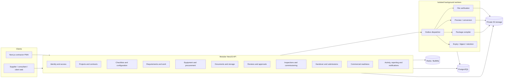
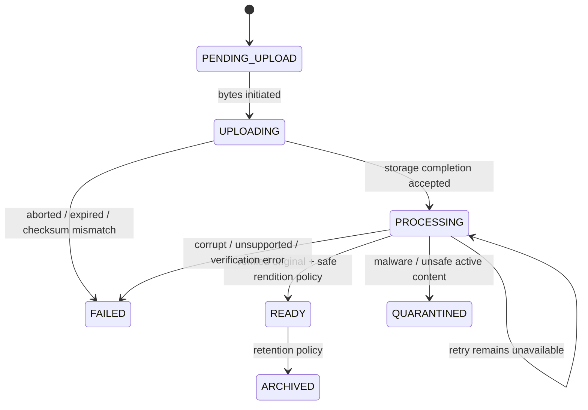
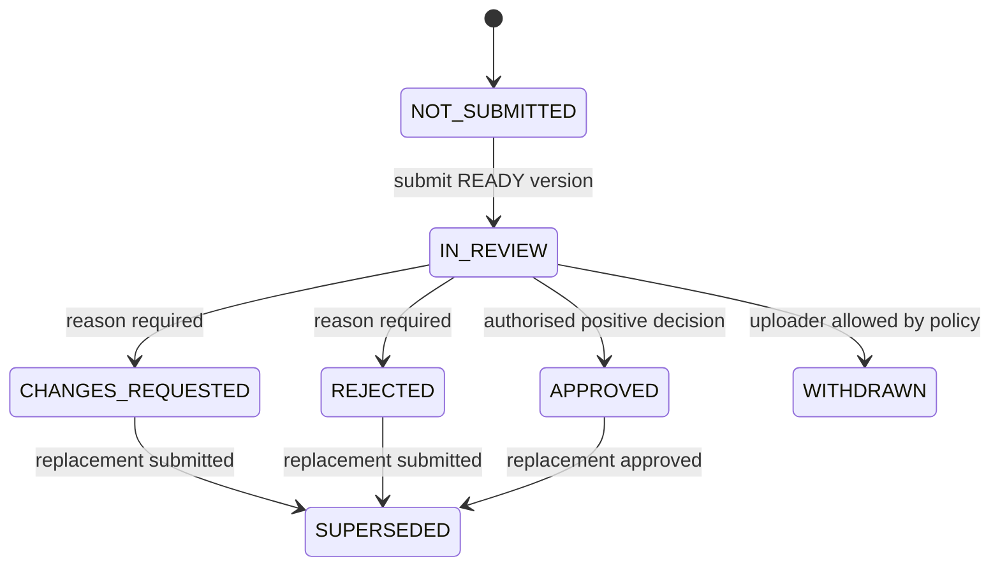

# TradeCloseout 2.0 — Target Architecture

**Status:** Discovery/design only; no application source changes  
**Date:** 4 November 2026  
**Primary constraint:** Small engineering team operating confidential contractual evidence  
**Architecture choice:** Modular monolith + isolated workers + PostgreSQL + private object storage

## 1. Architectural principles

1. **Evidence before convenience.** Missing bytes, unavailable scanning or unknown authority must produce an explicit blocked state, never a green status.
2. **Originals are immutable.** Sanitisation, compression, annotation and compilation create separately identified derivatives.
3. **One domain command per business decision.** No alternate review, upload or recipient service can bypass invariants.
4. **Independent business states.** File processing, review, requirement satisfaction and handover acceptance are not interchangeable.
5. **Tenant and project scopes are distinct.** RLS isolates organisations; services and database constraints additionally enforce project/grant scope.
6. **Database transactions define truth.** External side effects follow committed outbox events and are idempotent.
7. **Small-team operability.** No microservices, Kubernetes, Kafka, Elasticsearch or additional warehouse without measured need.
8. **Progressive migration.** Preserve sound schema and data, dual-read where necessary, and never rewrite history to fit a new model.
9. **Contracts at boundaries.** OpenAPI, runtime DTO validation and generated client types replace informal inline object agreements.
10. **Measured performance claims.** Do not claim O(1) memory, sub-three-second streaming or production readiness without representative measurements.

## 2. Current architecture critique and response

| Current condition | Consequence | Target response |
|---|---|---|
| `completeUpload` can mark `READY`; ClamAV refusal can be clean | Unverified evidence enters review/download | Upload completion only `PROCESSING`; worker result alone sets `READY`; scanner unavailable blocks |
| Missing original can generate a “certified” PDF | Chain of custody is broken | Hard failure; original and rendition objects separated |
| Several review services and stamp-back paths exist | Different state and permission rules by route | One `ReviewDecisionService` used by in-app, external and bulk decisions |
| Permission scope computed but project role is not resolved/enforced | Same-org cross-project access risk | Request scope resolver + service invariants + negative project tests |
| Outbox has minimal entity payload and weak polling ownership | Handover/scan jobs stall or duplicate | Versioned full envelope, deterministic jobs, leases, idempotent consumers |
| Inline TypeScript request bodies | Whitelist pipe does not validate runtime shapes | OpenAPI + DTO/Zod validation + generated client |
| SQL migrations, Drizzle and statuses conflict | Clean deployment and business queries can fail | Reviewed baseline, migration ledger, schema contract CI |
| Browser/API upload response shapes differ | Offline upload cannot reliably complete | One versioned upload contract and integration tests |
| Rich demo UI performs local success actions | User believes contractual work completed | No production demo fixtures; all actions persist and refetch |
| Asset/document/warranty foundations exist, but no structured Cx or actual RA ledger | Product lifecycle is incomplete | Add bounded Cx and commercial modules; avoid generic ERP |

## 3. Logical system architecture



### Deployment units

- **Web:** Next.js application and PWA; no privileged business logic.
- **API:** One deployable modular monolith with domain modules and shared infrastructure.
- **Worker:** One codebase with separate BullMQ consumers and concurrency limits. Risky qpdf/LibreOffice/image operations run as bounded subprocesses, with explicit resource/time limits.
- **PostgreSQL:** System of record for domain, outbox, idempotency, audit and reporting projections.
- **Private S3-compatible storage:** Originals, derived renditions, package artefacts and exports, encrypted and non-public.
- **Redis:** Queue coordination, rate limits, short-lived OTP and lock leases only. Never the sole source of business truth.

No network-accessible storage bucket, Redis or PostgreSQL should be public.

## 4. Module boundaries

| Module | Owns | Must not own |
|---|---|---|
| Identity & Access | users, identities, memberships, sessions, OTP, grants, project scope | Evidence approval, project business state |
| Projects & Contracts | project, contract baseline, parties, variations, specifications, project lifecycle | SaaS subscription invoices, document reviews |
| Configuration & Checklists | config versions, template packs, snapshots, requirement definitions/change history | Actual evidence, acceptance |
| Requirements & Work | requirement instances, applicability, assignments, current actor, inbox projection | File bytes, approval cryptography |
| Equipment & Procurement | systems/equipment/locations, PO and delivery milestones, replacement lineage | Full inventory/accounting, generic procurement |
| Documents & Storage | logical documents, versions, objects, renditions, verification, upload intents | Human approval, satisfaction |
| Reviews & Approvals | reviews, comments, decision, external approval, override policy | File verification, package acceptance |
| Inspections & Commissioning | ITP versions, inspections, items, instruments, attempts, witnesses, results | Arbitrary engineering standard values, automatic approval |
| Defects & Warranties | defects/NCR, rectification, verification, warranty events and claims | Editing approved inspection history |
| Handover & Submissions | readiness, packages, pinned items, artefacts, submissions, recipients, exceptions | Changing source evidence after issue |
| Commercial Readiness | milestone rules, RA bills, deductions, retention instalments, receipts | Technical approval, generic invoicing/accounting |
| Activity & Reporting | audit reads, project timeline, exports, notification preferences, search projections | Unauthorised cross-project data aggregation |
| Platform Operations | migration, queue health, dead letters, environment validation, restore verification | Tenant business decisions |

### Consolidation required

- Merge review decisions from `ReviewsService`, `review-decision.service.ts`, external approval and transmittal stamp-back into one application command with separate input methods.
- Replace the two supplier-link implementations with one grant service and one scoped guest-session service.
- Remove patch-bucket responsibilities from `modules/remediation/perfect-10-patches.ts`; move domain behaviour to owning modules.
- Use one status catalogue for persistence and one mapping to presentation language.
- Keep tenant transaction helpers in `packages/db`, but request/project scope belongs in an application-scope resolver.

## 5. Domain and database design

### 5.1 Preserve, extend, consolidate or replace

| Existing object | Decision | Reason / required change |
|---|---|---|
| `users`, `user_identities`, `sessions`, `organisations`, `memberships`, `project_members` | Preserve + extend | Sound core identity; add grant-safe session actor model, active project role resolution and consistent nullable org onboarding |
| `parties`, `party_contacts`, `guest_grants` | Preserve + consolidate | One grant model, explicit capabilities/scopes, revoked timestamps, recipient binding, no creator impersonation |
| `projects`, `contracts`, `specification_refs`, `variations` | Preserve + extend | Complete project type/status fields, contract baselines, milestones and warranty terms; avoid duplicate project contract columns |
| `config_versions`, `template_packs`, `checklist_snapshots`, `requirement_change_requests`, `requirement_revisions` | Preserve + repair | Use consistent `checklist.requirements` paths, persisted layers, immutable approved versions and impact history |
| `requirements` | Preserve + extend | Stable requirement identity; replace implicit status overloading and string-only scope with formal scope links and work/satisfaction projections |
| `assets` | Preserve + extend | Add systems, location hierarchy and procurement/lifecycle relations; retain tag/replacement/warranty fields |
| `documents`, `document_versions` | Preserve + extend | Exact revision lineage and separate file/review states; add verification/rendition relationships and immutable approved pointer |
| `document_requirements` | Replace through migration | Document-level link lacks exact evidence version and coverage. Migrate to `requirement_evidence` with dual-read/backfill |
| `document_assets` | Preserve for discovery | Equipment-document relationship is useful, but requirement satisfaction must use `requirement_evidence` |
| `storage_objects` | Preserve + extend | Actual bytes/hash/provider version, verification state, retention and original/derivative separation |
| `reviews`, `review_comments`, `approval_overrides` | Preserve + repair | Real reviewer subjects, method/authority/evidence, comment coordinates/resolution and role enforcement |
| `waivers` | Preserve + repair | Two-person mandatory decisions, evidence, status and distinct approvers |
| `handover_packages`, `package_items`, `package_requirements`, `submissions`, `submission_recipients` | Preserve + repair | Real artefacts, exact versions, recipient identifier consistency, deterministic decisions and exceptions |
| `warranty_events`, `defects` | Preserve + extend | Correct severity/timestamps/location, rectification review, DLP closure and warranty conflicts |
| `audit_events`, `outbox_events`, `idempotency_keys` | Preserve + redesign behaviour | Full event envelope, verified canonical hash, leases, atomic idempotency and replay operations |
| `plans`, `subscriptions`, `invoices`, `invoice_tds`, `usage_counters` | Preserve + isolate from project commercial | SaaS billing is distinct from customer project RA/retention; correct quota metrics and idempotency |
| `digital_signatures` | Quarantine as unverified feature | Do not expose as valid signing until actual CMS/certificate/target validation exists |
| `perfect-10-patches.ts` | Remove as architectural pattern | Domain logic must move to owners rather than patch modules |

### 5.2 Conceptual ER diagram

```mermaid
erDiagram
  ORGANISATIONS ||--o{ MEMBERSHIPS : has
  USERS ||--o{ MEMBERSHIPS : holds
  ORGANISATIONS ||--o{ PROJECTS : owns
  PROJECTS ||--o{ PROJECT_MEMBERS : scopes
  USERS ||--o{ PROJECT_MEMBERS : assigned
  PROJECTS ||--o{ CONTRACTS : governed_by
  CONTRACTS ||--o{ CONTRACT_MILESTONES : defines
  CONTRACTS ||--o{ VARIATIONS : changed_by
  PARTIES ||--o{ CONTRACTS : counterparty

  TEMPLATE_PACKS ||--o{ CONFIG_VERSIONS : versions
  PROJECTS ||--o{ CHECKLIST_SNAPSHOTS : applies
  CHECKLIST_SNAPSHOTS ||--o{ REQUIREMENTS : instantiates
  REQUIREMENTS ||--o{ REQUIREMENT_SCOPES : applies_to
  SYSTEMS ||--o{ REQUIREMENT_SCOPES : subject
  ASSETS ||--o{ REQUIREMENT_SCOPES : subject
  LOCATIONS ||--o{ REQUIREMENT_SCOPES : subject
  REQUIREMENTS ||--o{ REQUIREMENT_REVISIONS : history

  PROJECTS ||--o{ SYSTEMS : contains
  SYSTEMS ||--o{ ASSETS : contains
  LOCATIONS ||--o{ ASSETS : locates
  ASSETS ||--o{ PROCUREMENT_EVENTS : lifecycle
  ASSETS ||--o{ ASSETS : replaced_by

  PROJECTS ||--o{ DOCUMENTS : contains
  DOCUMENTS ||--o{ DOCUMENT_VERSIONS : revisions
  DOCUMENT_VERSIONS ||--|| STORAGE_OBJECTS : original
  DOCUMENT_VERSIONS ||--o{ DOCUMENT_RENDITIONS : derived
  STORAGE_OBJECTS ||--o{ FILE_VERIFICATIONS : checked_by
  DOCUMENT_RENDITIONS ||--|| STORAGE_OBJECTS : output

  REQUIREMENTS ||--o{ REQUIREMENT_EVIDENCE : proven_by
  DOCUMENT_VERSIONS ||--o{ REQUIREMENT_EVIDENCE : exact_evidence
  REQUIREMENT_EVIDENCE ||--o{ REQUIREMENT_SATISFACTIONS : supports
  REVIEWS ||--o{ REQUIREMENT_SATISFACTIONS : authorises
  DOCUMENT_VERSIONS ||--o{ REVIEWS : reviewed_in
  REVIEWS ||--o{ REVIEW_COMMENTS : contains
  WAIVERS ||--o{ REQUIREMENT_SATISFACTIONS : alternative

  ITP_TEMPLATES ||--o{ INSPECTIONS : instantiates
  ASSETS ||--o{ INSPECTIONS : tested
  INSPECTIONS ||--o{ INSPECTION_ATTEMPTS : attempts
  INSPECTION_ATTEMPTS ||--o{ INSPECTION_RESULTS : measurements
  INSTRUMENTS ||--o{ INSPECTION_ATTEMPTS : used_in
  INSTRUMENTS ||--o{ CALIBRATION_RECORDS : calibrated_by
  INSPECTION_ATTEMPTS ||--o{ DEFECTS : may_create

  ASSETS ||--o{ WARRANTY_EVENTS : covered_by
  ASSETS ||--o{ DEFECTS : affected_by
  DEFECTS ||--o{ DEFECT_EVENTS : history

  PROJECTS ||--o{ HANDOVER_PACKAGES : versions
  HANDOVER_PACKAGES ||--o{ PACKAGE_ITEMS : pins
  DOCUMENT_VERSIONS ||--o{ PACKAGE_ITEMS : included
  HANDOVER_PACKAGES ||--o{ SUBMISSIONS : transmitted_as
  SUBMISSIONS ||--o{ SUBMISSION_RECIPIENTS : recipients
  SUBMISSION_RECIPIENTS ||--o{ SUBMISSION_DECISIONS : decides
  SUBMISSION_DECISIONS ||--o{ WORK_ITEMS : exceptions

  CONTRACT_MILESTONES ||--o{ RA_BILLS : bills
  RA_BILLS ||--o{ RA_DEDUCTIONS : deductions
  RA_BILLS ||--o{ RETENTION_INSTALMENTS : accumulates
  RETENTION_INSTALMENTS ||--o{ COMMERCIAL_EVENTS : release_claim_receipt

  PROJECTS ||--o{ OUTBOX_EVENTS : publishes
  PROJECTS ||--o{ AUDIT_EVENTS : records
```



All tenant-owned rows carry `org_id`; all project-owned rows carry both `org_id` and `project_id`. Composite foreign keys must enforce same-tenant/project relationships, not only ID references.

### 5.3 Key proposed records

#### `requirements`

- `id`, `org_id`, `project_id`, `current_snapshot_id`.
- Stable `requirement_key`, group, title, description, doc type.
- `mandatory`, `milestone_id` (nullable only where truly non-commercial).
- `owner_user_id`, `owner_party_id`, `reviewer_role`.
- `due_at`, `work_status`, `superseded_at`, `row_version`, timestamps.

Do not infer satisfaction from `work_status`. Current satisfaction is a separate projection of active evidence/waiver/N/A and validity.

#### `requirement_scopes`

- `id`, `org_id`, `project_id`, `requirement_id`.
- `subject_type`: `PROJECT | SYSTEM | ASSET | LOCATION`.
- `system_id`, `asset_id`, `location_id` with exactly the appropriate reference set.
- Optional applicability note/rule provenance.

Asset-category templates expand to concrete asset scopes when the checklist is applied. Historical scopes remain even after equipment replacement.

#### `requirement_evidence`

- `id`, `org_id`, `project_id`, `requirement_id`, `document_version_id`.
- `relationship`: `PRIMARY | SUPPORTING | EXCEPTION`.
- `coverage_scope_json` only for meaningful partial coverage; avoid using JSON to bypass relational scope.
- `linked_by_actor`, `linked_at`, `unlinked_at`, `superseded_at`.

Exact document version is mandatory. The old `document_requirements` relationship may remain as a discovery hint after migration but cannot itself approve anything.

#### `requirement_satisfactions`

- `id`, `org_id`, `project_id`, `requirement_id`.
- `kind`: `EVIDENCE | WAIVER | NOT_APPLICABLE`.
- `evidence_link_id`, `review_id`, `waiver_id` as appropriate.
- `status`: `ACTIVE | EXPIRED | REVOKED | SUPERSEDED`.
- `valid_from`, `valid_until`, `created_at`.

A requirement may have many historical satisfaction records but at most one active primary satisfaction under the MVP rule. Future multi-evidence requirements need an explicit coverage rule, not silent many-to-many approval.

#### `storage_objects` extensions

- Provider, bucket, key and provider object version.
- Declared/actual size and MIME; detected MIME.
- Original SHA-256; byte-verification timestamp.
- State and retention class.
- Created by user/grant actor, no sensitive bearer data.

#### `file_verifications`

- `document_version_id`, `object_id`.
- Hash/size match, AV engine/database version and verdict.
- Structure/page/object results, encryption/active-content result.
- Started/completed timestamps, failure code/detail, worker ID and idempotency key.

#### `document_renditions`

- `document_version_id`, `source_object_id`, `output_object_id`.
- `rendition_type`: `SANITISED_PDF | PREVIEW_PDF | THUMBNAIL | OCR_TEXT | COMPRESSED_IMAGE`.
- Generator/version, source/output hashes, created timestamp.

#### `inspection_attempts` and `inspection_results`

Attempts have inspection ID, attempt number, started/completed times, actual test date/time, participants, weather/conditions where relevant, status and reviewer.

Results have item definition snapshot, numeric/text/boolean value, unit, design range/operator, result, comment and evidence links. The item definition snapshot prevents a template edit from rewriting old tests.

#### `instruments` and `calibration_records`

Instrument identity, serial, type, calibration certificate document version, valid from/to, issuing lab and status. Attempt-instrument join captures what was used even if the instrument is later recalibrated or replaced.

#### `ra_bills`, `ra_deductions`, `retention_instalments`, `commercial_events`

- RA: contract milestone, number, period, gross/certified/net payable in paise, status and evidence links.
- Deduction: type, amount, reason, source reference.
- Retention instalment: source RA, withheld amount, release conditions, expected/actual release amounts.
- Event: `CERTIFIED | CLAIMED | ACCEPTED | DEDUCTED | RELEASED | RECEIVED | ADJUSTED`, amount, effective date, actor, reference and evidence.

No ledger mutation by AI or a readiness evaluator. Readiness only reports whether prerequisites are met.

## 6. Canonical state machines

### 6.1 File processing



Only storage/worker transitions alter this state. `PROCESSING` objects cannot be reviewed, downloaded or packaged.

### 6.2 Version review



Review never changes file state. External approvals use the same decision command with `method=EXTERNAL` and required authority/evidence.

### 6.3 Requirement work and satisfaction

Requirement `work_status` coordinates effort, not proof:

```text
OPEN → ASSIGNED → READY_FOR_REVIEW → IN_REVIEW
  ↑             ↓                       ↓
  └── CHANGES_REQUIRED ←────────────────┘
                    └→ READY_FOR_REVIEW
CLOSED when active satisfaction exists or requirement is superseded by controlled change
```

`MISSING`, `OVERDUE`, `EXPIRING` and current actor are derived projections. `HANDED_OVER` is derived from package/submission acceptance, not a substitute for satisfaction.

### 6.4 Handover package and submission

```text
Package: DRAFT → QUEUED → GENERATING → READY | FAILED
         READY → SUPERSEDED when a replacement is generated

Submission: DRAFT → SENT → ACKNOWLEDGED
           SENT/ACKNOWLEDGED → PARTIALLY_ACCEPTED | ACCEPTED | REJECTED | WITHDRAWN
```

Package status does not automatically become accepted because a submission was accepted. Link acceptance events explicitly.

Aggregation:

- Any required recipient rejection → `REJECTED`.
- All required recipients accept (including approved exception policy) → `ACCEPTED` or `PARTIALLY_ACCEPTED` per exception semantics.
- Some, not all, required decisions → `PARTIALLY_ACCEPTED`.
- No required recipients configured → block submission until explicitly resolved; never silently accept.
- Required recipient identity and row-affected count are mandatory.

### 6.5 Defects and warranty

```text
Defect: OPEN → IN_PROGRESS → RECTIFIED → VERIFIED
                 ↑             ↓
                 └── REOPENED ─┘
        OPEN/IN_PROGRESS → WAIVED (authorised commercial exception)

Warranty event: RECORDED → CONFIRMED | DISPUTED → CONFIRMED
               CONFIRMED → CLAIMED → RESOLVED
```

Rectification evidence and QC verification are separate. Warranty basis conflicts never silently overwrite confirmed dates.

## 7. API contract design

### 7.1 Standards

- `/api/v1`, JSON `camelCase`, Problem+JSON errors.
- UUID route parameters and runtime validation on all inputs.
- UTC `timestamptz`; explicit local calendar dates for test/warranty/contract terms.
- Money as decimal strings in **paise**, never JS floating point.
- `rowVersion` plus `If-Match` for mutable aggregates.
- Idempotency key on eligible mutation POSTs.
- Pagination with stable cursor, filters and maximum limits.
- API response DTOs are explicit; never return arbitrary `SELECT *` guest data.
- Versioned OpenAPI 3.1 document generates frontend client and contract fixtures.

### 7.2 Core command/query endpoints

| Area | Endpoint pattern | Important rule |
|---|---|---|
| Work | `GET /work-items?assignee=me&state=open` | Authoritative scope, actor, action, age and blocker |
| Projects | `POST /projects`, `GET /projects/:id/dashboard` | Session org, project role and write-state checks |
| Checklists | `POST /projects/:id/checklist-imports`, `POST .../:importId/apply` | Preview and commit are separate; source provenance |
| Requirements | `GET/POST /projects/:id/requirements`, `POST /requirements/:id/change-requests` | Append/change is not full-list replacement |
| Evidence | `POST /projects/:id/upload-intents`, `POST /document-versions/:id/complete`, `POST /requirement-evidence` | Exact version and same project; complete only PROCESSING |
| Review | `POST /document-versions/:id/review-submissions`, `POST /reviews/:id/decision`, `POST /document-versions/:id/external-approval` | One command, role/self-approval/If-Match/current submission |
| Supplier | `POST /projects/:id/supplier-grants`, `POST /guest/:token/session`, `POST /guest/upload-intents` | Grant-bound actor and repeated scope checks |
| Equipment | `GET /assets/:id/passport`, `POST /assets/:id/lifecycle-events` | Read model from actual lifecycle evidence |
| Inspection | `POST /inspections`, `POST /inspections/:id/attempts`, `POST /attempts/:id/submit` | Immutable attempts and calibration-on-test-date |
| Handover | `POST /projects/:id/packages`, `GET /packages/:id`, `POST /packages/:id/submissions` | Real artefacts, exact versions and acceptance separate |
| Decisions | `POST /submissions/:id/recipients/:recipientId/decision` | One matching recipient and deterministic aggregation |
| Commercial | `POST /contracts/:id/ra-bills`, `POST /retention-instalments/:id/events` | Exact paise and actual event types |
| Search | `GET /search?q=&projectId=` | Permission filter before retrieval, result citations |

### 7.3 Idempotency algorithm

1. Hash canonical method + route template + route parameters + body.
2. Atomically insert/claim `(org_id, actor_id, endpoint, key)` in `IN_PROGRESS`.
3. Different hash for existing key → `409 IDEMPOTENCY_KEY_REUSED`.
4. Existing completed same request → replay original status/body without re-execution.
5. Existing in-progress → `409 REQUEST_IN_PROGRESS` or bounded safe wait.
6. Execute business transaction; persist response and completion atomically where feasible.
7. Retain upload-intent keys for the retry window; retain decision keys according to audit policy.

Offline clients use a stable operation UUID from initial capture through upload and review submission. Bearer/session tokens are never stored in the offline operation record.

## 8. Storage and background processing

### 8.1 Secure upload sequence

1. API authenticates actor and project/grant scope; validates declared metadata and quota reservation.
2. Store original object metadata and create real, constrained presigned upload instructions.
3. Storage completion verifies provider result, actual object size and expected hash.
4. In one transaction set `PROCESSING` and write `FILE_VERIFICATION_REQUESTED` outbox event with `orgId`, `projectId`, `versionId`, `objectId`, `eventId`, `schemaVersion`.
5. Worker reads original stream and calculates hash independently.
6. Validate signature and archive safety; scan with real ClamAV INSTREAM and timeouts.
7. Validate PDF/Office/image structure under resource limits.
8. Preserve original, create derived rendition if required, store verification result.
9. Atomically set `READY`, verified storage metadata, rendition and quota usage. Failures remain unavailable and retry safely.

Scanner unavailable, timeout or unexpected response is not clean. Any already-`READY` legacy record should be reconciled before relying on it.

### 8.2 Outbox reliability

Extend `outbox_events` with:

- `event_id`, `schema_version`, `org_id`, `project_id`, `event_type`.
- `aggregate_type`, `aggregate_id`, full `payload_json`.
- `actor_user_id`, `guest_grant_id`, `request_id`, `correlation_id`, `causation_id`.
- `attempts`, `available_at`, `lease_owner`, `lease_expires_at`, `last_error`, `dispatched_at`, `dead_lettered_at`.

Polling transaction claims rows with `FOR UPDATE SKIP LOCKED` and a lease. BullMQ `jobId` is deterministic from `eventId + consumerVersion`. Consumers load current state and use a `job_executions` uniqueness key to ensure one effective result.

Unsupported event types remain visible and alert; they are never silently marked dispatched. Dead-letter replay must be an authorised operation with audit.

### 8.3 Package compilation

The package command persists complete `package_items` and `package_requirements` before emitting the event. Worker input comes from those rows, not transient HTTP request data.

Steps:

1. Lock package `QUEUED → GENERATING` idempotently.
2. Load pinned approved versions and verified original objects.
3. Revalidate hashes and readiness relevant to package generation.
4. Render front matter/index and stream merge via qpdf where available.
5. Generate manifest with original and output hashes, versions, page ranges, exclusions and snapshot checksum.
6. Store PDF, ZIP and manifest objects.
7. Verify output readability, page ranges and hashes.
8. Update package/artefacts/page ranges to `READY`; otherwise record actionable `FAILED` without losing diagnostics.

Do not claim constant memory while pdf-lib bookmark injection reads the entire merged file. Profile this step and move to an out-of-process or streaming method if representative package size requires it.

## 9. Security model

### 9.1 Authentication

- Opaque random session token stored hashed, HttpOnly cookie, server-side expiry/revocation.
- CSRF for cookie-based unsafe requests; bearer API rules explicit if supported.
- Real production SMS/email adapters with timeout and delivery failure handling; no silent no-op providers.
- OTP challenge and attempt consumption atomic in Redis; production rate limits by identifier/IP/grant.
- No raw session token in JSON response, logs, localStorage or offline queue.
- Development identities only in isolated non-production builds/config.

### 9.2 Authorisation layers

1. Session active organisation from DB—not path/body.
2. Active organisation membership and role.
3. Project membership/status/role for scoped permissions.
4. Requirement reviewer role/owner for specific decisions.
5. Guest grant project/party/requirements/package/capabilities and expiry.
6. Tenant RLS and composite foreign keys as defence in depth.
7. Explicit response DTOs/field visibility for commercial/internal data.

A single canonical permission matrix drives decorators, service invariants, OpenAPI and tests. UI visibility is convenience only.

### 9.3 Guest sessions

A guest grant is exchanged for a short grant-bound session with `guest_grant_id`, token hash, csrf hash, org/project and capabilities. Do not use the grant creator's user ID as the guest's actor identity. Supplier, consultant and client roles have distinct grants and no org membership.

Every read/upload/complete/decision rechecks grant status and resource scope. Revocation updates grant and active grant sessions. Sensitive acceptance always uses stronger verification than optional low-risk supplier upload, with actual policy validated in pilots.

### 9.4 File and data security

- Private encrypted buckets, tenant-prefixed random keys, no user-controlled absolute paths.
- Signed URLs constrain method/key/size/MIME/checksum and expire quickly.
- Only `READY` originals/renditions may be served, after authorisation.
- No local fallback `/tmp` evidence or generated substitutes.
- Sandboxed conversion with bounded memory/CPU/time/output; no shell interpolation.
- ZIP traversal, symlink, nested archive, compression and OOXML checks.
- Malware/PDF fixtures in CI; ClamAV signature freshness monitoring.
- Export formula neutralisation and no hidden internal fields.
- Secrets managed through deployment secret store, not migration defaults or committed files.

### 9.5 Audit integrity

Keep append-only events and hash chaining, but:

- Recompute hashes during verification, not only `prev_hash` linkage.
- Use per-tenant ordering/advisory lock and a defined canonical representation.
- Store before/after sensitive-field redaction and correlation IDs.
- Periodically anchor chain heads outside the primary database if stronger dispute evidence is needed.
- Describe audit as tamper-evident, not impossible for a database superuser to manipulate.

## 10. Search, caching and reporting

### Search

Start with PostgreSQL indexes, trigram title/tag/search fields and metadata filters. Extract OCR text asynchronously into tenant-scoped `document_search` rows if needed. Permission filtering precedes results and snippets. Do not add Elasticsearch until measured query/scale requirements justify another system.

Natural-language search later compiles to a small allowlisted filter grammar, then executes the same authorised queries as the UI. Results cite project/requirement/equipment/version IDs.

### Caching

- No shared cache of guest responses or signed URLs.
- Cache only tenant+user+project+permission scoped read projections with short TTL and event-driven invalidation.
- Do not cache current readiness or review decision state across mutations without version tokens.
- Service worker caches static shell only, never APIs/original files/tokens.

### Reporting

Start with transactional queries and small read projections for inbox, project dashboard and equipment passport. Add materialised summaries only after query plans show need. Exports are asynchronous for large sets and audited.

## 11. Performance and scalability

- Cursor pagination and server-side filters for requirements/documents/reviews.
- Composite indexes on tenant/project/status/current actor/due dates and exact evidence joins.
- Avoid `SELECT *` on wide/guest records; use query-specific DTOs.
- Avoid N+1 requirement/evidence joins and duplicated readiness rows.
- Bounded worker concurrency and storage backpressure.
- Large files streamed end-to-end; cap fallback PDF libraries or avoid them for large outputs.
- Partition audit by time with automated future partitions, not hardcoded 2026-only partitions.
- Index outbox available/lease state, idempotency expiry and file-processing queues.

Define performance budgets using real customer artefacts after pilot measurement: file sizes, assets/project, requirements/project, concurrent users and package pages. Do not fabricate load claims now.

## 12. Observability and operations

- Structured JSON logs with request ID, correlation/causation ID, actor type, safe org/project identifiers and job/event ID.
- Metrics: API latency/errors, DB pool, queue oldest age/retries/dead letters, AV availability/signature age, storage failures, package duration, unverified object counts.
- Alerts on `READY` objects without verification, queued package age, outbox lease expiry, repeated tenant-denied access and expired future audit partitions.
- Readiness checks: DB, Redis, private storage and worker dependencies. Liveness should not claim readiness.
- Runbooks for scan outage, storage outage, queue replay, tenant isolation suspicion, leaked grant and corrupted package.
- Database + object storage backup; restore drill verifies row counts, RLS roles, migration version, original hashes and an actual authorised read. A script must not print success without assertions.
- CA/counsel sign-off for tax, privacy, retention and external-approval wording before commercial claims.

## 13. Migration strategy

### Phase A — Reconcile and baseline

- Inventory actual deployed schema/data; run read-only inconsistency queries.
- Correct current migration history without rewriting applied production migrations.
- Establish a clean verified baseline and forward-only checksum ledger.
- Align Drizzle, SQL, status and permission catalogues.

### Phase B — Stop unsafe writes

- Gate upload completion and review commands.
- Introduce real storage/verification records and outbox envelope.
- Backfill verification status as `UNKNOWN`, not pretend verified.
- Quarantine synthetic or unverifiable evidence for human review.

### Phase C — Version-exact evidence

- Create `requirement_evidence` and `requirement_satisfactions`.
- Backfill from existing document/requirement links only where exact approved version is provable.
- Keep dual-read comparison and produce unresolved evidence reports; do not invent links.
- Switch commands after parity, retain historical old rows for audit.

### Phase D — Product modules

- Add Cx/commercial tables and read projections.
- Migrate recipients/decision vocabulary and real package artefacts.
- Introduce equipment passports and timeline from existing events.

### Phase E — Verification

For every phase: empty DB migration, upgraded copy migration, tenant negative tests, evidence security tests, API contract tests, concurrency tests, package/retry tests, backup/restore verification and a reversible rollout plan.

## 14. Architecture acceptance criteria

The architecture is accepted for a live pilot only when:

1. A clean and upgraded database passes schema and domain contract tests.
2. Unverified/missing originals cannot become reviewable or packaged.
3. Two tenants and multiple projects/grants pass negative access tests.
4. One review service governs all approval methods with concurrency protection.
5. Duplicate uploads, outbox polls and worker retries create one effective result.
6. A real project produces verified PDF/ZIP/manifest and recipient acceptance.
7. No simulated production actions or unverified signature claims remain.
8. Backup restoration proves data and original-evidence usability, not only SQL counts.
9. A live-project pilot demonstrates the target UX without a shadow register for the core workflow.
