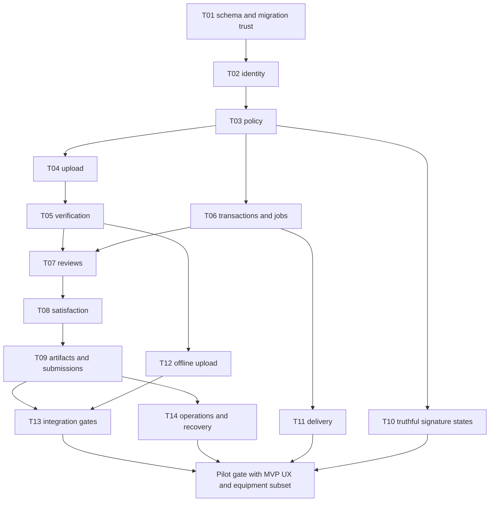

# Final transformation roadmap

## Planning assumptions

Effort estimates are focused engineer-days including design translation, meaningful tests and review. They are ranges, not model-speed promises. Luna/Gemini output must receive senior review for security, migrations and contractual invariants. Calendar plan assumes two capable implementation engineers plus a part-time reviewer and operations support, with disposable infrastructure and real provider accounts available. A single engineer should plan substantially longer. The complete product programme exceeds 90 days; the first 90 days target a trustworthy narrow pilot, not all P3/P4 features.

Priority taxonomy denotes type of work, not permission to defer dependencies. T06/T08/T09 are P1 but mandatory for closing P0 trust failures that depend on them. T11–T14 are P2 and still pilot gates. Do not launch merely because a task has a higher priority number.

## Task roadmap

Exact files, detailed sequence, tests, acceptance and rollback are in each identically numbered task specification. This table is the scheduling projection of those tasks, not a competing backlog.

| Task | Priority | Outcome | Dependencies | Effort | Risk | Gate |
|---|---|---|---|---|---|---|
| [T01](TRADECLOSEOUT_TASK_IMPLEMENTATION_SPECS.md#t01--reconcile-migration-history-and-tenant-relationships) | P0 | Reconcile migration history and tenant relationships | Baseline | 5–8 days | High | Pilot core |
| [T02](TRADECLOSEOUT_TASK_IMPLEMENTATION_SPECS.md#t02--repair-member-and-guest-authentication-and-logout) | P0 | Repair member and guest authentication and logout | T01 | 4–7 days | High | Pilot core |
| [T03](TRADECLOSEOUT_TASK_IMPLEMENTATION_SPECS.md#t03--centralize-resource-authorization-and-response-projection) | P0 | Centralize resource authorization and response projection | T02 | 5–8 days | High | Pilot core |
| [T04](TRADECLOSEOUT_TASK_IMPLEMENTATION_SPECS.md#t04--implement-provider-backed-upload-and-immutable-revisions) | P0 | Implement provider-backed upload and immutable revisions | T03 | 5–8 days | High | Pilot core |
| [T05](TRADECLOSEOUT_TASK_IMPLEMENTATION_SPECS.md#t05--make-file-verification-a-complete-bounded-storage-workflow) | P0 | Make file verification a complete bounded storage workflow | T04 | 5–8 days | High | Pilot core |
| [T06](TRADECLOSEOUT_TASK_IMPLEMENTATION_SPECS.md#t06--unify-transactions,-idempotency,-outbox-and-job-recovery) | P1 | Unify transactions, idempotency, outbox and job recovery | T01, T03 | 5–8 days | High | Pilot core |
| [T07](TRADECLOSEOUT_TASK_IMPLEMENTATION_SPECS.md#t07--consolidate-review,-external-response-and-authority) | P0 | Consolidate review, external response and authority | T03, T05, T06 | 6–10 days | High | Pilot core |
| [T08](TRADECLOSEOUT_TASK_IMPLEMENTATION_SPECS.md#t08--introduce-version-pinned-evidence-qualification-and-readiness) | P1 | Introduce version-pinned evidence qualification and readiness | T07 | 6–10 days | High | Pilot core |
| [T09](TRADECLOSEOUT_TASK_IMPLEMENTATION_SPECS.md#t09--build-real-immutable-dossiers,-submissions-and-archives) | P1 | Build real immutable dossiers, submissions and archives | T06, T08 | 7–12 days | High | Pilot core |
| [T10](TRADECLOSEOUT_TASK_IMPLEMENTATION_SPECS.md#t10--remove-false-signature-assurance) | P0 | Remove false signature assurance | T03 | 2–4 days | High | Pilot core |
| [T11](TRADECLOSEOUT_TASK_IMPLEMENTATION_SPECS.md#t11--implement-real-delivery-and-notification-lifecycle) | P2 | Implement real delivery and notification lifecycle | T02, T06 | 4–7 days | High | Pilot core |
| [T12](TRADECLOSEOUT_TASK_IMPLEMENTATION_SPECS.md#t12--consolidate-uploads-and-secure-offline-work) | P1 | Consolidate uploads and secure offline work | T04, T05, T06 | 5–8 days | High | Pilot core |
| [T13](TRADECLOSEOUT_TASK_IMPLEMENTATION_SPECS.md#t13--establish-representative-automated-release-tests) | P2 | Establish representative automated release tests | T07, T09, T12 | 4–7 days | High | Pilot core |
| [T14](TRADECLOSEOUT_TASK_IMPLEMENTATION_SPECS.md#t14--complete-production-operations-and-recovery) | P2 | Complete production operations and recovery | T01, T06, T09 | 5–9 days | High | Pilot core |
| [T15](TRADECLOSEOUT_TASK_IMPLEMENTATION_SPECS.md#t15--deliver-unified-workspace,-inbox-and-controlled-baseline-import) | P3 | Deliver unified workspace, inbox and controlled baseline import | T08, T12 | 6–10 days | Medium | MVP subset; expanded domain later |
| [T16](TRADECLOSEOUT_TASK_IMPLEMENTATION_SPECS.md#t16--complete-equipment-identity-and-supplier-documentary-workflow) | P3 | Complete equipment identity and supplier documentary workflow | T08, T15 | 7–12 days | Medium | MVP subset; expanded domain later |
| [T17](TRADECLOSEOUT_TASK_IMPLEMENTATION_SPECS.md#t17--add-inspections-and-commissioning-with-instrument-traceability) | P3 | Add inspections and commissioning with instrument traceability | T16 | 10–16 days | Medium | Post-pilot domain |
| [T18](TRADECLOSEOUT_TASK_IMPLEMENTATION_SPECS.md#t18--add-sectional-acceptance,-defects,-warranty-and-dlp) | P3 | Add sectional acceptance, defects, warranty and DLP | T09, T16 | 7–12 days | Medium | Post-pilot domain |
| [T19](TRADECLOSEOUT_TASK_IMPLEMENTATION_SPECS.md#t19--deliver-commercial-milestone-and-retention-readiness) | P3 | Deliver commercial milestone and retention readiness | T08, T09, T18 | 7–12 days | Medium | Post-pilot domain |
| [T20](TRADECLOSEOUT_TASK_IMPLEMENTATION_SPECS.md#t20--evaluate-gated-differentiation-and-assistive-ai) | P4 | Evaluate gated differentiation and assistive AI | T13, T14, T15 | 5–8 days for evaluation; 3–6 days per accepted AI slice | High | Future measured option |

## P0 execution order

1. Contain vulnerable guest exchange, alternate approval and unsupported certification surfaces until replacement; synthetic demonstrations only.
2. T01 migration/constraint and runtime-role foundation; T02 atomic auth, guest proof and logout; T03 all-resource policy and guest projections.
3. T04 real multipart/immutable object identity; T05 storage retrieval, scan attestations and bounded processing. T06 transaction/outbox/receipt repair is a hard dependency, not optional cleanup.
4. T07 canonical authority and exact submitted-version decisions; T08 qualified evidence and deterministic satisfaction; T09 real frozen package artifacts. These P1 tasks close the false-approval/dossier trust chain.
5. T10 remove unsupported signature-valid claims. This can run after policy repair and need not wait for dossier work.
6. T11 actual delivery, T12 truthful recoverable upload UI, T13 real integration gates and T14 measured recovery. Enable a real pilot only after every gate passes.

## Genuinely usable MVP

Include tenant/project/grant enforcement, delivered login, one controlled imported baseline, owner/due assignment, minimal equipment identities, supplier request list with scoped OTP upload, verified originals/revisions, internal assigned review and recorded external response, version-pinned satisfaction and explanations, inbox and server-filtered search, frozen handover/RA evidence package with real files, required recipient response tracking and independent project export. Basic commercial stage links expose documentary blockers only. Operations, recovery and negative boundary tests are included, not add-ons.

The MVP subset of T15 is S01–S03/S10, baseline import, basic bulk assignment and accessible navigation; postpone advanced offboarding analytics/custom views. T16 subset is asset identity plus manually created scoped supplier requests and passport evidence list; postpone PO allocation automation, portal integration and advanced comment closure. These subsets still require T08 semantics and T03 policy; do not create a separate simpler unsafe evidence model.

Exclude native test reading entry, broad procurement/PO administration, advanced sectional/DLP/warranty cases, retention receipt ledger, AI and actual cryptographic signing. Uploaded commissioning reports, warranty and contractual proof are supported as evidence within the core, even when native structured forms are deferred.

## 30/60/90-day milestones

| Time | Planned outcome | Required evidence / exit |
|---|---|---|
| Days 1–30 | Baseline inventory, migration/constraints, auth/policy and real upload/verification vertical slice; disable false claims | T01–T05 and T10 demonstrated under runtime DB role; initial T06 receipts; no real customer data yet |
| Days 31–60 | Canonical review, exact-version satisfaction, real dossier and recipient loop; truthful offline UI and provider delivery | T06–T12 complete in staging; independent artifact verification; MVP inbox/import/equipment work begins |
| Days 61–90 | MVP role workflows, integration/recovery gates, controlled paid pilot and observed return cycle | T13–T14 plus stated T15/T16 subsets; operator readiness; no open Critical/High trust bug; pilot may start only when gate passes |
| After pilot evidence | Structured quality/commissioning, sectional acceptance, aftercare and retention readiness | T16 expanded, T17–T19 in customer-validated order; do not commit date before real templates/contract variation reviewed |
| Later differentiation | Low-risk AI proposals and selected opportunity experiments | T20 evaluation gates, processing permission, measured precision and value; feature-specific rollout |

If trust work exceeds these ranges, move the pilot date. Do not narrow negative tests to preserve a calendar target. First 14 task ranges total roughly 68–114 engineer-days before extra product work; critical path and external provider readiness limit parallelism. Pilot polish, data cleanup and real customer validation require additional capacity. T15–T19 full scope is another 37–62 engineer-days. No claim that one fast coding model makes this a weekend implementation.

## Before pilot / before production / during pilot / future

Before pilot: all trust/integrity tasks, real identity/storage/worker delivery, minimum role workflows, backup recovery, security controls and exact-commit gates. Before general production: production-readiness evidence pack, repeat migrations and outage drills, actual topology/security assessment, measured load and cost envelope, validated customer workflows and reviewed privacy/contractual policies. During early pilots: customer index formats, filters, bulk usability, contract templates, improved explanatory reporting and noncritical UX; never leave isolation or integrity repair to pilots. Future: structured commissioning, larger procurement/aftercare/commercial scope and selected assistive AI.

Track leading outcomes: unresolved missing slots, owner response age, returned-review cycles, supplier receipt completeness, time to produce verified package and successful independent export. Track commercial adoption: repeated weekly use, reduction in parallel bookkeeping, paid renewal and support time. Financial impact and retention recovery remain hypotheses until measured against customer baseline.
