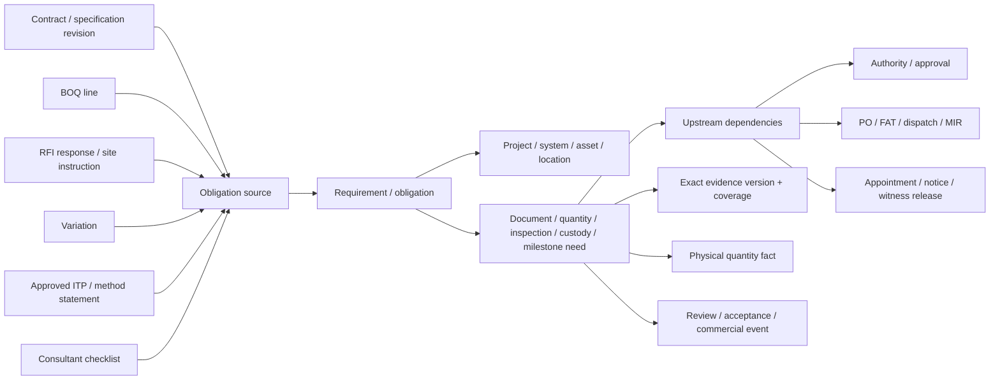

# TradeCloseout — Future Domain Model

**Status:** Second-pass conceptual design only; no application source changes  
**Date:** 4 November 2026  
**Purpose:** Model obligations, authority, physical execution, commercial claims and long-term continuity without becoming a full ERP

## 1. Design boundaries

This model extends the earlier requirement/evidence/review/handover design. It does not replace it with a second checklist, event-sourced ERP or graph database.

### Preserve

- Organisation/user/membership/project/party and scoped grant foundations.
- Immutable checklist snapshots and stable requirement identities.
- Original storage objects, document versions and exact review decisions.
- Equipment replacement lineage and package snapshots.
- Append-only audit/outbox and transactional commands.

### Add selectively

- Obligation provenance/dependencies and RFI/variation decisions.
- BOQ/quantity, procurement, shipment and MIR facts where customers need them.
- Identity revision history and authority snapshots.
- Inspection appointments/notices and instrument suitability.
- Transmittal hops and external response meanings.
- Custody, layered warranty/service and obligation-aware archives.

### Explicit non-goals

- Estimating, inventory, payable accounting, payroll, CPM scheduling, generic chat, CMMS, BIM coordination and a universal workflow-definition engine.

## 2. Conceptual obligation model



### `obligation_sources`

Links a concrete requirement to its authoritative origin:

- `id`, `org_id`, `project_id`, `requirement_id`.
- `source_type`: `CONTRACT_CLAUSE | SPECIFICATION | BOQ_LINE | CLIENT_CHECKLIST | RFI_RESPONSE | SITE_INSTRUCTION | VARIATION | ITP_REVISION | AUTHORITY_REQUIREMENT`.
- `source_id` and exact source version/revision.
- `source_locator`: clause, sheet, page, row or section reference.
- `derivation`: `DIRECT | INFERRED | CUSTOM`.
- `confirmed_by`, `confirmed_at`, `source_hash`.

AI can suggest `INFERRED`; only a human confirms contractual meaning. A new source revision creates a new obligation change proposal, never a silent edit to historical obligations.

### `obligation_dependencies`

- `upstream_obligation_id`, `downstream_obligation_id`.
- `dependency_type`: `APPROVAL | PROCUREMENT | FAT | DISPATCH | DELIVERY | MIR | METHOD | NOTICE | WITNESS | INSPECTION | ACCEPTANCE | CUSTODY | COMMERCIAL`.
- `required`: boolean and optional rule/policy reference.
- `source`: contract/ITP/client rule and version.

This supports limited dependency/readiness checks without a general CPM scheduler.

## 3. BOQ, quantities and commercial claims

### New records

**`boq_revisions`**: contract ID, revision, source document version, approved status, effective date and hash.

**`boq_lines`**:

- BOQ revision and client line number.
- Description, specification reference, unit, contracted quantity and rate where permission allows.
- Approved make/model policy if applicable.
- Variation lineage; values are versioned, not edited in place.

**`boq_scope_links`**:

- BOQ line to system/location/asset or non-serialised work zone.
- Allocation note and optional quantity share, only when it has contractual meaning.

**`quantity_events`**:

- `event_type`: `ORDERED | DISPATCHED | DELIVERED | MIR_ACCEPTED | INSTALLED | JMR_ACCEPTED | CERTIFIED | BILLED | REJECTED | RETURNED | REPLACED`.
- BOQ line, quantity value/unit, actual occurred time and system recorded time.
- Related PO/shipment/MIR/inspection/RA line/evidence IDs.
- Actor, counterparty confirmation and source evidence.

**`ra_bill_lines`**: RA bill, BOQ line, current-period quantity, cumulative quantity, certified amount, supporting JMR/variation and review status.

### Quantity invariant

For each unit and measurement basis, the system must be able to explain:

```text
Ordered → dispatched → delivered → MIR accepted → installed → jointly measured → certified/billed
```

Do not automatically require every stage for every contract. Lumpsum/serial-equipment and item-rate/non-serialised materials need different quantity policies.

### Illustrative example — not customer data

A BOQ line calls for two chillers and another calls for 500 m of chilled-water piping. The chillers map to `CH-01` and `CH-02`; piping maps to zones/system sections rather than fake “assets” per metre. Delivery of 320 m is a quantity event, not a fully installed milestone. A signed JMR for 280 m supports only that quantity for the RA line. An approved PDF can support the transaction, but it is not the quantity itself.

## 4. Procurement and delivery model

### `procurement_orders` and `procurement_order_lines`

Lightweight reference to PO/revision, supplier, approved material/make decision, ordered quantity/model, promised dates and source evidence. No supplier invoice, payment, tax or inventory valuation.

### `supplier_document_obligations`

- PO line, document/inspection type and scope.
- Required before: `MANUFACTURING | FAT | DISPATCH | DELIVERY | INSTALLATION | HANDOVER | WARRANTY`.
- Assignee party, due/promised/actual date and current state.
- Supplier grant/request and exact evidence received.

This generates supplier requests from real upstream needs rather than ad hoc requirement links.

### `shipments`, `shipment_items`, `delivery_events`, `mir_results`

Separate:

- Dispatch clearance and actual dispatch.
- Shipment/packing list/LR or reference where relevant.
- Physical receipt date/time and receiver.
- MIR inspection with accepted, short, damaged, rejected and pending quantities/serials.
- Transit NCR/replacement and installation eligibility.

Partial/consolidated shipments use line-level events, not one `delivered=true` flag.

### Make/deviation compatibility

`make_deviation_decisions` link original specified make/model, proposed make/model, technical reason, cost/time impact, authority snapshot and evidence. PO and MIR check whether the physical unit is covered by an effective approved decision. Unknown metadata creates a review task, not an automatic rejection.

## 5. Equipment identity and evidence revalidation

### Current risk

`updateAsset` can mutate make/model/serial/location in place. Existing evidence remains linked to the stable ID but may now describe another unit.

### `asset_identity_revisions`

- Asset ID and revision number.
- Tag, make, model, serial, location, capacity and effective-from/to.
- `change_type`: `CLERICAL_CORRECTION | RELOCATION | SUBSTITUTION | REPLACEMENT | TAG_REUSE`.
- Reason, authority, occurred/recorded time and evidence.
- Supersedes revision, never deletes it.

### `asset_aliases`

Project-scoped external identifiers from BOQ/PO/OEM/client schedules, alias type/source and canonical asset. Alias assignment is human-confirmed and historical; normalised text alone never merges.

### `evidence_revalidations`

On identity change, list affected PO/FAT/MIR/install/Cx/warranty/package relationships with:

- `status`: `NOT_REQUIRED | PENDING | CONFIRMED | MISMATCH | EXEMPT`.
- Reason, reviewer, decision and exact evidence version.

A serial correction does not automatically invalidate evidence; it creates a controlled review. Replacement creates a new asset and lifecycle lineage rather than only a revision.

## 6. RFI, instruction and variation model

### `correspondence_items`

- Type: `RFI | SITE_INSTRUCTION | NOTICE | MEETING_DECISION | EXTERNAL_RESPONSE`.
- Subject/body, exact clause/drawing/BOQ/equipment references.
- Issuer/responder party/person and intended authority.
- Required-by, occurred-at, recorded-at and current holder.
- Source email/portal/document references and visibility.

### `decision_records`

- Correspondence item, decision text and exact supporting evidence.
- Authority snapshot and decision occurred/recorded timestamps.
- `impact`: `NO_CHANGE | REQUIREMENT_CHANGE | VARIATION_REQUIRED | COST_UNKNOWN | TIME_UNKNOWN`.
- Supersedes prior decision if corrected; original response remains immutable.

### `variation_events`

Ordered but independently stateful events:

```text
Instruction received
→ Notice issued
→ Quotation/rate basis submitted
→ Technical acceptance (optional/required)
→ Commercial approval
→ Execution (may be EXECUTED_AT_RISK)
→ Measurement/JMR
→ RA inclusion / certification / rejection
```

Each has occurred/recorded time, authority, amount/time impact where known and evidence. Never insert `APPROVED` merely because a variation draft was created.

### States that must remain separate

- Technical acceptability.
- Commercial approval.
- Actual execution.
- Measurement acceptance.
- Payment certification.
- Actual receipt.

## 7. Approval authority and temporal model

### `authority_grants`

- Party/person and optional application user/grant.
- Project and scope: decision class, discipline, requirements/equipment/package, monetary/technical limit.
- Appointer/delegator, source evidence, valid-from/to and revoked-at.

### `authority_snapshots`

Embedded or referenced by every approval/waiver/acceptance/variation decision:

- Grant and exact version used.
- Person/party, role/title and decision scope/limit.
- Validity and appointer evidence.
- Snapshot timestamp and verification outcome.

Application RBAC answers “may this actor use the function?” Authority answers “was this person authorised to make this contractual decision?” They are separate checks.

### Standard event envelope

All significant external/physical/commercial events include:

- `occurred_at` and `occurred_at_precision` (`INSTANT | DATE | UNKNOWN`).
- `time_zone` and `recorded_at` from server.
- `source_reference` and optional `backdated_reason`.
- `correction_of_event_id`, never destructive editing.
- Actor/grant, request/correlation/causation and policy version.

Historical decisions use authority valid at `occurred_at`; new actions also require current authority. Expired delegation triggers reassignment of pending work, not invalidation of a previously valid approval.

## 8. Inspection, appointment and instrument model

### `inspection_appointments`

- Inspection/ITP revision, system/location/equipment, planned window and actual window.
- Required witnesses/hold-point parties and prerequisite obligations.
- Current scheduling state: `PROPOSED | CONFIRMED | NOTICE_REQUIRED | READY | COMPLETED | RESCHEDULED | CANCELLED`.

### `inspection_notices`

- Appointment, recipient/channel/reference, notice required-by/sent/acknowledged time.
- Delivery status and failed-notification reason.
- Response: confirmed, reschedule, no-show, authorised waiver or release.

### `inspection_releases`

- Type: `WITNESS_ACCEPTED | WAIVER_APPROVED | HOLD_RELEASED | CANCELLED`.
- Authority snapshot, reason/evidence, occurred/recorded time.
- Concealed-work release linkage where applicable.

An attempt cannot be considered contractually complete merely because numeric readings passed if a required hold release is absent.

### Instrument suitability and allocation

Extend instruments with measurement type, range, units, accuracy/uncertainty, calibration points and ownership/provider.

`instrument_allocations` record planned/actual use across projects, checkout/return and third-party instrument reference. ITP requirement captures acceptable range/accuracy from the approved procedure; the application does not invent engineering limits.

Checks:

- Certificate valid on actual test date.
- Measured value within instrument range.
- Units compatible.
- Required accuracy/uncertainty met if specified.
- No conflicting allocation without authorised substitution.

## 9. Transmittal and external-response model

### `transmittal_hops`

- Submission/package, parent hop and sequence.
- Sender/recipient party and actual recipient contact where known.
- Exact package/version and external transmittal reference.
- Sent, acknowledged, forwarded, returned and recorded times.
- Current holder and response required-by.

### `external_status_mappings`

- Client/consultant/party and source wording pattern.
- Meaning class: `COMMENT_ONLY | TECHNICAL_APPROVAL | NO_OBJECTION | CHANGES_REQUIRED | REJECTION | COMMERCIAL_ACCEPTANCE | ACCEPTANCE_WITH_EXCEPTIONS`.
- Effective dates, author and original example evidence.

Always show original wording alongside the canonical meaning. “Reviewed” is not approval; “no objection” is not automatically client commercial acceptance.

### `transmittal_responses`

- Exact hop/version and original response object.
- Meaning class mapped with confidence and confirmation.
- Decision authority snapshot and actual/recorded timestamps.
- Exception items and next-current-holder.

This is a record/interoperability layer, not a replacement for Aconex or email.

## 10. Custody, warranty and service model

### `custody_items` and `custody_events`

- Type: `SPARE | SPECIAL_TOOL | KEY | BMS_ACCESS | LICENCE | TRAINING | DOCUMENT_PHYSICAL | OTHER`.
- Item, quantity/condition/location, required versus transferred.
- Provider and receiving custodian, actual transfer and acknowledgement.
- Exception/replacement due and evidence.

Credentials are never stored. Record reset/handover proof and custodian only.

### `warranty_coverages`

- Asset/component and provider/beneficiary party.
- Coverage type: `OEM_UNIT | COMPONENT | CONTROLS | SUPPLIER_INSTALLATION | CONTRACTOR_WORKMANSHIP | EXTENDED_RIDER`.
- Scope, exclusions, assignment evidence and warranty basis/start/end.

Multiple concurrent coverages are allowed. The beneficiary and legal entity receiving warranty must match contract/OEM documents.

### `service_claim_events`

- Claim and coverage/defect relationship.
- Type: report, entitlement decision, response due, attendance, restoration, client verification, chargeability, repeat failure, replaced-part warranty effect.
- Actual/recorded timestamps, provider, parties, evidence and next actor.

Do not build preventive-maintenance schedules or work-order inventory. A defect is closed only after required verification; warranty service additionally needs restoration evidence and entitlement history.

## 11. Responsibility and actor-time model

### `work_periods`

- Work item and current actor party/user.
- Required action and entered/left time.
- Waiting reason: `CONTRACTOR | SUPPLIER | CONSULTANT | CLIENT | SCHEDULED | SUSPENDED | EXTERNAL`.
- Blocking dependency and current/next actor.

This projection powers factual SLA/supplier/consultant metrics without treating all elapsed time as one party's delay.

### `responsibility_transfers`

- Outgoing/incoming person, acting/permanent, effective dates and project scope.
- Requirements, reviews, RFIs, supplier obligations/grants, appointments, variations, claims, packages and commercial commitments included.
- Successor eligibility, unresolved context, outgoing/incoming acknowledgement and authority impacts.

## 12. Policy, retention and archive model

### `policy_versions`

Versioned readiness, evidence-validity, retention, external status and commercial policies with effective dates, author, reason and source. Readiness decisions store the policy version used; never recalculate history silently.

### `legal_holds`

Extend beyond project-level:

- Subject type: project/asset/submission/document/object/claim/change/order.
- Scope includes originals, derivatives, relationships, manifests and decision history as needed.
- Reason, authority, created/released times and release evidence.

### `archive_exports`

- Project/scope, archive schema version, creation actor/time and purpose.
- Included object manifest and source/derived classifications.
- Archive hash, object count/bytes, validation results and storage location.
- Customer download/receipt timestamp and subsequent verification history.

### Archive completeness policy

1. Required original evidence is present and hash-verified.
2. Exact revisions and source/obligation links are present.
3. Approval authority and both event timestamps are present.
4. Accepted package and submission/recipient decisions are linked.
5. Relevant custody, warranty and open-claim context is included.
6. Derived previews are marked reproducible; they are not mistaken for originals.
7. No grant/session secret is needed to verify archive contents offline.

## 13. Simplified ER additions

```mermaid
erDiagram
  REQUIREMENTS ||--o{ OBLIGATION_SOURCES : derived_from
  REQUIREMENTS ||--o{ OBLIGATION_DEPENDENCIES : upstream
  REQUIREMENTS ||--o{ OBLIGATION_DEPENDENCIES : downstream
  BOQ_REVISIONS ||--o{ BOQ_LINES : contains
  BOQ_LINES ||--o{ BOQ_SCOPE_LINKS : allocated_to
  ASSETS ||--o{ BOQ_SCOPE_LINKS : equipment
  BOQ_LINES ||--o{ QUANTITY_EVENTS : measured_by
  RA_BILLS ||--o{ RA_BILL_LINES : contains
  BOQ_LINES ||--o{ RA_BILL_LINES : billed_against
  PROCUREMENT_ORDERS ||--o{ PROCUREMENT_ORDER_LINES : contains
  PROCUREMENT_ORDER_LINES ||--o{ SUPPLIER_DOCUMENT_OBLIGATIONS : requires
  PROCUREMENT_ORDER_LINES ||--o{ SHIPMENT_ITEMS : shipped_as
  SHIPMENTS ||--o{ SHIPMENT_ITEMS : includes
  SHIPMENT_ITEMS ||--o{ MIR_RESULTS : inspected_as
  ASSETS ||--o{ ASSET_IDENTITY_REVISIONS : identified_by
  ASSETS ||--o{ ASSET_ALIASES : also_known_as
  ASSET_IDENTITY_REVISIONS ||--o{ EVIDENCE_REVALIDATIONS : triggers
  CORRESPONDENCE_ITEMS ||--o{ DECISION_RECORDS : resolved_by
  DECISION_RECORDS ||--o{ VARIATION_EVENTS : may_create
  AUTHORITY_GRANTS ||--o{ AUTHORITY_SNAPSHOTS : captured_as
  DECISION_RECORDS ||--|| AUTHORITY_SNAPSHOTS : authorised_by
  INSPECTIONS ||--o{ INSPECTION_APPOINTMENTS : scheduled_as
  INSPECTION_APPOINTMENTS ||--o{ INSPECTION_NOTICES : notified_by
  INSPECTION_APPOINTMENTS ||--o{ INSPECTION_RELEASES : released_by
  INSTRUMENTS ||--o{ INSTRUMENT_ALLOCATIONS : allocated
  SUBMISSIONS ||--o{ TRANSMITTAL_HOPS : routed_by
  TRANSMITTAL_HOPS ||--o{ TRANSMITTAL_RESPONSES : answered_by
  WARRANTY_COVERAGES ||--o{ SERVICE_CLAIM_EVENTS : claim_history
  ASSETS ||--o{ WARRANTY_COVERAGES : concurrent_cover
  PROJECTS ||--o{ CUSTODY_ITEMS : transfers
  CUSTODY_ITEMS ||--o{ CUSTODY_EVENTS : acknowledged_by
  PROJECTS ||--o{ ARCHIVE_EXPORTS : preserves
```



## 14. Read models and indexes

### Required projections

- **Obligation readiness:** source, current dependency, current actor and next action.
- **Procurement lead time:** approval/PO/FAT/dispatch/delivery/MIR planned vs actual and current blocker.
- **Quantity reconciliation:** per BOQ line and unit, ordered/accepted/installed/measured/billed quantities.
- **Transmittal holder:** current party, hop, sent/acknowledged age and response meaning.
- **Inspection readiness:** approved procedure, notice/release, instrument suitability, appointment and attempt.
- **Responsibility transfer:** all open commitments, not only requirements/reviews.
- **Archive health:** missing objects/links, verification result and retention holds.

### Index principles

- Every tenant-owned table has `org_id`, and every project-owned table has `project_id`.
- Composite FKs enforce same project and exact source revision relationships.
- Index current actor/due/waiting reason, PO/BOQ line, asset effective dates, transmittal current holder and outbox lease.
- Effective-dated identity/authority uses exclusion constraints or transaction checks to avoid overlapping active revisions.
- Quantity values use `numeric`, with unit on every row; money remains integer paise.
- Variable test fields live in versioned template/item schema snapshots, not uncontrolled EAV across core entities.

## 15. Migration and complexity controls

1. Introduce dual timestamps and identity history before adding more workflows.
2. Add obligation source links alongside existing requirements; backfill source as `UNKNOWN` where not provable.
3. Introduce PO obligations for a small set of equipment before modelling all materials.
4. Add shipments/MIR only for customers with split delivery/quantity problems.
5. Add BOQ/JMR only for item-rate/quantity-driven customers; never require it for all projects.
6. Keep current satisfaction for document-only requirements; compute quantity readiness separately rather than force one universal aggregate.
7. Build read models from committed relational state and append-only events; do not require replay to use the application.
8. Do not purge any original evidence until retention holds and archive verification are implemented and tested.
9. Any archive/export migration must preserve source hash and version lineage; metadata-only exports are not evidence archives.

## 16. Domain acceptance scenarios

- **RFI impact:** A consultant instruction changes a required isolator. The system identifies affected PO, installation, ITP and handover obligations, retains the instruction/authority, and creates a variation with cost impact unresolved rather than assuming zero cost.
- **Serial correction:** A user corrects `CH-01` serial after FAT. Old FAT stays unchanged; linked MIR/warranty enters revalidation and only matching records are reconfirmed.
- **Partial delivery:** One of two chillers arrives damaged. Other unit can proceed; damaged unit has NCR/replacement outstanding and does not satisfy delivery/installation.
- **Hold-point:** Pressure test passes numerically, but required consultant hold notice was not acknowledged. Test remains pending contractual release and concealed work cannot proceed normally.
- **Forwarded approval:** MC forwards R1 to consultant. Consultant approves R1 technically while client has not accepted commercially. Current holder and status show both facts separately.
- **Warranty gap:** Unit warranty ended, compressor coverage remains, contractor workmanship DLP continues. Service claim shows which coverage and chargeability decision applies.
- **Customer exit:** Former customer downloads archive, verifies all original hashes and exact accepted-package versions without a live account or TradeCloseout availability.
