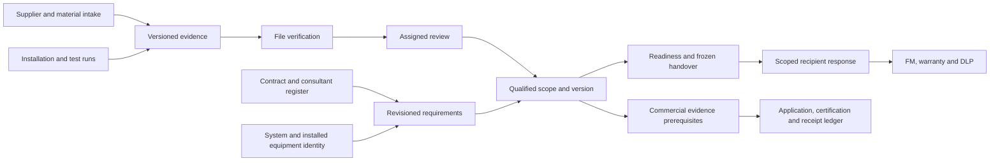

# TradeCloseout HVAC excellence: implementation plan for the agent

Date: 2026-11-06. Target owner: the user. Implementation owner: the engineering agent and reviewer. This document translates the full-project re-audit into concrete work. It does not declare the target achieved.

Start with the [new re-audit](TRADECLOSEOUT_HVAC_PRODUCTION_REAUDIT_2026-11-06.md), which owns findings N01–N32 and records both the initial regression failures and their subsequent fixture repair. Use the [existing task specifications](TRADECLOSEOUT_TASK_IMPLEMENTATION_SPECS.md) for additional contracts and the [extensive testing guide](TRADECLOSEOUT_EXTENSIVE_TEST_IMPLEMENTATION_GUIDE.md) for case IDs. When earlier documents say a repair is missing, inspect the current implementation before rebuilding it. Do not edit or rename an applied migration.

## 1. Product target, expressed as outcomes

Build the system an HVAC contractor opens every working day because it answers:

1. What work or document is needed next, for which equipment/system/location and contractual milestone?
2. Who owns it, who is waiting on whom, how long has it waited, and what can I send now?
3. Is this the correct installed unit, approved make/model, serial, drawing revision and evidence version?
4. Was the installation inspected and the system tested using the right procedure, instruments and witnesses?
5. What prevents commissioning, handover, a bill-support package or retention application, and which source requires it?
6. Can I give the consultant/client/FM team an accurate, usable package and prove what they received and accepted?
7. What warranty/DLP/defect obligations remain after handover, and what remedy has actually been verified?

The product should connect these answers across people and time. A larger collection of dashboards or uploaded PDFs is not, by itself, the target outcome.

### Initial customer profile and expansion

Planning assumption: begin with India-based commercial HVAC subcontractors handling several projects and a mix of chillers/pumps/AHUs/FCUs/VRF/duct/ventilation systems, whose consultants and clients use Excel, email, WhatsApp and PDFs. Validate this with actual contractors; do not treat Hyderabad fixture data as market research.

Support a small team's workflows elegantly before expanding into the heaviest enterprise variants. Hospitals/cleanrooms/data centres and integrated life-safety interfaces can be supported through engineer-approved procedure packs and clearly scoped acceptance; never claim a generic test form certifies a regulated system. Large enterprise security, integrations and sector packs are later increments on the same trustworthy model.

### What excellence means in practice

- Contractor: import the consultant register without retyping it, assign ownership and identify blockers the same day.
- Site engineer: find the right asset, capture proof/measurements in poor connectivity, and trust the sync state.
- QA/QC: review the exact version or test run, preserve comments and avoid repeated untraceable resubmissions.
- Procurement/supplier: see a short request list, upload against a specific line/stage, get a receipt and understand returned items.
- PM/director: see factual waiting and milestone blockers plus source-backed commercial exposure, with unknowns visible.
- Consultant/client/FM: review a frozen package, accept a scope or record exceptions, find current O&M information quickly, and retain a portable record independent of the app.
- Operator/support: diagnose a stuck job safely, recover evidence and explain each sensitive action without impersonating customer authority.

## 2. Release gates and sequencing

| Gate | Required outcome | Evidence |
|---|---|---|
| G1: trustworthy engineering baseline | Applicable N01–N22 trust/contract defects repaired or safely contained for enabled routes; clean build and migration parity | Green regressions plus actual route/role matrix and reproduced negative boundaries. No bypassed assignment/OTP/recipient checks. |
| G2: production pilot | Real identity/storage/scanner/worker deployment, complete contractor/supplier/recipient journey, recovery and bounded load | HTTP/browser traces, actual provider receipts, immutable file checks, process-kill recovery, restore/RPO/RTO and operator runbook. |
| G3: daily contractor product | Controlled import, inbox/search, equipment identity, supplier requests, practical package/acceptance/FM and basic aftercare/commercial links | Representative customers complete weekly work with low support, little parallel re-entry and correct exports. |
| G4: deep HVAC execution | Material-to-installed-unit trace, native inspections/TAB/functional/seasonal commissioning, sectional aftercare and commercial evidence | Engineer-reviewed templates, witnessed runs, instrument-at-test trace, real customer commissioning/return cases. |
| G5: best-in-segment evidence | Sustained customer value, reliability, usability, adoption and differentiated traceability | Baseline-versus-product metrics, repeated usage/paid continuation, independent usability/security review and comparative task studies. |

Priority P0 means an immediate trust or release defect. P1 means necessary pilot/daily-workflow completion. P2 means depth and scale after its dependencies. P3 means gated differentiation. A later priority is not permission to skip a dependency or a production gate.

The machine-readable [JSON backlog](TRADECLOSEOUT_HVAC_EXCELLENCE_BACKLOG.json) and [CSV backlog](TRADECLOSEOUT_HVAC_EXCELLENCE_BACKLOG.csv) contain the same 32 packages and validated dependencies. Proposed effort bands are S: 1–3, M: 4–8, L: 8–15 and XL: 15–30 focused engineer-days including implementation/tests/review; these are planning ranges to refine after discovery, not dates or delivery promises.

Run customer discovery XP28 from the start. Run UX foundations XP26 and operating architecture XP10 alongside core work where dependencies allow. Do not treat early mockups as production workflows. Critical path: XP00 → XP01/XP02 → XP03 → XP04/XP05 → XP07/XP08 → XP09 → XP27 → G2. Daily-product work then brings XP11–XP15/XP20/XP21/XP22 into G3; deeper commissioning brings XP16–XP18 into G4.

A realistic programme is multiple increments over several months, followed by measured customer improvement. Do not promise completion of all 32 packages in a weekend or attach a 90-day guarantee. Estimate after XP00 and after reviewing actual customer templates. Track focused engineer-days separately from elapsed time, provider setup and customer availability. Break each package below into independently reviewable 1–3 day slices; security, migrations and commissioning rules receive explicit human review in the delivery process.

## 3. Architecture and implementation rules

The intended information flow is:



### 3.1 Keep a modular monolith, make ownership explicit

Retain Nest/Next/PostgreSQL/Redis/BullMQ/S3. Establish application boundaries for identity/tenancy, baseline/requirements, equipment, supply, evidence, review, commissioning, handover, aftercare, commercial readiness and operations. Keep SaaS subscription accounting distinct from the contractor's project-commercial evidence.

Extract duplicated decisions/readiness logic before adding another entry point. Controllers validate input and call one application command; services/repositories share the command's transaction. Workers use explicitly scoped SYSTEM principals and the same invariant functions, without generic owner access. Avoid a microservice rewrite until measured deployment boundaries justify it.

### 3.2 Identity, policy and requests

Principal context is immutable: kind, principal ID, org, user or grant, assurance, effective membership/role, request ID and trace. Resolve actual resource/project before evaluating authority. Guest scope is explicit and empty scope denies. Recheck principal/grant and relevant row versions inside mutations. Shared SQL/DTO builders must use identical visibility for lists, counts, search, exports and signed URLs.

Every active mutation has concrete DTO/schema validation, bounded strings/lists/numbers/enums, explicit unknown-field policy, stable errors and a documented concurrency/idempotency contract. Use If-Match for updates; do not default absent versions. Return UTC instants, project-local business dates and integer-paise amount strings. Internal enum keys can stay stable; UI labels describe the specific aggregate.

### 3.3 Transaction and asynchronous command pattern

For a synchronous command:

1. Parse/validate; resolve principal and resource; compute a canonical request hash.
2. Begin one runtime-role tenant transaction; lock/create command receipt under `(org, principal, operation, resource-scope, idempotency-key)`.
3. Reject conflicting hash or stale/forbidden action; replays must recheck current visibility before returning a previously sensitive response.
4. Apply mutation, append business decision/audit, insert versioned outbox event and persist the minimal command result in that same transaction.
5. Commit; serialize HTTP response without inventing a new business outcome.

For remote work: commit an intent and job receipt first, perform the external operation with a stable provider idempotency identifier, verify its receipt/bytes, then finalize state in a scoped transaction. Crash in between must be recoverable from durable intent/receipt. A transaction should not hold a pooled DB client/row lock while sending dozens of messages or compiling a large dossier. Never delete an uncertain command claim merely because it is old.

Use explicit event types and schemas. Distinguish informational audit events from executable commands. Treat queues as retryable transport; database execution receipts and reconciliation establish durable effect. Monitor oldest pending work and unknown outcomes, not just queue length.

### 3.4 Domain model to implement without duplicating existing tables

Inspect current physical schema before creating each entity; reuse/adapt requirements, revisions, assets, identity revisions, documents/versions, reviews, packages, submissions, procurement and aftercare tables where sound. Suggested logical additions:

| Boundary | Logical additions or adaptations | Core relationship |
|---|---|---|
| Scope/baseline | ProjectBaselineRevision, RequirementRevision, EvidenceSlot, SourceReference | Contract clause/register row/template revision → requirement revision → required coverage. |
| Evidence | EvidenceQualification, Coverage, QualificationDisposition, AssessmentReason | Exact document version + exact requirement revision/slot + covered asset identity/system/stage + policy version. |
| Equipment | EquipmentType/MakeApproval, System, Zone/Location, AssetIdentityRevision, replacement link | Product model/type differs from installed serial instance; replacements do not overwrite history. |
| Supply/material | SupplierRequest/Item, PO-line allocation, Delivery/MIR/MaterialApproval reference | One PO line may supply many assets; received/intake-approved differs from technical approval. |
| Quality | ProcedureTemplateRevision, InspectionRun, TestRun, Reading, Witness, HoldPoint, Instrument/CalibrationVersion, RetestLink | Run pins procedure and actual test instant; every instrument qualification uses that instant. |
| Coordination | DecisionRecord, CommentResponse, WaitingInterval, Instruction/VariationReference | Original source and exact version linked to response/closure; waiting claims factual and attributable. |
| Handover/aftercare | AcceptanceScope, Exception, TrainingSession, SparesReceipt, WarrantyTerm, DLPTerm, verified defect disposition | Scope/recipient/source event anchor controls obligations; acceptance does not imply money paid. |
| Commercial | ContractMilestone, BillReference, BillEvidenceManifest, RetentionTranche, Application/Certification/Receipt | Documentary eligibility, applied amount, certification and receipt remain separate. |
| Operations | CommandReceipt, ExecutionReceipt, DeliveryAttempt, provider callback inbox, reconciliation case | Stable identity through HTTP, outbox, worker and external receipt. |

Every tenant/project child must have composite ownership constraints and explicit RLS. Global catalogue rows are read-only to tenant runtime callers. Use one canonical tenant setting; reject mismatched aliases during transition. Backfills report conflicting records for disposition and never reassign ownership silently. Forward-only expand/backfill/validate/contract rollout preserves old evidence references.

### 3.5 One evidence/readiness kernel

Implement a pure assessment interface backed by explicit scoped queries, for example:

`assessRequirement(client, { requirementRevisionId, asOf, projectTimezone, scopeIdentityRevisionIds, policyVersion }) → { satisfied, blockingReasons, warnings, qualifiedVersionIds, qualificationDecisionIds, waiverDecisionIds }`.

It must verify required slots, evidence file/storage state, review and qualified coverage, validity dates, identity revisions, companions at the relevant test/contract time, and active valid exceptions. A pending revalidation for asset A cannot invalidate unchanged B unless coverage actually overlaps. An approval for A must never satisfy B merely because a document was linked later. Reuse this kernel for project readiness, passport, package/RA selection and commercial prerequisite explanations. Frozen historical packages retain their old decisions even after current eligibility changes.

## 4. Work packages: exact instructions for implementation

### XP00 — Establish the current baseline and complete journey boundaries

Priority: P0. Dependencies: none. Gate: G1.

Read the new audit and source manifest. Re-run current commands; preserve user changes and identify source changes since fingerprints were captured. The two initial fixture failures now pass after changes during the review. Preserve the assignment guard, and improve the new journey by calling the existing review-assignment/submission command instead of manually inserting its state before approval. Include org/project role context obtained through actual principal resolution, rather than promoting the reviewer to owner. Replace the stale recipient mock with real disposable submission/recipient records. Preserve denial tests for unassigned and self approval.

Add a boundary declaration to each suite: service/direct SQL/HTTP/BullMQ/browser/protocol fixture/real provider. Rename the journey if it still omits HTTP and actual services. Record current CI failures before and after; do not use skip/passWithNoTests or relax guards. Delivery: green baseline, route-to-test inventory, known blockers and exact source revision. Findings N01/N28.

### XP01 — Repair OTP identity and delivery assurance

Priority: P0. Dependencies: XP00. Gate: G1.

Own `identity.controller.ts`, `identity.module.ts`, session guard and guest proof adapters. Replace duplicated recipient/challenge payloads with one authoritative opaque challenge plus a reference alias if compatibility is needed. One Lua operation resolves the alias, checks purpose/recipient/generation/expiry, increments a shared attempt budget and consumes exactly once. Reissue supersedes the old generation; invalid attempts persist. Store hashes and minimum recipient metadata; do not expose OTPs outside explicit development.

Forbid loopback/debug delivery in staging/production at startup. Add configured provider deadlines/acceptance IDs, safe provider error mapping and actual 429/Retry-After responses. HTTP tests: mixed-alias replay/races, wrong recipient, reissue, threshold cooldown, Redis outage, provider rejection, logout replay, org switch and revoked membership. Do not log full challenge/token values. Findings N02/N03/N06; guide IAM/GUEST cases.

### XP02 — Centralize real resource authority and response contracts

Priority: P0. Dependencies: XP01. Gate: G1.

Create one ResourceResolver/PolicyService using current guard/session and shared permission modules. Resolve indirect IDs before loading project roles. Move project-state gates into the authority actually used by commands. Explicitly bind a recipient decision to principal/grant/frozen recipient/submission; reject contradictory parents. Correct notification audiences and notification creation permission. Gate archive download by explicit export/download scope before correcting its key.

Replace shape-detected external serialization with per-endpoint nested DTO allowlists, preserving timestamps intentionally. Inject serializer dependencies through Nest; use exact guest capabilities and covered resource IDs. Forward-migrate mixed-alias RLS safely, including bootstrap/global catalogue cases. Acceptance: two tenants/two projects, every role and alias, arrays, direct calls, nested canaries, counts/search/export/download and revoke-during-write. Findings N08–N13/N30/N31; AUTHZ/HTTP tests.

### XP03 — Implement durable command outcomes and strict API contracts

Priority: P0. Dependencies: XP00, XP02. Gate: G1.

Own idempotency interceptor, `tenant-tx.ts`, TenantDbService and DTOs. Introduce the command receipt/unit-of-work pattern in §3.3. Start with non-idempotent review, waiver, recipient decision, package request, notification announcement and commercial commands; audit other mutations and aliases. One owning transaction receives the scoped client; remove nested pool transactions. Normalize request hashes independently of key order and bind receipts to principal/operation/real resource.

Contain the unused payment webhook with an explicit unavailable response until signature/durable processing is implemented in XP22. Add concrete DTOs, size limits, row-version preconditions and standard error mapping; unify validated DB environment configuration. Fault tests must cover commit-then-handler-error, serialization/receipt failure, crash/replay, conflict payload and revoked replay visibility. Do not lose HTTP status through error-body fields. Findings N05/N07/N16/N17/N22.

### XP04 — Finish immutable, bounded file processing

Priority: P0. Dependencies: XP02, XP03. Gate: G2.

Own documents/S3 service, file worker, scanner and converters. Persist provider identity, expected/observed size/hash, intent state and verification attestation (engine/parser version, time, result). Enforce streaming byte/timeout/temp-disk limits before download completes; sandbox CPU-heavy parsers/converters and limit total concurrent resource use. Preserve originals and record derivative provenance; do not overwrite evidence with a sanitized copy.

Reconcile provider-created upload sessions/orphans after DB failures; provide deliberate retry/abort states. Test real versioned object storage and ClamAV in a separate infrastructure lane, while keeping protocol fixtures for deterministic failure cases. Run EICAR bytes, disguised/macro/active formats, partial transfers, changed latest object and unavailable scanner. All READ/preview/stream routes check the same immutable receipt and policy. Finding N19; DOC/SCAN cases.

### XP05 — Make outbox, worker effects and recovery explicit

Priority: P0. Dependencies: XP03. Gate: G2.

Own worker main, scheduler and job handlers. Define event registry/schema versions and classify executable versus informational events. Add per-event execution receipt and durable outcome; unknown executable events fail visibly. Deterministic job IDs prevent duplicates within their retention limits; the durable effect receipt handles later replay/Redis loss. Add dead-letter/reconciliation queue and authorized operator actions.

Run separate worker processes with fault injection: after intent commit, enqueue, dispatch marking, source download, external acceptance, effect commit and before queue acknowledgment. Assert one effect, no false completed state and eventual safe recovery. Test lock renewal/stall behavior under CPU pressure and tenant fairness. Publish queue age, processing time, failure reason and reconciliation metrics. Findings N18/N26; TX/SCHED/SCAN cases.

### XP06 — Complete messaging and actionable reminders

Priority: P1. Dependencies: XP01, XP05. Gate: G2.

Adapt notification delivery gateway into explicit provider adapters with recipient resolution, approved templates, locale, consent/preferences, purpose and tenant budget. Persist delivery attempts/provider IDs and verified callbacks; support queued/accepted/delivered/failed semantics without rewriting SENT as proof of receipt. Honor quiet hours, urgency and Retry-After; retry transient failures with bounded jitter and expose permanently failed delivery to the responsible user.

Normal events create notifications through domain handlers. Contractor-authored reminders use a specific authorized command, not arbitrary event JSON from document readers. Distinguish private notification versus tenant announcement audiences. Tests use capture server plus selected real-provider sandbox acceptance; validate duplicate/out-of-order callbacks, invalid signatures and foreign IDs. Findings N03/N09/N10; NOTIF/IAM cases.

### XP07 — Introduce coverage-aware evidence qualification

Priority: P0. Dependencies: XP03, XP04. Gate: G2.

Adapt requirement revisions/document links into evidence slots and explicit qualification decisions. Add exact revision, immutable file version, coverage/identity, stage and policy references. Build the assessment kernel from §3.5. Do not replace existing historical approvals or silently qualify newly linked requirements; backfill ambiguous links into review-required state with an impact report.

Make revalidation decisions asset/identity/version-bound, authorized, concurrent and append-only. Shared generic evidence can cover multiple units explicitly; serial-specific proof cannot transfer on replacement. Reuse assessment in project readiness, passports, package/RA generation and commercial read models. Return safe blocker/warning reasons. Tests: shared manual two assets, replacement A versus unchanged B, late link, expired-at-test certificate, duplicate candidates, waiver and snapshot behavior. Findings N13–N15; READY/ASSET cases.

### XP08 — Deliver one canonical review and external-response workflow

Priority: P0. Dependencies: XP02, XP03, XP07. Gate: G2.

Consolidate reviews service, decision helper and v021 workflow helpers behind one command per action. Inventory controller/simulation/internal callers; retire weaker paths explicitly. Define assignment → submission → exact-version decision and separate technical review from recorded external response/delegation. Preserve uploader separation, required reviewer role, latest submitted revision and immutable decision history.

Add persisted response/comment dispositions linked to old/new version/page and a verification step for closure. Support returned/approved-as-noted only through explicit conditional rules, not a generic green badge. UI confirms exact version, scope and authority. Tests include alias parity, mixed-authority batches, concurrent conflicting decisions, external proof substitution, revocation and retained original history. N01/N11/N15/N17; REV cases.

### XP09 — Finish practical dossiers, archives and recipient acceptance

Priority: P0. Dependencies: XP05, XP07, XP08. Gate: G2.

Fix N04 by resolving `verification_receipt_json.artifact` or a typed artifact FK; validate storage object org/hash/size/version, then sign the recorded bucket/key/version with the correct download capability. Extend S3 signer to take the verified bucket if different output/source buckets are supported. No guessed key reconstruction. Add completion-status polling and truthful download errors.

Finish a real package builder with contract index/sections, ordered contents, separate volumes, source-version manifest, index/page labels and unresolved exceptions. Acceptance is by persisted recipient/scope/submission and cannot be supplied by an unrelated party ID. Validate PDF text/page/bookmark content and archive extraction independently. Test compiled export → API download → bytes, wrong-role access and old/latest object overwrite. Preserve working offline verifier; provide safe original display filenames/extensions alongside immutable paths. N04/N11/N31; PKG/SUB/ARC.

### XP10 — Make the deployable service and recovery trustworthy

Priority: P0. Dependencies: XP00, XP03. Gate: G2.

Fix clean worker entrypoint and build only into clean isolated artifacts; smoke-start API/web/worker from those artifacts on the target architecture. Validate production env/runtime roles, schema compatibility, TLS/trusted proxies/CORS/secrets and actual network/IAM boundaries. Separate liveness from readiness and safe dependency status. Pin images and establish patch/rollback procedures, managed durable Redis and worker/scanner capacity as measured requirements demand.

Repair restore tooling: snapshot-consistent inventory, robust URL parsing, null/missing audit handling, all tenant/partition policies, DB plus immutable object versions, external digest receipt and explicit RTO/RPO thresholds. Exercise key-unavailable/object-missing/database-corrupt failures and preserve diagnostics. Do not run destructive tests on customer databases. Deliver operator runbook, alerts, deployment evidence and observed recovery result. N07/N23–N25/N30/N32; OPS cases.

### XP11 — Deliver import-first project onboarding

Priority: P1. Dependencies: XP03, XP07. Gate: G3.

Create an import draft workflow for consultant registers/equipment schedules/document folders, reusing existing parsers. Endpoints: create upload/draft, preview mapping/errors, resolve duplicate/owner/scope, commit expected baseline revision, and get receipt. Logical persistence: source file version, row number, mapped data, validation result, impact/diff and commit receipt.

Preview never mutates active scope. Commit is either fully atomic or explicitly per-row resumable with stable row keys; choose and expose one contract. No swallowed errors or silent changes to approved scope. Workbook formulas/macros/external links are not executed. UI offers spreadsheet-like mapping and actionable row errors. Validate real anonymized customer fixtures, concurrent commits, foreign IDs and source edits. N27; IMP/CHK cases.

### XP12 — Build the daily inbox, search and project workspace

Priority: P1. Dependencies: XP02, XP07. Gate: G3.

Define source-derived WorkItem projections: action, owning principal, actual source entity/version, due/waiting time, blocker, next command and permitted destination. Do not add independent completion checkboxes detached from domain state. Implement scoped `/work-items`, search and dashboard endpoints with stable cursors, counts and explainable filters. Avoid separate inconsistent counts for approved versus satisfied evidence.

Split the large project page by requirements/equipment/supply/quality/submissions/aftercare/commercial routes with shared navigation. Preserve filters/sort/pagination in URLs and saved views; keyboard search works, not just a decorative shortcut. Fix multi-contract dashboard joins and unknown location rendering. Tests include reassignment, cross-project counts, ties/pagination and back/refresh behavior. N09/N21/N28; HTTP/WEB cases.

### XP13 — Make the equipment passport the physical-unit spine

Priority: P1. Dependencies: XP03, XP07. Gate: G3.

Separate type/model-approved data from installed unit identity; add system/location relationships and aliases/replacement history without breaking asset IDs. Create a passport screen with installed identity, source drawings, applicable obligations, qualified evidence, latest inspection/test state, warranty anchors and outstanding exceptions. Controlled label/QR creation has explicit guest/FM projection and revocation.

Identity edits show impact before commit; replacements create a new unit/revision as appropriate, retaining retired-unit records. Bind revalidation URL asset ID, qualification authority and expected version. Support PO-line multi-unit allocation with XP15. Test duplicate serials, reused tags, model-wide manuals, serial-specific reports, foreign QR and shared-evidence scope. N13/N14; ASSET cases.

### XP14 — Complete the supplier documentary request loop

Priority: P1. Dependencies: XP06, XP11, XP13. Gate: G3.

Add SupplierRequest/Item records referencing exact project requirement revision, supplier/PO line, equipment type/instances, document type and stage. Preserve existing grant machinery; guest sees only request items and can upload from phone with OTP. Request state differentiates requested, received, file verified, intake accepted, technical review and returned.

Send real delivery/reminder receipts through XP06, allow delegated contractor follow-up with provenance, and handle supplier reissue/revocation safely. Return comments identify the exact expected replacement. Contractor has a queue of incomplete supplier responses and aging; supplier never approves its own requirement. Acceptance: first upload, malformed file, interrupted resume, wrong item, returned revision and completed request in actual mobile browser. GUEST/E2E-02.

### XP15 — Trace material approval through delivery and installation

Priority: P2. Dependencies: XP13, XP14. Gate: G4.

Adapt procurement tables into MAR/technical approval, approved make/model, PO line, dispatch/delivery/MIR and installed-unit allocation. Record ordered/delivered/allocated quantities separately; avoid one asset_id pretending a quantity-ten line is one unit. Changes/substitutions require a source decision and trigger only affected evidence/inspection obligations.

Implement intake/partial delivery, document receipt, inspection acceptance and per-unit serial checks; expose discrepancies without claiming technical approval from a supplier certificate. UI groups outstanding documentary stages by PO/supplier/system and supports barcode/serial capture where useful. Tests: partial/multiple deliveries, over-allocation, wrong make, duplicate serial, approved substitution and foreign relationship constraints. GUEST-08/09 and quality prerequisites.

### XP16 — Add native inspections, hold points and test runs

Priority: P2. Dependencies: XP07, XP13, XP15. Gate: G4.

Create a quality boundary using engineer-approved, revisioned procedures. Fields: scope, prerequisite qualifications, actual performer/time, witness request/attendance, hold/release, measurement schema, conditions, instrument/calibration versions, source tolerance and outcome. Do not invent universal HVAC thresholds. Store measurement values as decimal strings with unit/precision; instrument certification validity is evaluated at actual test time.

States: draft/planned → prerequisites ready → performed → witness/review pending → accepted/failed/deferred → linked retest. Corrections are append-only revisions. Generated reports become ordinary immutable evidence versions for review and qualification. Mobile forms work offline with explicit conflict resolution; templates expose required versus optional fields. Acceptance QA-01..06 plus real engineer review of at least the first commissioning pack.

### XP17 — Deliver air/water TAB with traceable calculations

Priority: P2. Dependencies: XP16. Gate: G4.

Start with customer-approved AHU/air-terminal and hydronic/pump balancing procedures, then chiller/VRF variants as validated. Store design basis/version, fan/pump/system/branch/terminal relationships, conditions, measured values, units, correction factors where approved, instrument identity and source tolerances. Allow repeated balancing iterations with history; differences and unresolved exceptions are explicit.

Keep formula versions and independently checked calculation vectors; defer decisions where design data or applicable tolerance is unknown. Produce reviewer-readable sheets and system summary linked to original readings. Acceptance: correct/incorrect units, rounding boundaries, calibration-at-test, missing terminal readings, failed/retest and a complete real report reviewed by an HVAC engineer. Source catalogue licensing/authority is handled by XP30; do not auto-label a report certified.

### XP18 — Support functional, controls and seasonal commissioning

Priority: P2. Dependencies: XP17. Gate: G4.

Model controls sequences and integrated interfaces as versioned source-defined tests: operating mode, stimulus, expected response, observed response, evidence/trend slice and witness. Cover startup/shutdown, alarms, interlocks, duty/standby, modes and approved integrated interfaces only with their responsible discipline's authority. Store BMS point references and permitted trend exports; import read-only initially.

Seasonal/deferred tests retain a due condition, responsible party, impact and acceptance exception. Deferred does not mean passed. Link changed controls logic or plant replacement to impacted test qualifications. Acceptance: source sequence changed, failure/retest, missing witness, unavailable season/load and return visit closure; representative contractor/client commissioning cycle.

### XP19 — Add decision register, returned-comment closure and waiting ledger

Priority: P1. Dependencies: XP08, XP12. Gate: G3.

Create factual DecisionRecord/WaitingInterval references for submittal, clarification, instruction, variation and returned response. Capture source/version, sender/recipient, requested/actual response dates, action owner and related scope; proposals from email/WhatsApp ingestion require human confirmation before linking authority. Manual entry is the initial reliable path.

Close comments only against a pinned response/version and verifier. Produce chronological evidence packs showing requests, reminders and responses without declaring fault, liability or entitlement. Corrections preserve original facts. UI explains who is awaited and offers a permitted follow-up. Tests: duplicates, incorrect auto-match proposal, backdated provenance, pauses/reassignment and foreign-project message matching. OPT-01/REV comments.

### XP20 — Deliver client/FM-ready handover and information access

Priority: P1. Dependencies: XP09, XP13. Gate: G3.

Make scope-based handover usable: select system/section, compare obligations versus qualified items, review exceptions, choose contract/client index, freeze volumes and recipient list, submit, receive scoped decisions and reconcile returns. Store training attendance/materials, spares quantities/receipt and O&M responsibilities as evidence-bearing obligations rather than free text.

FM view provides exact installed unit/manual/warranty/contact information with controlled QR access, revision history and offline export. Add customer CSV/Excel mapping first; offer a validated COBie adapter when the client's delivery contract requires it. Do not claim a generic export conforms to an information standard. Test an FM user finding a required manual/isolated section without contractor help and retaining an independently verified package.

### XP21 — Separate aftercare, warranty and DLP into a real service workflow

Priority: P1. Dependencies: XP13, XP20. Gate: G3.

Extract aftercare ownership from SaaS billing while preserving endpoints with aliases where necessary. Model warranty terms versus contractor DLP separately, anchored to actual source events and acceptance scopes. Represent pending/disputed/active/ending/expired terms explicitly. Track defect location/unit, severity, response/visit/remedy, proof, independent verification and reopen history.

Fix N20 before broadening closure UI: nonexistent/foreign defect and unqualified proof cannot return CLOSED. Support scope handover/replacement changes, complaints, training gaps and retained client correspondence. Notifications use real delivery/quiet-hour contracts. Acceptance CARE-01..06, past-date boundaries, overlapping terms, reopened remedy and verified closure on a real pilot incident.

### XP22 — Build source-backed commercial milestone and retention evidence

Priority: P1. Dependencies: XP07, XP09, XP21. Gate: G3.

Create a project-commercial boundary distinct from subscription invoices. Capture source clause, milestone, amount basis/cap, stage prerequisites, bill/JMR/MB references and evidence manifest. Track eligible/applied/certified/partially received/received/disputed using append-only amount/proof records; acceptance never means payment. Preserve paise as integer strings through APIs and views; unknown versus zero must remain distinct.

Fix current digest/dashboard arithmetic and duplicate joins. Integrate external accounting references rather than making financial or tax-law assumptions. If subscription payment webhooks are enabled, implement raw-body HMAC, durable callback dedup and account/amount/currency checks before credit/activation. Acceptance MONEY/BILL cases with verified fixtures, duplicate receipts, caps, missing terms and role privacy. Product claims about money released need observed customer evidence.

### XP23 — Provide truthful portfolio and supplier performance insight

Priority: P2. Dependencies: XP12, XP22. Gate: G5.

Create source-linked, explainable read models for blocked scope, response age, first-pass acceptance, returned cycles, overdue owner work, supplier documentary completeness and package preparation time. Define denominator, observation window and excluded/missing data. Separate operational completion from contractual/commercial readiness.

Do not infer supplier quality from upload volume or assign blame from missing data. Add drill-down to the actual record; visibility matches source permissions. Compare per-customer baseline with measured use and expose metric definitions. Tests: repeated contracts, zero denominator, censored/open waiting intervals, role-scoped counts and corrected timestamps. OPT-02 and independent read-model calculations.

### XP24 — Integrate the tools contractors already use

Priority: P2. Dependencies: XP02, XP03, XP05. Gate: G4.

Start with safe spreadsheet/folder export and confirmed email intake, then WhatsApp Business/provider integration, accounting reference import and consultant/platform adapters in validated order. Each integration has tenant-bound credentials, permission/consent scope, provider event inbox, dedup, mapping review, retry/dead-letter and audit.

Avoid claiming that a forwarded message is an approval without identity/proof and explicit human disposition. Import equipment/drawing identifiers as proposals with conflict reports. Version connector payloads and test provider sandbox plus deterministic contracts; handle revoked credentials and partial batches. Do not scrape external accounts or send messages without user/project authorization. Value gate: materially reduces re-entry for an observed contractor workflow.

### XP25 — Add assistive AI only where it saves verified effort

Priority: P3. Dependencies: XP07, XP24, XP27. Gate: G5.

Start with document classification, equipment/serial/date metadata proposals and file-to-obligation mapping suggestions. Pin source version/digest/page, parser/model/prompt version, tenant, cost and confidence. Human accept/edit/reject creates a traceable disposition; no autonomous review, qualification, waiver, signing, acceptance or financial mutation.

Build a labelled holdout from permissioned anonymized customer examples before enabling. Include blurred photos, duplicate tags, regional text, date/serial ambiguity and malicious document instructions. Measure corrected accuracy and review time versus manual work, cost and failure rate. ACL-aware retrieval/caches recheck revoked access. Enable by project with spend limits and a manual path. AI-01..05 are required, not optional demonstrations.

### XP26 — Make mobile, offline, accessible and localized work dependable

Priority: P1. Dependencies: XP02, XP12. Gate: G3.

Reuse one upload queue with immutable principal/tenant/grant scope, cross-tab lease/locking and versioned IndexedDB migrations. Retire or partition dormant draft helpers after call-site inventory. Add explicit local saved/uploading/received/processing/verified/failed/conflict states, safe retry/refresh and logout/org-switch disposition. Offline shell alone is not assigned-data offline operation.

Extract the project workspace into accessible domain screens; use mobile capture and real file/camera input, stable filters, clear errors and responsive tables. Prototype role-specific high-frequency actions, then translate critical actions/errors with field-language review rather than just translating labels. Prove offline/restart/two-tab/other-user/expired-grant/full-storage paths plus keyboard/focus/contrast and narrow-screen review. OFF/UX/WEB cases.

### XP27 — Establish complete release, fault, load and recovery gates

Priority: P1. Dependencies: XP00, XP04, XP09, XP10, XP26. Gate: G2.

Expand CI into clearly named pure-rule, real DB, HTTP, worker/process, artifact, application-browser, real-provider sandbox and operations lanes. Every active route/alias has authority, DTO, concurrency and projection cases. Build a real contractor → supplier → assigned reviewer → client return journey; do not manually mark scanned/approved states. Keep deterministic protocol fixtures as a separate fast layer.

Run worker/API kills, Redis loss, provider callback disorder, KMS/storage errors, hostile bounded file inputs and backup/object restore. Define representative scale profiles and hardware budgets. Proposed initial targets to validate: p95 scoped 100-row lists under 1 second at 10k project requirements, no unbounded memory/temp growth, zero unauthorized cross-scope effects. Agreement and measured evidence, not those proposed numbers alone, establish supported capacity. Map applicable ASVS controls; commission independent assessment. All 281-case guide items have pass/blocked/not-applicable rationale, not unchecked case-ID comments.

### XP28 — Validate workflows with contractors from the beginning

Priority: P1. Dependencies: none. Gate: G3.

Recruit with the user's authorization; do not send outreach automatically. Proposed discovery sample: at least five contractor firms and the corresponding site/QC/procurement/consultant/FM roles; collect permissioned examples of registers, equipment schedules, returned submittals, TAB/commissioning sheets, handover indices, warranty terms and bill-support references. These are proposed sample sizes, not statistical claims.

Shadow real work: baseline import, supplier chase, returned revision, test witness, package assembly and defect revisit. Record steps/time/errors/context-switches before showing prototypes. Turn findings into test fixtures and acceptance tasks; maintain unanswered contract/authority questions. Conduct uncoached task trials and document where users resume Excel/WhatsApp because the product fails. Validate willingness to continue/pay through actual pilot behavior rather than compliments.

### XP29 — Build onboarding, support and adoption into the product

Priority: P1. Dependencies: XP11, XP12, XP20. Gate: G3.

Create guided first-project setup, sample-free production empty states, import help and short role-based walkthroughs. Add an authorized support console for job/receipt status, safe diagnostics and scoped retry/reconciliation; any support access is time-bound, reasoned and audited, without unrestricted customer impersonation.

Instrument activation, weekly use, request/return completion and support burden using minimized analytics without evidence contents/tokens. Provide customer-owned export, offboarding/reassignment and visible service status. Acceptance: a new firm completes its first meaningful workflow and recovers a failed upload without developer SQL or hidden demo defaults. Record training/support time and resulting product improvements.

### XP30 — Make evidence governance and client-specific rule packs explicit

Priority: P1. Dependencies: XP02, XP10. Gate: G2.

Determine actual deployment jurisdictions and customer agreements with the responsible specialists; implement approved retention/access/export/deletion and support-access rules without assuming a universal eight-year rule. Source technical rule packs from properly authorized material and customer/project engineering approval. Record jurisdiction/contract/template edition, effective dates and override provenance.

Define malware evidence handling, original/derivative retention, object version lifecycle, legal holds where required, backup expiry, deletion logs and export completeness. Validate key loss and scheduled deletion against pending acceptance/hold/retention. Respect licensing for standards/forms and distinguish external professional certification from app workflow approval. This package creates technical controls and evidence; it does not invent legal or engineering authority.

### XP31 — Keep implementation maintainable and contracts traceable

Priority: P1. Dependencies: XP00, XP03. Gate: G3.

Refactor only along established ownership: typed application commands/read models, repositories accepting one scoped transaction, shared request/response schemas and explicit serializers. Split large project/service files incrementally with route and behavior parity. Generate an API/route contract inventory and typed client rather than spreading `any` and guessed field aliases.

Delete dormant simulated flows only after call-site/build checks; preserve compatibility aliases with removal milestones and tests. Maintain an architecture decision record, migration/runbook index and findings-to-test matrix. Keep reviewer-friendly small changes with why/behavior/tests/risks. Never claim completion from a SQL-shaped mock or source comment. Prevent unsafe shortcuts from reappearing by targeted lint/architecture tests where useful.

## 5. Concrete screens and API experience

Implement these as domain routes/read models; do not create disconnected mock pages.

| Workspace | Main actions and visible states |
|---|---|
| Today / Inbox | My uploads/reviews/returns/witness requests/approvals/overdue responses; safe bulk assignment; Waiting on and next action. |
| Project baseline | Import preview/mapping/errors; baseline revision; obligation owner/due/source; controlled change impact. |
| Requirements | Missing slot and exact blocker; Upload received versus File verified versus Review approved versus Requirement satisfied. |
| Equipment / System passport | Type and installed identity; system/location; approved make; revisions/replacement; qualified evidence/test/warranty. |
| Supplier requests / Materials | Request items/stages; sent/received/verified/returned; PO quantity/delivery/MIR; safe scoped upload. |
| Quality / Commissioning | Planned run, prerequisites, hold/witness, readings/instruments, failed values, retest and deferred seasonal work. |
| Review / Decisions | Assigned exact revision; annotated comments; external proof; response closure; factual waiting and instruction links. |
| Handover / FM | Scope checklist, frozen index/volumes, package artifact, recipients, exceptions, training/spares and FM export. |
| Aftercare | Warranty versus DLP anchors, open service requests, remedy submitted/verified, visit history and replacement impact. |
| Commercial readiness | Documentary prerequisites, Ready to apply/Applied/Certification pending/Partially received/Disputed; source amount and receipt. |
| Operations / Settings | Members/roles, delivery/dependency health, jobs/reconciliation, imports/integrations, retention/export and audit. |

Navigation and calls to action depend on capability, while server commands remain authoritative. Use consistent empty/error/pending/conflict states and accessible keyboard/mobile interaction. Do not expose schema names, internal queue tokens or provider errors in contractor-facing journeys.

## 6. First implementation sequence: what the agent should do next

1. **XP00:** capture the latest green baseline, preserve the corrected assignment fixture, and complete/label the new journey's actual test boundaries.
2. **XP01:** reproduce and repair mixed-alias OTP replay; forbid production loopback; correct real 429 responses. These changes precede inviting real pilot users.
3. **XP02 + XP09 narrow slice:** fix notification recipient/audience policy and exact recipient authority; gate archive access, then sign its recorded versioned artifact and prove downloaded bytes. Do not merely replace the ZIP key without authorization tests.
4. **XP03:** introduce one command unit of work for review/recipient actions and remove nested transaction ownership; demonstrate durable replay after every failure boundary.
5. **XP07 + XP13 narrow slice:** prove generic manual A/B coverage and replacement revalidation with exact asset/identity/version decisions; unify readiness projections.
6. **XP04 + XP05:** bound actual file downloads, create execution receipts and run real queue/scanner/storage failure/recovery tests.
7. **XP10:** fix clean worker startup/configuration/readiness, then demonstrate recoverable staging with actual object restore.
8. **XP11 + XP12 + XP14:** deliver the first contractor daily-work slice from imported baseline to supplier return to assigned review. Observe users completing it.
9. **XP09 + XP20 + XP27:** run full handover/recipient/FM export on the same project and satisfy G2/G3 evidence for that enabled scope.
10. **XP15–XP18, XP21–XP23:** deepen material/commissioning/aftercare/commercial trace in customer-validated order; retain the same trust model.

Do not implement all packages simultaneously or replace this order with cosmetic dashboard work. Advance independent preparation when dependencies allow; enable customer behavior only after its prerequisites and evidence pass.

## 7. Concrete acceptance stories

### Story A: one approved manual, two installed units, one replacement

Project contains AHU-A and AHU-B of the same model. A generic manual explicitly qualifies specified slots for both identities. Replace AHU-A with a new serial/model revision. B remains correctly satisfied; A's serial-specific test cannot transfer. User sees A's blocker, submits/reviews/requalifies correct evidence, and packages only the intended current scope. Old accepted package remains intact. Run through browser plus actual HTTP/worker boundaries, not manual DB updates.

### Story B: consultant return and resubmission

Supplier uploads a report against a requested FAT/delivery item. Contractor verifies intake; assigned QC reviews; consultant returns two exact-version comments. Supplier/contractor provides a new revision and evidence for each response. QC verifies closure; consultant response is recorded by authorized identity/delegation. No later link silently approves a new requirement. Waiting intervals are factual, reminders are delivered and original decisions remain readable.

### Story C: witnessed TAB and deferred seasonal test

Site/QC completes prerequisites, records actual measurements with units and instrument calibration valid at test time, and obtains required witness/release. One result fails source tolerance and is retested. Seasonal operating conditions are unavailable; that item is deferred with owner/due/acceptance exception, not passed. Handover/FM package includes the correct report/retest history and outstanding condition.

### Story D: partial handover, warranty and retention evidence

Client accepts one floor/system with explicit exceptions, while another remains pending. Only the accepted scope triggers its contractual clocks; OEM warranty and contractor DLP remain distinct. A defect remedy is submitted then independently verified. Commercial view shows eligible documentary scope, application/certification/receipt separately; partial receipt cannot zero the entire retention balance. Every amount and date traces to a source record.

### Story E: interrupted site upload and worker recovery

Technician captures evidence offline, restarts browser, and later reconnects. A second actor/tab cannot access or submit the draft. Worker is killed after upload verification and before acknowledgment; retry/reconciliation produces one verified file and one effective event/quota charge. Recipient can download the pinned artifact after later versions exist. Operator diagnoses recovery using safe receipts, not SQL edits.

## 8. Measurable product and operational goals

The numbers below are proposed acceptance targets for pilots, not existing measurements or guaranteed industry benchmarks. XP28 must establish baselines and adjust targets before contractual commitments.

| Measure | Proposed target / decision rule | How to measure |
|---|---|---|
| Import usefulness | At least 95% of valid mapped rows retained accurately on agreed representative fixtures; zero silent loss | Customer-reviewed expected register versus committed baseline and per-row errors. |
| Uncoached usability | At least 5 of 6 representative users finish the core assigned task without developer intervention | Observe first-run tasks; log failure/retry/help. |
| Contractor chasing effort | Aim for at least 40% less time on the agreed supplier/review follow-up workflow | Compare task-level baseline with repeated pilot cycles; include reminder administration time. |
| Package assembly | Aim for at least 50% less preparation/rework time on comparable customer packages | Time final index/source gathering/return correction, not merely server compilation. |
| Evidence correctness | Zero accepted wrong-tenant/unit/version or fabricated verification outcomes in required cases | Boundary tests, sampled customer records and independent artifact checks. |
| Daily adoption | Repeated weekly use by site/QC/PM, completed supplier return cycles and reduced duplicate register maintenance | Cohort activity and observed source-of-truth behavior, not logins alone. |
| Reliability | Proposed initial production SLO 99.9% for defined interactive endpoints; async job budgets separate | Versioned SLI definitions, deployment telemetry and error budgets before promising SLA. |
| Recovery | Proposed pilot RPO ≤15 minutes for DB and explicit object-version durability; RTO ≤4 hours | Timed actual restore plus data-loss accounting and encryption-key dependency. Validate topology/cost first. |
| Performance | Profile-specific budgets, starting with p95 lists/readiness under 1 second at agreed 10k-requirement workload | Hardware/fixture/concurrency recorded; large artifact jobs measured separately. |
| Customer value | Continued paid use/renewal and falling support burden | Cohort interviews plus actual commercial continuation; do not attribute retention-payment recovery without evidence. |

Use a competitor workflow comparison on the same permissioned sample tasks: onboarding, mobile supplier return, exact-unit evidence retrieval, commissioning/retest, package revision, FM lookup and defect closure. Measure completion/error/time/support rather than produce unsupported marketing rankings. Maintain the advantage through accurate HVAC-specific workflow and service quality, not copying competitors' feature lists.

## 9. Agent working contract and completion evidence

For each package:

1. Read exact current owning files, callers, migrations and tests. Capture changed files and confirm applicable instructions.
2. Create a minimal failing reproduction for confirmed bugs. Identify authority/state/data impact before editing.
3. Write/update a short contract note: principal/resource/action, input/DTO, output/projection, permitted transitions, row versions, receipt, audit/outbox and external effects.
4. Implement the smallest complete vertical slice with forward migrations and typed boundaries. Complete server behavior, UI state and recovery together.
5. Run meaningful unit/integration/HTTP/browser/artifact tests appropriate to that slice. Use real dependencies at the boundary being claimed and record doubles honestly.
6. Review least privilege, concurrency, replay, invalid inputs, zero/unknown values, historic evidence and resource limits.
7. Update the source finding, case IDs, migration prerequisites, feature flags, operator notes and remaining blockers. A package cannot be closed while its acceptance story is only a mock.
8. Deliver a small reviewable change set; no production release/merge/migration without the deployment authorization required in that environment. Routine reversible implementation and tests continue autonomously within the user's scope.

Suggested handoff format:

```text
Package: XPxx / slice name
User-visible result:
Findings addressed and boundaries reproduced:
Files and forward migrations:
Contracts / authority / state changes:
Test IDs, commands, actual results and real versus mocked dependencies:
Artifact or browser/DB evidence:
Rollout/configuration and recovery:
Remaining blockers and next slice:
Commit or exact dirty-tree manifest:
```

### Copyable instruction for the next implementation agent

```text
Implement TradeCloseout toward the HVAC contractor excellence target in
TRADECLOSEOUT_HVAC_EXCELLENCE_AGENT_PLAN.md. Read the re-audit and source
manifest first. Preserve user changes. Start with XP00, then follow §6 and
hard dependencies. The target includes real contractor, supplier, QC,
consultant/client and FM/aftercare workflows, not only more document screens.

Reproduce N02 mixed-alias OTP consumption and N04 archive download mismatch
before fixing them. The initial fixture failures were repaired during the
review; keep the assignment guard and replace manual state seeding with
the real assignment/submission commands. Fix recipient/export
and notification authority before enabling their successful user flows.

Use one canonical evidence-coverage/readiness model and one owning command
transaction. All authority-bearing decisions pin actual scope/version/actor;
no worker or AI may invent approval/acceptance or monetary receipt. Use
forward migrations, concrete DTOs, immutable provider version identities and
durable recovery receipts. Do not duplicate existing domain models.

Run the actual test layer you claim. A programmable scanner/storage service
is a protocol fixture, not genuine ClamAV/AWS. Do not mark an absent future
workflow complete, skip a release blocker, or count SQL-shaped mocks as an
HTTP/browser journey. Finish the selected package's vertical slice with
negative/concurrency/recovery evidence, update findings/status and continue
the next authorized slice. If credentials/customer input block one item,
record the dependency and progress independent work without inventing data.

At each handoff report the exact user outcome, files, migration/configuration,
tests/results, remaining risks and next action. Do not claim production
readiness until G1/G2 evidence exists, or best-in-segment until G3–G5
customer outcomes are measured.
```

## 10. Final validation record for this planning pass

Typecheck passed. The initial root run failed two API fixture tests (149 passed / 2 failed across 22 suites). Their files and migration 0015 changed during review; the targeted rerun passed both affected suites (14 tests). DB upgrade/security/audit, shared, PDF and six offline-browser checks passed earlier in the run. Independently executed worker regression lane passed ten behavioral subtests (eleven Node tests including the parent). The contractor journey uses protocol fixtures and direct services; it does not establish production ClamAV/S3, HTTP/browser or queue-worker acceptance. The final full-suite recheck **passed** across all six packages: API 22 suites / 151 tests, shared 4 suites / 44 tests, eight DB and ten worker behavioral subtests, six browser cases and three scripted PDF checks. The actual OTP verification Lua was separately exercised against isolated duplicate-alias records: both consumptions returned OK; no sessions were created. This is a critical regression gap despite the green suite.

No application source was changed in this planning pass. The next implementation action is XP00 and the security fixes in XP01/XP02, not a production deployment. The ambition is retained in full; the work is organized so each increment earns the next level of confidence and contractor value.
