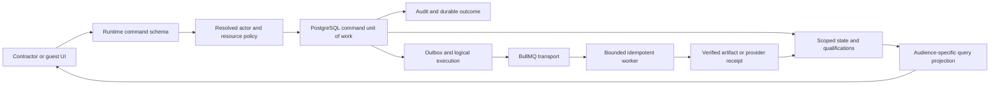

# Agent implementation plan: production-level HVAC contractor product

Date: 2026-11-07. Basis: [current code audit](TRADECLOSEOUT_PRODUCTION_CODE_AUDIT_2026-11-07.md), its PA01–PA32 register and executed evidence. This is the current actionable supplement to the [original XP00–XP31 programme](TRADECLOSEOUT_HVAC_EXCELLENCE_AGENT_PLAN.md), not a replacement that drops its deeper product target.

## Objective and implementation rules

Deliver a trustworthy, operated product in which a contractor can establish a project baseline, trace installed equipment/materials, obtain supplier evidence, review/return/retest it, perform commissioning, issue a frozen handover, capture authorized client responses, and manage aftercare/commercial evidence. Every displayed state must be explainable from persisted scope, source, qualification and decision records.

1. Work in small reviewable slices. Start by reproducing the named failing behavior against the real boundary. Preserve working composite tenant keys, pinned storage identities, anti-replay, negative tests, original evidence and append-only history.
2. Do not patch each symptom with another independent status check. Establish the shared state, authorization, qualification and transaction contract, then move its callers together.
3. Do not edit an applied SQL migration or rename historical ledger entries. Choose the next unused forward migration after checking the live branch. Include populated-data preflight/backfill/quarantine behavior and a roll-forward plan.
4. Use the runtime role and actual schema in integration tests. Use synthetic fixtures and provider capture; never reset a developer/customer database. HTTP/browser tests must retain guards, pipes, metadata and serialization.
5. Keep original files immutable; derived previews/reports/archives reference exact source versions and transformation receipts. A READY file is not automatically technically accepted evidence. A calculation within tolerance is not automatically witnessed commissioning acceptance.
6. Use explicit unavailable/pending/failed states for unfinished integrations. Do not fabricate subscription facts, delivery, payment processing or cryptographic certification.
7. Every PR records implemented behavior, migration behavior, executed positive/negative tests and remaining acceptance. A comment naming a PA/XP item does not close it.

## Delivery gates and order

| Gate | Required outcome | Main packages |
|---|---|---|
| R1 — trusted boundaries | Guest/project/resource scope and external DTOs correct; canonical wire contracts; OTP failure races fixed; exposed dependency risks triaged/remediated | A01–A05, required A16 schema work |
| R2 — reliable closeout journey | Baseline → evidence → review/return → readiness → package → authorized recipient decision with recoverable commands/jobs | A03, A06–A10, A15–A17, A20 journey |
| R3 — operated customer pilot | Reproducible release, full dependency readiness, restore/replay, alerts, supported devices and customer task acceptance | A18–A20 plus R1/R2 |
| R4 — deep HVAC execution | Procurement-to-serial trace, native inspection/TAB/controls/seasonal runs, sectional acceptance/aftercare and commercial evidence | A11–A14, A17 |
| R5 — sustained product excellence | Measured task success, performance/fairness at agreed scale, repeatable customer onboarding, support/recovery improvements | A17–A20 continuously |

Critical path: A01 → A02/A03 → A06/A07 → A08/A09/A10 → integrated R2 acceptance → A18/A19/R3. A04 and A05 are immediate security/reliability work. Start permissioned customer procedure/template discovery while those foundations are implemented; do not wait to learn the actual engineering workflow until after modelling it.

The package dependencies are sequencing aids, not approval to claim entire gates complete from one PR. Split large packages into independently deployable slices and estimate after the initial failing acceptance cases and representative customer samples exist. Do not promise all 20 packages in a weekend or assign a readiness percentage from test counts.

## Shared target implementation shape

Retain Nest, Next, PostgreSQL, Redis/BullMQ and versioned object storage. Build stronger boundaries within this stack before adding infrastructure or replacing frameworks.

The queue transports work; the database records the logical execution and recovery state. The UI invokes domain commands rather than submitting arbitrary event payloads or asserting successful outcomes locally.

## A01 — Canonical actor/resource policy and external response contracts

**Priority P0. Findings PA01/PA02; original XP02.** Start in common guards, tenant contexts, shared permissions, project/asset/checklist/review/handover queries and the global projection registration.

**Implementation:** define one `ActorContext` carrying actual user, active tenant, member/guest classification, grant ID, relevant project membership, request ID/IP/user agent and delegation. Resolve target resource tenant/project/parent/version from persisted data, then evaluate action, scope and workflow state. For guests, load the active grant and check expiry, capability, exact project and defined resource scope inside the command/query boundary. Treat collection/item routes consistently. Do not infer authority from URL fragments or allow a guest capability to become tenant-wide access.

Create audience-specific query DTOs for contractor, consultant, client, supplier and auditor. Classify all external actors by actor type, not a partial role-name set. Serialize dates explicitly and pass streams/buffers through deliberate paths. Register metadata-dependent interceptors through DI. Replace unknown-object deny heuristics with schema-based projections for sensitive routes.

**Acceptance:** HTTP grant for A0 cannot read/write A1 using project IDs, nested resources, direct IDs, filters or collection routes. Every external role loses synthetic internal/pricing fields in nested structures. Dates remain ISO/date-only values. Positive own-scope actions still succeed; expired/revoked grants and removed membership fail. Run the matrix on reused pool connections and direct application commands too.

## A02 — Executable API schemas, routes and generated clients

**Priority P1. Depends A01. Findings PA03/04/07/08/13; XP00/XP03.** Use the retained 144-handler inventory to make an explicit contract table: method/path, actor policy, DTO, precondition, idempotency class, response schema, errors and tests.

**Implementation:** adopt one `/api/v1` routing strategy without double-prefixing existing controllers. Correct work-item/commissioning routes and verify the Next rewrite. Put `getOrgs` inside a user-scoped transaction and wire switcher/CSRF refresh correctly. Replace erased/inline DTOs in high-risk commands first: guest profiles, recipient decisions, reviews, commissioning, financial amounts, nested import data and memberships. Add enum/UUID/finite/range/array bounds and typed money/date fields. Define accepted unknown-field behavior.

Use one decision enum and one remarks/exception schema across browser and API. Map business-purpose guest profiles to persisted grant types/roles/capabilities on the server; validate mandatory party/target/scope and prevent privilege escalation. Generate client types and route constants from executable schemas, and check them in CI. Normalize 400/404/409/412/422/428 semantics deliberately without masking domain errors.

**Acceptance:** the current guest-page acceptance/rejection/exception payloads complete over HTTP and persist the correct meaning. All new routes work through the web proxy. Owner with multiple memberships sees exactly those organisations. Unknown enums, invalid nested objects, oversized arrays, invalid IDs and unsafe amounts reject before writes. Classify legitimate public endpoints and compatibility aliases rather than blanket-protecting every handler.

## A03 — One workflow state vocabulary and executable next actions

**Priority P1. Depends A02 and A16 migration contract work. Findings PA05/06/09/15.** Start with review submission, pending waivers and work-item queries.

**Implementation:** reconcile the effective SQL constraints, shared enums, services and UI states. Select the canonical persisted vocabulary using the actual deployed ledger; use forward migration if changing it. Add transition functions with explicit predecessor, actor, expected revision and side effects. Review submission must assign the intended reviewer and atomically link evidence and update states. Preserve separate returned/rejected/superseded outcomes.

Work-item projections should return actual entity ID, row version, responsibility, waiting reason and a typed next-command descriptor. Use PENDING_SECOND_APPROVAL for waiver work and `er.row_version` for revalidation; handle OPEN/IN_PROGRESS/RECTIFIED distinctly. Resolve reviewer roles/resource IDs instead of advertising a route that accepts another ID type. Define required versus optional recipient aggregates and zero-required behavior explicitly.

**Acceptance:** real database submit → assignment → changes requested → revised submission → independent approval; mandatory waiver request → independent countersign; pending items appear and disappear correctly. Execute every returned next-command type through its real route. Concurrent stale commands fail; no change leaves a state permitted in TypeScript but rejected by SQL. Dashboard counts reconcile with the authoritative underlying rows/qualifications.

## A04 — OTP challenge lifecycle and production identity recovery

**Priority P1, immediate. Findings PA10/PA21; XP01.** Preserve the working atomic issuance and generation-bound consume.

**Implementation:** encapsulate challenge issuance, supersession, attempt accounting, consume and cleanup in a challenge-store interface backed by atomic Redis operations. Cleanup on provider failure must compare the alias's generation before deleting anything. Define how rejected/unknown delivery affects that generation. Remove the in-memory `eval` string classifier; either require Redis for development/integration or implement the same store contract without pretending to interpret arbitrary Lua. Validate exact challenge/identifier/purpose semantics and shared attempt/cooldown/IP budgets.

Persist security/session results after successful identity verification with actual schema fixtures; account/bootstrap/invitation/organisation selection must be deterministic. Define what happens if Redis consume succeeds but the DB session transaction fails. Return retry guidance without exposing codes or provider secrets. Wire provider acceptance/message IDs and later delivery receipts distinctly.

**Acceptance:** barrier-controlled A-pending/B-issued/A-delivery-fails leaves B usable; old generations remain rejected. Correct fallback/development behavior matches Redis or the unsupported mode fails clearly at boot. Wrong code/identity/purpose, replay, rate exhaustion, concurrent verifies and DB/provider outages are tested. Session creation, revocation and switched-organisation CSRF behavior use real HTTP/database state.

## A05 — Dependency and untrusted parser remediation

**Priority P1. Findings PA11/PA18/PA28.** Start with the recorded production audit paths and the reachable consultant spreadsheet parser.

**Implementation:** create a dependency reachability/advisory matrix with exact installed versions, responsible package, reachable input, fixed supported version/distribution and test impact. Replace/upgrade the stale xlsx distribution using a maintained verified source or choose a maintained parser after fixture comparison. Isolate parsing and enforce workbook sheet/row/cell/byte/time/memory limits. Move heavy parsing off the UI thread. Do not evaluate formulas or trust spreadsheet markup/links as HTML.

Upgrade Drizzle/Zod and nested Next/PostCSS/multer paths through supported parent upgrades or narrowly justified overrides with compatibility tests. Zod major-version migration needs schema/output validation. Do not assert SQL injection is reachable solely because Drizzle is installed; check identifier/alias construction. Retain lockfile checksums, a software inventory and a CI audit policy with scoped, expiring exceptions only when exposure is understood.

**Acceptance:** advisory scan after installation has no unexplained high/critical production path. Original permissioned consultant files import correctly; malicious/oversized structures terminate within budget and leave no partial baseline. Framework builds and file upload routes still work. No blanket suppression replaces remediation or an explicit documented reachability decision.

## A06 — Atomic durable commands, complete audit and idempotent outcomes

**Priority P1. Depends A01–A03. Findings PA14/PA16; XP03/XP05.** Replace the interceptor's separate business/outcome transaction with application command ownership.

**Schema/contract:** introduce a command record keyed by tenant, actor/delegation, stable command type and idempotency key, with request hash/schema version, expected entity revision, outcome state, result reference/error, timestamps and reconciliation metadata. Keep command attempts separately where needed. Use an appropriate uniqueness rule; do not rely on a random request key generated again for every retry.

**Implementation:** pass one unit of work through validation of persisted state, policy recheck, domain mutation, audit, outbox and durable result. Own BEGIN/COMMIT at one layer. Local failures roll back all effects; external operations get stable provider IDs and explicit unknown outcomes. Expose command status and an authorized recovery action. Apply required client preconditions consistently to mutable commands and propagate actual versions to the UI. Audit completeness must be tested per command, including contracts, waivers, requirement changes and grant/member actions.

**Acceptance:** process dies before mutation, after business writes, during outcome persistence and after response loss; retries return one durable effect or a visible reconciliable unknown state. Payload/key mismatch rejects. No timeout/handler error deletes a committed effect's protection. Audit/outbox/result all exist together or none does, and no secret/OTP is recorded.

## A07 — Scoped evidence qualification and verified artifact identity

**Priority P1. Depends A01/A03/A06. Findings PA12/PA15/PA26; XP07/XP08/XP09.** Centralize readiness and qualification before expanding commissioning claims.

**Schema:** model immutable evidence version references, requirement/baseline revision, asset identity revision or project scope, qualification procedure/slot, verifier/authority, validity basis, decision/disposition and superseding/correction links. Retain document versions as source containers; one document can have different qualification outcomes for different obligations.

**Implementation:** make readiness, package transaction recheck, RA packs, passport and commercial gates consume the same scoped qualification policy/view. On equipment/baseline/procedure changes, create targeted revalidation impacts, not global approval clearing. Keep immutable accepted pointers and decisions. For artifacts, require persisted observed size, declared/artifact size equality, digest and exact provider key/bucket/version. Preflight legacy incomplete READY rows and quarantine unavailable facts instead of synthesizing verification.

**Acceptance:** changing A blocks A's affected evidence while valid B coverage using the same manual remains usable through actual package generation. Old asset/baseline/procedure acceptance cannot qualify the new revision. Missing observed size/version/digest and mismatched receipts reject; valid compiled/downloaded bytes independently hash correctly. Independent verifier/current revision rules hold under concurrency.

## A08 — Durable outbox, bounded file/artifact execution and recovery

**Priority P1. Depends A06/A07. Findings PA17–PA20; XP04–XP06.** Preserve registered producer coverage, pinned source checks, stream caps and fail-closed scanning.

**Schema:** logical executions keyed by event/operation ID, payload schema version, owner/lease, attempt scheduling, accepted/running/succeeded/retryable/terminal state, result receipt and reconciliation history. Queue dispatch state is separate from execution completion. Informational-only events have an explicit contract; workflow/delivery events require real handlers.

**Implementation:** validate payloads before enqueue and reload authoritative object/command identities in workers. Add connection/body/whole-job deadlines and cancellation, parser child-process limits, host-wide disk/temp/process quotas and fair tenant scheduling. Validate extension/MIME/magic/OOXML/ZIP contents and persist detected metadata/scan receipt. Hash and count exact source bytes. Keep source/derived lineage, safe temp cleanup and idempotent output ownership. Use stable provider idempotency IDs, callbacks/inbox receipts and accepted/delivered/failed delivery states. Move network work outside long database locks using leased claims/reconciliation.

**Acceptance:** actual ClamAV and versioned S3-compatible storage fixtures; bad signature/format, archive/pixel/PDF bombs, slow/truncated/excess streams, missing scanner and conversion tools all fail safely. For every sanitizer, independently inspect output for catalog/page JavaScript, OpenAction/AA/Launch and attachments according to the approved policy; saving a PDF is not proof of removing actions. Run real installed-qpdf JSON-version and fallback cases, including the synthetic retained-OpenAction regression. Kill before/after enqueue/upload/commit, restart with lost Redis and verify reconstruction. Multiple workers cannot complete conflicting outputs; terminal failures appear with an authorized retry/runbook. No tenant can monopolize all workers/disk.

## A09 — Frozen handover, recipient authority and decision corrections

**Priority P1. Depends A01/A02/A06/A07/A08. Findings PA01/PA08/PA15/PA30; XP09/XP20.** A package and its exact acceptance audience are immutable business revisions.

**Implementation:** freeze scope, evidence versions/qualification decisions, package digest, exclusions/waivers, recipient party/role and required-approver policy at dispatch. Resolve direct recipient from session/grant and frozen binding; member-recorded external responses require explicit delegation/method/proof rather than silently impersonating a client. Define exact typed grant scopes for submission/recipient and recheck expiry/revocation. Derive aggregates from required recipients; optional observations cannot acquire veto authority. Define zero-required policy and correction/supersession rather than overwriting decided facts.

Use durable dispatch/transmittal/delivery receipts and a single validated decision DTO. Acceptance with exceptions creates traceable return/change work without silently changing the frozen original baseline. A late decision on withdrawn/superseded submissions must have a defined rejection/history path. Sectional scope must be explicit.

**Acceptance:** wrong grant/recipient/project, revoked/expired grant, unauthorized member recording, concurrent decisions, required/optional mixture, exceptions, withdrawal/revision and correction. Download digest equals the dispatch/acceptance digest. Run all three outcomes from the actual guest browser page and show truthful persisted receipts.

## A10 — Recoverable field uploads and actor-safe offline behavior

**Priority P1. Depends A02/A06/A07. Findings PA25/PA31; XP14/XP27.** Build on current partitioned IndexedDB, original blobs and stable queue IDs.

**Implementation:** model local queued/uploading/received/processing/ready/rejected/blocked states explicitly. Store upload-intent generation/expiry and a lease per queue item; use Web Locks or an IndexedDB lease with owner/expiry for cross-tab drains. Recheck actor/tenant/grant before each server command and stop on logout/switch/revocation. Refresh expired URLs through the existing endpoint, reconcile uploaded part numbers/ETags authoritatively and reset only parts belonging to an obsolete multipart generation. Retain original hash/bytes; derived image compression needs explicit source lineage and user visibility.

Implement bounded backoff, resume/cancel, storage quota feedback and explicit cleanup/export controls. Partition or remove the legacy unpartitioned draft helper. A service-worker message to an open tab is not guaranteed closed-browser uploading; describe the actual supported behavior.

**Acceptance:** actual IndexedDB/browser tests for offline capture, reload, tab contention, hours-later expired URLs, lost completion response, processing failure, signout/switch-org/switch-user and revoked guest. Confirm one server command effect and no wrong-actor resume; local originals survive interrupted/failed verification.

## A11 — Stable baseline/import and material-to-equipment trace

**Priority P2. Depends A03/A05/A06/A07/A16. Findings PA28/PA29; XP11/XP12/XP13/XP15.** Start with permissioned contractor equipment schedules/checklists and real PO/supplier returns.

**Schema:** import session with immutable source object/hash, parser/mapping version, target baseline revision, row IDs, validation/collision dispositions and committed receipt. Add PO/line, delivery/receipt/lot inspection, accepted/rejected/quarantined quantity and installed serial/batch allocation records where absent. All references use tenant/project composite scope.

**Implementation:** bound parser work; show row-specific actionable preview and source/normalized values. Persist the reviewed preview; commit it atomically against an expected baseline or reject stale scope. Preserve consultant IDs and changes across revisions. Support partial deliveries, substitutions, manufacturer/model conflicts, split allocation, returns and replacement-unit identity. Derive supplier obligations by stage and responsible party, link intake/review evidence, and project the full chain into passport/work items.

**Acceptance:** duplicate/case/serial collisions, stale preview, partial commit failure, source revision, wrong-project PO/asset, partial delivery, rejected lot and replacement. Quantities reconcile and an installed unit traces to accepted material and qualified evidence. Preserve and test import receipts rather than recomputing an unreviewed preview at commit time.

## A12 — Native inspection, witness and traceable TAB

**Priority P2. Depends A01/A07/A10/A11. Finding PA27; XP16/XP17.** Use engineer-approved customer procedures; do not add universal HVAC tolerances based on equipment names or a standards label.

**Schema:** procedure/template revision; test scope and design source; planned run/prerequisites/hold/witness request; performer and actual conditions/time; instrument identity/certification version; measurement value/unit/precision; sourced tolerance/formula version; disposition/acceptance/retest/correction lineage. Store decimal values deliberately, including original input/display precision.

**Implementation:** use planned → prerequisites ready → performed → witness/review pending → accepted/failed/deferred → linked retest transitions. Separate raw calculation compliance from authorized acceptance. Bind witness to an actual authenticated party/delegation and required attendance; document.upload is not witness authority. Evaluate calibration at actual test time. For TAB, model system/branch/terminal design relationships, required readings, approved conversions/correction factors and explicit missing data. Retain unrounded-versus-display policy and independent calculation vectors. Generate reviewable immutable evidence sheets linked to original readings.

**Acceptance:** missing mandatory reading/witness/design/tolerance, incompatible units, precision boundaries, expired calibration, failed/retest and corrected values. Offline form conflicts are resolved explicitly. An HVAC engineer reviews a complete original/generated commissioning pack before the procedure is offered as accepted practice.

## A13 — Functional controls and seasonal/deferred commissioning

**Priority P2. Depends A12/A09. Finding PA27; XP18.** Extend the current schedule foundation into actual execution and return-visit closure.

**Schema:** versioned controls source/sequence, operating mode, stimulus, expected/observed response, BMS point/trend slice, responsible discipline, witness, due season/load/ambient condition, deferral reason/impact/acceptance exception and return-visit linkage.

**Implementation:** support approved startup/shutdown, alarms/interlocks, duty/standby and integrated interface tests through source-defined procedures. Read-only trend import first, with explicit time/point/units provenance; do not silently command live plant. Add perform/defer/waive/retest/return-visit commands under policy and version checks. A deferred seasonal test stays open with an accountable owner and impact; it must not become passed because the project closed. Changed plant or controls sequences generate scoped requalification work.

**Acceptance:** unavailable season/load, missing witness, wrong trend interval/point, failed interlock, changed sequence and completed return visit. Required open work remains visible to consultant/FM after sectional handover. Validate one representative customer commissioning/return cycle.

## A14 — Sectional aftercare, warranty conflicts and commercial evidence

**Priority P2. Depends A07/A09/A11/A12. Findings PA09/PA30; XP21–XP23.** Retain the new mandatory defect versions, RECTIFIED predecessor and performer independence checks.

**Schema:** accepted section/equipment scope with effective date/source; warranty/OEM registration events and basis disputes; service/claim responsibility/SLA; remedy revision with exact qualified proof; independent verification/correction; retention/application milestones and supporting evidence. Keep SaaS accounting separate from the contractor's project-commercial records.

**Implementation:** derive dates from approved source/basis, preserve disputed dates and date-only versus instant precision. Defect evidence must positively qualify for the defect/asset/remedy; eliminate path-substring authorization and ambiguous LIMIT 1 association. Close the submitted remedy or record an explicit verified-evidence correction. Calculate retention/exposure in integer paise with explicit zero/null rules and effective contract scopes. Return evidence-supported application readiness, not a fabricated payment receipt or legal entitlement.

**Acceptance:** sectional acceptance, conflicting OEM basis, wrong/missing asset proof, superseded remedy, self-verification, concurrent close, unresolved critical states, approved waiver and retention applications with zero/multiple contracts. Client/FM can retrieve exact unit evidence and reopen/claim through the documented lifecycle.

## A15 — Truthful billing/profile UI and optional financial/signing integrations

**Priority P1 for truthfulness; P2 for optional integrations. Depends A02/A03/A06. Findings PA09/PA24/PA30.** Remove sample company/tax/plan assertions from the active billing page immediately as part of its real data integration.

**Implementation:** build explicit profile/subscription/plan/invoice query DTOs and load/error/unavailable states. Display returned values without fabricated defaults or swallowed authorization/outage errors. Centralize subscription limits and exact money types; use effective dated tax/accounting configuration and an accountant-reviewed workflow where the product intends to issue real invoices. Consolidate competing invoice/TDS code paths and keep external requests out of transactions through durable intents/receipts.

Keep payment webhook and cryptographic signature functions unavailable until raw-body signature validation, durable provider inbox/dedup/account/amount/currency reconciliation, and actual signature/trust-chain verification exist. Unsupported features must not advertise completion or certification. Separate simple acknowledgement, verified document digest and cryptographic signing in product language.

**Acceptance:** a new tenant sees its own actual profile/limits; outages show error/unavailable. Zero/large values and multiple invoice paths agree. If enabling providers, test duplicate/concurrent callbacks, unknown outcomes, altered raw bytes/digests and provider rejection. Otherwise verify the unavailable feature stays honestly disabled.

## A16 — Schema reconciliation and safe populated upgrades

**Priority P1, foundational. Findings PA05/PA13/PA26; XP00/XP03/XP30.** Run alongside each dependent domain slice, not as a final cleanup.

**Implementation:** introspect fresh and representative upgraded PostgreSQL catalogs and compare tables/columns/types/defaults/constraints/indexes/RLS to declared models. Reconcile commissioning tables and revalidation/remedy fields; make canonical status contracts executable. Inventory effective RLS policies, bootstrap/global surfaces and composite FKs, not just whether FORCE RLS is enabled. Test deliberately conflicting tenant aliases and nonprivileged role capabilities.

For each forward migration, document preflight of invalid legacy data, controlled backfill or quarantine, lock duration, batching/index strategy, application compatibility and failure recovery. Preserve applied checksums and never use privileged runtime access to hide RLS bugs. Do not silently turn missing observed storage facts into verification during a backfill.

**Acceptance:** fresh plus populated historical upgrades converge, mismatched ledger fails, tenant/user/token bootstrap remains usable, wrong-tenant/project inserts reject, and the previous application behavior is compatible during the intended rollout window. Real SQL projections and every command state are tested against the resulting schema.

## A17 — Connected contractor UI, work desk, search and accessible mobile flows

**Priority P2, minimum R2/R3 slice required. Depends A01–A03 and relevant domain packages. Findings PA24/PA31; XP19/XP24–XP27.** Deliver daily task completion, not isolated backend endpoints.

**Implementation:** connect the next-action work desk, equipment passports, supplier return/intake, quality/TAB/retest, package/recipient decisions and aftercare screens. Each state shows scope, source, owner, waiting reason and permitted next action. Add permission-aware search/facets with exact equipment tag/serial, source/revision and document lookup. Define loading/empty/permission/offline/error states; never substitute seed content or simulated success. Remove dormant demonstration code after checking references.

Split the large project detail page into domain views/hooks and lazy-load heavy spreadsheet/preview features. Measure before optimizing. Implement accessible labels, focus restoration, keyboard forms/tables, contrast and readable mobile field capture, including gloves/poor connectivity where customer observation supports the choice.

**Acceptance:** role-specific task scripts on representative phone/tablet/desktop hardware, keyboard/screen-reader checks, slow network and large project data. Every important button has a real authorized outcome or an honest unavailable reason. Track task success, rework and time-to-resolution against a baseline.

## A18 — Validated configuration, release packaging and observability

**Priority P1. Depends A01/A08/A16. Findings PA21/PA22/PA32; XP10/XP29.** Produce a runnable supported environment rather than infer deployability from Terraform resources.

**Implementation:** one startup configuration schema for API/worker/adapters with canonical DB/Redis/S3/DLT/provider names and explicit optional feature flags. Reject development credentials/fallbacks when their production dependencies are required. Verify runtime DB role/migrations, storage versioning and required scanner/worker tooling. Add bounded liveness/readiness/diagnostic behavior and graceful drain/shutdown.

Build immutable images for the intended runtime/architecture; include qpdf/converter/scanner tooling deliberately. Define private networking/security groups, TLS ingress, secrets/rotation, supervised API/web/worker/Redis and rollout/rollback with migrations and readiness gates. Reproduce the root build in clean Node 22 CI; do not label the local Turbo spawn error a compiler fix. Add structured request/command/event/job IDs, redacted logs, dependency/queue/latency/resource metrics and traces across asynchronous work. Give each alert an owner and tested runbook.

**Acceptance:** empty/misnamed production config fails early, permitted optional integrations stay unavailable honestly, role/versioning checks reject unsafe modes, clean deployment serves the journey, process termination drains or recovers, and induced dependency/queue failures produce actionable alerts without exposing secrets.

## A19 — Recovery, load envelopes and failure rehearsals

**Priority P1 for R3; continuous for R5. Depends A06–A08/A18. Findings PA19/PA23/PA32.** Choose and document customer-backed workload and recovery objectives before claiming capacity or HA.

**Implementation:** create a backup manifest at a consistent database snapshot with object bucket/key/version/digest/size, audit anchor and logical execution state. Restore into isolation, retrieve/restore object versions, independently hash bytes and execute the application as the restricted role. Reconstruct missing Redis jobs from durable state; test lost/missing object versions as visible recovery failures. Preserve encrypted drill evidence and use cleanup traps. Measure RPO/RTO from explicit incident/recovery points.

Build representative tenant/project/asset/document/measurement datasets and request/job mixes, including concurrent large uploads/compiles and noisy tenants. Measure p50/p95/p99 latency, time-to-ready, queue age, DB locks/connections, memory/temp disk and fair progress. Set product budgets from measured/customer needs, then add limits, indexes/keyset pagination, isolation/failover where demonstrated bottlenecks justify them.

**Acceptance:** process kill, DB/Redis outage, storage latency, scanner failure, disk pressure, partial rollout and restore/replay rehearsals. No duplicate domain effects, silent loss or falsely complete evidence. Recorded results meet the agreed envelope/objectives; untested larger loads are not advertised as proven.

## A20 — Boundary tests, customer acceptance and the completion protocol

**Priority P1 for R2/R3 and continuous. Depends relevant packages. Findings PA22 and all acceptance gaps; XP00/XP27/XP28/XP31.** Use the existing [extensive test guide](TRADECLOSEOUT_EXTENSIVE_TEST_IMPLEMENTATION_GUIDE.md) as the area inventory, with today's reproduced cases added as mandatory regressions.

**Implementation:** retain unit/property tests for pure rules; real PostgreSQL/RLS/Redis for transactions and state; actual HTTP for guards/DTOs/metadata; browser/IndexedDB for user contracts; real storage/scanner and capture providers for pipeline boundaries; process-fault tests for recovery. CI must run the application browser project on isolated fixtures and preserve traces/artifacts. Avoid hardcoded customer personas or live data dependence.

Create the flagship acceptance journey: new tenant → multiple memberships/switch → baseline import → equipment/PO/material allocation → scoped supplier evidence → actual scan → assigned independent review/return → native commissioning/retest → readiness/package download → frozen recipient acceptance/exceptions → sectional warranty/defect verification → commercial evidence/archive → backup restore and same evidence retrieval. Run a smaller complete closeout journey before deeper domain packages land, then extend it.

Recruit representative contractor/site/QC/procurement/consultant/FM participants only with the user's authorization; do not send outreach automatically. Review permissioned procedures/templates and observe independent task completion. Measure failures/rework/support burden and feed concrete priorities back into the backlog. A pilot is evidence of its tested scope, not proof of universal standards compliance or market leadership.

## Required regression cases for the first delivery slices

| Case | Boundary and required outcome | Owner |
|---|---|---|
| PROD-001 | Guest project A0 cannot retrieve A1 by direct HTTP ID; own scope succeeds | A01 |
| PROD-002 | Every external role loses nested internal/commercial fields; dates serialize correctly | A01 |
| PROD-003 | Work items/commissioning routes work through `/api/v1` and Next proxy | A02 |
| PROD-004 | Active owner gets all and only memberships; switch rotates usable CSRF context | A02 |
| PROD-005 | Review submission/return/revision/approval succeeds against migrated constraints | A03 |
| PROD-006 | Pending second-approval waiver appears; next action uses actual ID/version | A03 |
| PROD-007 | Default supplier/client/consultant grant profiles persist and authorize only intended actions | A02 |
| PROD-008 | Browser ACCEPT/EXCEPTIONS/REJECT persists the exact meaning and required-recipient aggregate | A02/A09 |
| PROD-009 | Zero retention remains zero in every dashboard/digest; multiple contracts reconcile | A03/A14 |
| PROD-010 | Older OTP delivery failure cannot remove newer generation; real/fallback store contracts agree | A04 |
| PROD-011 | Production advisory paths remediated or precisely justified; hostile spreadsheet bounded | A05 |
| PROD-012 | Missing observed artifact size or version rejects before signer; valid download hash matches | A07 |
| PROD-013 | Commit/outcome response-loss retry produces one effect and recoverable outcome | A06 |
| PROD-014 | Queued execution survives process death/Redis loss or becomes visible terminal failure | A08 |
| PROD-015 | Hours-old offline multipart upload refreshes and resumes once across two tabs | A10 |
| PROD-016 | Plant A replacement leaves valid B manual coverage usable through package generation | A07 |
| PROD-017 | Required witness/calibration/source tolerance absent cannot become accepted commissioning | A12 |
| PROD-018 | Deferred seasonal test remains accountable and closes only on verified return visit | A13 |
| PROD-019 | Restored DB plus actual pinned object bytes support the same unit/guest retrieval under policy | A19 |
| PROD-020 | End-to-end contractor journey passes in clean supported-runtime CI and customer observation | A18/A20 |

## Agent handoff and definition of done

Begin with A01's live HTTP reproductions, then A02/A03 broken contract cases and A04/A05. Add tests with the exact persisted/HTTP outcome before implementing the shared fix. Keep each branch's database migrations and in-flight edits intact; inspect current status before editing. Use feature flags/unavailable states where a larger domain workflow is not ready.

For every package, provide: final behavior and source files; schema/upgrade and data-integrity proof; executed positive/negative/concurrency/failure cases; API and UI contracts; telemetry/runbook impacts; and remaining customer/operating acceptance. Update the backlog with evidence references rather than turning everything to complete at once. Close production gates only when their complete contractor/operational outcomes have actually been demonstrated.
