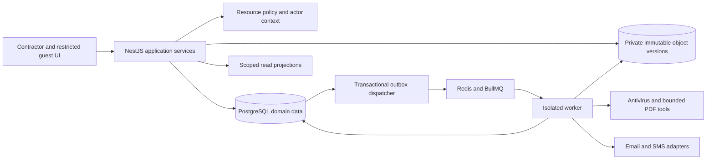
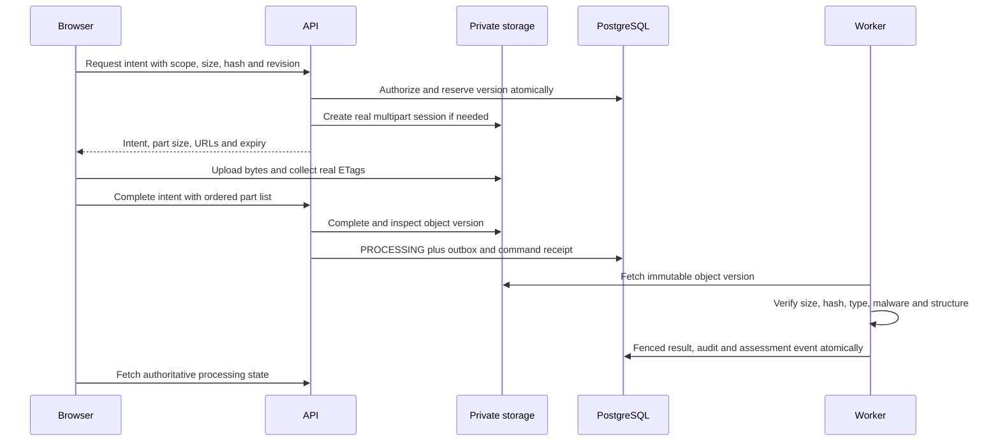

# Target architecture

## Architectural decisions

Retain Next.js, NestJS, PostgreSQL and a separately deployed worker from the same repository. PostgreSQL is authoritative for domain state, command receipts, audit and outbox. Redis/BullMQ transports jobs and accelerates rate limiting; loss of Redis must not lose business facts. Private object storage is authoritative for immutable original and generated bytes. Keep qpdf and antivirus in constrained worker processes. Do not introduce microservices, Kafka, a graph database, an external workflow engine or a separate search cluster for MVP.

The modular monolith permits review, satisfaction and snapshot constraints in one transaction, minimises operational burden and fits current modules. Microservices would add cross-service consistency problems before boundaries are stable. A DB-only job queue would simplify infrastructure but replacing BullMQ now adds migration work; retain it with DB-backed receipts and reconciliation. A managed identity service reduces custom-auth liability but guest/tenant migration is substantial: repair current auth first, evaluate managed migration separately after pilot evidence.

## Domain boundaries and data ownership

| Domain / existing module | Owns | Consumes; must not mutate directly |
|---|---|---|
| Identity / identity, organisations | User, verified identity, organisation membership, session, guest principal | Project grant references; no domain approvals |
| Access / common guards and policy service | Actor context and policy evaluation | Resource ownership resolved by owning module |
| Project scope / projects, configuration, checklists | Project, contract revision, scope, requirement definition, applicability, baseline | Approved evidence and milestones |
| Equipment / assets | Asset identity, location/system membership, replacement history | Evidence links, commissioning, warranty |
| Supply / parties | Parties, procurement documentary schedule, supplier requests | Requirement status through commands only |
| Evidence / documents | Document, immutable version, upload, storage object, processing attempt | Review conclusions and satisfaction projections |
| Assurance / reviews | Review cycle, stage, assignment, decision, comment, exception | File verification and requirement evidence rules |
| Satisfaction / new application service beside checklists | Evidence qualification and requirement assessments | Frozen review decisions, waived/applicability decisions |
| Delivery / handover | Manifest, artifact, transmittal, submission, recipient decision, archive | Exact qualified evidence and acceptance authority |
| Field quality / staged new modules | Inspection, test run, instrument, defect and retest | Assets, scope and frozen template |
| Aftercare / warranty domain extracted from billing | Warranty terms/events, DLP period, service defect | Handover acceptance and asset identity |
| Commercial readiness / new boundary beside billing | Contract milestone, bill evidence reference, retention tranche and follow-up | No ledger posting or tax determination |
| Platform / notifications, worker, database | Outbox, deliveries, receipts, audit, jobs, observability | Domain facts only through explicit handlers |

Use application services as sole mutation boundaries. Repository functions accept an existing tenant transaction; they never start or commit transactions. Route adapters translate legacy payloads temporarily but invoke the same command. Delete duplicate logic only after parity tests and usage inventory. Shared package holds validated contract types and UI labels; it must not contain an alternate business-authorisation algorithm.

## Actor context and authorization

Actor context fields: organisation ID from server session; principal kind MEMBER/GUEST/SYSTEM; principal ID; optional member user ID; active project assignments; grant ID and grant version for guest; request/trace ID; authentication assurance; IP/user agent for audit. Guest identity is separate from link creator. Never attribute supplier action as creator's personal approval. Re-read grant status, expiry and version at every mutation; short-lived cached reads may be used only for non-sensitive views.

Policy order: authenticate; resolve resource organisation and project; require active tenant; intersect capability with current project/resource scope; enforce project state; enforce transition and assigned authority; project only explicitly allowed response fields. Deny by default. Owner/Admin may have tenant-wide visibility, but no automatic consultant acceptance authority. PM and document controller may be configured tenant-wide for lists; project mutation always requires explicit project authority. Scoped project role grants never escape their project.

| Action | Owner/Admin | PM | Document controller | Site | QC | Procurement | Consultant/client guest | Supplier guest |
|---|---|---|---|---|---|---|---|---|
| Manage members/security | Yes | No | No | No | No | No | No | No |
| Edit scope/baseline | Yes | Assigned | Propose/import | No | Propose | No | Comment if granted | No |
| Upload original | Authorised project | Assigned | Assigned | Assigned | Assigned | Assigned | Explicit grant | Requested requirements only |
| Internal technical decision | Explicit stage assignment | Explicit assignment | Record only | No | Explicit assignment | No | Only assigned external stage | No |
| Record external response | Authorised | Assigned | Assigned | No | If separately granted | No | Own response | No |
| Waive requirement | Propose/authorise | Propose/authorise if delegated | Propose | No | Propose | No | Approve only delegated contractual authority | No |
| Generate package | Yes | Assigned | Assigned | No | No | No | No | No |
| Accept submission | Explicit acceptance authority only | Record proof only | Record proof only | No | No | No | Named required recipient | No |
| Commercial values | Explicit commercial grant | Explicit grant | Readiness without amounts | No | No | PO amount if granted | No by default | No |
| Download original | Explicit download permission and resource scope for every actor | Same | Same | Same | Same | Same | Frozen grant items | Own uploads if expressly granted |

Mandatory waiver requires two distinct authorised principals, rationale, exact requirement revision, effective dates and external authority proof when contract requires. No exception can bypass malware, byte integrity, tenant isolation or fabricate acceptance. Tenant admin manages access, not another party's technical certification.

## Entity and field specification

All tenant entities carry id, org_id, project_id where project-owned, created_at, created_by_principal and row_version. IDs are opaque; timestamps are UTC instants and local business dates are date values with project timezone default Asia/Kolkata. Use integer paise, ISO currency, decimal-string quantities/readings and explicit units. Composite foreign keys carry org/project alongside entity ID. Soft deletion never removes referenced evidence or frees a business revision identity; aborted intents may be explicitly retried as the same revision after preserving attempt history.

| Entity | Required fields beyond common fields | Relationships and constraints |
|---|---|---|
| ContractRevision | contract_id, revision_no, source_version_id, effective_date, status, scope_summary | Project has multiple contracts; one current issued revision per contract; no universal retention/DLP defaults |
| ScopeItem | contract_revision_id, external_BOQ_ref, description, quantity, unit, location_id, system_id | Evidence scope independent of accounting BOQ totals |
| RequirementRevision | stable_requirement_id, revision_no, source_clause/page, scope_item_id, owner_principal/party, reviewer_policy_id, due_date, mandatory, applicability, evidence_rule_revision_id, milestone_id | Issued revision immutable; amendments create revision and impact review |
| EvidenceRuleRevision | doc_type, min_count, scope_match_policy, required_metadata, companion_rule_set, validity_basis, decision_stages | ALL required slots by default; alternatives must be explicitly configured; no arbitrary executable expressions |
| Document | title, document_number, doc_type, latest_version_id, current_approved_version_id | Pointers are navigation aids, never satisfaction authority |
| DocumentVersion | document_id, version_no, revision_code, storage_object_id, issue_date, expiry_date, uploader_principal_id | Original content immutable; project/document revision code normalized unique; no implicit historical reassignment |
| StorageObject | provider, bucket, key, provider_version_id, declared_size/hash, observed_size/hash, detected_mime, verification_attempt_id | Original and derived artifact objects distinct; object version identity immutable after sealing |
| ProcessingAttempt | object_id, attempt_no, lease_token, engine/version, signature_db_version, started/ended_at, verdict, failure_code | Only active fenced attempt may publish result; retry creates new attempt |
| RequirementEvidence | requirement_revision_id, document_version_id, asset_identity_revision_id nullable, evidence_role, qualification_status, review_decision_id | Version-pinned; one file may support many requirements but qualification is per edge |
| SatisfactionAssessment | requirement_revision_id, rule_revision_id, evaluated_at, evaluation_date, result, reasons, source_event_id | Immutable result and member evidence links; current assessment is a projection |
| ReviewCycle/Stage | exact_version_id, submission_id nullable, round_no, stage_order, required_authority, assignee_principal/party, due_at, state | Multiple parallel reviewers within stage; unanimous required reviewers before next stage |
| ReviewDecision | stage_id, decision, comment, authority_id, recorded_by, occurred_at, recorded_at, evidence_version_id, supersedes_decision_id | Append-only; external reported response distinguished from in-app authenticated response |
| ApplicabilityDecision/Exception | requirement_revision_id, type, reason, authority, countersigner, proof_version, effective range | Waiver and not-applicable are decisions, not editable strings |
| PackageManifest/Item | purpose, baseline_id, evaluation_date, build_policy_version, digest, item version/object/assessment IDs, order, exclusion reason | Frozen before queueing; artifact never rebuilt against mutable latest pointers |
| GeneratedArtifact | manifest_id, output_object_id, observed_sha256/size, compiler_version, page_map, built_at | READY requires durable sealed object; failed artifacts remain non-downloadable |
| Transmittal/Item | project_sequence, revision, recipient authority, purpose, exact_version_id, requirement_revision_ids, issued_at | No timestamp-suffix numbering; issue freezes items |
| Submission/RecipientDecision | package_id, recipient_id, required flag, authority_scope, response, exceptions, proof, occurred_at | Submission acceptance independent of package generation and delivery |
| WorkItem | source_type/id, responsible_principal/party, action, due_at, blocked_reason, status | Derived projection rebuilt from authoritative workflow; one logical item per pending obligation |
| AuditEvent/CommandReceipt | actor, action, before/after identifiers, request_id; command hash/result/status | Same transaction as domain mutation; no mutable credentials or raw links in audit |
| DeliveryAttempt | message_id, provider, recipient, consent/preference basis, provider_ref, attempt, state, next_retry | Business submitted, provider accepted and delivered are separate states |

Reuse existing tables where semantics match. Add missing relationship/assessment tables additively; do not create competing second copies of documents/reviews. New names above are logical names; T01 inventory determines exact migration names after prior database history is known.

## State machines

| Aggregate | From | Trigger and guard | To / consequence |
|---|---|---|---|
| Upload | PENDING_UPLOAD | Provider completion verified; expected state | PROCESSING; enqueue scan |
| Upload | PROCESSING | Observed immutable bytes, clean AV and valid permitted format | READY; seal attestation |
| Upload | PROCESSING | Malware | QUARANTINED; block all standard reads |
| Upload | PROCESSING | Transient tool/storage outage | RETRY_WAIT; bounded next attempt |
| Upload | PROCESSING | Invalid bytes/type/hash or exhausted attempts | FAILED; preserve reason |
| Upload | PENDING_UPLOAD | Actor abort/intent timeout | ABORTED; provider multipart abort; retain intent tombstone |
| Review | DRAFT | Submit READY version with complete evidence slots | IN_REVIEW; assigned stage active |
| Review stage | IN_REVIEW | Assigned authority response with concurrency token | APPROVED / APPROVED_WITH_NOTES / CHANGES_REQUESTED / REJECTED |
| Review cycle | Active | Required stage responses complete | Next stage or completed; no automatic requirement approval |
| Qualification | PROPOSED | Rule-specific scope and review requirements met | QUALIFIED; trigger assessment |
| Satisfaction | OPEN/BLOCKED | All required slots qualify or valid exception | SATISFIED / WAIVED / NOT_APPLICABLE |
| Satisfaction | SATISFIED | Evidence expiry, withdrawn approval, scope amendment or asset replacement | BLOCKED; new assessment; historical assessment retained |
| Package | REQUESTED | Frozen manifest commits | QUEUED |
| Package | QUEUED | Leased build starts | BUILDING |
| Package | BUILDING | Every member hash verified; artifact stored and verified | READY |
| Package | BUILDING | Failure/exhausted retry | FAILED; manifest unchanged |
| Submission | DRAFT | READY package plus required named recipient | ISSUED; delivery pending independently |
| Submission | ISSUED | Any required recipient rejects | REJECTED; preserve all decisions |
| Submission | ISSUED | All required recipients decide, at least one exception | ACCEPTED_WITH_EXCEPTIONS; open exception actions |
| Submission | ISSUED | Every required recipient accepts | ACCEPTED |
| Project | ACTIVE | Handover stage chosen | HANDOVER; does not mean accepted |
| Project | HANDOVER | Named authority accepts scope | ACCEPTED scope recorded; DLP anchors may become available |
| Project | Active/accepted | Commercial obligations closed and authorised project close | CLOSED; immutable historical evidence preserved |

Expiry date is inclusive through project-local date, unless contract rule explicitly differs. A new draft version does not invalidate previously qualified approved evidence automatically; show accepted R1 / pending R2. Qualification changes only through explicit assessment. Rejection of R2 does not silently withdraw R1. Conditional approval satisfies only configured stages and conditions; unresolved conditions remain blockers where required.

## Transaction, event and queue contract

One command owns one DB transaction with tenant context. Lock order: project sequence/baseline when required, document, version, review cycle/stages in ID order, requirement revisions in ID order, package/receipt. Re-read guard conditions after locks. All mutating commands require expected row version; absent yields 428, stale yields 412. Identical idempotency key/hash returns prior status/body; different hash returns 409; store receipt with business changes. Responses never claim success before commit.

Outbox envelope fields: eventId, schemaVersion, eventType, orgId, projectId, aggregateType/id/version, actorPrincipalId, commandId, occurredAt, correlationId, payload containing stable IDs only. Dispatcher discovers tenant IDs through a restricted global projection rather than unrestricted tenant-table credentials; dispatches each tenant under RLS. Queue job ID is stable event ID. Consumers deduplicate by event and handler version. Unsupported event types remain visible as unsupported/dead-letter; never mark them delivered silently. Retry transient failures with jitter and capped backoff; permanent failures create an actionable work item. DB manifest and outbox replay recover after Redis loss. Renewal plus fencing prevents stale workers publishing a later result.

## Storage and evidence sequence

Uploaded original cannot be changed through a live PUT URL after verification: seal through immutable provider version identity, revoke/stage keys or copy to non-overwritable final key before qualification. Merely hashing once is insufficient. Keep originals, sanitized preview derivatives and compiled outputs as distinct objects with transformation provenance. Signed PDFs remain preserved even if a preview transformation invalidates their signatures. No hidden photo compression: capture as original or label/store original plus derivative according to declared evidence policy.

Private buckets, encryption, short-lived signed GET with explicit download permission, no public original QR URL. Public QR resolves only opaque asset identity and requires appropriate authentication; client passport export may be separately published with an allowlisted data projection and revocation. Worker egress limited to required storage/provider endpoints; no document-supplied network fetches. Filesystem paths come from trusted temporary workspaces, never customer object-key basename lookup.

## Migration and recovery strategy

Inventory actual schema_migrations names/checksums before touching renumbered migrations. Preserve deployed migration identity; do not rewrite history. Establish migration advisory lock and checksum validation, then add nullable columns/tables, backfill in resumable batches, report invalid relationships, dual-read with comparison metrics, switch writes, enforce constraints after data validation, and retire old readers only after a rollback window. Ambiguous document-wide approval becomes NEEDS_REASSESSMENT; never fabricate an approved version edge. Existing submitted packages keep original contents and recorded status with a legacy-unverified marker where object provenance cannot be established.

Database recovery target proposed for pilot: RPO at most 24h and RTO at most 8h; general production target RPO at most 15m and RTO at most 4h, both require measured restore proof and commercial agreement. DB PITR and object version retention are coordinated by immutable manifest/object IDs. Restore audit chain and storage digests, validate tenant access and reopen traffic only after reconciliation. Feature flags may disable new domains; rollback must not undo append-only decisions or remove evidence references.
